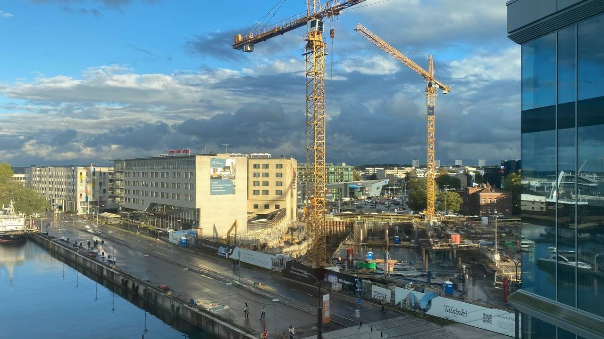
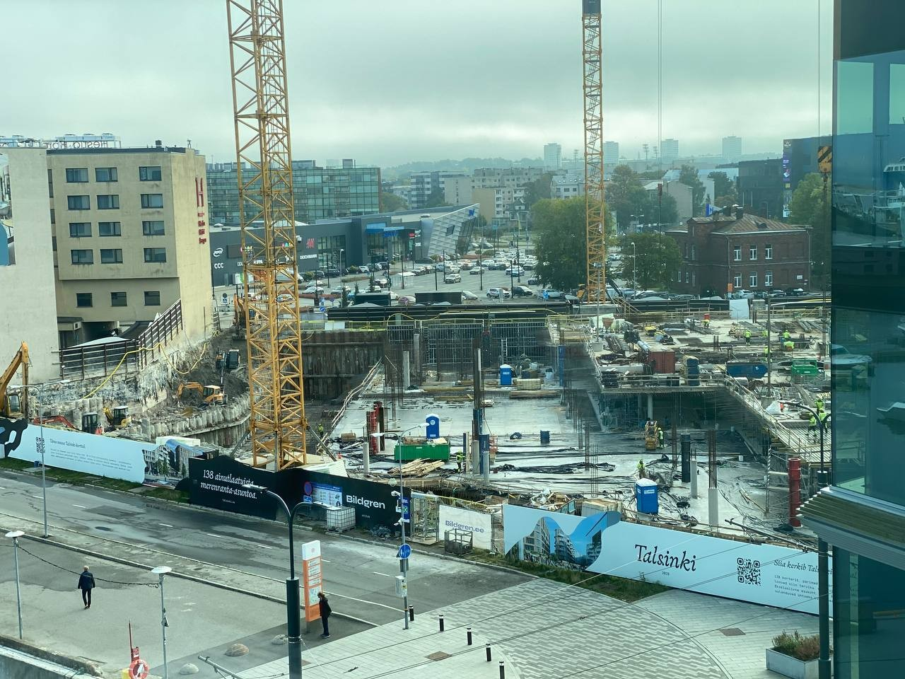

# 10 economic-driving projects that are reshaping Estonia's labour market

**Author:** Olga Kryuchkova  
*Nordic Tech and Innovation Ecosystem Explorer | ICT Trainer | Certified AI Transformation Leader | MSc (Tech.) | Engineer*  
**Published on:** October 19, 2026

Estonia, just like its northern neighbour, needs more workplaces. That sounds simple enough. But we should dig deeper: **Where are those workplaces actually going to come from? And who is going to create them?**

Definitely not from another motivational seminar about entrepreneurship. Not from magically turning every unemployed person into a startup founder or entrepreneur. And not necessarily from the next software company with a five-person team and a very optimistic LinkedIn page. Estonia's investment pipeline provides some clues as to the direction in which the labour market is moving.

Across the country, large projects are being developed in rail infrastructure, AI and data centres, renewable energy, energy storage, defence manufacturing, hydrogen, chemicals, paper production and urban development. Together, the ten projects examined here represent a very different Estonia from the one associated internationally with e-government and startups. They show an economy becoming more physical again. More electricity. More factories. More infrastructure. More industrial land. More logistics. More data centres. More defence production. And, potentially, more jobs.

But we still have to keep in mind that a billion-euro investment does not automatically mean thousands of permanent jobs. A €1.7 billion AI data centre may employ fewer people permanently than a much smaller mixed-use urban development. A €130 million specialised manufacturing facility may create only 30 direct jobs but generate a much larger supply-chain effect. A railway project may employ thousands during construction but only hundreds after opening.

So the question is not:

> *"How many euros are being invested?"*

It is:

> *"What economic ecosystem does the investment create around itself?"*

## The 10 Ambitious Projects

### 1. Rail Baltica: Estonia's biggest infrastructure job machine

#### Short overview
Rail Baltica is the largest infrastructure project currently reshaping Estonia's physical economy. The railway will connect Estonia, Latvia and Lithuania to the European standard-gauge railway network and create a new north-south transport corridor. Construction is already underway and will remain a major economic activity throughout the second half of the decade. For Estonia, this is not just a railway project. It means:

- Construction;
- Engineering;
- Logistics;
- Railway operations;
- Maintenance;
- Stations;
- Depots;
- Connections to ports and airports;
- New regional accessibility;
- And potentially new businesses locating around the corridor.

Rail Baltica expects the overall project to create around 13,000 direct construction jobs and more than 23,000 indirect and induced jobs, followed by approximately 800 permanent jobs in operations and infrastructure management. The numbers refer to the overall Rail Baltica project rather than Estonia alone.

#### Financial side
The investment programme requires approximately €500–600 million annually in the coming years. A significant part comes from EU financing, particularly the Connecting Europe Facility, combined with national funding. The Tallinn Ülemiste passenger terminal alone has a construction contract worth approximately €85 million excluding VAT. The planned Rail Baltica rolling-stock depot in Rae municipality has an estimated construction value of approximately €41.3 million and is expected to create up to 200 jobs.

#### Why it matters for the labour market
Rail Baltica demonstrates the difference between construction employment and structural employment. Thousands of people can be employed while the railway is being built. After completion, the number falls sharply. But the railway can then create another effect: accessibility can create economic activity. Better connections make it easier for people to commute, companies to move goods and international businesses to connect with Estonia. The job effect therefore continues beyond the construction payroll.

### 2. Sunly Risti AI Data Centre: €1.7 billion looking for electricity, talent and AI

#### Short overview
Sunly is planning what could become the largest data centre in the Baltic states in Risti, Lääne County. The planned facility would have approximately 180 MW of capacity, with the wider campus now being developed with Magnora potentially expanding to 400 MW. This is particularly interesting because the project is being developed next to Sunly's renewable-energy ecosystem. In other words:

> **renewable electricity → storage → data centre → AI infrastructure.**

That is much more complicated economically than simply "another server building".

#### Financial side
The planned data-centre investment is approximately €1.7 billion. The current Sunly–Magnora joint venture covers the Risti campus, with 180 MW of grid capacity available today and an expansion pathway towards 400 MW. The surrounding Risti energy ecosystem also includes a major solar park and planned battery storage.

#### Why it matters for the labour market
Sunly estimates that the data centre itself would create more than 150 jobs. At first glance, that looks surprisingly small for €1.7 billion. And it is. But this is exactly why investment statistics need interpretation. Data centres are extremely capital-intensive and highly automated. The labour-market impact comes through several layers:

- Construction;
- Electrical engineering;
- Cooling;
- Cybersecurity;
- Network infrastructure;
- Maintenance;
- Energy production;
- Grid development;
- AI/cloud services;
- Specialist technology jobs.

The Risti project therefore creates relatively few permanent jobs directly but potentially creates a much larger technology and energy ecosystem around them.

### 3. Ülemiste — turning infrastructure into an economic district

#### Short overview
Ülemiste is not one building. It is becoming an economic ecosystem connecting:

- Rail Baltica;
- Tallinn Airport;
- Railway;
- Tram;
- Bus connections;
- Offices;
- Residential development;
- Conference facilities;
- Services;
- Public space.

Rail Baltic Estonia, Tallinn Airport and Mainor Ülemiste expect to invest approximately €500 million in the area over the coming years. The objective is to turn Ülemiste into an international transport, business and service hub. The district already ranks as Estonia's third-largest economic city measured by labour-tax revenue. The target is that by 2030 around 25,000 people will live, study and work there.

#### Financial side
Approximately €500 million of combined investment is expected across the development programme. The Rail Baltica Linda terminal itself has an approximately €85 million construction contract.

#### Why it matters for the labour market
Ülemiste illustrates another type of job creation: place-based employment. The infrastructure does not employ 25,000 people itself. Instead, it creates a location attractive to companies. That means offices, headquarters, conferences, hotels, restaurants, services, retail and professional services. The project is therefore less about "building 25,000 jobs" and more about building a place where other companies can build jobs. That distinction matters.

### 4. Estonian Defence Industry Parks — from security expenditure to industrial policy

#### Short overview
Estonia is developing defence-industry parks in Ermistu in Pärnu County and Põhja-Kiviõli in Ida-Viru County. The parks are intended to attract companies producing ammunition, explosives, components and other defence-related products. The model is particularly interesting because the state is developing the basic infrastructure while companies build their production facilities. Estonia has also already begun rebuilding domestic ammunition production capacity.

#### Financial side
The state has allocated approximately €50 million for the initial infrastructure of the Ermistu defence industrial park. Government expectations have previously pointed towards roughly €300–400 million of private investment in the parks. That gives an indicative total investment ecosystem of approximately €350–450 million.

#### Why it matters for the labour market
Defence manufacturing is different from many infrastructure projects because the objective is not only employment. It creates:

- Manufacturing;
- Engineering;
- Chemistry;
- Mechanical engineering;
- Logistics;
- Security;
- R&D;
- Export capability;
- Supply-chain businesses.

For Estonia, this is particularly important because it creates industrial jobs outside Tallinn. The project could therefore become part of the economic diversification of Ida-Viru and Pärnu County, not merely a national security investment.

### 5. Talsinki Quarter — €250 million of urban economic activity

#### Short overview
Talsinki is US Real Estate's large development next to Tallinn's Admiralty Basin. The project includes offices, apartments, retail, restaurants, services and hospitality. The current project website lists approximately:

- 73,330 m² gross floor area;
- 20,000 m² Class A office space;
- 3,200 m² retail, dining and hospitality space;
- 138 apartments;
- Completion in 2028–2029.

The project is estimated to cost approximately €250 million.

#### Financial side
Approximately €250 million private investment. The project is being developed in phases.

#### Why it matters for the labour market
Talsinki demonstrates why real-estate projects can become economic projects. The building itself creates construction employment. After completion, the office space can accommodate businesses and employees, while retail, restaurants, hospitality and services create additional permanent employment.

There is no reliable official total for the number of jobs the completed district will create. A reasonable analytical estimate can be made using office employment density. With 20,000 m² of office space and a benchmark of approximately 10–15 m² per employee:

- 20,000 / 15 ≈ 1,330
- 20,000 / 10 ≈ 2,000 potential office positions.

Adding hospitality, retail, restaurants and services suggests an indicative range of roughly **1,500–2,400 permanent jobs**. This is an analytical estimate, not a developer commitment. And that distinction should remain visible whenever the figure is published.

### 6. BHG Estonia — green hydrogen and ammonia

#### Short overview
BHG Estonia is developing a green hydrogen and ammonia complex in Sillamäe. The project includes:

- 15 MW electrolysis;
- Hydrogen storage;
- Hydrogen refuelling infrastructure;
- Ammonia production.

It is one of the clearest examples of Estonia trying to build a new industrial value chain around clean energy.

#### Financial side
- **Total investment:** €153.5 million
- **State support:** €20 million  
The remainder therefore represents approximately €133.5 million of other financing if the full grant is received.

#### Why it matters for the labour market
The project is expected to create at least 32 high-paying jobs. Again, the direct employment number looks modest relative to the investment. But the purpose is not mass employment. It is the creation of a high-value industrial capability. The wider impact can include:

- Engineering;
- Chemicals;
- Energy;
- Transport;
- Maintenance;
- Equipment supply;
- Export services.

This is the kind of project where productivity and value added matter more than headcount.

### 7. Enery battery-storage investments — the infrastructure behind renewable energy

#### Short overview
Enery is developing a large battery-storage portfolio in Estonia. The project involves battery facilities across several counties and is designed to help balance renewable electricity production and consumption. This is becoming increasingly important as Estonia adds solar and wind capacity.

#### Financial side
The investment programme is approximately €150 million. The investment is primarily private.

#### Why it matters for the labour market
Battery storage is another example of an investment that is not labour intensive. A battery park does not need thousands of employees. Its economic value comes from enabling other investments. Without storage and grid flexibility, additional wind and solar capacity becomes harder to integrate. So the labour-market chain is:

> **battery storage → more renewable capacity → more industrial electricity → more industrial investment.**

This is an example of indirect job creation through infrastructure capacity.

### 8. Horizon Paper & Cellulose — €129.5 million of industrial upgrading

#### Short overview
Horizon is expanding its paper-production capability in Kehra with a new production unit for specialised kraft-paper products. This is a different kind of investment from a data centre. It takes an existing industrial ecosystem and attempts to move it further up the value chain. Horizon already has decades of manufacturing experience in Estonia and exports to international markets.

#### Financial side
- **Total investment:** €129.5 million
- **State support:** €12.95 million  
The project therefore represents approximately €116.55 million of other financing if the full support is received.

#### Why it matters for the labour market
The project is expected to create at least 30 direct jobs. Thirty jobs may not sound impressive next to €129.5 million. But these are industrial jobs in a regional manufacturing ecosystem. They can support additional employment in:

- Maintenance;
- Logistics;
- Engineering;
- Raw materials;
- Packaging;
- Transport;
- Technical services.

The strategic question is therefore not only how many people Horizon hires. It is whether the investment allows Estonia to export more value per tonne of raw material and per employee.

### 9. Sunly Risti solar + battery ecosystem — energy as the foundation for future jobs

#### Short overview
Sunly's Risti development is larger than the future data centre. The company is also developing the Baltic region's largest solar park in the area. The solar park covers approximately 250 hectares and has a planned capacity of 244 MW. A battery-storage facility of similar investment scale is planned nearby.

#### Financial side
The solar park is estimated at more than €120 million. A nearby battery park is also expected to require approximately another €120 million. This means that the energy infrastructure surrounding the future AI campus can itself represent roughly €240 million or more.

#### Why it matters for the labour market
Again, the permanent headcount is relatively small. But energy availability is increasingly becoming a location factor for industry. The economic chain is:

> **renewable energy → storage → reliable electricity → data centre / industrial consumer → technology and service jobs.**

This is potentially more important than the number of people employed by the solar park itself.

### 10. Derivaat NH3 Power — Paldiski's industrial transformation

#### Short overview
Derivaat is developing energy and ammonia-related infrastructure in Paldiski. The project forms part of the broader ambition to turn Paldiski into a smart industrial and energy hub. The technology combines hydrogen production with ammonia production and is connected to the emerging green-energy economy.

#### Financial side
The large-scale investment programme puts the project at approximately €110.5 million with up to €11 million state support. The project company's earlier development information described a first-stage investment of around €70 million and approximately 20 jobs when operational; the later large-scale investment programme gives the larger €110.5 million figure and at least 30 jobs.

#### Why it matters for the labour market
The project is expected to create at least 30 direct positions. But Paldiski's potential is bigger than the headcount of one plant. The combination of:

- Port infrastructure;
- Energy;
- Hydrogen;
- Ammonia;
- Logistics;
- Industrial land;

can create a cluster effect. And clusters are where small numbers of direct jobs can turn into much larger economic ecosystems.

## So, where are Estonia's new jobs actually coming from?

The ten projects reveal an important distinction. There are three different job engines:

### 1. Construction jobs
Rail Baltica, Talsinki, Ülemiste, data centres and energy infrastructure can employ large numbers of people during construction. These jobs are important, but temporary.

### 2. Direct permanent jobs
These are the people who remain after the ribbon-cutting ceremony:

- Engineers;
- Technicians;
- Operators;
- IT specialists;
- Maintenance workers;
- Managers;
- Logistics specialists.

The numbers are often surprisingly modest.

### 3. Ecosystem jobs
This is the most difficult category to measure. A data centre creates demand for electricity, fibre, cooling, construction, cybersecurity and maintenance. A battery park supports renewable energy. Rail Baltica supports logistics and regional development. A defence factory creates suppliers. A new office district attracts companies.

These are the jobs that do not appear in the project's own payroll. And they may ultimately be more important than the direct employment number.

## Three observations from the Estonian data

### Observation 1: Estonia is investing heavily, but the investments are becoming more capital-intensive

The headline numbers are impressive:

- **€1.7 billion** for a data centre
- **€500 million** around Ülemiste
- **€250 million** for Talsinki
- **€150 million** for hydrogen
- **€150 million** for batteries

Yet many of these projects create only dozens or a few hundred direct permanent jobs. This means Estonia is moving towards a higher-capital, higher-productivity economy, rather than simply trying to maximise employment. That is economically rational. But it creates a new challenge: **Where will the people with the required skills come from?**

The future labour shortage may increasingly be a shortage of:

- Engineers;
- Electricians;
- Automation specialists;
- AI infrastructure specialists;
- Industrial technicians;
- Project managers;
- Cybersecurity professionals;
- Energy specialists.

The problem may therefore not be "not enough jobs". It may become: **not enough people with the right skills for the jobs being created.**

### Observation 2: Energy is becoming Estonia's new industrial real estate

Look at the projects again: Risti, Sillamäe, Paldiski, battery storage, hydrogen, AI data centres, renewables. They are connected. The common denominator is increasingly: **electricity**. Cheap, reliable, low-carbon electricity is becoming an industrial-location advantage.

The project pipeline therefore suggests that Estonia is not simply building renewable energy. It is trying to build an energy-to-industry chain:

> **renewable generation → storage → electricity-intensive industry → AI/data infrastructure → exports.**

This is potentially one of the most important economic developments in the country.

### Observation 3: Regional Estonia is becoming more important

Tallinn still dominates the Estonian economy. But many of the most interesting new industrial investments are outside Tallinn:

- Risti / Lääne County;
- Sillamäe / Ida-Viru;
- Paldiski;
- Pärnu County;
- Kehra;
- Rae;
- Kiviõli.

This matters. A successful industrial project outside Tallinn does not only create jobs. It can create a reason for:

- Housing;
- Transport;
- Education;
- Local services;
- Suppliers;
- Restaurants;
- Logistics;
- New businesses.

In other words: the real economic unit is increasingly not the company but the ecosystem around the company.

## Estonia vs Finland: the same trend, but at different scale

The comparison with Finland is particularly revealing. Finland is currently experiencing a much larger investment wave. The projects are not identical, and some Finnish projects are still conditional or at planning stage, so the comparison should not be interpreted as a precise statistical ranking. But the direction is remarkably similar. Both countries are moving towards the same economic equation:

> **Clean electricity + infrastructure + strategic industry + digitalisation + defence = new investment.**

The difference is the depth of the industrial base. Finland already has:

- Major manufacturing companies;
- Large engineering companies;
- Heavy industry;
- Ports;
- Energy companies;
- Universities;
- Research institutions;
- Established defence manufacturers.

Therefore a new €1 billion investment can plug into an existing industrial ecosystem. Estonia is still building many of those ecosystems. That creates both a weakness and an opportunity.

### The most interesting difference: Estonia is building the platform, Finland is scaling the platform

Estonia's projects often look like infrastructure for the next wave: Rail Baltica, Ülemiste, renewable energy, battery storage, industrial parks, ports, data-centre campuses.

Finland is further along the chain. It can attract:

- Green steel;
- AI factories;
- Major data-centre campuses;
- Hydrogen production;
- Defence manufacturing;
- Advanced industrial production.

The infrastructure and industrial ecosystem already exist at much greater scale.

That means Estonia's next economic challenge is not simply:

> *"How do we attract another large investment?"*

It is:

> *"How do we make the second investment want to locate next to the first one?"*

That is how clusters emerge.

## Final takeaway

The ten Estonian projects do not suggest that Estonia is suddenly about to create tens of thousands of permanent jobs. Estonia is building the infrastructure and industrial foundations from which those jobs can emerge:

- **Rail Baltica** creates connectivity.
- **Ülemiste** creates an international business district.
- **Risti** combines renewable energy, storage and AI infrastructure.
- **Defence parks** create manufacturing capacity.
- **Sillamäe and Paldiski** build hydrogen and energy ecosystems.
- **Horizon** upgrades manufacturing.
- **Talsinki** creates a new mixed-use business district.

The direct job numbers are often surprisingly small compared with the investment. But that is precisely the point.

The next Estonian labour market will be shaped less by how many employees one project hires and more by how many companies, suppliers and services grow around that project.

And this leads to perhaps the most important question for Estonia: **Does the country have enough people with the skills these investments will need?**

Because if €100 million creates 30 highly skilled industrial jobs, the challenge is no longer simply creating jobs. It is creating the people who can take them. And Finland is already showing what happens when large-scale capital investment meets an established industrial, energy and research ecosystem.

For Estonia, the opportunity is to build that ecosystem before the next wave of investment arrives. Otherwise, the country may successfully attract the buildings — and then discover that the people required to run them are somewhere else.
