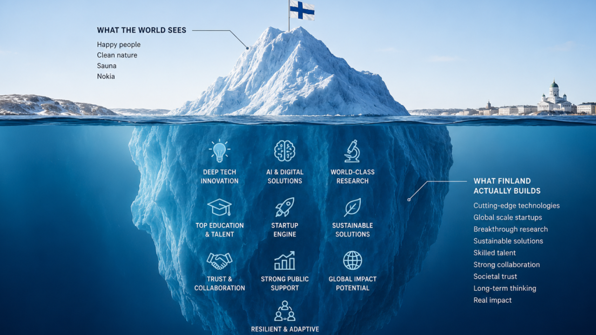

# 7 Patterns I Keep Hearing Across Finland's Innovation Ecosystem 🇫🇮✨

**Author:** Olga Kryuchkova  
*Nordic Tech and Innovation Ecosystem Explorer | ICT Trainer | Certified AI Transformation Leader | MSc (Tech.) | Engineer*  
**Published on:** August 10, 2026

---

For the last two years, I have spent hundreds of hours interviewing founders, researchers, investors, educators, public-sector leaders, and startup communities across Finland. From **ARCTIC15 2027 — The Growth Edition ↗️** and **Slush** to university laboratories, startup hubs, and corporate innovation events, I kept hearing the same ideas repeated by people who rarely meet each other.

Different industries. Different generations. Different roles.

Yet the same patterns kept emerging. None of these observations come from a single interview. It comes from firsthand observations, independent research, and public evidence and analysis. Here are the seven themes I believe deserve much more attention.

---

### Pattern 1: Finland has world-class expertise, but often communicates it too modestly to the world.

This is probably my strongest observation. Finnish companies frequently produce remarkable engineering, research, and deep technology. Yet many international visitors discover these achievements almost by accident. Innovation marketing often receives far less attention than innovation itself.

When I first arrived in Finland, I knew the country for Nokia, clean design, education, and the obvious clichés. The longer I stayed, studied, worked, and became part of its innovation ecosystem, the more surprised I became by how much the country builds that remains relatively invisible internationally. Finland has contributed technologies such as Linux and SSH, built globally recognized companies such as Supercell, and continues to produce ambitious innovations in areas ranging from quantum computing and satellite technology to AI, healthtech, gaming, and sustainable technologies. 

What surprised me even more was not the lack of innovation, but how many researchers, founders, startups, and technologies I encountered that were doing remarkable work without receiving the international attention I expected. Perhaps this is one of Finland's paradoxes: a small country with an innovation ecosystem much larger than its global visibility suggests. And the more people I meet, the more convinced I become that telling these stories and connecting the people behind them is not simply communication, it is part of building the ecosystem itself.

*   **OECD** describes Finland as one of the world's strongest innovation economies while also emphasizing the need to strengthen ecosystem performance and commercialization.
*   International discussions about European innovation frequently highlight that Finland produces globally successful companies but receives less international visibility than larger ecosystems.

*Visibility is not vanity.*

---

### Pattern 2: Trust moves faster than contracts.

Almost everyone mentions trust. Founders, universities, investors, and the government. Collaboration begins long before documents. 

One aspect that I have come to appreciate most about Finland is how often meaningful collaboration starts without a formal agenda. A coffee, a short conversation after a conference, or a mutual introduction is a daily reminder that weak ties can create strong opportunities. Simply asking someone, *"What are you working on?"* can gradually become a research collaboration, a startup partnership, a pilot project, a mentoring relationship, or a completely unexpected opportunity. 

There is a quiet culture of trust behind this: people are often willing to share what they know, introduce you to someone who might help, and explore an idea before anyone starts talking about contracts or business cases. In a world increasingly obsessed with speed and transactions, this ability to build relationships first may be one of Finland’s most valuable, and underestimated, innovation advantages.

*   This "Platform of Trust" is evident every time I visit **Aalto University's** entrepreneurship ecosystem.
*   Ecosystem governance research emphasizes that building trust and shared understanding is essential before ecosystem collaboration succeeds.

---

### Pattern 3: The ecosystem is stronger than any individual organization.

What strikes me most about innovation ecosystems: when you look closely at the story of a successful startup, you rarely find a single hero. Behind one company there may be a university where the original research began, an incubator that helped shape the idea, investors who provided the resources to move forward, a corporate partner willing to run the first pilot, and eventually international partners who helped take the solution to new markets. 

We often tell startup stories as stories of individual founders, but the ecosystem around them matters just as much.

*No one wins alone. Innovation is collective and collaborative.*

---

### Pattern 4: Education is treated as infrastructure, not an afterthought.

One of the observations that surprised me as an international student in Finland was how naturally universities become part of the innovation ecosystem. During my Master’s studies at **LUT University**, learning was not limited to lectures and academic theory; we regularly worked on real challenges with companies and public organizations. 

Our courses included collaboration with companies such as **EDAG Group**, **Matmatch** (Germany), **GE** (United States), **Wapice Ltd**, as well as the **Lappeenrannan kaupunki - City of Lappeenranta**, among others. I am especially grateful to Professor **Leonid Chechurin**, who introduced us to TRIZ and organized the environment for practical collaboration with companies, showing us how structured problem-solving and innovation methods can be applied to real business challenges. 

We were expected to apply what we learned to real business and societal challenges, work with external stakeholders, and see how ideas move from the classroom into practice. This experience changed how I see education: continuous learning is not separate from innovation, it is one of the mechanisms that makes innovation possible. Universities can be places where students, researchers, companies, and public organizations meet, experiment, exchange knowledge, and create something that none of them could develop alone.

---

### Pattern 5: Finland is a small country, but surprisingly persistent in targeting a global mindset.

What I have increasingly noticed in Finland is how a small country can have a remarkably global mindset. Entrepreneurs and startups from all over the world look at Finland as a place to develop and grow their businesses, attracted by its strong technology, education, trust-based society, and access to the wider European market. 

But entering the Finnish ecosystem does not automatically mean succeeding in it; the expectations are high, competition is very serious, and companies need to demonstrate real value to earn trust and build long-term relationships. At the same time, Finnish innovation is deeply international: I meet founders and researchers from different countries, attend English-speaking events, see EU-funded collaborations connecting Finnish organizations with partners across Europe, and encounter international accelerators and communities working with Finnish startups. 

Perhaps because Finland itself is a relatively small market, many ambitious companies have to think beyond its borders from the beginning. That is why Finland is a small country, but with a globally oriented mindset.

---

### Pattern 6: AI is no longer just a conversation in Finland.

Yes. I would strengthen the pattern I am noticing by making it evidence-based and concrete, rather than simply saying "AI has moved from hype to implementation." There is now strong Finnish evidence for that: AI Finland reports that **66% of Finnish companies use generative AI** (compared with 37% across the EU), while 85% of technology companies report investing in AI. **Business Finland** is explicitly running a program to help companies apply generative AI to products, services, and business models.

And the most interesting part for me is where AI is actually being applied.

Large Finnish companies are integrating AI into established businesses and infrastructure:
*   **Nokia** is benefiting from the rapidly growing AI and cloud market through its networking and optical technologies, with AI and cloud customer sales increasing 49% year-on-year in Q1 2026.
*   **Kesko - K-Group** is incorporating AI solutions and intelligent automation into a major IT transformation, including AI-based customer solutions and data-driven business support.
*   **KONE** is developing digital and sustainable solutions for existing buildings and bringing in research institutions.
*   **Snowflake** is helping Finnish organizations put AI into practice by enabling them to build AI applications and agents directly on governed enterprise data, bringing data, analytics, and AI into the same environment.
*   **Kempower** (an electric-vehicle charging company) is another strong example: researchers documented how Kempower used generative AI to support the development and implementation of its Information Security Management System, reducing the resources required for a complex ISO 27001-related process.

At the same time, Finnish startups are applying AI to very specific problems rather than simply building "another AI platform":
*   **AIATELLA** is developing AI-powered cardiovascular imaging to help medical professionals analyze medical images more efficiently.
*   **Gosta Labs** develops machine-learning solutions aimed at reducing the administrative workload of healthcare professionals.
*   **Uoma Mind** is applying AI to narrative therapy, turning spoken reflections into therapeutic stories.
*   **Staria** has developed an AI assistant specifically for accounting, trained on Finnish tax guidance, legislation, and accounting materials.
*   **Silo AI** (which was acquired by AMD for approximately $665 million) built AI solutions for industrial and enterprise applications rather than treating AI as a consumer novelty.

What I find particularly interesting is the diversity: telecommunications, retail, buildings, healthcare, accounting, and industrial technology. AI is becoming less of a separate technology conversation and more of a layer integrated into existing industries. For me, this is the real proof of transition: *from AI curiosity to AI capability.* The next competitive question is therefore not who talks about AI the most; it is who can implement it responsibly, integrate it into real workflows, create measurable value, and help people actually use it.

---

### Pattern 7: The biggest opportunity is connecting the dots.

The more I explore Finland’s innovation ecosystem, the more I realize that many of the ingredients for innovation are already here: strong research, talented people, ambitious startups, established companies, investors, universities, public organizations, and international connections. 

The challenge is not always creating something new. Sometimes it is just helping the right people discover each other. A researcher may have exactly the expertise a startup needs. A company may be looking for a solution that is already being developed at a university. An investor may be interested in a field they simply haven't discovered yet. A founder may need just one weak connection that opens a completely new market.

One conclusion I have reached after interviewing and talking with people across the Finnish tech and innovation ecosystem is that connections themselves can become an innovation infrastructure. A conversation, an introduction, a shared project, or even a coffee can connect resources that were already there but existed in separate and parallel worlds.

Every interview reminds me that innovation rarely fails because of a lack of ideas. More often, valuable ideas, people, and opportunities simply don't meet at the right time.

This is one reason I continue talking to founders, researchers, investors, educators, and ecosystem builders, sharing their stories, looking for patterns, and making Finland’s innovation ecosystem more visible internationally.

*Because sometimes the most valuable thing we can create is not another idea, but a connection between the ideas that already exist.*
