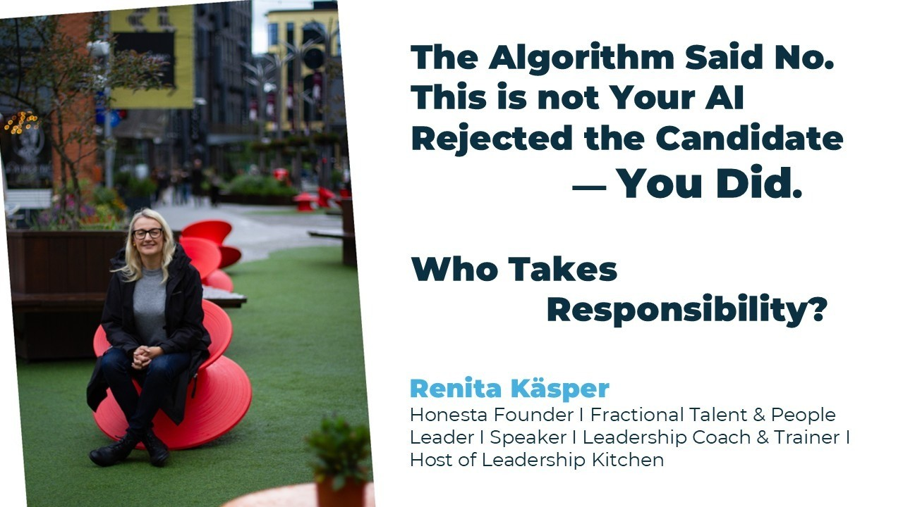
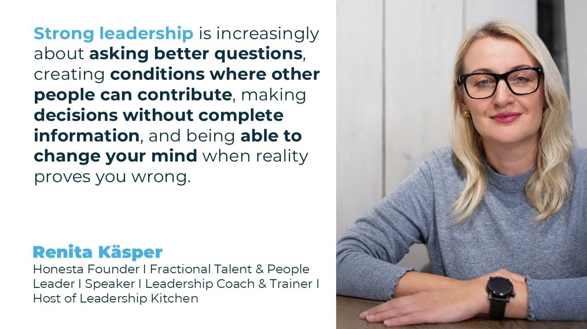
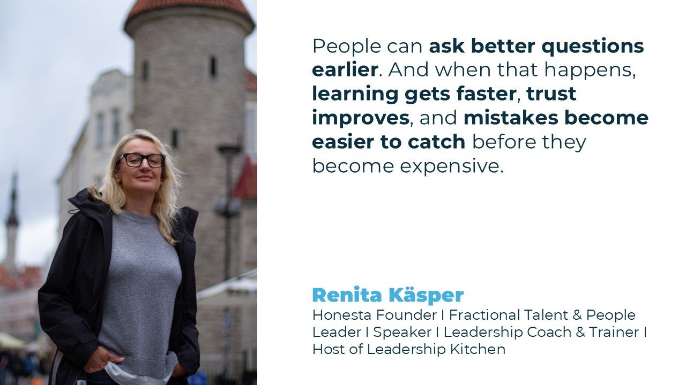
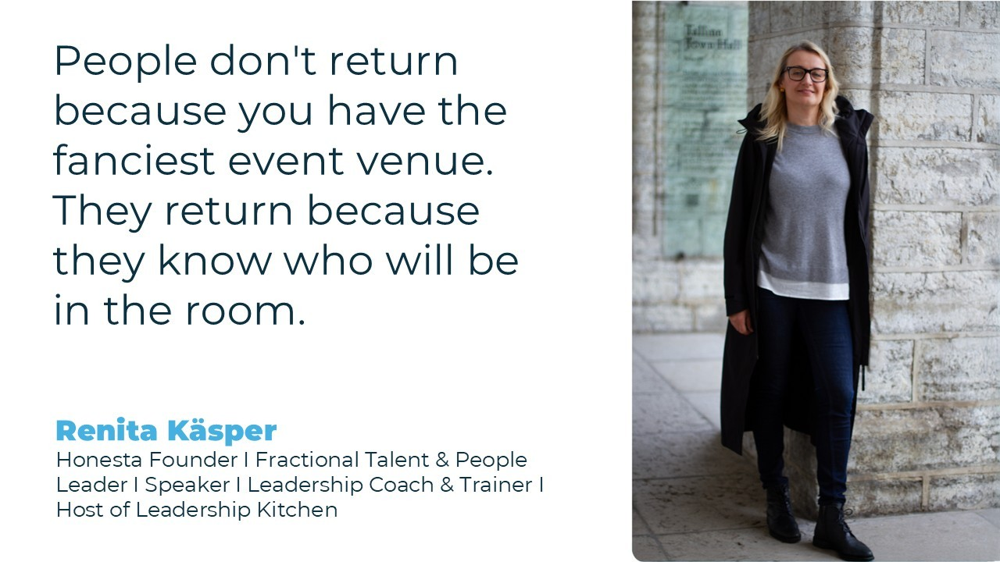
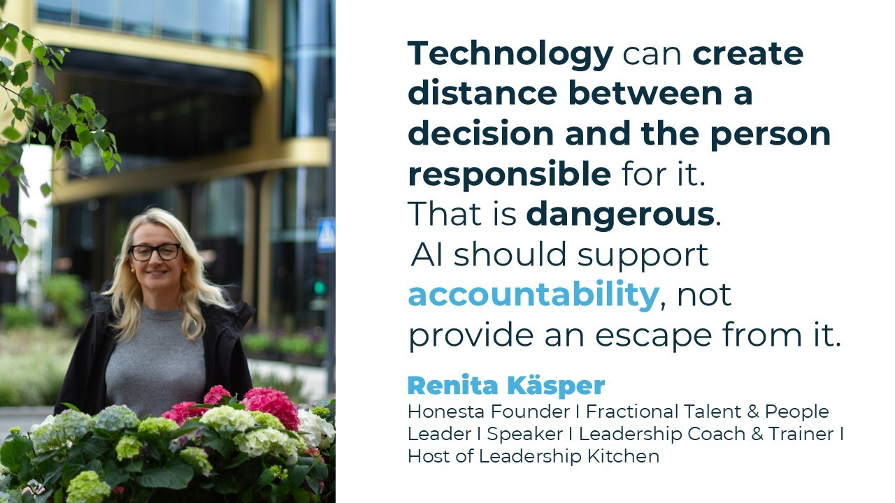
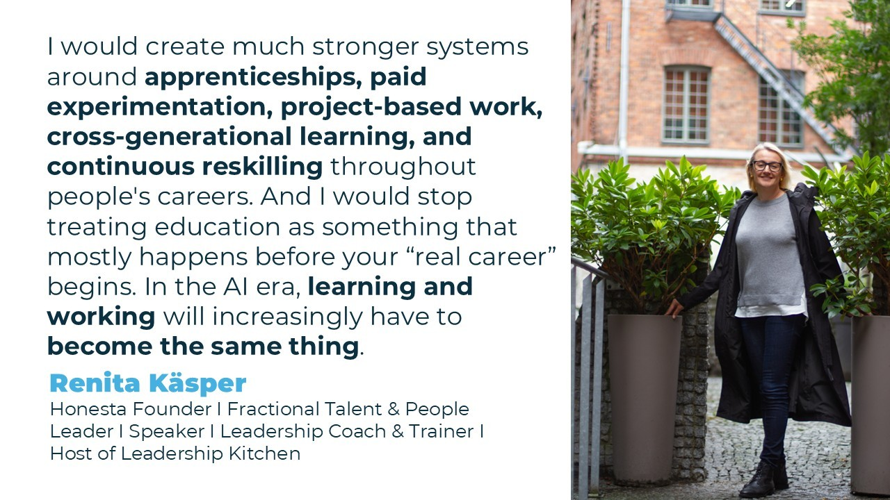

# The Algorithm Said No. This is not Your AI Rejected the Candidate — You Did. Who Takes Responsibility? 🤖👥

**Author:** Olga Kryuchkova  
*Nordic Tech and Innovation Ecosystem Explorer | ICT Trainer | Certified AI Transformation Leader | MSc (Tech.) | Engineer*  
**Published on:** September 22, 2026

In a world where AI is rapidly transforming hiring, leadership, and the structure of work, few voices combine technological realism with human-centered thinking as clearly as [Renita Käsper](https://de.linkedin.com/in/renitakasper). With more than 20 years of experience in global talent acquisition, recruitment transformation, leadership, coaching, and cross-cultural collaboration, Renita has become one of the Nordic-Baltic voices shaping conversations around the future of work in Europe.

Today, she is the founder of [Honesta Nordic](https://www.linkedin.com/company/honesta-nordic), where she works with leaders and organizations at the intersection of leadership, talent, culture, AI, and growth. She is also the founder and host of [Leadership Kitchen](https://www.linkedin.com/company/leadership-kitchen), a podcast and growing community built around honest conversations about leadership.

Known for her direct reflections on AI, hiring systems, leadership, talent communities, and cultural intelligence, she consistently challenges simplistic narratives about automation and efficiency. Instead, she asks harder questions:

* What happens to society if entry-level jobs disappear?
* Can AI-driven hiring ever truly become fair?
* Are we optimizing recruitment for speed while losing human potential?
* And what kind of leaders will emerge from an AI-native generation?

This interview explores not only technology and HR innovation, but also the deeper human, ethical, and societal shifts happening underneath the future of labor itself.

### I. Origins & Background

**Olga K.:** Renita, please tell us a bit about your background and your current projects?

**Renita Käsper:** I have spent more than 20 years working with people, recruitment, leadership, and organizations. I started in recruitment in Estonia and eventually moved into leading global Talent Acquisition and Employer Branding functions. I have built and scaled recruiting teams, hired across more than 40 countries, worked in high-growth international companies, and experienced everything from hypergrowth to restructuring and transformation.

Today, I run my own company, [Honesta Nordic](https://www.linkedin.com/company/honesta-nordic). My work sits at the intersection of leadership, talent, culture, AI, and growth. I work as an executive and leadership coach, advisor, facilitator, trainer, speaker, and fractional talent and people leader. I am also a certified Cultural Intelligence facilitator, which has become increasingly important in my work because so many organizations are global before their leaders have actually learned how to lead globally.

And then there is [Leadership Kitchen](https://www.linkedin.com/company/leadership-kitchen), my podcast and growing leadership community. The idea behind it is simple: leadership is not built in PowerPoint presentations or corporate slogans. It is built through real decisions, difficult conversations, mistakes, uncertainty, and reflection. I also teach, speak at conferences, work with HR and leadership communities, and run Recruitment Thursday, a professional community I started in Estonia almost a decade ago.

At first glance these projects may look quite different. To me they are all connected by one question: how do we build organizations where technology helps humans perform better rather than simply making organizations more efficient?

**Olga K.:** You’ve worked across Europe in Estonia, Germany, other countries and global remote ecosystems, what part of your “small-country mindset” became your biggest strategic advantage internationally?

**Renita Käsper:** You learn very quickly that nobody is coming to solve things for you. Estonia is a tiny country. Our domestic market is small, our resources are limited, and if you want to build something meaningful, you have to think internationally almost immediately. That creates a certain pragmatism. You experiment. You figure things out. You talk directly to decision-makers. You don't automatically assume something requires 14 committees and two years of discussion.

It also teaches you cultural humility. When you come from a country of 1.3 million people, you don't walk into Germany, Spain, India, Brazil, or the US assuming the Estonian way must be the correct way. That has probably been one of my biggest advantages internationally: I am comfortable saying, “I don't know how this works here. Let's understand it.” Small countries teach you that adaptability is not a nice leadership competency. It is survival.

**Olga K.:** Was there a specific hiring decision, candidate conversation, or career moment that completely changed how you think about people and work?

**Renita Käsper:** I don't think there was one dramatic moment. There were hundreds of smaller ones. But one thing changed fundamentally as I became more global: I stopped believing that good recruitment was primarily about identifying the “best candidate.” The best according to whom? Once you recruit across countries and cultures, you realize how many things we interpret as competence are actually familiarity.

Someone communicates the way we expect. They interview well. Their university is familiar. Their career path makes sense to us. They make eye contact in the way we expect. They talk about achievements in the way our culture rewards. And suddenly we call that “talent.” That realization changed a lot for me. Recruitment is not only about assessing candidates. It is also about understanding the biases, assumptions, and limitations of the people doing the assessing.

**Olga K.:** Recruitment is often described as a “people business,” but what did you learn about human psychology that no HR textbook ever taught you?

**Renita Käsper:** People are much less rational than organizations pretend they are. We create competency frameworks, scorecards, interview processes, performance systems, and elaborate decision-making structures. Then a hiring manager meets somebody and says, “I just have a good feeling about her.” Or the opposite. That feeling can overpower an enormous amount of data.

I learned that people often make emotional decisions first and construct rational explanations afterwards. I also learned how much people want certainty. Hiring is fundamentally uncertain. Leadership is uncertain. Careers are uncertain. AI doesn't remove that uncertainty, although we are very tempted to use technology to make it look as if it does. A system giving somebody a score of 87 does not mean we suddenly have objective truth. Sometimes it just means we have given uncertainty a number.

**Olga K.:** Estonia became digitally advanced long before many larger countries. How did growing up in that environment shape your relationship with technology, trust, and experimentation?

**Renita Käsper:** Technology has always felt more like infrastructure to me than something magical. In Estonia, you don't celebrate every time you sign something digitally. You just expect it to work. That creates an interesting relationship with technology. I am very open to experimentation, but I am also quite impatient with technology for technology's sake. The question is not, “Does this use AI?” The question is, “Does this solve something?” And if it creates five new problems while solving one, then maybe it isn't innovation.

The Estonian digital model also taught me something important about trust: successful technology requires more than good software. People need to understand the system, trust the institutions behind it, and believe there are safeguards when something goes wrong. We sometimes forget that when discussing AI.

**Olga K.:** Looking back at your early career, which belief about talent or leadership did you have to completely unlearn?

**Renita Käsper:** That the strongest leader is the person with the answers. I now believe almost the opposite. The more complex the environment becomes, the less realistic it is that one leader can know everything. Strong leadership is increasingly about asking better questions, creating conditions where other people can contribute, making decisions without complete information, and being able to change your mind when reality proves you wrong. Leadership isn't knowing. Leadership is navigating.

### II. The Idea & Innovation Behind Renita's Project

**Olga K.:** Most HR tech claims to “save time.” What problem do you think the industry should actually be solving instead?

**Renita Käsper:** Better decisions. I am tired of “save recruiters X hours per week” being treated as the ultimate definition of HR innovation. Of course efficiency matters. Nobody wants recruiters spending hours copying information between systems. But if we automate a bad hiring process, we haven't created a good process. We've created a faster bad process. The real opportunity is to help organizations make better decisions: understand talent better, reduce unnecessary friction, identify potential that humans might overlook, improve candidate experience, and give managers better information. Saving time should be the side effect. Better hiring should be the outcome.

**Olga K.:** If you could remove one outdated ritual from recruitment forever: CVs, cover letters, interviews, job titles, performance reviews, what disappears first and why?

**Renita Käsper:** Cover letters. Especially generic mandatory cover letters. We ask somebody to write 500 words explaining why they are passionate about our company. Now AI writes the letter, AI inside the ATS may summarize it, and a recruiter might spend 20 seconds reading that summary. What exactly are we assessing? If you genuinely need to understand someone's motivation, ask them something meaningful.

I wouldn't necessarily eliminate CVs or interviews because both can still provide useful information. I would eliminate rituals where nobody can clearly explain what signal we are trying to collect. If you cannot explain why a step exists, remove it.

**Olga K.:** Your work often sits between automation and human connection. Where do you think technology still fundamentally misunderstands people?

**Renita Käsper:** Context. Humans are inconsistent because life is inconsistent. A career gap can mean failure, caregiving, illness, travel, reinvention, immigration, burnout, entrepreneurship, or simply taking time to figure out what you want. The same behavior can mean completely different things in different cultures.

Silence can mean disengagement in one environment and respect in another. Confidence can indicate competence. It can also simply indicate confidence. Technology is becoming incredibly good at recognizing patterns. The danger begins when we confuse pattern recognition with understanding. Humans are stories, context, contradictions, and change. That is much harder to put into a dataset.

**Olga K.:** Many founders build products around efficiency. Have you intentionally designed anything around empathy, trust, or emotional experience instead?

**Renita Käsper:** Absolutely. [Leadership Kitchen](https://www.linkedin.com/company/leadership-kitchen) is probably the clearest example. I didn't create it because the world needed another leadership content platform. There is already more leadership content than anybody can consume. I created it because I think we need more honest spaces.

Leadership can be incredibly lonely. Senior people often have fewer places where they can admit, “I don't know,” “I made the wrong decision,” or “I genuinely don't know what to do next.” That is also where I see the community developing: not as another place where people consume content, but as a trusted room where leaders can bring the problem they cannot easily discuss inside their organization. That is intentionally designed around trust rather than scale.

**Olga K.:** If your project succeeds beyond expectations, what invisible change in workplace culture would happen that people may not notice immediately?

**Renita Käsper:** People would become more comfortable saying, “I don't know.” That sounds small. I think it is huge. Organizations waste enormous amounts of energy pretending. Leaders pretend they know. Employees pretend they understand. Teams pretend they agree. Companies pretend transformation is going according to plan. In a genuinely healthy culture, uncertainty doesn't automatically undermine credibility. People can ask better questions earlier. And when that happens, learning gets faster, trust improves, and mistakes become easier to catch before they become expensive.

### III. Your Project & the Emerging Nordic and European Tech Ecosystem

**Olga K.:** Nordic and Baltic ecosystems are often praised for trust and agility. But what blind spots do you think Europe still has when competing globally in AI and HR innovation? To your opinion Is the future in international collaboration on labor market?

**Renita Käsper:** Europe's biggest risk is fragmentation. We have extraordinary talent, universities, companies, public institutions, and very different labor markets sitting incredibly close to each other. But we still think far too nationally. AI doesn't care about the Estonian-Finnish border. Talent increasingly doesn't either.

So yes, I absolutely think international collaboration is part of the future. But Europe also has to become more comfortable with speed, experimentation, and failure. Sometimes we are so focused on preventing every possible negative outcome that somebody else has already built, tested, failed, rebuilt, and scaled before we finish discussing the first version. Protecting people matters. But protecting people from innovation altogether is not a strategy.

**Olga K.:** Europe talks a lot about “ethical AI.” Do you think Europe can realistically lead innovation while also regulating it heavily?

**Renita Käsper:** Yes, but only if regulation creates trust rather than paralysis. I reject the idea that we have only two options: unregulated innovation or no innovation. Good regulation can create competitive advantage. If companies and individuals trust AI systems built in Europe because they know there are meaningful safeguards, that has value.

But regulation written too far away from how technology and businesses actually work can absolutely slow innovation. The challenge is proportionality. A chatbot helping somebody rewrite a job advertisement and an algorithm making consequential decisions about someone's employment should not automatically be treated as the same risk. Europe can lead in responsible AI. But “responsible” cannot become another word for “afraid.”

**Olga K.:** What advantage do smaller ecosystems like Estonia or Finland have that Silicon Valley still struggles to replicate?

**Renita Käsper:** Proximity. In a small ecosystem, founders, government, universities, investors, and operators can be surprisingly close to one another. You can get the right people around one table relatively quickly. There is also less room for bullshit. If your market is tiny, your product often has to become international very early. You cannot spend ten years believing your local bubble represents the world. The disadvantage is obviously capital and scale. The advantage is that constraints force clarity.

**Olga K.:** Community-led ecosystems seem increasingly important, from talent communities to founder circles. Are communities becoming more powerful than institutions, what do you see now?

**Renita Käsper:** In some areas, yes. Institutions still matter enormously. But communities can move faster and often create something institutions struggle to manufacture: belonging. I have run Recruitment Thursday since 2017, and one thing I have learned is that people don't return because you have the fanciest event venue. They return because they know who will be in the room. That is a completely different value proposition.

The strongest professional communities increasingly act as trust infrastructure. They help people find knowledge, opportunities, collaborators, employees, clients, and sometimes simply people who understand what they are dealing with.

But community is becoming an overused word too. An audience is not automatically a community. A Slack channel is not automatically a community. Community exists when people would notice if other members disappeared.

**Olga K.:** If you had to predict which European country will unexpectedly dominate the future-of-work space in the next decade, who would you bet on and why?

**Renita Käsper:** I wouldn't bet everything on one country. I would bet on a corridor: the Nordics and Baltics connected more strongly with Central and Southern European innovation hubs.

Estonia is particularly interesting because digital behavior is already deeply embedded in society. Finland has exceptional education, technology, and institutional capability. Germany has industrial scale. Spain is becoming increasingly interesting as an international talent and startup hub. The winner may not actually be a country. It may be the ecosystem that becomes best at connecting those strengths across borders.

### IV. Tech, AI, Data & Ethics, the Future of Work

**Olga K.:** We’re entering a world where AI can evaluate candidates faster than humans. But should speed ever become the primary value in hiring?

**Renita Käsper:** No. Speed matters when slowness creates unnecessary friction. But the fastest hiring process in the world is useless if you hire the wrong person. There is a strange obsession in recruitment with reducing everything: time-to-hire, cost-per-hire, recruiter hours. Those metrics matter. I have managed them myself.

But recruitment is ultimately a decision about putting a human being into a system where they may spend several years of their life. The goal should be enough speed to remain competitive and enough depth to make a good decision. Not maximum speed.

**Olga K.:** Do you think future employees will increasingly be hired for adaptability and learning velocity rather than expertise itself?

**Renita Käsper:** Yes, but I would not declare expertise dead. We need both. AI makes certain knowledge easier to access, which means memorizing information becomes less valuable in many roles. But somebody still needs enough expertise to recognize when AI is wrong.

That becomes extremely important. The strongest people will combine domain knowledge with curiosity, adaptability, judgment, and the ability to learn quickly. Learning how to learn may become one of the most economically valuable skills of the next decade.

**Olga K.:** AI systems are trained on historical data and history itself contains bias. Can recruitment AI ever truly become neutral?

**Renita Käsper:** No. But neither are humans. I think “neutral AI” is the wrong goal because it creates a false promise. Every system contains choices: what data we use, what outcome we optimize for, what variables we include, what we exclude, and what we define as success. Those are human decisions. The better question is whether AI can make certain biases more visible, measurable, and correctable than they are in purely human decision-making. Potentially, yes. But that requires transparency, governance, auditing, and humans who understand that an algorithm is not objective simply because it is mathematical.

**Olga K.:** What worries you more: humans overtrusting AI, or humans using AI to justify decisions they already wanted to make?

**Renita Käsper:** The second one. Overtrust is dangerous, but at least we are discussing it. What concerns me more is using AI as a convenient shield for human decisions. “The algorithm said no.” Which algorithm? Based on what? Who decided what it should optimize? Who is accountable when it is wrong? Technology can create distance between a decision and the person responsible for it. That is dangerous. AI should support accountability, not provide an escape from it.

**Olga K.:** We often hear that AI will replace repetitive work. But what human skills do you believe will become dramatically MORE valuable because of AI?

**Renita Käsper:** Judgment. Curiosity. Critical thinking. Cultural intelligence. Empathy. Communication. The ability to ask excellent questions. The ability to build trust. And increasingly, discernment: knowing when not to use AI. When everybody has access to similar technology, access itself stops being the competitive advantage. What you do with it becomes the advantage. AI can generate 100 strategies. A human still has to understand which one makes sense here, for these people, in this culture, at this moment.

### V. Vision and Future of Labor Market

**Olga K.:** To your opinion what kind of talent will thrive in the next 5-10 years that traditional education systems are still failing to prepare for?

**Renita Käsper:** People who can operate between disciplines. The future belongs less to people who can say, “This is my box and I stay inside it,” and more to people who can connect technology, business, people, culture, and context. We will need people who can learn quickly, challenge information, collaborate with AI, communicate across cultures, and reinvent themselves repeatedly.

But there is another part we don't discuss enough. Young people need opportunities to become experienced. If AI removes large amounts of entry-level work because machines can perform the basic tasks faster, where does the next generation learn? You cannot hire somebody with ten years of experience if nobody gave them year one. That is one of the biggest future-of-work questions for me.

**Olga K.:** If you could redesign the labor market from scratch for the AI era, what would be the first thing you would change?

**Renita Käsper:** I would redesign the transition between education and work. Our current system is still largely based on an industrial-era sequence: Study. Graduate. Get an entry-level job. Build experience. Move upward. That pathway is already breaking.

I would create much stronger systems around apprenticeships, paid experimentation, project-based work, cross-generational learning, and continuous reskilling throughout people's careers. And I would stop treating education as something that mostly happens before your “real career” begins. In the AI era, learning and working will increasingly have to become the same thing.

**Olga K.:** What type of collaborations are you actively looking for right now: startups, policymakers, researchers, educators, communities, or something else entirely?

**Renita Käsper:** All of those, if there is a real problem to solve. I am particularly interested in collaborations around AI adoption, leadership, Cultural Intelligence, global talent, and the future of work. That includes organizations experimenting with AI and trying to understand the human implications, universities and educators redesigning how we prepare people for work, communities creating cross-border connections, and researchers or policymakers looking at what technological change actually means for people and labor markets.

I am also building [Leadership Kitchen](https://www.linkedin.com/company/leadership-kitchen) internationally and looking for leaders, partners, guests, and organizations willing to have more honest conversations about leadership. I am less interested in another panel where five people agree that “AI is changing everything.” I am interested in rooms where we can ask: Okay. So what are we actually going to do about it?

**Olga K.:** Many people feel uncertainty about the future of work. What signals today actually can give us optimism?

**Renita Käsper:** Humans are incredibly adaptable. We tend to discuss technological change as if people are passive objects waiting for technology to happen to them. We're not. People are already experimenting, building companies, changing careers, learning new skills, creating communities, and inventing completely new ways of working. I also see more conversations about leadership, wellbeing, culture, flexibility, inclusion, and meaning than I did 20 years ago.

Not because we have solved those things. We definitely haven't. But they are on the agenda. The future of work is not predetermined by AI companies. We are building it right now through thousands of decisions made by leaders, governments, educators, founders, employees, and communities. That means we still have agency. That gives me optimism.

**Olga K.:** If someone listening to this conversation wants to help shape a more human-centered future of work, what should they start doing already tomorrow?

**Renita Käsper:** Stop talking about AI as something that is coming. It is already here. Use it. Understand it. Question it. Learn what it is good at and where it fails. Then look at one decision you make about another human being — hiring, promotion, performance, leadership, education — and ask: Are we using technology here to make a better decision? Or simply a faster one? Who benefits? Who could be excluded? What assumptions are built into the system? And where does human judgment still matter? You don't need to become an AI engineer to influence the future of work. But you do need to participate. Because if the people who care about humanity stay out of the technology conversation, we shouldn't be surprised when the technology isn't designed around humans.

