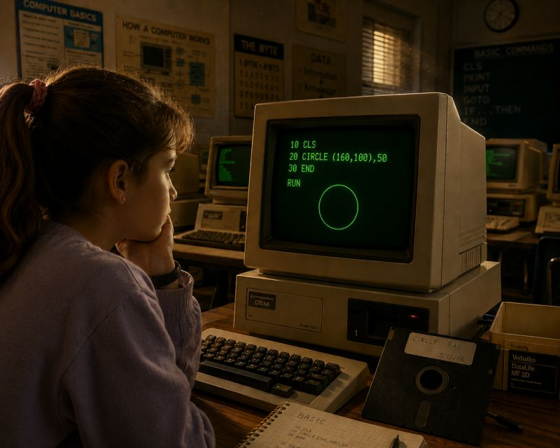

# Blinking Green Cursor… The Beginning of a Journey ⌨️✨

**Author:** Olga Kryuchkova  
*Nordic Tech and Innovation Ecosystem Explorer | ICT Trainer | Certified AI Transformation Leader | MSc (Tech.) | Engineer*  
**Published on:** June 24, 2026

---

Blinking green cursor… I still remember the first time I touched a computer. It was the late 1980s, and to me it felt less like a machine and more like something forbidden and powerful. Power over knowledge, over data, over possibility.

At school, we had a computer room filled with large monitors glowing green. The screens felt enormous, and the quiet hum of the machines created an atmosphere that was both captivating and exciting. There was no internet, no colorful graphics, and certainly no smartphones. Just blinking cursors patiently waiting for instructions ⌨️✨

We loaded programs from large floppy disks that felt almost magical. Holding one in my hands, I had the strange feeling that entire worlds could be hidden inside that thin black square of plastic. Every time a disk spun and the computer responded, it felt like a small miracle—a miracle that actually worked and was real 💾✨

One of the first things we learned was BASIC. I remember typing commands and feeling powerful when the program finally ran and showed the results of my work. The assignment that fascinated me most was writing a program to draw a circle. Today, drawing a circle is effortless. But back then, it felt like a breakthrough.

---

### Connecting Thought to Reality

Looking back, I realize that the circle was more than a programming exercise. It represented a connection between thought and reality. An idea existed only in my mind until I found the right language to bring it into the world. 

Perhaps much of life works the same way: we spend years trying to express our thoughts, dreams, and feelings through words, actions, and choices, hoping they will take shape beyond ourselves.

The technology of that era now seems primitive, but the emotions remain vivid: curiosity, wonder, frustration, and pride. Those green screens taught me something that still feels true today. 

> **Technology changes rapidly and opens breathtaking possibilities, but the human desire to create, understand, and leave a small mark on the world remains the same 🌱**

And every time I see a modern computer perform tasks that would have seemed impossible back then, I think of that glowing green monitor and the simple circle I drew for the first time. Somehow, that small circle became the beginning of a much larger journey 🌍
