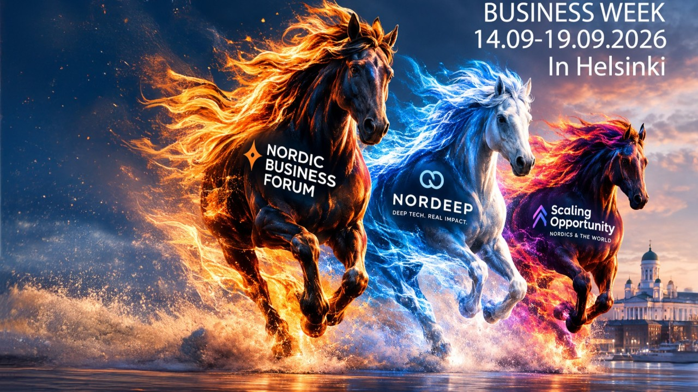
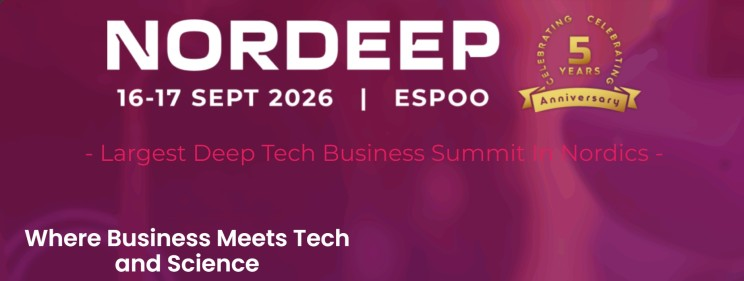
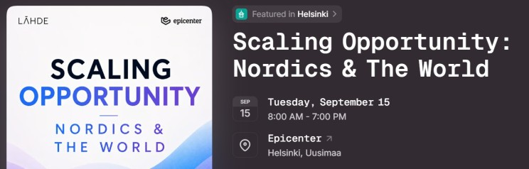
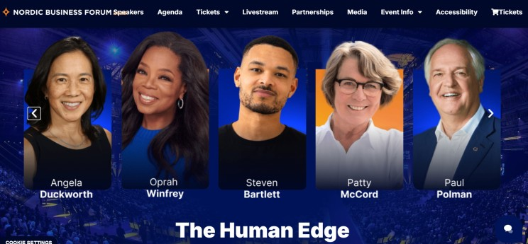

# Business week in Helsinki 14.09 - 19.09.2026 Where to go? 🐎🇫🇮

**Author:** Olga Kryuchkova  
*Nordic Tech and Innovation Ecosystem Explorer | ICT Trainer | Certified AI Transformation Leader | MSc (Tech.) | Engineer*  
**Published on:** September 14, 2026

There is a rather interesting three-way race happening in Helsinki this week and, for once, “competition for attention” is not just a metaphor. Three ambitious business events are lining up almost back-to-back. Different audiences, different propositions, different flavours of ambition. So, before everyone starts running from one badge to another, let’s compare the horses. 🐎🐎🐎

### The Powerhouse: NORDEEP 🐎

My absolute favorite: [NORDEEP | 6th Edition: The Powerhouse Edition](https://www.linkedin.com/showcase/nordeep-summit/). NORDEEP celebrates its **5th anniversary on 16–17 September**, bringing the Nordic deep-tech ecosystem together in Espoo.

**Three things make it particularly interesting:**

1. **Actual deep tech.** Computing, semiconductors, photonics, intelligent machines, biology, energy, materials, security and space — basically the technologies that require considerably more than a nice SaaS landing page. 😉
2. **The right ecosystem density.** 750+ participants from 10+ countries, including startups, investors, corporates, universities and research institutions.
3. **Built for transactions, not just inspiration.** 1-to-1 meetings, matchmaking, workshops, investor gatherings, showcases and opportunities around funding, pilots, clients and talent.

If Nordic deep tech is your playground, NORDEEP is less “listen to an impressive person” and more **“who can actually help this technology become a business?”**

Is it possible to participate? Yes: [Buy Tickets | NORDEEP — 5th Anniversary Edition](https://nordeep.com/buy-tickets-nordeep-5th-anniversary/)

### And then there is the dark horse 🐎: Scaling Opportunity: Nordics & The World

This is the one I would **not underestimate**, guys. [Epicenter Helsinki](https://www.linkedin.com/company/epicenter-helsinki) + [Lahde Impact](https://www.linkedin.com/company/lahdeimpact) are bringing founders, investors, buyers, business leaders and international market experts together on **15 September**, literally before the two giants take the stage.

**Three things make it different:**

1. **The question is brutally practical:** Where can Nordic companies grow next and who can help them get there? New markets, new capital, new relationships.
2. **Quality over quantity.** One day, one room, up to 250 people. Not 8,500 people trying to accidentally meet the same three people.
3. **Perfect timing.** It catches the international crowd **just before** Helsinki turns into the business-event equivalent of a [Formula 1](https://uk.linkedin.com/company/formula-one-management-ltd) paddock.

And that is precisely why I find the **dark horse** interesting. It doesn't have the celebrity gravity of Nordic Business Forum. It doesn't have five years of deep-tech positioning like NORDEEP. But it has something more important: **proximity.** A closer space where the conversation can move rather quickly from *“What do you think about global expansion?”* to **“Fine. Who should we talk to today?”** And honestly, that is where things get interesting.

Is it possible to participate? Mmm... I am not sure, but you can check it out: [Scaling Opportunity: Nordics & The World · Luma](https://luma.com/ofzdvl4f?tk=2uyGUK)

### Nordic Business Forum: The Heavyweight 🐎

[Nordic Business Forum](https://www.linkedin.com/company/nordic-business-forum) takes the **16–17 September** slot at [Messukeskus, Helsinki Expo and Convention Centre](https://www.linkedin.com/company/messukeskushelsinki) with its *Human Edge* theme.

**Three obvious strengths:**

1. **Star power.** [Oprah Winfrey](https://www.linkedin.com/in/winfrey-oprah-288672208), [Steven Bartlett](https://uk.linkedin.com/in/stevenbartlett-123), [Angela Duckworth](https://www.linkedin.com/in/angeladuckworth), [Paul Polman](https://it.linkedin.com/in/paulpolman), Kjell Nordström and many others. The speaker list is basically a LinkedIn algorithm’s dream.
2. **Scale.** Around **8,500 people** are expected — senior executives, decision-makers and business leaders from around the world. The in-person event is already sold out.
3. **Big-picture leadership.** Decision-making, performance, collaboration and the increasingly important question of what humans still bring to the table when technology becomes very good at doing things.

If you want the biggest stage, biggest crowd and biggest names, this is the obvious favourite.

Is it possible to participate? Maybe, if you can afford it: [Nordic Business Forum - Europe's Largest Business & Leadership Event](https://www.nbforum.com/)

### So… who wins? Prediction?

There will be three very different answers to the question:

**What do you actually want from an event?**

* 🧬 **Deep tech + capital + ecosystem connections → NORDEEP**
* 🌍 **International expansion + market access + focused relationships → Scaling Opportunity**
* 🎤 **Inspiration + global business leadership → Nordic Business Forum**

And I suggest we revisit this **at the end of the week**. Not according to the number of famous people on stage. But according to something much more interesting:

> **Where did you actually have the best conversations? Who did you meet? What happened afterwards? And where did one conversation turn into an opportunity?**

Because conferences are very good at producing photographs. The interesting ones produce **consequences**. Let the race begin! 🐎

**Who are you betting on?**
