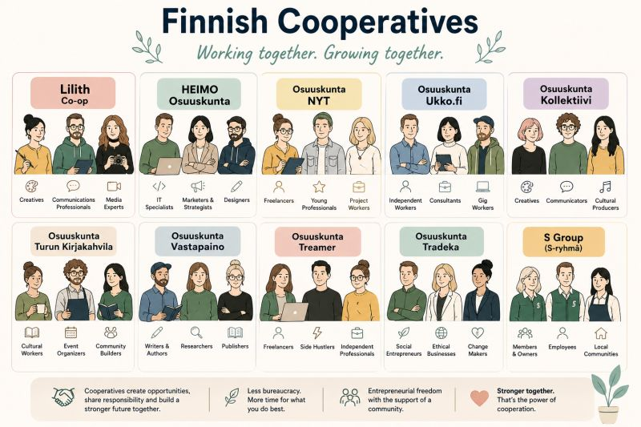

# Cooperatives: The Underrated Model for the Future of Work in Finland 🤝

**Author:** Olga Kryuchkova  
*Nordic Tech and Innovation Ecosystem Explorer | ICT Trainer | Certified AI Transformation Leader | MSc (Tech.) | Engineer*  
**Published on:** May 3, 2026

---

I’ll say it straight: **the labor market is shifting faster than we’re adapting to it.** ⚡

I’ve worked across corporate and academic IT education, in both international and national environments, building courses, campaigns, and learning systems. And what I see now isn’t just a “cycle.” It’s structural change.

Across Finland, Europe, and beyond:
*   Layoffs are rising 📉
*   Stable roles are shrinking
*   AI is reshaping not just jobs, but how work itself is done 🤖
*   And yet… viable alternatives to traditional employment remain underused

Here’s the paradox: **new models of work do exist. We’re just slow to adopt them.**

One of the most underrated? **Cooperatives.** 🤝

Finland has a long-standing cooperative tradition—practical, resilient, and surprisingly modern:
*   **Shared admin**, accounting, and bureaucracy
*   **Collective marketing** and client acquisition
*   **Lower individual risk**
*   **More time** for actual work and expertise

It’s a model that blends entrepreneurial freedom with structural support—something many professionals are actively searching for right now.

---

### Why Aren’t We Scaling This? 🚀

At a time when Finland needs more flexible employment solutions, cooperatives could:
*   **Enable mass participation** in the workforce
*   **Support freelancers** and specialists
*   **Reduce friction** in starting independent careers
*   **Create communities**, not just contracts

This isn’t a new idea. It’s a forgotten one—and maybe exactly what we need to rethink.

I’m actively exploring collaborations—especially within cooperative models.

If you:
*   Work in a cooperative
*   Know successful examples
*   Are building something similar
*   Or want to explore this direction

New-generation cooperatives (like Lilith & HEIMO) are quietly solving:
*   → freelancing instability
*   → admin burden
*   → lack of community

Let’s connect. Share your links, experiences, or thoughts!

> **The future of work won’t build itself.**

*#FutureOfWork #Cooperatives #Finland*
