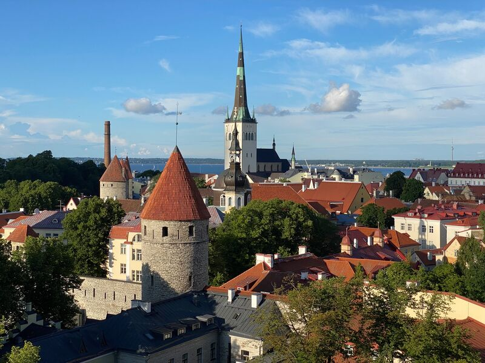
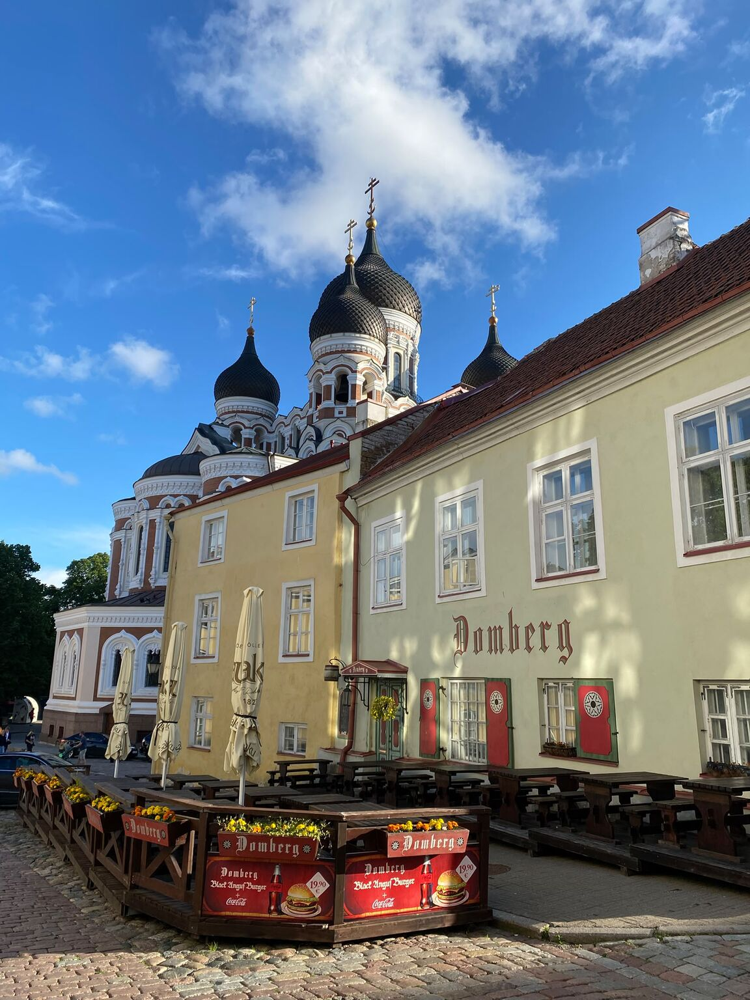
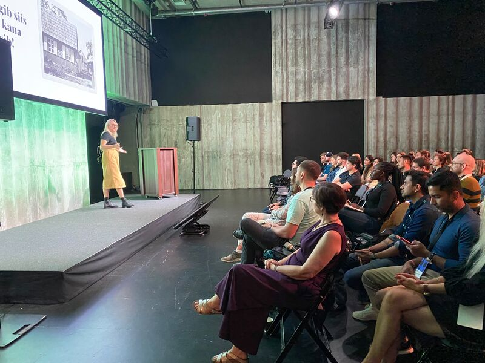
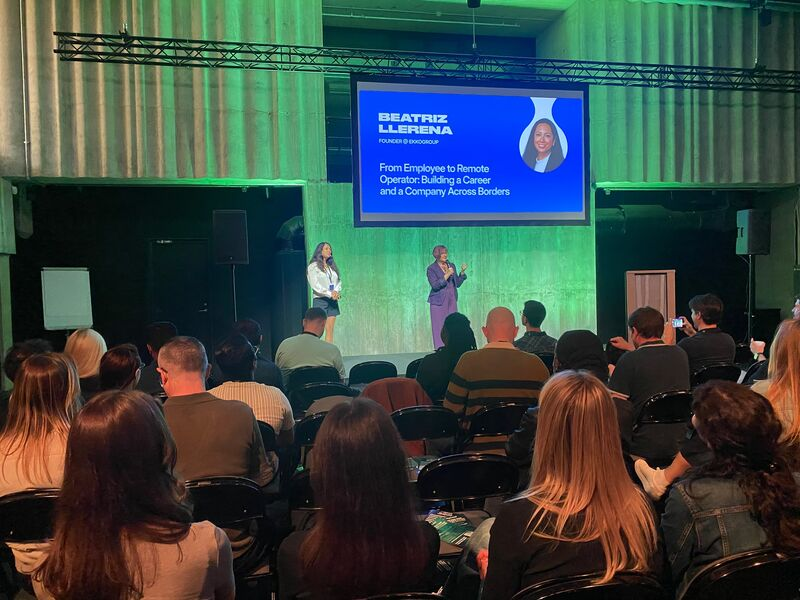
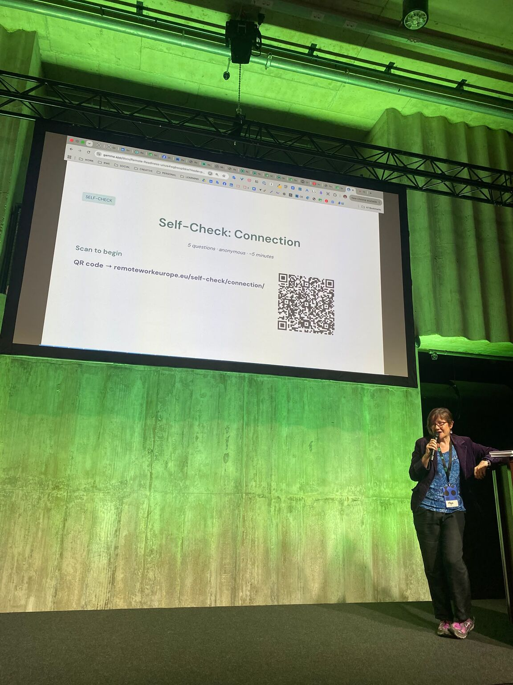
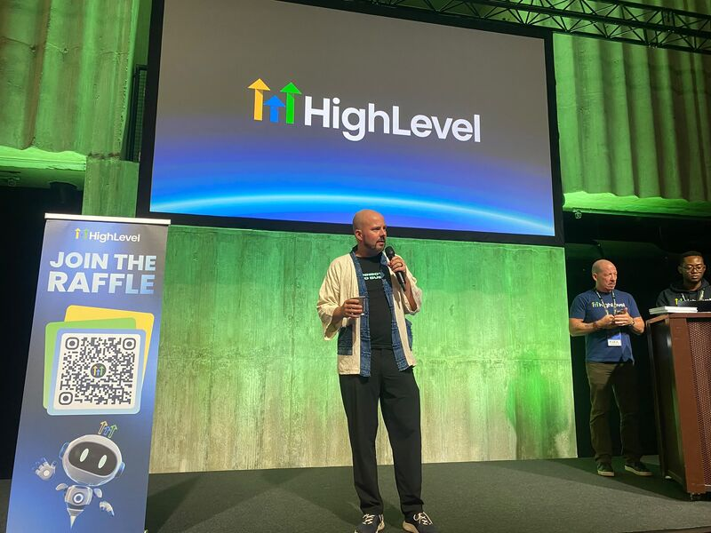
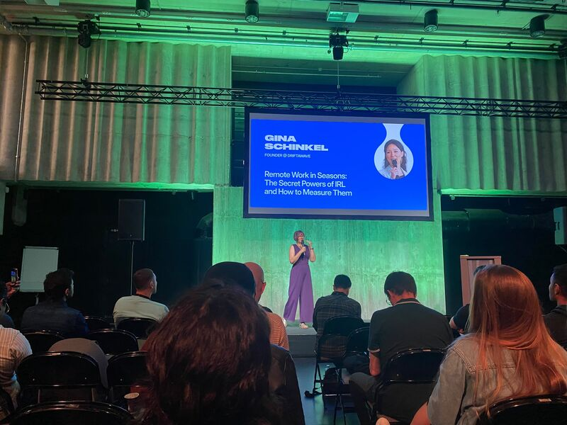
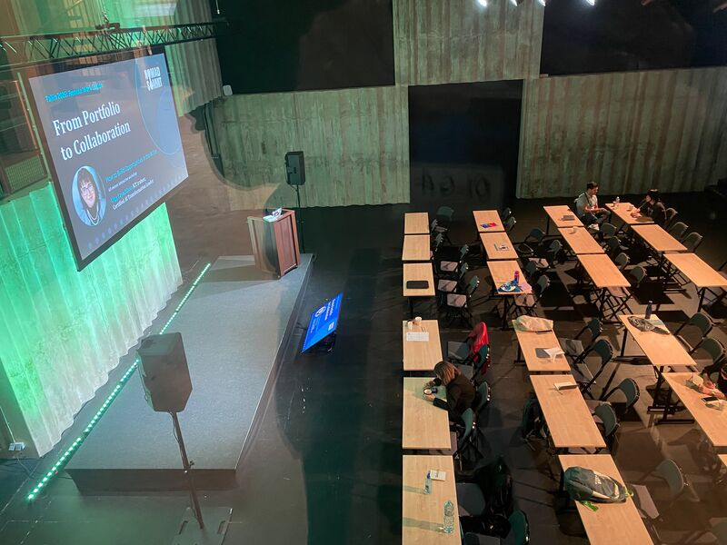
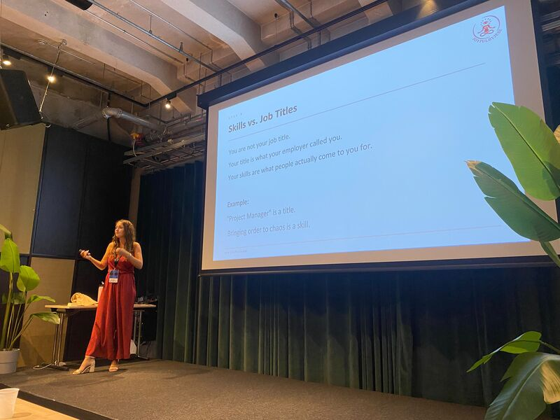

# Unpacking Thoughts after the First European Nomad Summit in Tallinn 🇪🇪

**Author:** Olga Kryuchkova  
*Nordic Tech and Innovation Ecosystem Explorer | ICT Trainer | Certified AI Transformation Leader | MSc (Tech.) | Engineer*  
**Published on:** July 8, 2026

---

Uffff... I finally had enough time to unpack my thoughts after the First European Nomad Summit in Tallinn.

My conclusion? This didn't feel like just another conference where everyone nods wisely, exchanges LinkedIn QR codes, and promises to "stay in touch." It felt like the beginning of a conversation—and those are much rarer than conferences.

What struck me most was the feeling that something genuinely new is emerging across the Baltics and the Nordics. Not another startup trend, but a culture. As many speakers pointed out, innovation is rarely about technology alone. Technology scales ideas; trust scales communities. The summit managed to create both.

One observation I couldn't ignore: while southern Europe was busy melting, the Baltics and Nordics quietly became the place to be. Maybe climate change has accidentally become the best marketing campaign for Northern European innovation. 😄

So here's a proposal to the organizers Christoph Huebner, Alexandra Mosnitska, Maya Middlemiss: the next edition in Finland? I'm happy to help make it happen or at least let's open a Nordic Nomad HQ in Helsinki. The world's happiest country seems like a perfectly reasonable place to build Europe's happiest nomad community. 😉

On a personal note, this summit became an unexpected testing ground for my upcoming course, **"From Portfolio to Collaboration: A Course for Builders."** I had the chance to validate its methodology, experiment with collaborative exercises, and, most importantly, receive honest feedback from incredibly thoughtful people. Sometimes you don't need validation; you need intelligent questions. Fortunately, I got both.

Huge thanks to the organizers, speakers, volunteers, Julien Sicard, Adam Ethofer, Hendrik Ojamaa, Gina Schinkel ✨, Ángela-Jo Touza-Medina, Lina Rosseburg, Renita Käsper, Mike Peditto, Jessica Lacher, Lauri Linnamäe, Patrick Farrelly, Beatriz Llerena and everyone I had the pleasure of meeting 🙌. Creating an event that is simultaneously intellectually challenging, genuinely welcoming, and free from unnecessary startup theatre is far more difficult than it looks. You pulled it off.

I hope our paths cross again somewhere in Europe.

And if your travels bring you to Finland, my invitation stands: coffee is on me, followed by a walk through Helsinki and a few places that don't usually appear in tourist guides.

Thank you for great partnership HighLevel & Costa Brava Hub!

Finally, if you're planning your innovation calendar, don't miss Slush this year and **ARCTIC15 2027 — The Growth Edition** ↗️ next year. I'll be there, and I'd be delighted to continue the conversations we started at the summit.

Because, in the end, the most valuable takeaway from any event isn't the slide deck, it's the people who make you think differently.

Have a wonderful summer, everyone! 🌞

