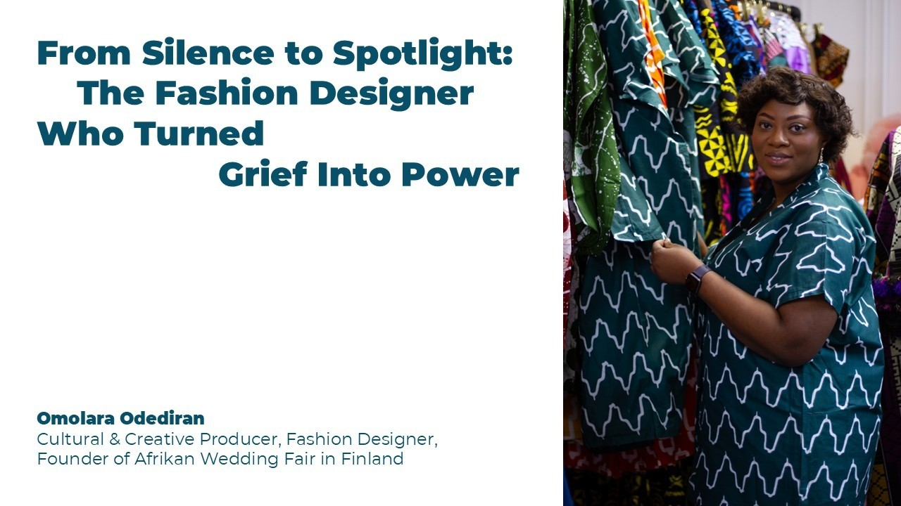
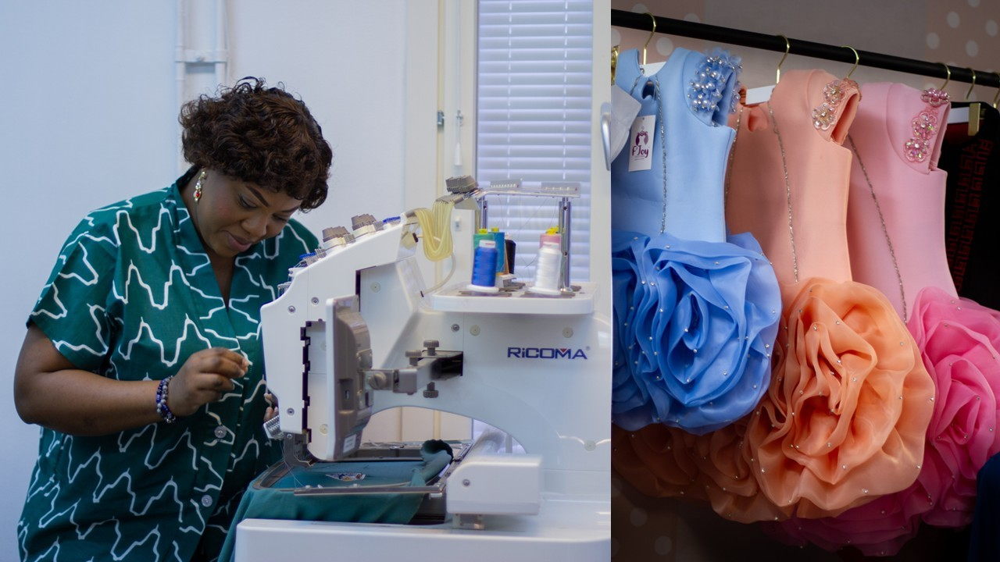
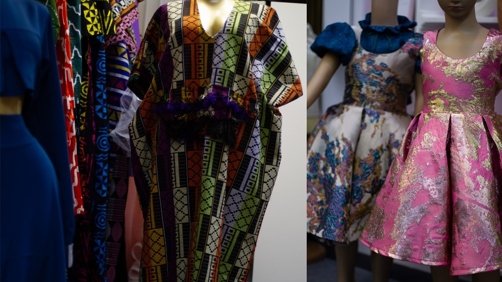
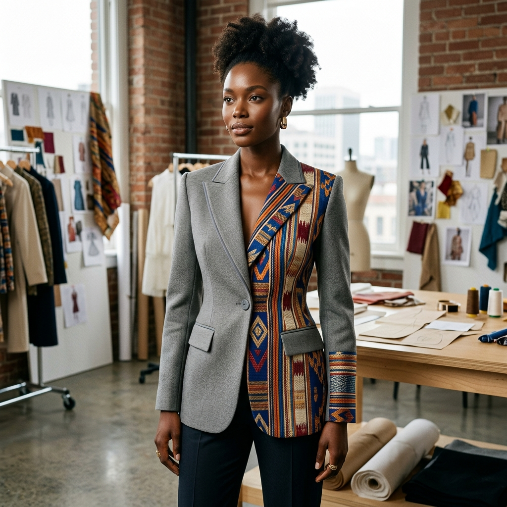
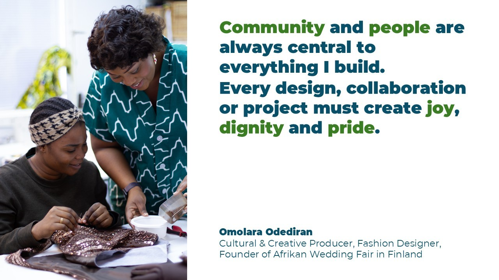
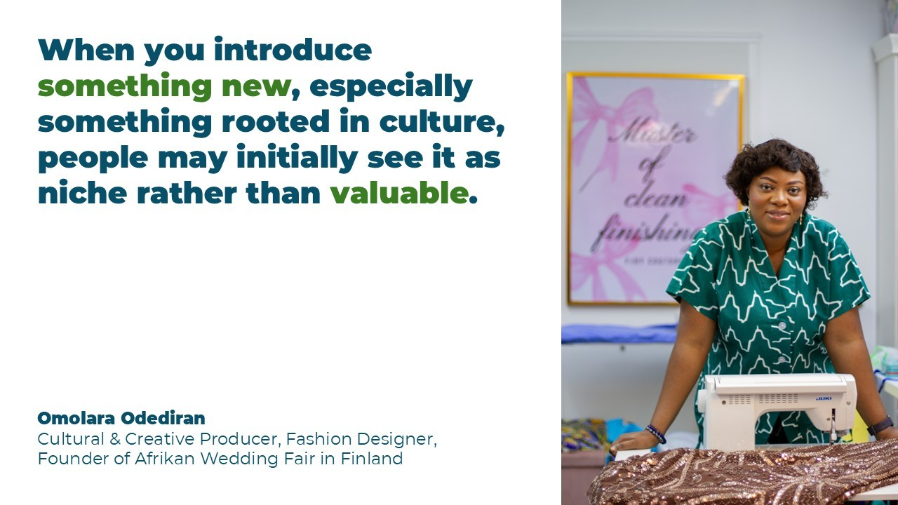
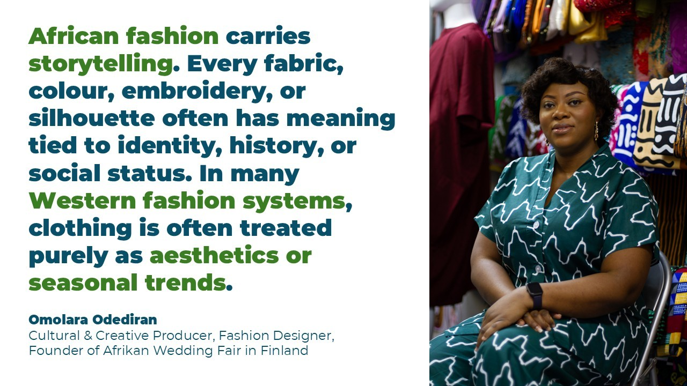
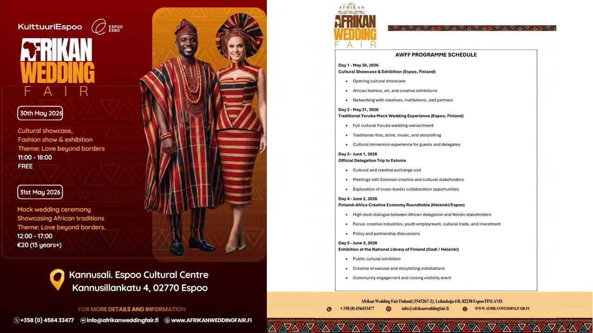

# From Silence to Spotlight: The Fashion Designer Who Turned Grief Into Power

**Author:** Olga Kryuchkova  
*Nordic Tech and Innovation Ecosystem Explorer | ICT Trainer | Certified AI Transformation Leader | MSc (Tech.) | Engineer*  
**Published on:** May 1, 2026

---

In the land of minimalist grey and functional black, **Omolara Odediran** is a vivid, necessary disruption.

But the founder of **F’Joy Couture** didn't come to Finland to be a fashion rebel. Armed with a degree in History from Nigeria and an MBA from Finland, she was a self-described introvert content with staying behind the scenes. Then, the unthinkable happened: the loss of her sister, Fayokemi.

What followed was a creative resurrection. From the "sacred" fabric traditions of Osun State to the high-stakes runways of Helsinki, Omolara has evolved into a formidable cultural diplomat. She isn't just selling clothes; she is dismantling the "niche" label, proving that African textiles can be soft, seasonal, and bridal—even in the dead of a Finnish winter.

In this interview, we sit down with the woman who uses fashion as a "cultural gathering point" to discuss the evolution of identity, the role of AI in heritage, and why her brand’s first heartbreak was the key to its global legacy.

---

## I. Origins & Background

**Olga:** Omolara, tell us about your background, education and how you appeared in the Finnish fashion scene.

**Omolara:** I am originally from Osun State in Nigeria, a place deeply rooted in culture, storytelling and tradition. I studied History as my 1st degree in Nigeria, and at first my life path was not necessarily fashion. Fashion was always around me though, through fabrics, celebrations, weddings, and the beauty of how Africans use clothing to communicate identity and pride.

When I moved to Finland in 2016 to study Business Administration, I noticed there was very little visibility of African fashion within the mainstream fashion ecosystem. What started as a personal creative outlet slowly became something bigger. I began designing pieces that reflected my heritage while also speaking to the European environment I was now living in. Over time, people became curious about the work and the cultural story behind it. That curiosity slowly opened doors and brought me into the Finnish fashion and creative scene.

**Olga:** Your name Omolara and your brand F’Joy are rooted in Yoruba culture. How do those roots inform how you approach business decisions today?

**Omolara:** In Yoruba culture, names carry purpose. *Omolara* means “a child is family,” which reminds me that community and people are always central to everything I build. *F’Joy* comes from my sister’s name, Fayokemi, which means “pamper me with joy.” That meaning has become a guiding philosophy for the brand. Every design, collaboration or project must create joy, dignity and pride. Those cultural roots make me approach business differently. For me, business is not only about profit. It is about legacy, responsibility, and honouring the people and stories that came before me.

**Olga:** You’ve transitioned from being an introverted business graduate to an outspoken creative leader — what triggered that evolution?

**Omolara:** Loss changed me. When my sister Fayokemi passed away, it forced me to confront my purpose very directly. I realized life is short and that the gifts we carry should not remain hidden. That moment pushed me to step out of my comfort zone. I am still naturally introverted, but purpose can make you brave. When you know that what you are building is bigger than you, your voice becomes necessary.

**Olga:** Growing up between cultures, what tradition or value do you intentionally keep alive today?

**Omolara:** Community. In many African cultures, success is collective. Celebrations, weddings, festivals — they are communal experiences. When I design or organize projects like the African Wedding Fair, I try to recreate that spirit of togetherness. Fashion is not only clothing. It is a cultural gathering point.

**Olga:** What early memory from Osun State influences how you run F’Joy Couture today?

**Omolara:** I remember watching how fabrics were treated almost like sacred objects during celebrations. Women would carefully select lace, Ankara, or Aso-Oke fabrics months before an event. Tailors were respected because they helped transform those fabrics into identity. That memory taught me that fashion can hold emotional and cultural value. At F’Joy Couture, we try to design pieces that people connect with emotionally, not just visually.

**Olga:** If you could invite three ancestral figures to dinner in Finland, who would they be?

**Omolara:** First, my sister, Fayokemi. She is the reason F’Joy exists, so having her at that table would feel like bringing the story full circle. I would ask her if she sees what this has become, and what she would do differently or boldly if she were building it with me today.

Second, my mother. She represents strength, sacrifice, and the quiet kind of leadership that holds a family together. I would ask her how she carried responsibility with grace, and how to build something that lasts without losing yourself in the process.

Third, I would invite someone grounded in faith who understands purpose beyond success. My journey is deeply guided by Faith, so I would ask about alignment: how to discern direction clearly while building something visible and impactful in the world.

And of course, Queen Moremi would still be welcome at that table. I would ask her about courage; the kind that requires sacrifice and how to stand firm in decisions that shape not just your life, but a whole community.

---

## II. The Beginning of F’Joy Couture

**Olga:** If Fayokemi were here today, what role would she play in the business?

**Omolara:** She would probably be the fearless one pushing us to dream bigger. Fayokemi was vibrant, bold, and full of ideas. I imagine she would have been involved in the creative direction and storytelling of the brand. She had a way of connecting with people that would have been powerful in building the community around F’Joy.

**Olga:** What was the first piece you designed that made you think F’Joy could become a legacy?

**Omolara:** The first time I created a piece using African fabric but structured in a more contemporary silhouette suitable for European environments. When people saw it, they were surprised. It challenged the assumption that African fabrics only belong to traditional settings. That moment made me realize there was space for something new.

**Olga:** Describe a design that challenged stereotypes about African fashion in Finland.

**Omolara:** One design that really challenged perception was an autumn-themed wedding dress I created. The bride wanted something that reflected the season; soft, earthy, romantic but I didn’t want to achieve that using only conventional Western fabrics. So I designed a custom wedding dress where I incorporated leaf-shaped patches cut from African prints, carefully placed across the gown to create that autumn feeling. 

From a distance, it looked like a classic seasonal bridal piece. But when you came closer, you began to see the layers—the texture, the colour story, and the fact that those “leaves” were actually African fabrics. That’s where the shift happened.

People were surprised. Because in many cases, African prints are expected to be bold, loud, or reserved for traditional ceremonies, not something delicate, soft, and bridal in a European sense. But this dress was both. It held the romance of an autumn wedding in Finland, while quietly carrying African identity within it. It showed that African textiles don’t have to be adapted to fit in—they can transform and elevate global design narratives.

For me, that piece was a statement: African fashion is not one-dimensional. It can be soft, seasonal, emotional, and deeply integrated into moments like weddings anywhere in the world.

**Olga:** What business belief have you reconsidered since starting F’Joy?

**Omolara:** At the beginning, I believed passion alone would open doors. Over time I learned that passion must be supported by strategy, partnerships, and institutional support. Creative businesses need structure to grow sustainably. 

**Olga:** If F’Joy Couture could speak as a person, what would its first heartbreak be?

**Omolara:** Probably realizing that cultural work is sometimes misunderstood. When you introduce something new, especially something rooted in culture, people may initially see it as niche rather than valuable. But that heartbreak also taught us patience and resilience.

---

## III. African Fashion & Nordic Markets

**Olga:** What cultural intelligence does African fashion bring to the Nordic creative sector?

**Omolara:** African fashion carries storytelling. Every fabric, colour, embroidery, or silhouette often has meaning tied to identity, history, or social status. In many Western fashion systems, clothing is often treated purely as aesthetics or seasonal trends. African fashion reminds us that clothing can also be narrative, heritage, and cultural documentation.

**Olga:** Can you, please, share an example where African-European fusion shifted perception?

**Omolara:** When people see structured Nordic-style tailoring made with Ankara or Aso-Oke, it often changes their perception immediately. They begin to see African fabrics not as “ethnic” but as premium textiles with global relevance.

**Olga:** What fashion taboo in Nordic fashion does African fashion help dismantle?

**Omolara:** Perhaps the idea that fashion must be minimal or restrained to be elegant. African fashion embraces colour, texture, symbolism, and celebration. It allows people to express identity more boldly.

**Olga:** If you created a Nordic-African fashion exchange program, what is the first rule?

**Omolara:** Mutual respect and curiosity. The goal would not be cultural appropriation but cultural dialogue, learning the meaning behind techniques, fabrics, and traditions.

**Olga:** How has the idea of heritage changed in your work as Finland becomes more multicultural?

**Omolara:** Heritage is no longer something fixed to geography. It is becoming something people carry and reinterpret across borders. My work reflects that evolving identity.

---

## IV. Technology & Fashion

**Olga:** If you could design an AI system for F’Joy Couture, what human quality should it emulate?

**Omolara:** Cultural memory. AI can process data, but fashion rooted in heritage requires understanding meaning. An AI system should be able to learn and respect the cultural significance behind fabrics, patterns, and symbols.

**Olga:** How are you exploring digital technologies in fashion?

**Omolara:** We are increasingly exploring digital patterning and documentation processes that make bespoke design more scalable. Digital storytelling and online platforms also allow African-inspired fashion to reach global audiences beyond physical borders.

**Olga:** What future material excites you most?

**Omolara:** Sustainable textiles that combine traditional craftsmanship with modern innovation—biodegradable fabrics or smart textiles that still allow cultural expression.

**Olga:** Can technology preserve design traditions?

**Omolara:** Yes. Digital archives could document embroidery patterns, symbolism, weaving techniques, and oral histories from different African communities. That way future designers can learn and build on them.

**Olga:** If F’Joy Couture had a digital world in the metaverse, what story would it tell?

**Omolara:** It would tell the story of African celebrations, weddings, festivals, music, colour, and joy. A digital cultural space where people could experience African heritage through fashion.

---

## V. Vision & Future and Call to Action

**Olga:** How do you want F’Joy Couture to be remembered in global fashion history?

**Omolara:** As a bridge. A bridge between Africa and the Nordics. Between heritage and innovation. Between storytelling and fashion entrepreneurship.

**Olga:** What collaboration could redefine your work?

**Omolara:** A collaboration between fashion, technology, and cultural institutions, where design, digital storytelling, and heritage preservation come together.

**Olga:** If a patron funded a global African-Nordic residency, what would your first project be?

**Omolara:** I would bring designers, textile artists, historians, and technologists together to explore how African and Nordic design philosophies can influence each other. The result could be a new design language.

**Olga:** What support is needed to realize the African-Nordic fashion vision?

**Omolara:** Cross-sector collaboration. Fashion cannot exist in isolation. We need support from cultural institutions, governments, technology companies, and educational institutions.

**Olga:** What partnerships are you most open to now? And how possible to know more about your projects?

**Omolara:** I’m drawn to partnerships that recognise fashion as more than aesthetics—as a powerful expression of culture, innovation, and economic opportunity. My work sits at the intersection of creative entrepreneurship, cultural diplomacy, and nurturing the next generation of designers shaping global narratives. 

If you’d like to experience this vision in motion, I warmly invite you to the **Afrikan Wedding Fair Finland (AWFF)**, happening here in Finland ([www.afrikanweddingfair.fi](http://www.afrikanweddingfair.fi)). AWFF is not just an event, it’s a curated celebration of African excellence. A space where fashion becomes storytelling, where heritage meets contemporary creativity, and where culture is presented with intention, pride, and global relevance. Expect a rich blend of runway showcases, music, art, and a beautifully immersive traditional Yoruba wedding experience, each element designed to honour identity while building bridges across cultures. It’s an opportunity to connect, to be inspired, and to witness how African creativity continues to shape conversations in fashion, business, and diplomacy. I would truly love to welcome you there.

