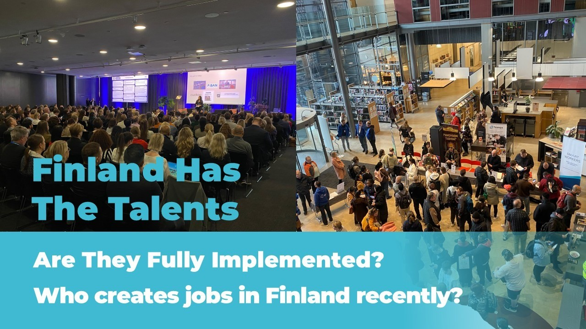
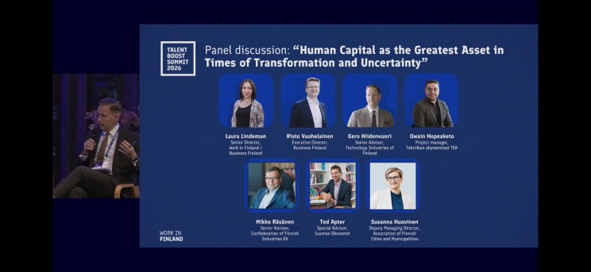
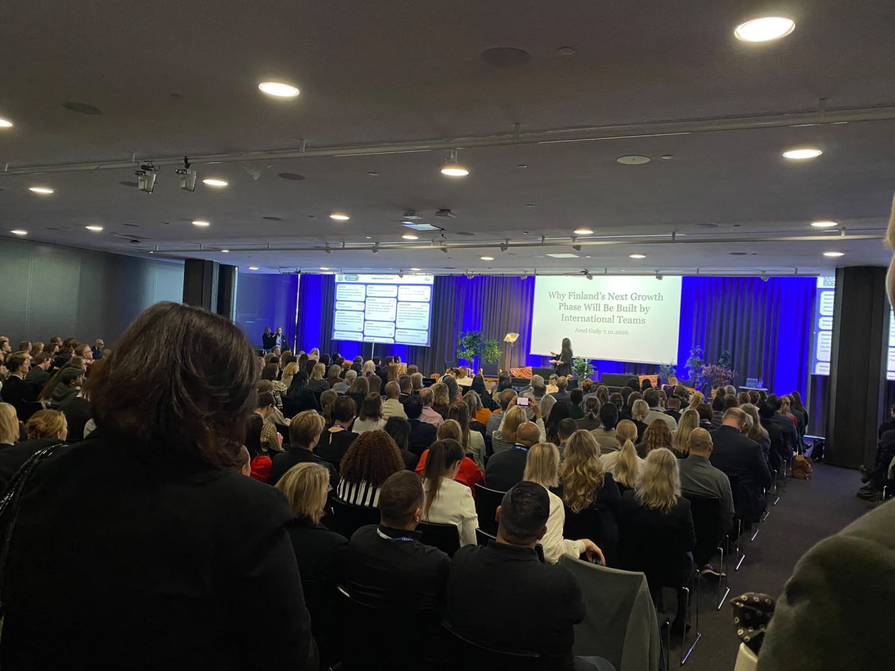
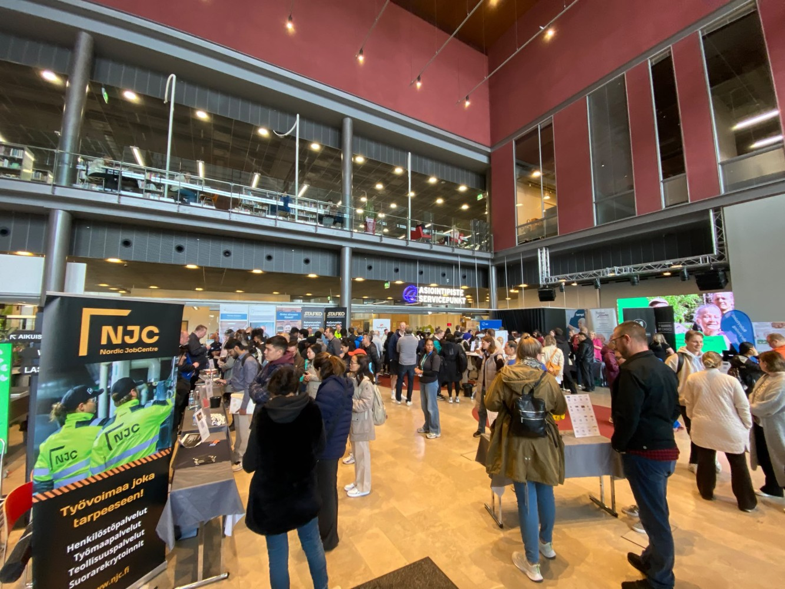
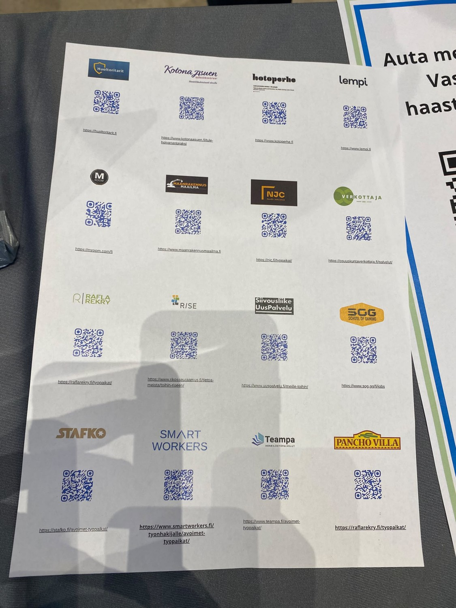
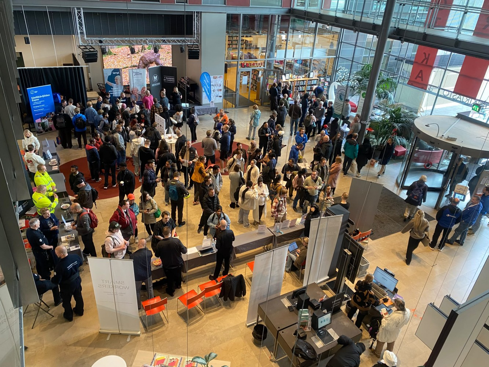
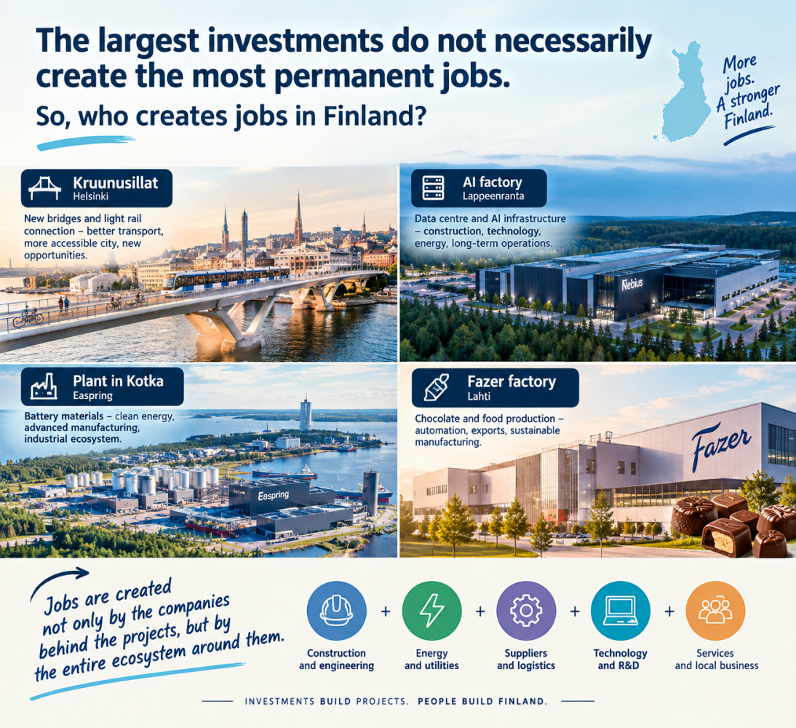
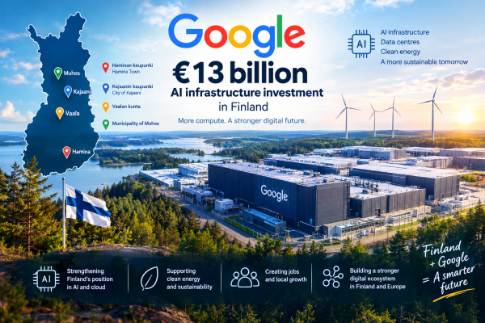
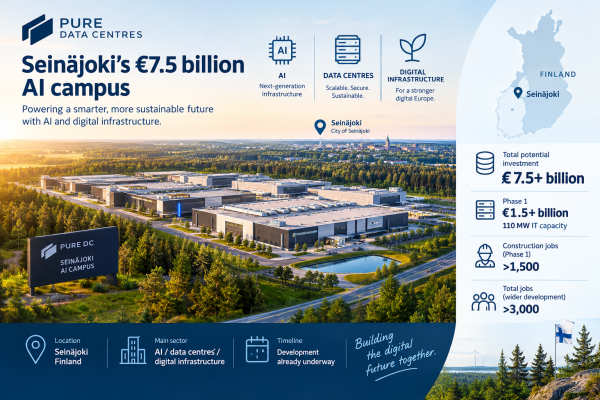
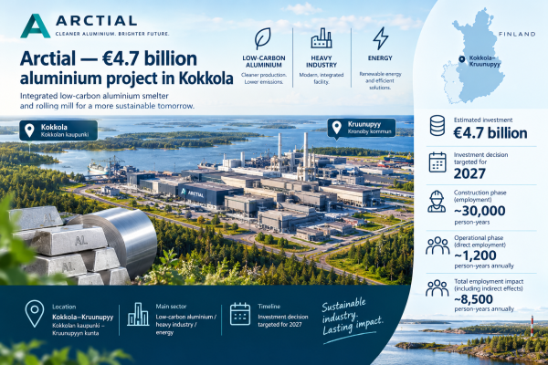

# Finland Has The Talents. Are They Fully Implemented? Who creates jobs in Finland recently?

**Author:** Olga Kryuchkova  
*Nordic Tech and Innovation Ecosystem Explorer | ICT Trainer | Certified AI Transformation Leader | MSc (Tech.) | Engineer*  
**Published on:** October 9, 2026

To begin with, let me say something very clearly: I love Finland and especially the Finns. Wonderful people live here. They embraced me, support my opportunities, and my experience of working and interacting with Finns has been overwhelmingly positive. I am genuinely grateful for that, and I of course always want to give something back. Perhaps, I have been lucky. Perhaps, my experience is more exception than rule. I know people in my own circle who are deeply frustrated with the Finnish employment situation, and I completely understand why.

That is exactly why I am writing this article. I love Finland and I want it to become an even better place for all inhabitants.

Not to complain. Not to declare Finland’s labour market “broken” from the comfort of LinkedIn. And certainly not to blame anyone. I want to look at what is actually happening: the labour market trends, the conversations taking place at events and gatherings, the solutions being proposed, and, most importantly, what are we actually doing about it?

This week alone, two events brought these questions particularly close to the surface, after a great deal of discussion about the state of the labour market and, crucially, about how Finland could make better use of the workforce it already has. Let me start with something positive.

The Talent Boost Summit organized by [Work in Finland](https://fi.linkedin.com/company/work-in-finland) in [Helsingin kaupunki – Helsingfors stad – City of Helsinki](https://fi.linkedin.com/company/city-of-helsinki) is undoubtedly doing valuable work. It helps push the Finnish labour market towards a more international mindset, and that shift is necessary. Finland needs to make better use of the talent already here while continuing to attract highly skilled people from abroad. There is little to argue about there.

And yet, I always leave these large, general-purpose discussions with a small feeling of unease. We talk about the problem. We name the problem. We agree that the problem exists. We acknowledge that the stories we hear are not simply a collection of isolated complaints from a few unhappy individuals. And then… we seem to go home.

The real issue, in my view, is more systemic: we still haven't developed sufficiently bold new mechanisms for organizing work, matching skills with actual needs, and allowing people to contribute at the level of their real capabilities, because future jobs do not exist yet and we need to invent together the new ways of work and collaboration.

And this has nothing to do with nationality. Finnish, Ukrainian, Indian, Estonian, Russian, American, it doesn't matter. We're all in the same boat. We must figure out how to row together. Like Norwegian fans supported their team in sport. What is our rowing motion that will unite us as society solving complicated situations together?

The Talent Boost Summit is positive and needed event, but me and many others would love to see more radical thinking. More experimentation. More uncomfortable questions. More concrete mechanisms, not simply more conversations about why the mechanisms are needed.

If Finland really wants to move the labour market forward, I see three practical shifts:

1. **Move from talent attraction to systematic talent utilisation:** create better mechanisms to match people with opportunities based on real skills, not just job titles, CV keywords or “Finnish experience”.
2. **Move from vacancy filling to job creation:** let companies and cities identify real problems and create paid short-term projects, fractional roles and pilots around them, turning unmet needs into new jobs.
3. **Make events such as Talent Boost Summit produce experiments, workshops, together-draft-strategy-formation, not only excellent conversations:** every major discussion could result in a few funded 90-day pilots with clear owners, participants and measurable outcomes.

In other words: we already know talent matters. Now we need to build the machinery that actually lets that talent create value, at least try to build the pilot together.

Because at the other end of the spectrum, very concrete job fairs are happening too.

This week, for example, I visited a recruitment event at Sello Library in [Espoon kaupunki - Esbo stad - City of Espoo](https://fi.linkedin.com/company/espoonkaupunki), where companies were looking for people in security, cleaning, elderly care, construction and various driving roles.

These are essential professions. There is absolutely nothing “less valuable” about this work, and it is important that cities such as Espoo openly recognize where the labor market actually needs people. But then I looked at the queues to the employers' tables — these queues told me another story.

There clearly weren't enough jobs for everyone. And, perhaps even more importantly, there was a significant mismatch between the skills people brought with them and the jobs available. One young woman standing in the queue for cleaning work told me she was applying because she couldn't find anything related to her actual background: she is a chemical engineer and a microbiologist specializing in disease research. And suddenly the whole discussion about “getting people into work” becomes much more complicated.

Because yes, technically, she can get a job. But is that really the goal and value for society?

It reminded me of a slightly absurd image: a worker trying to hammer a nail into a wall, and instead of picking up a hammer, he grabs an expensive scientific microscope. He can probably hit the nail with it. But something has gone seriously wrong in the way he is using his resources. And that is how the Finnish labor market sometimes looks to me.

We have educated people. Experienced people. International talent. People with highly specialized knowledge. People who are ready to work and contribute. And then we congratulate ourselves when they find a job, even if that job uses perhaps 10–20% of what they are actually capable of.

### Employment is not the same thing as contribution.

A person can be technically employed and still be economically underused. The real challenge should not simply be: **How do we get this person into a job?**

It should be:

> **How do we create mechanisms that allow this person to contribute at their highest level, uncover the potential and bring value to society?**

Because that is where the real economic value exists — for the individual, for companies, and ultimately for Finland. So perhaps the question we should be asking is not only how to attract more talent to Finland. Perhaps we should first ask: **What would happen if we became much better at using the talent already here?**

## Finland needs more jobs. But where will they come from?

Finland has a well-known problem: we need more economic growth, more investment and, ultimately, more jobs. The less familiar question is who is actually going to create them? Not necessarily the companies that are currently advertising the most vacancies or investments. A significant part of Finland’s next employment wave is building, literally, around data centres, energy infrastructure, industrial plants, batteries, food technology and major urban infrastructure.

Some of these projects are measured in hundreds of millions of euros. Others in billions. But there is an important catch: **€1 billion of investment does not equal €1 billion worth of jobs.** A data centre can generate thousands of construction and indirect jobs but relatively few permanent positions once the servers are switched on. A factory may employ fewer people during construction but create long-term industrial jobs. An infrastructure project can create substantial employment during construction while its longer-term economic effect comes from making an entire region more accessible.

So, instead of simply asking “How much money is being invested?”, isn't it wiser to ask: **What kind of work does the investment create and, more importantly, for how long?**

I looked at 10 major projects already under construction, moving towards construction, or scheduled to develop significantly around 2027. The result is a rather compelling picture of where Finland's labour demand is probably heading.

## 1. Google’s €13 billion AI infrastructure investment

- **Location:** [Haminan kaupunki - Hamina Town](https://fi.linkedin.com/company/hamina), [Kajaanin kaupunki - City of Kajaani](https://fi.linkedin.com/company/kajaaninkaupunki), [Vaalan kunta](https://fi.linkedin.com/company/vaalan-kunta) and [Municipality of Muhos](https://fi.linkedin.com/company/muhos)
- **Main sector:** AI infrastructure / data centres / energy
- **Timeline:** Major expansion during 2027–2028

[Google](https://www.linkedin.com/company/google) announced in September 2026 that it will invest €13 billion in Finland over the next two years in digital infrastructure, clean energy and local partnerships. The investment expands Google's existing Hamina data-centre operations and adds new facilities in Kajaani, Vaala and Muhos. According to Google, the construction phase in 2027–2028 will support more than 37,000 jobs nationwide and contribute approximately €3.6 billion annually to Finnish GDP during that phase. Google also says its Finnish data-centre ecosystem already involved more than 600 Finnish suppliers between 2023 and 2025.

The Finnish impact is therefore considerably broader than people sitting inside a data centre monitoring servers. The ecosystem includes construction, electrical and mechanical engineering, networking, security, catering, facilities management and other services. Google has also committed €31 million to local communities, including AI upskilling programmes for more than 4,400 workers and training opportunities for Finnish students.

### Financial side:
- **Investment:** €13 billion.
- This is primarily Google's corporate investment, complemented by partnerships in energy, education and local economic development.

### Why it matters for the labor market:
This is perhaps the clearest example of the new Finnish infrastructure economy. The employment impact has at least three layers:

1. Construction and engineering during the build-out;
2. Permanent technical and operational jobs;
3. A much larger supplier ecosystem around the infrastructure.

The important point is that the project does not simply need "IT people". It needs a quite broad workforce. And Google adds that AI infrastructure requires an AI-skilled workforce around it. That makes training, reskilling and technical education part of the infrastructure story itself.

## 2. Pure Data Centres Group, Seinäjoki’s €7.5 billion AI campus

- **Location:** [Seinäjoen kaupunki - City of Seinäjoki](https://fi.linkedin.com/company/city-of-seinajoki)
- **Main sector:** AI / data centres / digital infrastructure
- **Timeline:** Development already underway

Pure DC is developing what could become a 550+ MW AI campus in Seinäjoki. The total investment could exceed €7.5 billion when the campus is fully developed. The first phase alone represents more than €1.5 billion and will provide 110 MW of IT capacity. Pure DC estimates that the first phase will support more than 1,500 construction jobs, while the wider development could create more than 3,000 jobs.

### Financial side:
- **Potential total investment:** €7.5+ billion.
- **Phase 1:** €1.5+ billion.
- The scale makes this one of the largest foreign corporate investment projects ever developed in Finland.

### Why it matters for the labour market:
Seinäjoki demonstrates an important feature of the data-centre economy: The jobs don't stop at software engineering. They extend into:

- Construction;
- Electrical systems;
- Cooling;
- Energy;
- Automation;
- Networking;
- Security;
- Maintenance;
- Project management;
- Logistics;
- Facilities management.

And the employment effect spreads beyond the campus itself. This is the kind of project where one investment creates a local industrial ecosystem rather than one large employer.

## 3. Arctial — €4.7 billion aluminium project in Kokkola

- **Location:** Kokkola–Kruunupyy ([Kokkolan kaupunki - Karleby stad](https://fi.linkedin.com/company/kokkolan-kaupunki-karleby-stad) – [Kronoby kommun - Kruunupyyn kunta](https://fi.linkedin.com/company/kronoby-kommun-kruunupyyn-kunta))
- **Main sector:** Low-carbon aluminium / heavy industry / energy
- **Timeline:** Investment decision targeted for 2027

[Arctial](https://www.linkedin.com/company/arctial) is planning an integrated low-carbon primary aluminium smelter and rolling mill in the Kokkola–Kruunupyy region. The estimated investment is approximately €4.7 billion. And this project illustrates why employment statistics need to be handled carefully. According to an economic impact assessment by Ramboll, the construction phase could generate almost 30,000 person-years of employment. Once operational, the integrated facility is expected to directly employ around 1,200 person-years annually. Including indirect effects, the total employment impact could reach approximately 8,500 person-years per year.

### Financial side:
- **Estimated investment:** €4.7 billion.
- However, this is a planned investment, not €4.7 billion already spent. The final investment decision remains an important milestone.

### Why it matters for the labour market:
Arctial could become much more than an aluminium factory. It potentially creates an industrial cluster around:
**energy → metals → manufacturing → logistics → engineering → automation → renewable electricity.**

The project also illustrates a larger Finnish economic strategy: using abundant low-carbon electricity to attract energy-intensive industrial production. For the labour market, that means demand for both traditional industrial skills and newer combinations of:

- Automation;
- Energy systems;
- Digitalisation;
- Process engineering;
- Sustainability;
- Industrial data;
- Project management.

The question is therefore not simply *“How many people will Arctial employ?”*

It is: *How many companies will find a reason to locate themselves around Arctial?*

## 4. Nebius / Pajarila AI factory — Lappeenranta

- **Location:** [Lappeenrannan kaupunki - City of Lappeenranta](https://fi.linkedin.com/company/city-of-lappeenranta)
- **Main sector:** AI cloud / data centre
- **Timeline:** Construction started in 2026; first phase planned for 2027

[Nebius](https://nl.linkedin.com/company/nebius) is building one of Europe's largest AI-focused data centres in Pajarila, Lappeenranta. The project is described by the city as a multi-billion-euro investment, with planned capacity of approximately 310 MW. Construction started in spring 2026 and will continue in phases for several years. The first phase is expected to be completed during 2027.

### Financial side:
- **Investment:** Several billion euros.
- The project includes construction, technology, infrastructure and energy solutions.

### Why it matters for the labour market:
The construction phase is expected to create up to 700 skilled construction jobs, mainly in the Lappeenranta region. Once operational, the data centre is expected to employ more than 100 permanent workers, plus hundreds of indirect jobs related to operations and maintenance.

But there is another interesting layer. The city explicitly identifies opportunities for local companies in:

- Contracting;
- Logistics;
- Material deliveries;
- Support services.

[LUT University](https://fi.linkedin.com/school/lut-university/) and [LAB University of Applied Sciences](https://fi.linkedin.com/school/labfinland/) are also expected to interact with the project through research, energy efficiency, waste-heat utilization, electricity and heating networks, theses, internships and jobs. This makes Lappeenranta an intriguing example of a data centre becoming an education-and-innovation platform, rather than simply a large building full of computers.

## 5. Easpring — €800 million battery-material plant in Kotka

- **Location:** [Kotkan kaupunki – City of Kotka](https://fi.linkedin.com/company/kotkan-kaupunki)
- **Main sector:** Battery industry / advanced materials
- **Timeline:** Commercial production planned for 2027

[Easpring Finland New Materials Oy](https://fi.linkedin.com/company/easpring-finland-new-materials-oy) is building a plant producing cathode active material (CAM), an important component of lithium-ion batteries.

The first phase represents an investment of approximately €800 million.

The plant is expected to directly employ approximately 270 people once operating at first-stage capacity.

During the peak construction period, around 800 construction workers and equipment installers are expected on site. Commercial production is planned for 2027.

### Financial side:
- **Investment:** Approximately €800 million.
- Ownership is split between [Beijing Easpring Material Technology Co., Ltd.](https://cn.linkedin.com/company/beijing-easpring-material-technology-co-ltd-) (70%) and [Finnish Minerals Group Oy](https://fi.linkedin.com/company/finnish-minerals-group) (30%). The company has also applied for Finnish clean-transition investment support.

### Why it matters for the labour market:
The project is strategically important because Finland is trying to build a domestic battery value chain, not simply export raw materials. That creates opportunities across:
**materials → chemicals → manufacturing → automation → logistics → energy → recycling.**

The number 270 may look modest compared with Google's 37,000 supported jobs. But these are predominantly longer-term industrial jobs. This is the crucial distinction.

## 6. Fazer’s €400 million chocolate factory in Lahti

- **Location:** [Lahden kaupunki / City of Lahti](https://fi.linkedin.com/company/city-of-lahti)
- **Main sector:** Food manufacturing / automation / exports
- **Timeline:** Construction 2025–2028; production planned for 2028

[Fazer](https://fi.linkedin.com/company/fazer) is investing approximately €400 million in a new chocolate factory in Lahti. The factory combines automated production lines, electrification, energy recycling and new production technologies. The construction phase is expected to involve more than 500,000 working hours across hundreds of professionals.

### Financial side:
- **Investment:** Approximately €400 million.
- Fazer is financing the project through long-term debt financing and a green-finance framework. The project has also received support through Business Finland's clean-transition industrial investment programme.

### Why it matters for the labour market:
This is not simply a chocolate story — although Finland's relationship with chocolate is admittedly one of the more productive national stereotypes. The new factory is an example of advanced manufacturing. The relevant workforce includes:

- Automation specialists;
- Production engineers;
- Maintenance;
- Quality;
- Digital systems;
- Energy management;
- Logistics;
- Food technology;
- Management and operations.

The investment is also expected to strengthen Finnish food exports. And that matters because an export-oriented factory creates economic activity beyond the factory gates.

## 7. Kruunusillat — Helsinki’s €326 million urban infrastructure project

- **Location:** Helsinki
- **Main sector:** Transport infrastructure / urban development
- **Timeline:** Passenger traffic planned for early 2027

Kruunusillat connects Laajasalo, [Korkeasaaren eläintarha – Korkeasaari Zoo](https://fi.linkedin.com/company/korkeasaarizoo) and Kalasatama with Hakaniemi and central Helsinki through a new light-rail connection and major bridges. The project cost ceiling for the light rail and bridges is €326 million. Passenger traffic is expected to begin no later than early 2027, while pedestrians and cyclists already gained access to Kruunuvuorensilta in April 2026.

### Financial side:
- **Investment:** €326 million.
- The main contractors include [YIT - Urban developer and construction company](https://fi.linkedin.com/company/yit) Infra and [Kreate Oy](https://fi.linkedin.com/company/kreateoy).

### Why it matters for the labour market:
Kruunusillat is different from the industrial projects above. Its employment effect is not primarily about creating a new permanent employer. It is about creating economic capacity and infrastructure.

Better transport changes:

- Commuting;
- Housing development;
- Accessibility;
- Business locations;
- Construction activity;
- Connections between labour and employers.

In other words: **Infrastructure doesn't only create jobs. It changes where people can work.** This is particularly relevant in a metropolitan labour market where geography and commuting can become hidden barriers to employment.

## 8. Hitachi Energy — €180 million expansion in Vaasa

- **Location:** Vaasa
- **Main sector:** Electrical engineering / energy transition / manufacturing
- **Timeline:** Completion planned for 2027

[Hitachi Energy](https://ch.linkedin.com/company/hitachienergy) is investing €180 million in a new production and technology centre in Vaasa. The new facility will be approximately 40,000 m² and will double production capacity. Most importantly from a labour-market perspective, the project is expected to create 200 new jobs.

### Financial side:
- **Investment:** €180 million.

### Why it matters for the labour market:
The investment responds to a structural trend rather than a temporary fashion: electrification. More renewable energy, electric transport, industrial electrification and new energy-intensive industries mean more demand for electrical infrastructure. The facility will also include new testing and R&D capabilities. Hitachi is working with VTT and the [University of Vaasa](https://fi.linkedin.com/school/univaasa/) on green hydrogen-related technology development. This creates a particularly interesting employment combination:
**manufacturing + engineering + R&D + energy transition.**

For Finland, these are precisely the kinds of high-value industrial capabilities that can anchor regional economies.

## 9. Solar Foods — industrial-scale Solein protein production

- **Location:** Lappeenranta
- **Main sector:** Food technology / biotechnology / industrial fermentation
- **Timeline:** Development towards industrial-scale production

[Solar Foods](https://fi.linkedin.com/company/solarfoods) is developing an industrial-scale gas-fermentation facility in Lappeenranta for production of Solein, a novel protein. In June 2026, Business Finland granted Solar Foods almost €78 million, its largest single financing decision in the organisation's history. The project is expected to create up to 900 person-years of direct and indirect employment. Business Finland describes the project as having the potential to create hundreds of new jobs if successful.

### Financial side:
The project has a combination of:
- Company financing;
- Business Finland financing;
- EU-related funding mechanisms;
- Development financing.

The Business Finland package alone is nearly €78 million.

Importantly, Business Finland also points out that the project carries significant risks, including regulatory approval, commercialisation and market access.

### Why it matters for the labour market:
Solar Foods represents a completely different category: Finland is trying to create an industry that does not yet properly exist at scale.

That means jobs not only in production but in:

- Biotechnology;
- Food science;
- Engineering;
- Process development;
- Quality;
- Regulatory affairs;
- International sales;
- Product development;
- Commercialisation.

This is potentially a new industry creation project, rather than simply an expansion of an existing industry. And that distinction matters enormously for a small economy like Finland.

## 10. Delfort / Tervakoski — €150 million industrial investment

- **Location:** Tervakoski, Janakkala
- **Main sector:** Advanced materials / paper industry / electrical equipment supply chain
- **Timeline:** Testing of the new production line planned for August 2027

Austrian-owned [delfort](https://at.linkedin.com/company/delfortgroup-ag) is investing almost €150 million in the Tervakoski paper mill. The investment includes green-energy solutions and a new production line for pressed fibreboard used in electrical transformers. The new line is expected to create 20–30 new jobs, with test production planned for August 2027.

### Financial side:
- **Investment:** Approximately €150 million.

### Why it matters for the labour market:
At first glance, 20–30 jobs may look almost irrelevant compared with Google's 37,000. It isn't. The project demonstrates another important feature of Finland's industrial economy: small employment numbers can support strategically important supply chains. The product is connected to electrical transformers — exactly the kind of infrastructure whose demand is growing as electricity systems expand. This is therefore a good example of a specialised industrial niche with relatively high economic value per employee.

## What does the data tell us?

Looking at these ten projects together is more revealing than looking at any one of them. The headline numbers are impressive:

- **Google:** €13 billion
- **Pure DC:** €7.5+ billion potential
- **Arctial:** €4.7 billion
- **Nebius:** multi-billion
- **Easpring:** €800 million
- **Fazer:** €400 million
- **Kruunusillat:** €326 million
- **Hitachi Energy:** €180 million
- **Delfort:** ~€150 million
- **Solar Foods:** major industrial-scale investment supported by almost €78 million from Business Finland

But the more interesting story is what these investments are actually building. Are they building Finland's next economic infrastructure?

## Three observations from the data

### 1. Are Finland's next jobs increasingly created by infrastructure, not just traditional employers?

The first striking observation is that employment creation is moving away from the simple model:

> Company opens office → company hires people.

The emerging model is:

> Major investment → construction → suppliers → infrastructure → technology ecosystem → permanent operations → new companies.

Google's Finnish ecosystem already involved more than 600 suppliers before the latest expansion. Lappeenranta explicitly expects its Nebius project to generate opportunities for contractors, logistics companies, material suppliers and support services. So if we look only at the permanent employee count of the company behind a project, we massively underestimate the labour-market effect. The jobs are often one or two layers away from the project's logo.

### 2. Is AI destroying jobs or is it creating a surprisingly physical economy around AI?

There is a slightly amusing contradiction in the current AI conversation. We talk about AI as if the future is entirely digital. Meanwhile, Finland is preparing to pour billions of euros into concrete, electricity, cooling systems, transformers, fibre, construction, logistics and industrial infrastructure to make AI possible. Google, Pure DC and Nebius together demonstrate this very clearly.

AI needs:
**land + electricity + buildings + cooling + networks + engineers + maintenance + security + people.**

This means Finland's AI economy is simultaneously becoming a construction, energy and industrial economy. That creates opportunities for people who would never describe themselves as "AI specialists".

### 3. Maybe the real employment opportunity is in the ecosystem between projects?

This is probably the most important observation and question. A project such as Arctial can create 1,200 direct jobs but potentially 8,500 annual jobs when indirect employment is included. Nebius expects hundreds of indirect jobs around only 100+ permanent data-centre positions. That means the real employment map looks less like:

> Google → jobs

and more like:

> Google → construction → suppliers → energy → networking → security → maintenance → training → local services → new companies → more jobs.

The same logic applies to batteries, electrical engineering, food technology and industrial materials.

## So, where should we actually look for Finland's next jobs?

Not only at the career pages of Google, Hitachi, Fazer or Nebius. Look one level below them. Look for the companies that are ready for new engineers and specialists:

- Building the facilities;
- Designing electrical systems;
- Installing automation;
- Supplying cooling;
- Managing energy;
- Providing cybersecurity;
- Moving materials;
- Maintaining equipment;
- Training workers;
- Managing projects;
- Communicating with stakeholders;
- Integrating digital systems;
- Providing local services.

That is where a significant part of the employment impact is likely to materialise. And there is one final lesson here. The labour market created by these projects is not one labour market. It is several markets overlapping:

> **construction + engineering + energy + manufacturing + AI + logistics + project management + education + services.**

For Finland, that may be more important than the impressive billion-euro headlines themselves. Because the real economic question is not:

> *“How much money is Finland attracting?”*

It is:

> *“How successfully can Finland turn those investments into skills, companies, careers and long-term economic ecosystems?”*

That is where the actual jobs will be.
