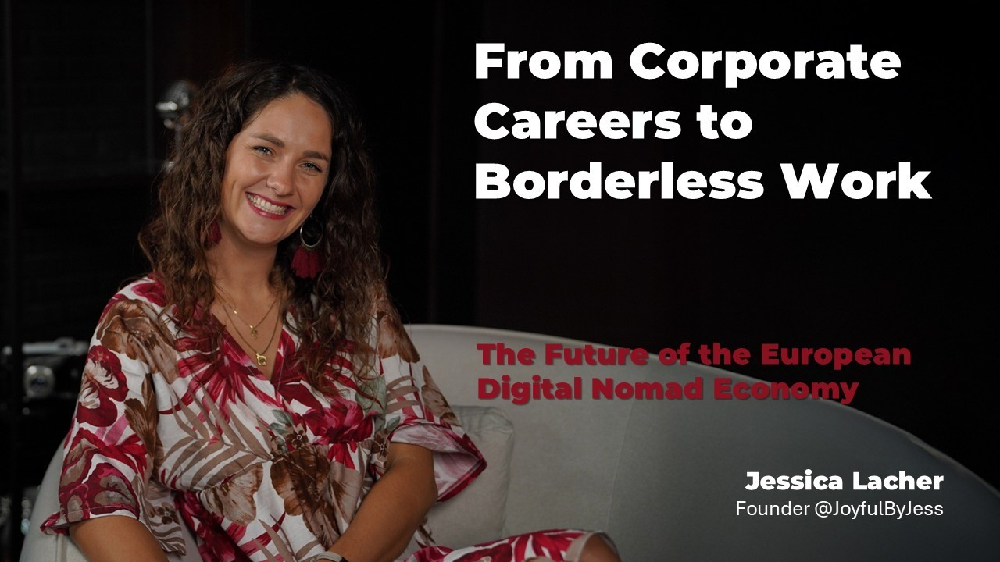
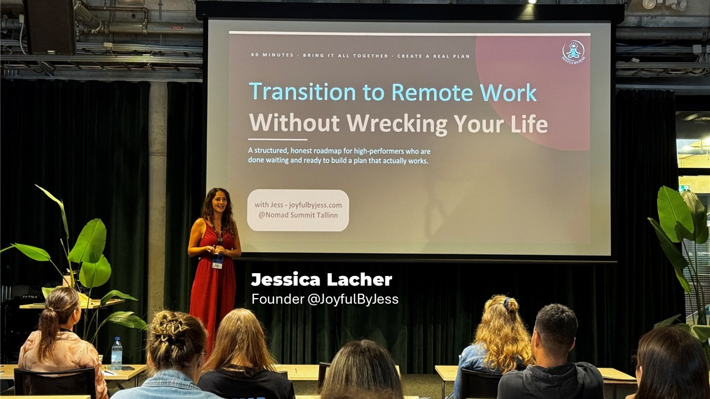
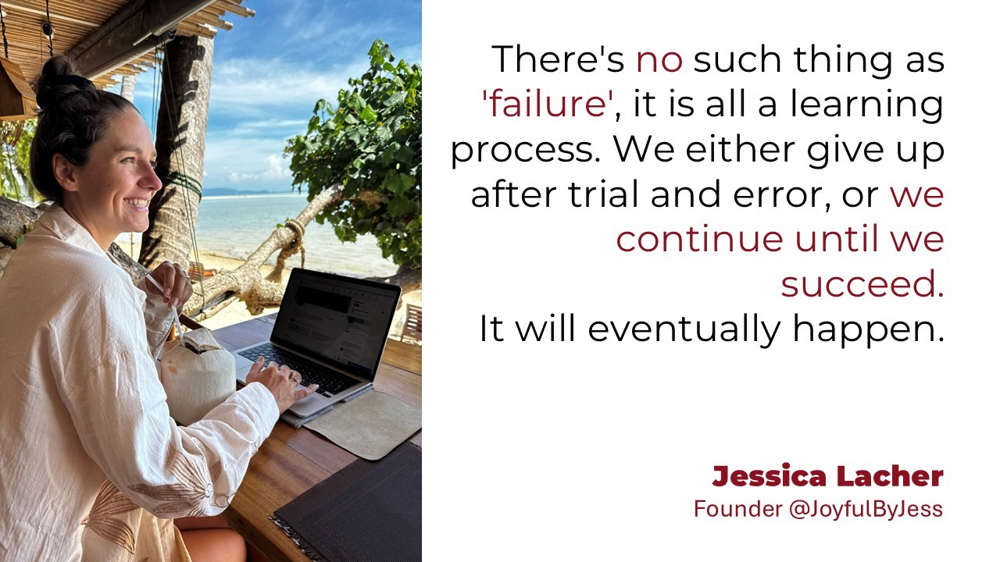
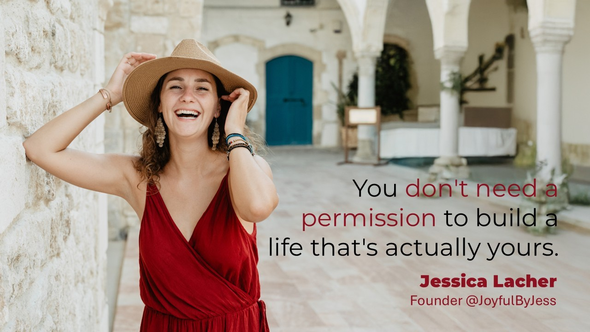
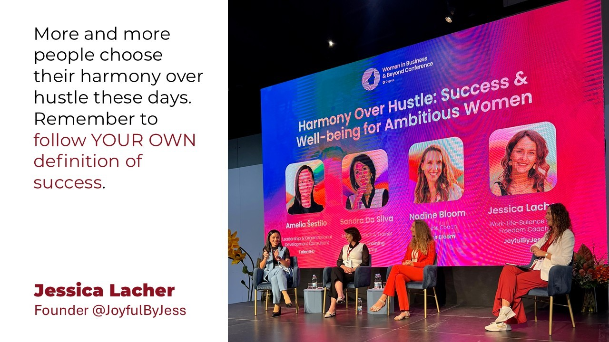
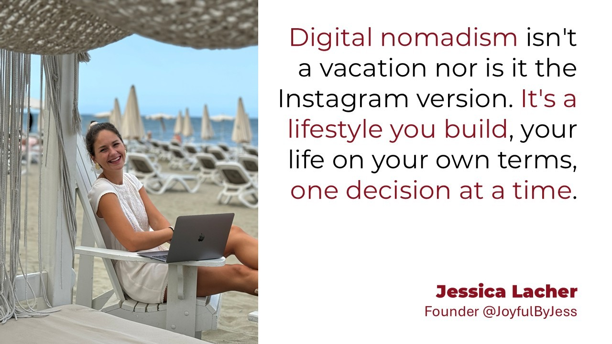
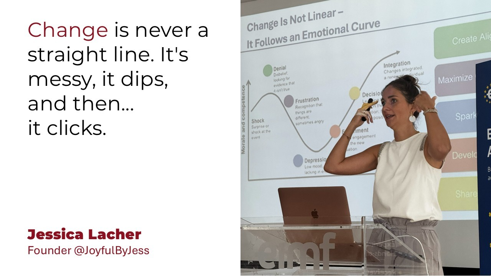

# From Corporate Careers to Borderless Work: The Future of the European Digital Nomad Economy 🌍💼

**Author:** Olga Kryuchkova  
*Nordic Tech and Innovation Ecosystem Explorer | ICT Trainer | Certified AI Transformation Leader | MSc (Tech.) | Engineer*  
**Published on:** August 27, 2026

---

For decades, success was measured by climbing the corporate ladder. Today, a new generation of professionals is sure: **the greatest career opportunity isn't a promotion, but the freedom to choose where and how you work.**

I chose to speak with **Jessica Lacher**, founder of JoyfulByJess and creator of the Nomad Transition Program, not only because of her work helping professionals build location-independent lives, but also because her story resonates with my own journey. I, too, moved from the corporate world of software integration and implementation through burnout and a one-way ticket, in my case, to Finland.

Embracing a new country, culture, people and technology forced me to develop practical skills that I now recognize as transferable professional capabilities. Today, I help others identify, articulate and transform those capabilities through my *From Portfolio to Collaboration* course. Jessica’s experience offers another perspective on the same fundamental question: how can we turn a major career transition into an opportunity to redesign not only where we work, but how we create value, collaborate and build a meaningful professional life to change the world for the better?

---

### I. Origins & Background

**Olga:** Many people dream about becoming digital nomads, yet very few actually leave and can work such life. Looking back, what invisible belief about work did you have to unlearn before your own transformation became possible?

**Jess:** I believe one of the core limiting beliefs was that you can only be successful in the corporate world, and that being self-employed is not for me. I had been thinking about becoming self-employed for quite a few years before that, but I never saw that there was an opportunity or that it was possible, because the hurdle looked so big. The fact that you need to do everything on your own while you're self-employed was such a big hurdle for me that I thought I could definitely not do it, and that there generally is no other way than climbing the corporate career ladder. And then, obviously, I also had the belief system that this is just what you do, and this is how I would have to do it as well, to fit into the system.

**Olga:** Tell us a bit about your transition a bit more: If someone met Corporate Jessica one week before she resigned, what assumptions would they make about your future that turned out to be completely wrong?

**Jess:** I'm not sure if it was exactly one week before I resigned, or whether it goes back a couple more weeks or a month. But they would have definitely considered me to be climbing the career ladder even further. I was very successful in my mid-20s. I had a small team that I was working with, and I was building automations and workflows. I was speaking on stages at big conferences in front of hundreds and hundreds of people. And there was absolutely no reason to believe that I would end this, because I had it all on paper. I was so successful on paper. I had a great salary. I had an amazing reputation, especially as a young female in a male-dominated IT world. Everyone knew my name, and everyone knew what a good job I was doing.

So if they had met me one week before I resigned, they would not have believed that anyone would be that “stupid” to drop any of this and leave it all behind. Because if you're looking at it through the lens of a normal-paced person in the system, then it probably is not the smartest decision to leave your six-figure job, where you have lots and lots of opportunities to become leader of a big department and even bigger teams internationally. They would have made the assumption that I was continuing to climb the career ladder, that I would become team lead, that I would become department lead, that I was going to have lots of responsibility leading people, getting even bigger projects done, and taking bigger steps and being successful in a corporate career.

**Olga:** People often think location independence begins with changing countries. Did your journey actually begin with changing geography, or changing identity?

**Jess:** It definitely is the latter, because changing locations itself does not change your mindset, and it doesn't really change your inner belief system either. I went through a major transformation, an inner transformation, before I had even sold everything and left my home country, because I first needed to figure out what it was that I truly wanted. Until then, I was following a clear path set out by society, by the system, about what I was supposed to do, what sounded good. But I never really listened to myself and what it was that I actually wanted.

So the inner transformation was such a massive step and really took the longest. Booking a flight or booking accommodation in a new country can be done within 30 minutes, but the transformation that was happening, the mindset shift, me becoming open to the fact that I could possibly become self-employed and that I could live as a freelancer, although that was a belief system I had held for a long time (that I couldn't) that is definitely the biggest part. And changing locations is peanuts compared to everything else.

**Olga:** After six years of living as a nomad, what part of your previous corporate life do you unexpectedly miss, and what part would you never be willing to reclaim?

**Jess:** Clearly the salary… that's an easy one. The salary and the security behind my previous corporate jobs is something I have not yet experienced in my self-employment and in my freelance business. The fact that money comes in even if you are sick, even when you are on holiday and taking time off… that is just a safety and security net that I don't have being self-employed and working as a freelancer. Because here it simply works in a way that if you are working for your customer, for your client, then you get paid, and if you're not, for whatever reason, no one else cares, you just don't get paid. So, unexpectedly, I am missing a safety net big time. I'm making enough money to survive, I have no problem with that. But it's that feeling in the back of your mind that once you're taking time off, again, for whatever reason, a family trip, or you're really just having another Bali belly and end up in hospital, your income stream just depends on whether you are available and whether you're working or not.

I would never be willing to accept the hidden expectations from society that you have to do things the way everyone else does again. I have worked for myself to find my OWN way of life, my OWN definition of success, and whatever it is that I enjoy doing. Of course, I always have a bigger interest in my clients, in the people I work with, and in the society I live in. It's definitely not an egocentric thought, but the fact that you just have to do things because they are expected by society, such as go to an office, work nine to five, or even nine to nine, doing 12- to 14-hour shifts just because it's expected.

I remember one job interview I had after I quit my first corporate job, where they told me it is absolutely normal and expected that you work your weekends, and then on Sunday morning you fly to your clients and stay with them the entire week, working until Friday late at night, at least 11 p.m., sometimes midnight, and you can have half of Saturday off, because the other half you need to prepare for the next week's client sessions. That is something I will never, ever go back into.

**Olga:** Imagine your nomad journey had failed within the first six months. What do you think would have been the real reason—not the obvious one?

**Jess:** The real reason would have probably been me giving up, because there's no such thing as “failure” in the first six months. If you're doing it the right way, you have a financial runway, which does not force you to quit that soon. The people I work with, I recommend having at least a six- to twelve-month runway, and within the first six months you can definitely make some sort of money. It may not be exactly what you would like to do, and it may not be exactly at the price you would love to sell your services for, but there is always a way to make money within the first six months.

So the reason it would not have worked out was because you realize the lifestyle is not for you. The constant movement, the constant change and adaptation, that is a very big thing that is unexpectedly hard for a lot of people, and still for me, after doing this for six years, constant change and constant newness is exhausting for the nervous system. And if you haven't experienced that before, that can clearly be overstimulating and can lead you to decide that this life is not for you.

---

### II. The Nomad Transition Program

**Olga:** Your program isn't really teaching people how to travel, it's teaching them how to redesign their relationship with work. What transformation are your clients actually buying?

**Jess:** They're buying freedom. They're buying freedom within themselves, and they're buying the belief in themselves that there is another way out there besides corporate. It's something I mentioned earlier, we're growing up in a world where everyone is just following the norms and following the system. You can be a doctor, or a lawyer, or a teacher, but there are certain expectations from the world that you have to be one of those. And following your dream life, which is out of the norm, is something we're not being taught. We're not taught to follow our dreams, we're not taught to follow our joy.

And within my program, that is what I focus on with my clients. We focus on what it is that they really enjoy doing, what they really want to be doing in the future, what they're really good at, and then create a mix out of these things to see how the money can also support the lifestyle they are dreaming of which obviously includes traveling, because when you want to become location independent, one of your major goals is to travel the world, see the world, and support yourself financially on your own.

So, they are buying freedom, they are buying the belief in themselves that there is more out there, and they are transitioning into location independence.

**Olga:** Many people spend years collecting online courses without changing their lives. What is the psychological obstacle your program is really designed to overcome?

**Jess:** That is the core reason I designed the Nomad Transition Program the way that it is, because there are so many people out there who read generic advice online — whether it's through Google, or they talk to AI, or they take online courses — but the core problem is that all of this advice is generic. It's not specific to YOUR situation, YOUR skill set, YOUR beliefs, YOUR dreams, and YOUR desires. And that's exactly the problem.

My Nomad Transition Program answers that with a unique approach of one-on-one support throughout the entire period. There are different coaching and mentoring calls, and we make sure that whatever you're choosing is really mapped to what makes you unique.

So the core distinction is that online courses and generic advice, random stories that don't match your life, that's not what I do. What I do differently in my Nomad Transition Program is that we work one-on-one on your specific situation. There's no such thing as generic advice, so you can be really sure that what we're working on, what you're creating for yourself, is actually a match for you, and not for someone else out there.

**Olga:** If you had only one hour with someone before they quit their corporate job forever, what uncomfortable truths would you insist they hear first?

**Jess:** That nomad life and location independence is not always easy, and that it is not (only) the Instagram version that's out there. I make sure that the people I work with know what they're getting themselves into. I share, from my perspective, the difficulties and the struggles, because they are real, but you just don't see them on Instagram.

If you follow different nomads or travelers, you see beautiful sunsets, beaches, mountains, great food, and fun times, but you often don't see the hard times. You don't see the exhaustion and the constant changes I mentioned before. You don't see the homesickness because you're missing your family. You don't see the struggles with work, and the constant doubt about whether you're actually good enough, because you no longer have a system telling you so. You don't have the salary coming in that you connect your worth to.

So if I only had one hour to talk to someone before they quit their job, I would make sure they see the whole picture, and I would question whether this is really the life they want. Then we would look into whether they are ready yet, and there are different points we can touch on when it comes to readiness. One of them, as I said, is the financial runway. But there's also having a clear vision, knowing what you're running towards. I support people quitting their jobs, IF that is exactly what they want to do, and if the life they're choosing is their dream but they need to know what they're getting themselves into, not only the pretty version on Instagram, but also the other side of the story.

**Olga:** What advice about becoming a digital nomad is repeated so often online that you believe it's actually harmful?

**Jess:** That's easy: “just do it.” A lot of people say things like “just do it, I did it so you can do it too,” and I think that's very harmful, because it tends to make people quit their job without a plan and figure it out along the way. It IS possible, I'm not saying it isn't possible or doable but advice like “just do it, you can do it too, you'll figure it out, you can just become a freelancer” is, in my opinion, not helpful. Because if you're just moving your current job to a more beautiful location, and you're still as stressed and still hate what you're doing as much as you did back home, then you've really just moved to a prettier place, you haven't changed your lifestyle, your belief system, or your approach to work. There's a lot more to it than just quitting your job and going, because it's an entire mindset and attitude change that comes with location independence, and it's not just the location change.

**Olga:** What moment inside your coaching process makes you realize, "This person is no longer asking for permission, they've become ready"?

**Jess:** When they start taking action. When they start taking action and are super hyped, and see the power that is within themselves. When the creativity kicks in and the brainstorming comes up with cool and fun ideas, and they're ready to make it work, that's the moment. And that happens by getting to know yourself, by being aware of what your strengths are and what your skills are.

---

### III. The Future of Work in Europe & Global Labor Mobility

**Olga:** Europe has historically valued stability, long-term employment, and social protection. Do you think we're witnessing the end of that psychological contract between employers and professionals?

**Jess:** No, I don't think we're facing the end of it, because that is something super valuable and also something I mentioned at the beginning, that parts of this are the biggest pain point for me personally when it comes to location-independent life, or self-employment and freelance life in general. There are a lot of people out there who value this safety net and social security, for many valid reasons. That security and stability is a priority for many people, so I don't believe that is going away. There will be people who choose other values over this — who choose their own freedom, their own independence, over security and stability — but I still believe there will always be more people out there who continue to enjoy that safety net and stability.

**Olga:** What emerging workforce trend do you believe governments are underestimating today that could reshape European labor markets within the next decade?

**Jess:** I still think remote work is something that is underestimated. A lot of people want remote work and want more flexibility, and just want to work on their own terms. There are many jobs that COULD allow that, you could work remotely and don't have to be online at the same time as your 20 other team members. So I believe this will grow even more, which will bring costs down for companies and employers, because they won't have to create a space where people come together every single day.

It gives people the chance to work on their own terms, in their preferred location, within their own time frame and their best energy, and they'll deliver the best results. There will still be people who absolutely love coming to an office, I have a few clients who say that's the core thing they struggle with when thinking about becoming self-employed, because they love being in the office and working with their colleagues. So it's also important to make sure teams come together every now and then, for retreats, workations, team meetings, and events. But I do believe remote work is growing, because it allows you to adjust work to your life, it integrates work into your life, rather than the other way around.

**Olga:** Do you think "remote work" or “nomad one” is simply a workplace benefit or is it becoming an entirely new economic model?

**Jess:** It's definitely a new economic model. Personally, I can't think of work without the allowance of remote work anymore. A corporate benefit for me is a gym pass, or a dress-what-you-want Friday, or a cool laptop or phone. But remote work is truly a new model, because companies need to set it up in a way that works for them, as well as for their employees. They need to make sure they're still available for their customers at all times, so there needs to be some sort of rotation. They need to make sure meetings can still happen (though meeting culture will most likely reduce a lot, because we have so many unnecessary meetings nowadays) and that time can be spent more efficiently on other things. It's definitely an economic shift, rather than just a benefit.

**Olga:** Which European countries are quietly becoming the most attractive ecosystems for location-independent professionals, and why?

**Jess:** I think there are a few countries that come out on top right now. There are big nomad hubs in **Portugal**, because it has a beautiful coastline and people choose it for the great weather more or less all year round. Then there's also **Malta** and **Cyprus**, both big nomad hubs, especially for tax reasons.

I’m also thinking about the south of **Spain**, Gibraltar, and especially **Tarifa**, that's a big nomad hub nowadays. Tarifa is a big kitesurfing location, still quite cheap to live in, and people come together for the same reasons: the same hobbies, whether that's kitesurfing or diving.

**Bulgaria** has a massive nomad hub in Bansko, for people who love the mountains. **Tallinn**, in Estonia, has a big nomad community as well. Really there are plenty of locations to choose from nowadays.

Besides location and lifestyle/community benefits, ecosystems often gain attraction because of certain tax benefits and company setups. Wherever you're setting up your company, you usually stay in the country for a certain amount of time per year as well. Either because it is required in order to run your business from there, or because you simply enjoy the country and the community.

**Olga:** If Europe wanted to become the world's leading destination for digital talent, what mindset would policymakers need to abandon first?

**Jess:** The “old white men's” mindset of *‘we've always been doing things like that, so why would we change right now.’* This is a very classic mindset I've seen in my corporate life for long enough, and it's something that just closes you off to newness. It's the opposite of agile behavior, of flexibility, of adaptability. And I feel like in Europe we have a lot of that, we're not very innovative in new ways of work and life, because we're too rigid, too stuck in our old beliefs, our old ways of working, and everything that comes with it.

**Olga:** Do you believe the future belongs more to companies hiring globally—or individuals building careers globally?

**Jess:** I do think we need both. There are a lot of companies hiring globally, although I do see the trend that these companies are hiring a lot into markets and countries with “cheaper” employees, a more cost-effective way of working, which isn't great for skilled European talent. And I do see that these skilled European people, who are being swapped out for people from lower-salary countries, are the ones building new things on their own.

---

### IV. Vision for Europe's Nomad Culture

**Olga:** If Europe fully embraced location-independent work, how would our cities, careers, and communities look different by 2035?

**Jess:** We can fully embrace location independence and remote work, but there will still be people who don't enjoy this kind of lifestyle. So I don't think our cities are going to change too much within the next eight to nine years, because people have different values, different dreams. Some like to grow their roots without exploring the world first, some just like stability, a safety net, their friends, their family, their local supermarket, their favorite restaurant and grocery store, and all of these things.

I personally don't think everything is going to change massively and drastically, because everyone wants different things. Even among people who go remote and become location independent, there will most likely be a point in their life where other things become a priority, and they'll settle down again. So I honestly don't think it will change too much.

It could lead to more happiness, though, because people will generally be happier having the opportunity to follow something they really enjoy, without worrying that they don't have a place in society anymore, if location independence becomes more accepted. There would probably be more communal spaces where people come together, and it would be more accepted that people are working remotely. That can look like cafes having setups for people who want to work there, wider availability of high-speed internet around cities but also in rural areas. There would be more community-focused events for people who don't yet know each other, because they're traveling, so they can connect over these events and meet like-minded people.

I could see there being a lot more options for remote workers such as co-working spaces, quiet hubs and there should be availability for families too, so parents can work while someone takes care of and educates their children, without having to find a new school in every city they go to. These are things I would love to see. Am I confident this will happen in Europe in the next ten years? Not so much.

**Olga:** What role should governments, universities, and employers play in preparing professionals for this increasingly mobile future?

**Jess:** Acceptance, and supporting people in figuring out what actually works for THEM and what they want to do in/with their life. Especially when it comes to learning and educational institutions, I feel it's super important that people learn how to get to know THEMSELVES better, not learn about the life of another poet from the 16th century. But rather how to understand their own patterns, their own dreams, and their own desires. Because that's the core thing you need, whether you go location-independent and remote or not, you need to know what you need right now, what you want, what makes you thrive, when you need a pause, when your energy is at its lowest, and all these things. So it's really about getting to know yourself better and understanding your own patterns, a lot more psychological content and influence.

Also communication, because the way we communicate changes a lot once we go location-independent and often global or international. So language skills and communicating across cultures are also very important, and I wish that was on more curriculums.

And then governments are responsible for making sure everyone has the same opportunities, so that someone who goes abroad for a period of time still has a chance to come back without any disadvantages, and can get back into the system and also for supporting other people from around the world coming into your country by making your country more attractive for international talent.

**Olga:** What kinds of collaborations are you currently looking for to expand the impact of Joyful by Jess across Europe?

**Jess:** I'm looking to spread the word about location independence, about following your joy and the meaning of freedom and success. Overall about building life on YOUR terms. JoyfulByJess was born from my own intention to follow my joy and help others find theirs, and location independence is where I've chosen to focus, because it's the space that brings me the most joy and where I have the most to give.

Concretely, I'm open to:

*   **Workshops and webinars** on self-leadership, personal development, and mindset shifts
*   **University and educational partnerships** — I'm already working with several institutions on these exact topics
*   **1:1 sessions** for people who want individual guidance rather than generic advice
*   **Podcast features**, where I can share new perspectives and help people understand themselves better, so they can decide with clarity whether digital nomadism or location independence is right for them

At the core, it's all about reaching more people so they can follow their dreams, their passion, and their values… on their own terms!!

**Olga:** If someone watching this interview feels they're living someone else's version of success, what would you encourage them to do first?

**Jess:** Don't blame yourself. You're not alone, and there are many, many more people out there. But it's beautiful that you've come to that realization for yourself in this moment. And now the next thing is to take action, and not get lost in a hundred online courses and five hundred Google tabs.

Reach out to someone who has already been living this lifestyle, who is where you want to be. Have a conversation, see how it really is. Get the upsides but also the downsides, and tune into whether it's for you or not.

Look at what your priorities are, to see whether this lifestyle is for you. And then make sure you create a plan, with clear action steps to move forward, so that the version of yourself you've now discovered doesn't just stay a dream, but becomes reality. Take action by having conversations, putting yourself in the shoes of that desired future self, and weighing the pros and cons, the advantages and difficulties that come with it. And then create a plan.

You don't need to do this alone, you can always reach out!!

**Olga:** Finally, for professionals who sense they're ready for a different way of working, but don't yet know how to begin, what invitation would you extend through the Nomad Transition Program? Where can people connect with you, learn more about Joyful by Jess, and take their first step toward building a location-independent career?

**Jess:** My invitation is simple: reach out. Together we can figure out exactly where to begin for you. The Nomad Transition Program covers it all, because it's built around you rather than around a generic checklist. We work through it module by module:

*   **Mindset:** unlearning the beliefs that keep you stuck
*   **Vision:** getting clear on what your version of location independence actually looks like
*   **Finances:** building the runway and stability to make the move
*   **Skills:** turning what you already know into something sellable, remotely
*   **Travel & community:** the practical and social side of actually living this life

If you don't yet know how to begin, save yourself the time and energy of scrolling through a hundred generic tabs, reach out instead, and let's build your individual path.

The program itself comes with unique coaching and mentoring, and support throughout your journey, customized to your specific needs, dreams, desires, and skill set. I don't do generic advice, because we always start from your individual situation. There are video modules too, with workbooks and worksheets, but the core of it is one-on-one, personally tailored support.

---

### Connect with Jessica Lacher & Joyful by Jess:

*   **LinkedIn:** [Jessica Lacher](https://www.linkedin.com/in/jessica-lacher/)
*   **Instagram:** [@joyfulbyjess](https://www.instagram.com/joyfulbyjess/)
*   **Website:** [www.joyfulbyjess.com](https://www.joyfulbyjess.com)
*   **Weekly Dose of Joy:** Email newsletter with core learnings and insights every Monday

*And if you're ready to take your first step toward a location-independent career, reach out to set up a Nomad Assessment Call to look at where you're at and whether digital nomadism makes sense for you.*
