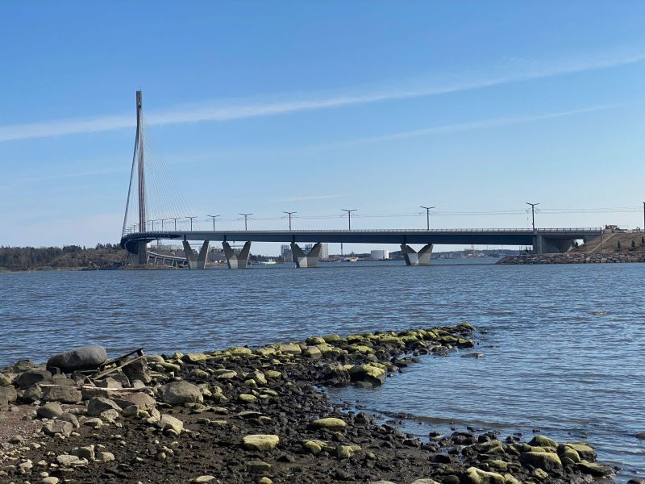

# Helsinki, it’s time to claim your crown! 👑

**Author:** Olga Kryuchkova  
*Nordic Tech and Innovation Ecosystem Explorer | ICT Trainer | Certified AI Transformation Leader | MSc (Tech.) | Engineer*  
**Published on:** April 15, 2026

---

Forget the treadmill; Saturday is for walking on water. 🌊

This Saturday, April 18th, Mayor Daniel Sazonov is cutting the ribbon on the **Kruunuvuorensilta**, officially making us the owners of the longest bridge in Finland. 🇫🇮

At 1,191 meters long, it’s basically a marathon for your Sunday stroll, but with much better views of the archipelago. 

The best part? **No cars.** Just you, your bike, same-minded people, and hopefully a very shiny crown. 🌉

### The Plan:
*   📍 **2 PM**: Walkers start at the Korkeasaari end (Ribbon cutting by the Mayor!). 🎀
*   📍 **5 PM**: The Bike Parade kicks off. ✨

*#Helsinki #Kruunuvuorensilta #Kruunusillat #VisitHelsinki #UrbanPlanning #CyclingLife*
