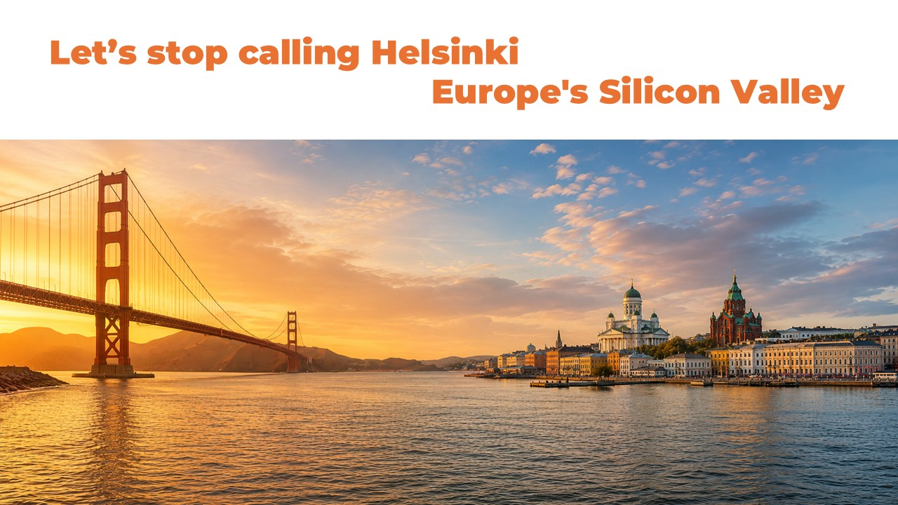

# Let's stop calling Helsinki "Europe's Silicon Valley" 🇫🇮💡

**Author:** Olga Kryuchkova  
*Nordic Tech and Innovation Ecosystem Explorer | ICT Trainer | Certified AI Transformation Leader | MSc (Tech.) | Engineer*  
**Published on:** July 13, 2026

---

Let's stop calling Helsinki "Europe's Silicon Valley."

That comparison is too narrow.

The real question is this: What if Helsinki represents the next evolution step beyond Silicon Valley?

Not because Helsinki is bigger. — It isn't.  
Not because it has more unicorns. — It doesn't. Yet. 😉  
Not because venture capital has to move north. It has only just started.  

But because we are asking the wrong question.

For twenty years, cities around the world have tried to become "the next Silicon Valley." Most failed. 

Richard Florida explained why. In his book *"The Rise of the Creative Class"*, he argued that great innovation ecosystems are not built by chasing companies. They are built by attracting people. Creative people. People who build things that did not exist yesterday.

He wrote: *"Companies follow talent rather than talent following companies."*

Let's look at Helsinki through that lens.

### Technology?
Aalto University. VTT. Maria 01. Slush. ARCTIC15 2027 — The Growth Edition ↗️ Deep-tech. AI. Gaming. Quantum. Clean tech. And so many more.

### Talent?
World-class education. Researchers (According to Statistics Finland, approximately 2,200 doctoral (PhD) degrees were awarded by Finnish universities in 2025). Engineers. Designers. Entrepreneurs. International founders who are targeting to stay in Finland.

### Tolerance?
Trust. Low hierarchy. Collaboration. Safety. Equality. There are some rough spots, of course, as everywhere. But overall, Finland has a society where ideas matter more than titles.

Florida called these the **Three Ts: Technology. Talent. Tolerance.** Miss one, and the system weakens. Helsinki has all three, and all three are strong and solid.

---

There is another number worth thinking about: A metropolitan area of only 1.6 million people produces around **40% of Finland's startups** and roughly **70% of the country's ICT business turnover**.

That is concentration. That is density. That is the signal of a powerful ecosystem.

Silicon Valley changed the world because brilliant people kept meeting other brilliant people. I see that happening in Helsinki — **NOW**. Walk into the universities. Visit startup hubs. Go to coffee shops during Slush week and around the year. You will see founders talking to researchers. Students talking to investors. Corporations talking to startups. Ideas moving faster than organizations.

Florida wrote: *"Human creativity is the ultimate economic resource."* Not oil. Not land. Not factories. They are just the parts. But People.

Maybe that is the lesson.

I believe that the future will not belong to the biggest cities; it will belong to the cities where talented people want to build together.

Yes, Helsinki is not the next Silicon Valley. Helsinki **IS** my Silicon Valley. Because Silicon Valley was simply the prototype for Helsinki.

---

**Tags:** #FinnishEcosystem #innovation #people  
**Special thanks to:** David Caceres Del Castillo, Risto Rautakorpi, Aape Pohjavirta, Peter Vesterbacka, Ilkka Paananen, Miki Kuusi, Timo Ahopelto, Tomi Pyyhtiä, and many others.
