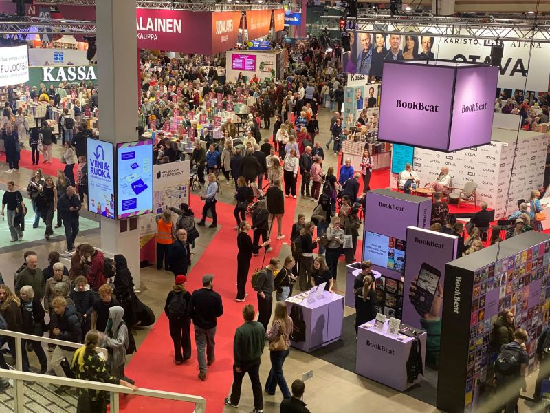

# Helsinki’s Intellectual Happy Hour: Four Days of Books, Wine & Delicious Ideas 📚🍷

**Author:** Olga Kryuchkova  
*Nordic Tech and Innovation Ecosystem Explorer | ICT Trainer | Certified AI Transformation Leader | MSc (Tech.) | Engineer*  
**Published on:** October 27, 2026

Last week, Helsinki offered a rather elegant solution to one of life’s perennial dilemmas: should we nourish the mind or indulge the senses?

From 22–25 October, Messukeskus (Helsinki Expo and Convention Centre) hosted both the **Helsinki Book Fair (Helsingin Kirjamessut)** and **Wine & Food 2026 (Viini & Ruoka)** — four vibrant days of literature, debates, culinary discoveries, and plenty of excellent excuses to linger just a little longer.

One ticket, two complete exhibitions. Finland clearly believes in a balanced diet: intellectual stimulation followed immediately by something delicious.

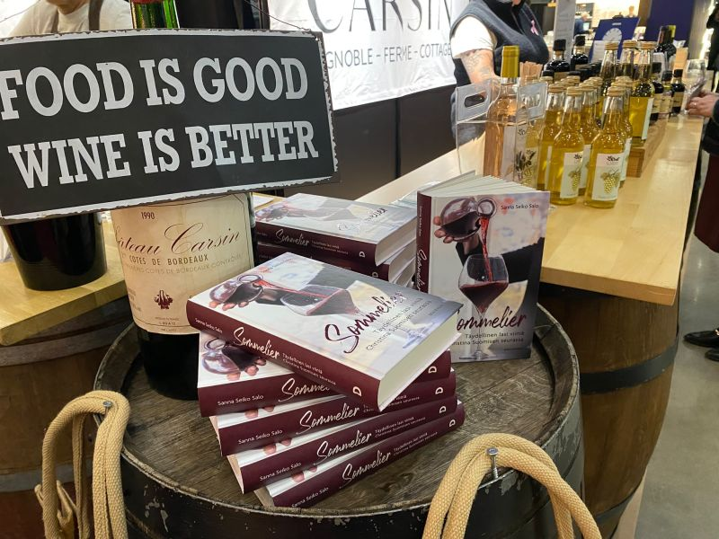

### Five Finnish Literary Voices to Explore

The Helsinki Book Fair remains the undisputed cultural anchor of the Finnish autumn, bringing together authors, publishers, scholars, and curious readers. Walking through the crowded aisles, you could feel the country’s deep, enduring reverence for the printed word.

Here is my editorial selection from the fair’s literary programme:

1. **Sirpa Kähkönen — *Marius***  
   A master of narrative memory, Kähkönen explores the private, quiet lives tucked beneath the overwhelming weight of political turmoil and historic upheavals.
2. **A. W. Yrjänä — *Alkemisti***  
   Known as the poet-philosopher and legendary frontman of CMX, Yrjänä delivers an exploration of philosophy, esotericism, and bold literary experimentation.
3. **Riikka Pulkkinen — *Pienet joutsenet***  
   A finely tuned work of psychological fiction examining human vulnerability, intimacy, and the shifting boundaries of identity.
4. **Severi Hämäri — *12 filosofia – Muinaisten filosofien suuria oivalluksia***  
   Ancient philosophy made urgent and applicable, exploring classical ideas that continue to govern modern ethics, logic, and decision-making.
5. **Satu Taskinen — *Rakastan vierasta***  
   A poignant exploration of otherness, migration, language, and the delicate threads that connect strangers.

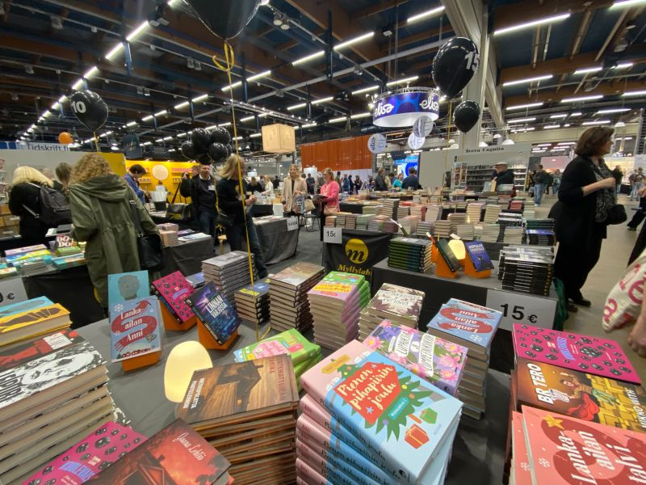

### Finnish and International Gastronomy Worth Discovering

Crossing from the book halls directly into the Wine & Food exhibition, the hum of philosophical debate seamlessly gave way to clinking glasses, sizzling pans, and rich aromas of roasted beans, aged cheeses, and simmering glögi.

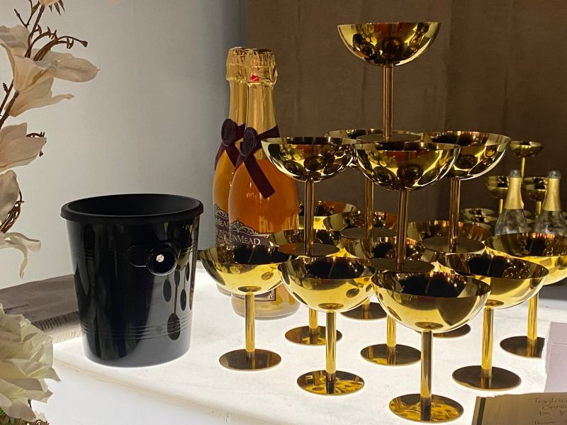

Here are my top Finnish and international food and drink producers worth discovering:

- **Meggala Viinitila:** Proving that Northern viticulture has its own distinct magic, Meggala crafts nuanced berry wines inspired by the pristine forests and marshes of Finland.
- **Heilukankaan Tyrni:** Pure sea buckthorn juices, warming spiced glögi, rich artisan jams, and vitamin-packed berry powders. Their handcrafted gift box rightfully took first place in Finland’s national food-gift competition in 2024.
- **Billnäs Chocolate Factory:** Hailing from one of Finland’s oldest ironworks villages, their artisanal bean-to-bar chocolates combine heritage craftsmanship with surprising flavor pairings.
- **Chef du Chocolat & Kanelimamma:** Master confectioners creating handcrafted chocolate slabs sprinkled with berries, fruits, and playful edible designs.
- **Porlammin Meijeri:** A venerable Finnish dairy crafting classic aged Emmentals alongside modern plant-based innovations.
- **Teerenpeli Distillery:** International award-winning single malt whiskies from Lahti — from the gently peated *Savu* to sherry-matured *Soidin* and *Kulo*.

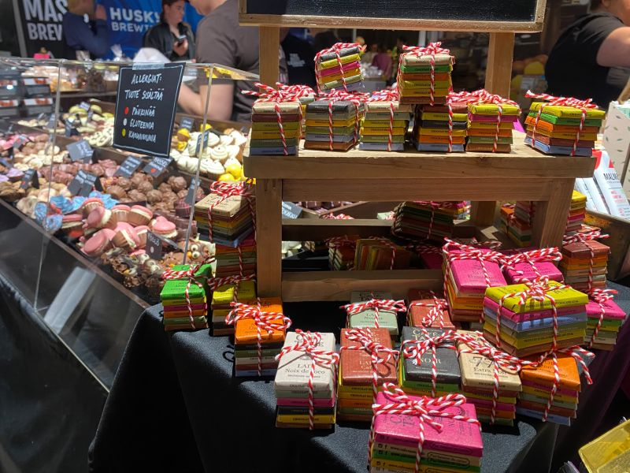

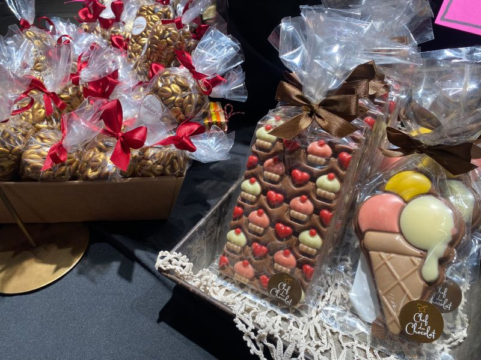

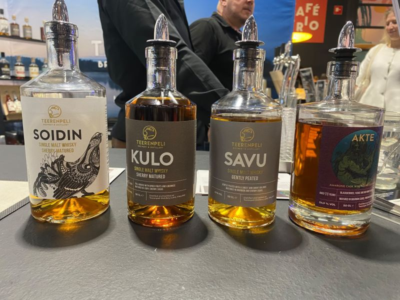

### Flavors from the South: Mediterranean Pairings

Beyond Nordic terroir, the exhibition featured a rich European tapestry: from Portugal's classic port wines and Madeira liqueurs to Catalan cured meats and Italian aged cheeses.

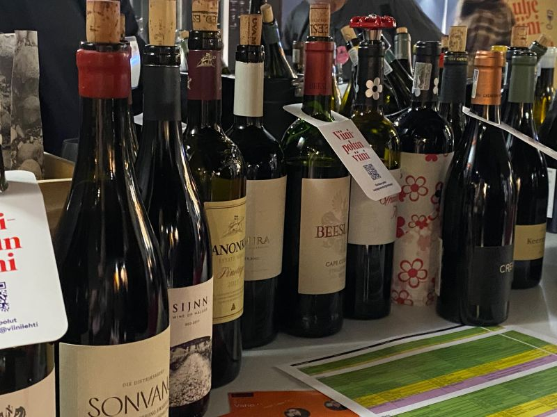

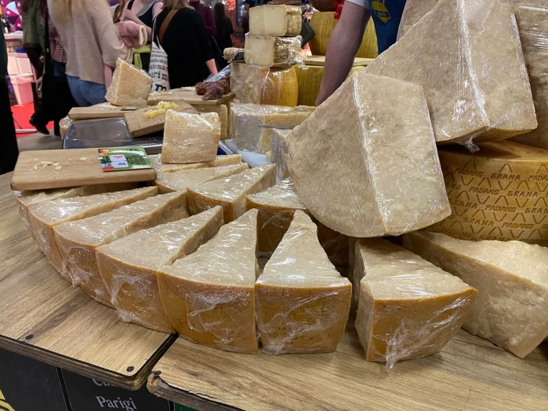

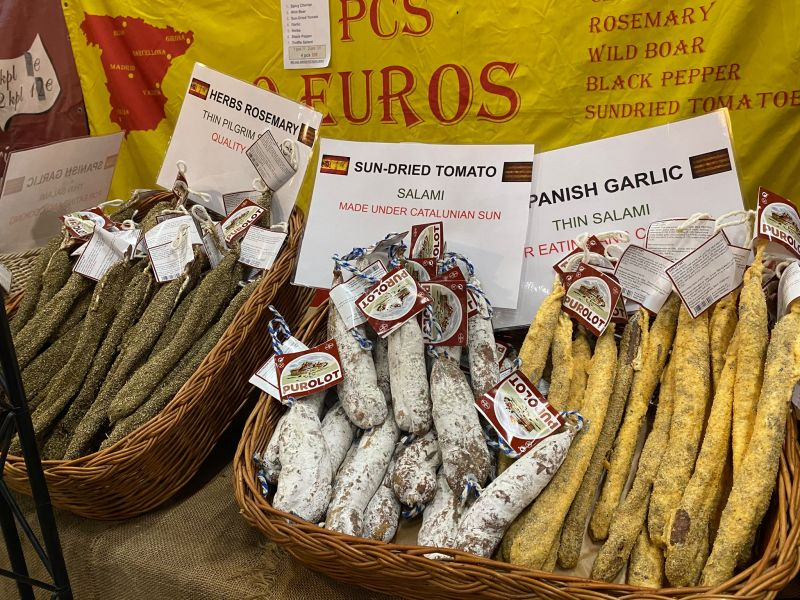

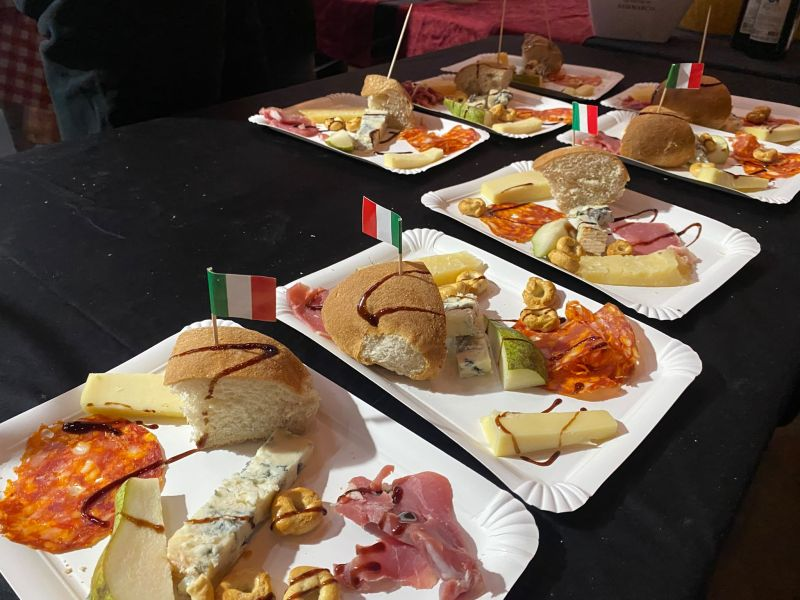

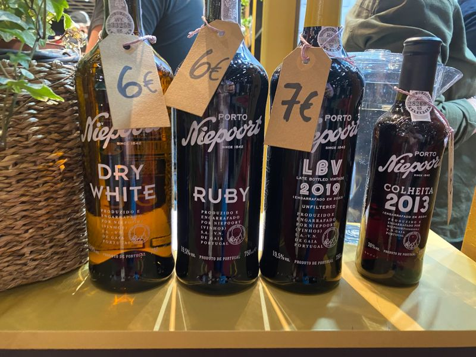

### Culture in All Its Forms

Culture doesn't live exclusively in libraries and galleries. Sometimes it comes bound in a book, sometimes in a bottle, and occasionally wrapped in handcrafted chocolate.

Helsinki served all three with warmth, generosity, and effortless Nordic charm. And really, who says pleasures for the mind cannot be delicious? 🇫🇮✨

*#Helsinki #FinnishLiterature #WineAndFood #FinnishFood #NordicCulture #Messukeskus #Kirjamessut*
