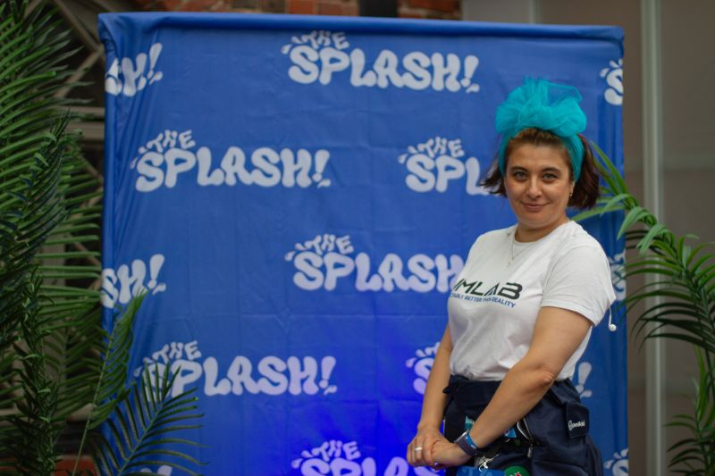
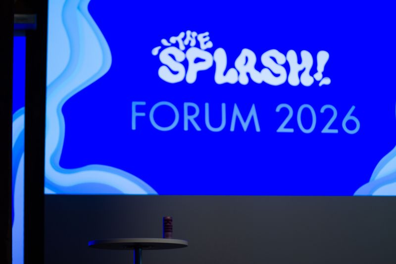
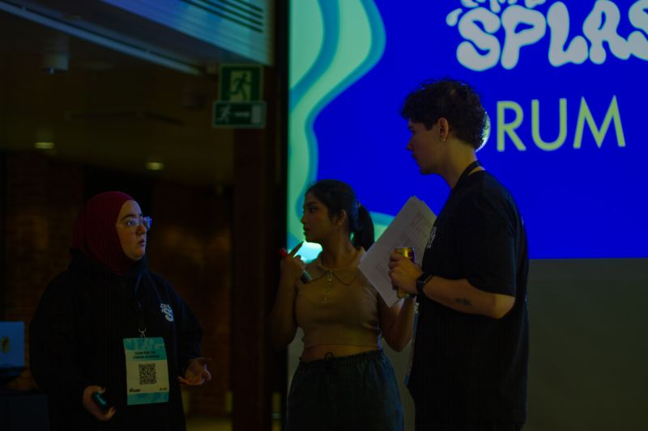
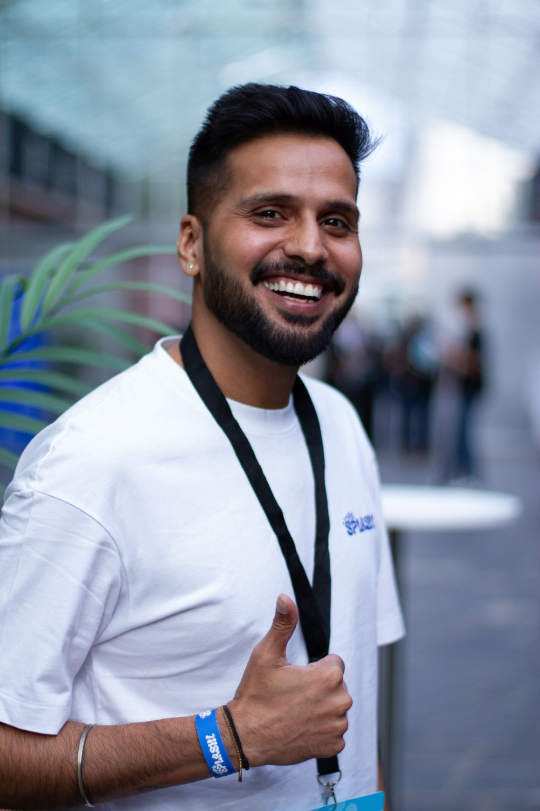
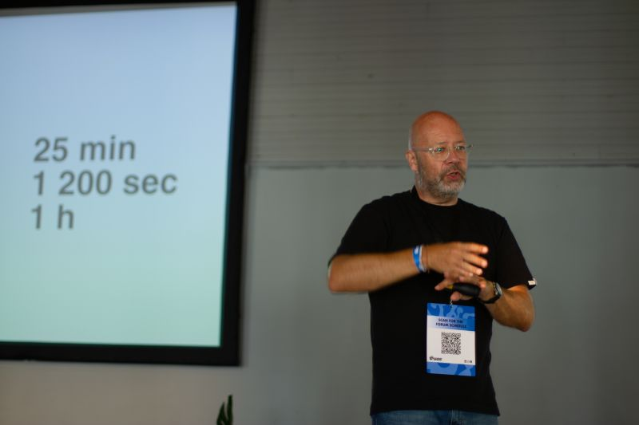
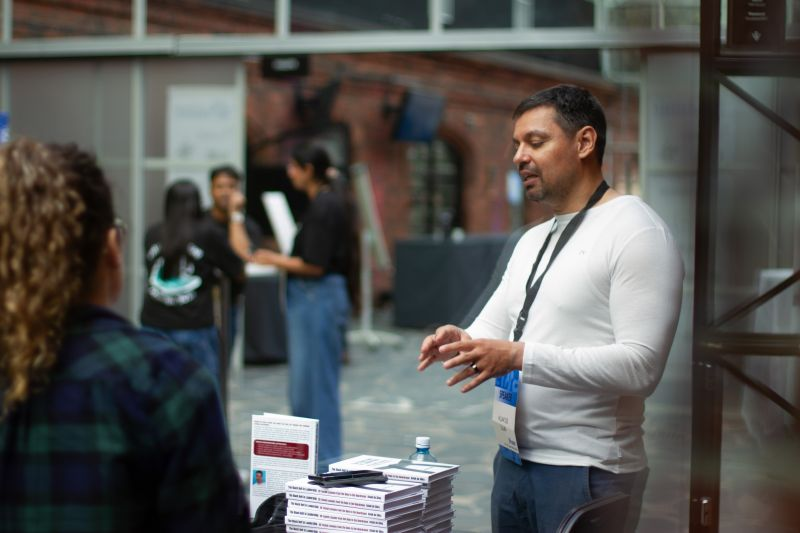
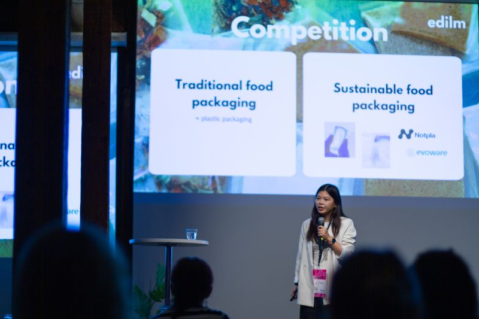

# Inside the Eye of a Tornado: My Second THE SPLASH! Experience 🌊🚀

**Author:** Olga Kryuchkova  
*Nordic Tech and Innovation Ecosystem Explorer | ICT Trainer | Certified AI Transformation Leader | MSc (Tech.) | Engineer*  
**Published on:** August 31, 2026

---

Now I can finally take a breath and attempt to summarize my second **THE SPLASH!** experience. 🌊🌊🌊

What can I say? In short: **Incredible 💯**. It felt like being inside the eye of a tornado, moving at ridiculous speed straight into the future. And the SPLASH team — Shidhanshu Khandelwal, Ala Benkherouf, Shruti Rauti, Roméo Rinne and others 💓 — has clearly levelled up since last year. The skills are now almost automatic, which leaves room for something much more interesting: **improvisation**. And they manage that chaos with impressive confidence.

I felt like a surfer trying to stay on the board of understanding entrepreneurship: from Elon Musk-sized ambitions and space flights 🚀 to those wonderfully small entrepreneurial victories when a solution appears before your eyes and an idea suddenly becomes a business you could launch this month already 🎉. That atmosphere is addictive.

A huge **THANKS** to everyone I managed to talk to, and everyone I didn't, for the great energy, curiosity, charisma and beautifully intense conversations.

And thank you to and the entire **THE SPLASH!** team 💓 for creating a space where something even more valuable than ideas emerged: **trust**.

> *“Trust can be so surprisingly close to love.”*  
> — **Aape Pohjavirta**

And perhaps that is exactly what made this SPLASH so special for me. ❤️🌊

---

### Together With

Mariia Makushina, Aslak de Silva 🥋, Reidar Wasenius, Paramartha Sajjana Narendradhipa, Ronny Eriksson, Monika Liikamaa, Samuli Pehkonen, Mario Henningson, Viktoria Shevchenko, Kateryna Piatyhor, Milo Mutka, Geoffroy Van Humbeeck, Apurva Ganoo, Sarita Runeberg, Sini Ågrén, Aly Metwaly, Maxine Buchert, Roope Ripatti, Maria Freidin, Mika Tikkala, Grigory Maevskiy, Henrik Sievers, and many others.

---

### Ecosystem Momentum & Singularity

And to the ecosystem around us we send positive vibes only 🌞:  
**Maria 01**, **Aalto University**, **University of Helsinki**, **Startup Foundation**, **Finnish Business Angels Network (FiBAN)**, **Helsinki Think Company**, **XES Helsinki**, **Joensuu Entrepreneurship Society (JoES)**, **LUTES**, **Patteri**, **Lahti Entrepreneurship Society (LahtiES)**, **Herizon**, **STRYV**, **Kili**, and all the partners who helped create the conditions for this strange and wonderful experiment called community.

Perhaps this is what makes the Finnish tech and innovation ecosystem so fascinating: it seems to have a tendency towards **singularity**, when talent, ideas, capital, knowledge, and trust begin reinforcing each other so intensely that the ecosystem starts generating its own momentum.

An ecosystem becoming smarter than the sum of its parts. Isn't that what we all strive for as a result?

---

*#TheSplash2026 #Entrepreneurship #Startups #Finland #Innovation*
