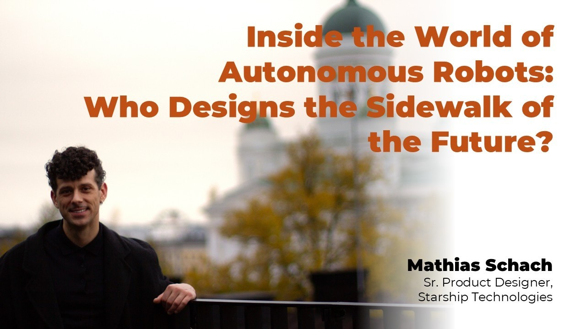
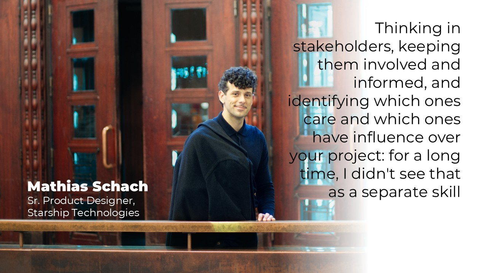
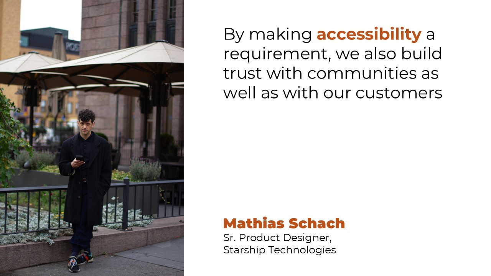
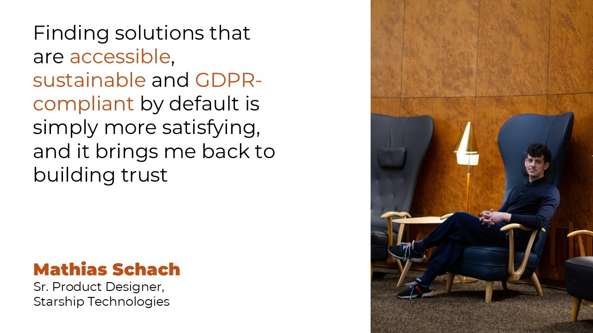
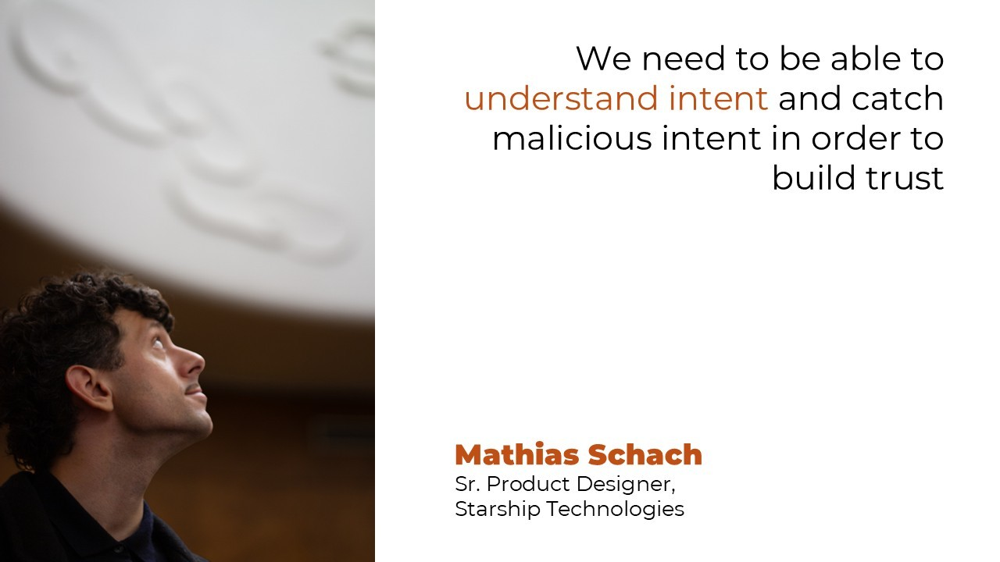
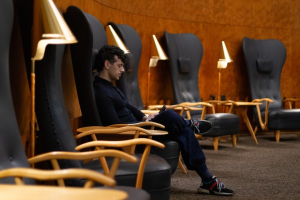

# [Inside the World of Autonomous Robots: Who Designs the Sidewalk of the Future?](https://www.linkedin.com/pulse/inside-world-autonomous-robots-who-designs-sidewalk-olga-xarcf)

*Published on 05-11-2026, 17 min read*

Today, I’m talking with [Mathias Leopold Schach](https://fi.linkedin.com/in/mathias-leopold-schach), Senior Product Designer at [STARSHIP TECHNOLOGIES LTD](https://uk.linkedin.com/company/starship-technologies-ltd), about what happens when Product Design moves beyond screens and into the physical world.

We’ll explore his journey into UX and Product Design, the innovation behind Starship’s autonomous delivery robots, what Finnish and European perspectives can bring to the future of technology, and how AI, data and ethics are reshaping the designer’s role. Finally, we’ll look ahead: what will Product Design, UX and human–machine collaboration look like when intelligent systems become active participants in our everyday lives?

### I. Origins & Product Designer’s Background

**Olga K.:** You started from a rather unusual combination of international relations, communications, service design and eventually product design. Looking back, which part of your earlier career is secretly doing the most work in your design decisions today?

**Mathias Leopold Schach:** It's hard to name a single secret weapon, but my background in international relations and public communications gave me a lot of hidden skills that I only pieced together later. Working in international relations and international organisations is largely about stakeholder management, a management skill that requires stamina. Thinking in stakeholders, keeping them involved and informed, and identifying which ones care and which ones have influence over your project: for a long time, I didn't see that as a separate skill. I just assumed it was basic, but it turns out it comes very naturally to me. The methodology side of the social sciences has also played a crucial part in my career. From the very first year, my studies taught me the basics of qualitative, quantitative and ethnographic research methods. Only later, when I was already working as a service designer and taking methodology courses at Aalto, did I realise how solid that foundation was and how easily it comes to me. And by stamina, I also mean the kind that comes from reading lots of boring-ass academic and legal texts, which today lets me absorb a lot of information with ease.

**Olga K.:** At what point did you stop thinking of design primarily as “making things easier to use” and start seeing it as a way of shaping strategy, behaviour and even business models?

**Mathias:** I've always had a systems approach, again an artefact of my first degrees in international relations and global studies, where Immanuel Wallerstein comes in, and where the French Annales School, most notably the historian Fernand Braudel, shaped the way I see things. But seeing things systemically also comes from my personal love of city-builder and infrastructure games like the Anno series. Seeing things as an interconnected system with upstream and downstream influences inherently makes me ask how behaviour, strategy and the underlying business model are shaped. Of course, I didn't have this framing from the get-go. It formed over time and evolved from keeping an open, curious mind and wanting to learn more, but my courses at Aalto that tied those nicely together in my head.

**Olga K.:** Your Aalto background combines interaction design, UX, service design, co-design, data visualisation and cognitive neuroscience. If you had to remove everything except one discipline from your designer’s toolbox, which one would you keep, and why?

**Mathias:** If I only take the Aalto toolkit and exclude what I brought from before Aalto Media Lab, I think I'd keep interaction design. Media Lab at Aalto is a wild mix of artists, designers, computer scientists and researchers working on very practical projects. What ties these disciplines together is a very hippie way of thinking about how interfaces and interactions are constructed, deeply rooted in Klaus Krippendorff's semantics. That fundamentally shifted the way I see everything around me, from physical objects and products to interfaces, systems, discourse and the role of language itself. Having this framing really changed how I engage with my work, and with the objects in my life.

**Olga K.:** You have worked in organisations such as Österreichische Post and Elisa before moving into autonomous robotics. What did those more traditional service environments teach you that turned out to be surprisingly useful at Starship?

**Mathias:** Working in big corporations taught me what large companies expect from partners, start-ups and scale-ups. Large organisations act the way they do not because they're large and slow on purpose, but because they have responsibilities towards their shareholders. Making decisions in a calculated, trust-evoking way matters, and I think it's only fair to have that expectation. There's a fair share of people in the start-up scene who move fast and break things first, but that's also what can make you an unpredictable partner. When you work on a B2B product, it helps to understand your partners' and customers' organisational intentions and reasoning, because that's how you successfully build trust.

**Olga K.:** Was there a particular project, failure or user-research moment when you realised: “I am not actually designing interfaces; I am designing systems of human behaviour”?

**Mathias:** I don't know if there was a single moment. I'd say I've had this understanding for a long time, but it has definitely deepened since I started at Starship Technologies. Starship has been around for more than ten years and had completed more than 11 million deliveries to date. Designing a product that creates a completely new way of delivering things comes with great responsibility, and the great thing is that everyone at Starship truly understands that.

### II. The Idea & Innovation

Starship is an especially good case for discussing innovation because the “interface” is partly invisible: the user interacts with an app, but the actual product is a robot navigating streets, pedestrians, crossings and unpredictable environments. Starship describes its solution as a combination of robotics, AI, sensors and autonomous navigation.

**Olga K.:** When the product has six wheels, cameras and a physical presence in the street, where does UX actually begin, and where does it end?

**Mathias:** Good question. It really depends on who the user is, who is experiencing the robot, and in what context. There are the obvious ones: the recipient unloading the robot and the person loading it. But in between, there are all the people who never chose to interact with the robot and still do, as bystanders on the pavement or as shoppers who see robots parked in front of the store or charging inside. Even if these people aren't interacting with the robot, they're experiencing it. And there's a broad variety within these groups: a mother holding a toddler in one arm while trying to unload the robot, or a person in a wheelchair navigating a narrow pavement as a robot passes by. So yes, with a product like a robot the lines become really blurry. That's what makes it challenging and fun, because you have a responsibility to all of these user groups.

**Olga K.:** A Starship robot has to negotiate with humans who never explicitly chose to interact with it: pedestrians, cyclists, children, wheelchair users, shop employees. Does that make the whole city part of the product interface?

**Mathias:** I wouldn't go that far. But if we think about it as a system, again in Krippendorff's sense, it requires us to consider a plethora of use cases and user groups. Take accessibility: there's digital accessibility, of course, but with a robot it goes further. We need to make sure the robot's street behaviour, sound design and modes of interaction are accessible from the get-go. By making accessibility a requirement, we also build trust with communities as well as with our customers.

**Olga K.:** Traditional UX often asks, “What does the user want to do?” With an autonomous robot, shouldn't we also ask, “What does the environment need the product to understand?”

**Mathias:** As systems like Starship become more visible and normal in the cityscape, what becomes important is foresight in planning city infrastructure. We've already touched on the space robots share with pedestrians and cyclists. Think of features like curb ramp steepness, which makes pavements easier to access for robots, wheelchairs and prams alike. Or think of road crossings and pedestrian signalling systems: if these are smart, so that both robots and humans can cross without much interaction needed, that's a win-win.

**Olga K.:** Can autonomous delivery become a genuinely new category of service rather than simply a cheaper replacement for a human courier? What would need to change in the product experience for that to happen?

**Mathias:** I think we're already seeing this in places where Starship's service is widely available. In Finland, for instance, a significant share of quick-commerce grocery delivery is handled by our robots. When our service is well integrated into the partner's digital ecosystem, people quickly build a habit around it. But an excellent integration obviously requires close collaboration between many teams, on both Starship's side and our partners' side.

### III. The Finnish, New Nordics & European Market

Starship has unusually deep Finnish roots in its current operation: its R&D presence includes Helsinki, and Finland has become one of its major real-world deployment environments. Starship reports more than 1.5 million deliveries across Finland and more than 270 S Group stores using the service.

**Olga K.:** Finland is often described as an excellent laboratory for testing new technologies because of its digital infrastructure, relatively small market and openness to experimentation. From inside Starship, what is genuinely Finnish about the way this product was developed, or is that simply a convenient national narrative?

**Mathias:** Our main office is in Estonia, where most of our engineering teams are, but the physical design is Finnish: the robot was designed by the talented folks at Aivan, who have worked on great physical products for brands from Fiskars to Iittala. I also think the Nordic climate, Estonian or Finnish, is a good test ground for showing that robots work in deep snowy winters, rainy autumns and spring slush. Along the same lines, Finnish city infrastructure is very generous in giving space to bikes and pedestrians, especially in newly developed areas, which also plays in favour of autonomous delivery robots. All of this enabled Starship to prove certain aspects of its business model. That said, our product development is extremely human-centred, with fast iteration cycles. Whether that's a Finnish, Estonian or Nordic trait, I won't attest; I'd attribute it to the extremely talented people at Starship and the genuine belief and fun we all share. And although our HQ is in Tallinn and our second-largest office is in Helsinki, Starship is very decentralised, with people all around Europe and very flat hierarchies. That last part I'd definitely attribute to Nordic, Finnish and Estonian working culture.

**Olga K.:** What can a Finnish or Nordic product designer learn from designing for public space that a designer working primarily with apps and screens in Silicon Valley might miss?

**Mathias:** I've never been to the West Coast, and even though I have friends working there, I can't judge that. I'm sure that, like every place, it comes with its own advantages and disadvantages. My experience comes from working in European countries, mostly for international companies. As a European, I find our regulatory and legal framework important. Of course, you can point out the downsides of unnecessary and outdated gold-plating, where countries like Austria or Germany make national regulation even stricter than the EU directive. But I'm a strong proponent of having legal frameworks and guardrails in place, and I think that's especially important now that new frontier LLMs are being developed and released. From that perspective, finding solutions that are accessible, sustainable and GDPR-compliant by default is simply more satisfying, and it brings me back to building trust. This matters even more for us because our robots move through physical space and have to comply with many standards and regulations. So my recommendation, whether you design digital or physical interfaces, is this: understand what you need to comply with, learn how to build the case for going beyond the legal minimum, and shoot for the stars while balancing business needs.

**Olga K.:** Nordic innovation often comes with a strong emphasis on trust, accessibility, sustainability and public value. When those principles collide with commercial pressure to scale, which one should win?

**Mathias:** I don't think it's one or the other. Yes, scaling requires moving fast, but a viable product also tackles real problems. If a product that aims to be a category leader simply chooses to ignore, let's say, accessibility, it abandons ca. 25% of its potential market, and that's a fallacy worth exploring. The 25% refers to the share of EU citizens above the age of 16 living with some form of disability according to Eurostat. Choosing to ignore a quarter of all people is a bold choice that might not sit well with your business plan. From my own perspective, and how we live these things, if you design a product to be accessible or sustainable by default, there's no conflict with commercial interests. It isn't just a selling point; it attracts users who choose a product for exactly that reason. If you don't make a digital product accessible from the get-go and have to retrofit it later, you launch with built-up debt that becomes unnecessarily expensive to fix. So commercially, I'd like someone to explain that decision to me.

**Olga K.:** Starship is now operating across very different European environments. How much of good product design can actually be standardised across Europe, and where does cultural context force you to redesign the experience?

**Mathias:** Having lived in four EU countries and visited many more, I know cultural context matters, but I also know there are far more shared elements than differences. The fundamental experiences of a delivery follow the same logic regardless of culture. What shapes the experience more is the available infrastructure. So we design our building blocks, down to the atomic level, to deliver a consistent user experience based on the same principles and infrastructure. When done well, that architectural foundation lets us create unique experiences that take cultural context into account. For example, our robots can talk. That comes with the responsibility to use this ability wisely, because you don't want to overuse it. But if you help a robot out of a snow pile in Finland, there's a very good chance it'll thank you for your act of kindness.

### IV. Tech, AI, Data & Ethics

**Olga K.:** AI is increasingly becoming the decision-maker inside products. Does the role of the product designer therefore shift from designing interfaces to designing the conditions under which machines are allowed to make decisions?

**Mathias:** I wouldn't go as far as calling LLMs decision-makers. Yes, I use LLMs in every step of the design process, but in the same way I still use pen and paper: both are technologies you need to understand when and how to use, without becoming overly reliant on them. Outsourcing decisions to an LLM without understanding the why behind them isn't very wise, is it? There was the initial hype about what LLMs can do, but one good practice we've established is clearly labelling LLM output and how it was used in the process. As for how the product designer's role might shift: LLMs are very useful for getting an idea out quickly to test it or communicate a vision, but putting that idea into action requires managerial and people skills. To paraphrase Jenny Wen, formerly head of design at Anthropic and now at Cursor, the product designer's role is shifting away from producing pixel-perfect screens for every use case and towards identifying the right problems worth solving, quickly creating a vision to test and gather feedback on, and then rallying support around it. Building on that, discovery and research that inform teams and influence strategy, along with the ability to manage the progress of development, are becoming increasingly relevant.

**Olga K.:** When an autonomous robot operates in a public space, whose intent should we design for the customer, the pedestrian, the person in a wheelchair, the remote operator, or the machine itself?

**Mathias:** Regardless of the situation, the robot’s intent should be clearly communicated and understandable to the person interacting with it at that moment.

**Olga K.:** How do you design trust when the most important part of the product is something the user cannot see or understand an AI system making thousands of tiny decisions in the background?

**Mathias:** What constitutes trust? What makes me trust one person over another? Probably continuous exposure to consistent behaviour, which leads to predictability and familiarity. That's why we agree on conventions, rules and laws in traffic: they create certainty that other road users will behave in a similarly predictable way. Products grow interfaces for the same reason, to strengthen predictability and let users signal intent. So when something is unpredictable, when I can't read its intention or it lacks clear communication, it doesn't evoke trust. Translated to LLMs, I'd say it's incredibly important that we keep LLMs expressing themselves in human-understandable language, including when agents communicate with each other. We need to be able to understand intent and catch malicious intent in order to build trust.

**Olga K.:** AI can now generate interfaces, analyse user behaviour and even suggest product decisions. What part of the designer's judgement should remain stubbornly human—even if AI eventually becomes better at predicting what users will do?

**Mathias:** What we are currently seeing is quite a lot of individualized approaches and processes, so I think it will be up to individuals to see what parts they see best fit to do themselves and where LLMs can assist.

### V. Vision & Future of UX, Collaboration & Product Design

Starship's Helsinki organisation combines product design with software engineering, data, analytics and customer success, while the company describes its development model as cross-functional collaboration between robotics, AI and logistics.

**Olga K.:** What happens to the profession of Product Designer when AI can produce ten interface concepts before a designer has finished explaining the problem? What becomes the designer's real competitive advantage?

**Mathias:** If you can't explain the problem in three to five sentences, your sizing of the problem might be off. But of course, LLMs bring an extreme level of speed to the table. The key is connecting that speed with judgement: what makes a well-designed interface, and what level of viability is good enough to build a prototype or feature and gather quick feedback. So there are a few areas where designers can make a difference: understanding which problems are out there and which are the right ones to solve, managing stakeholder relationships, and managing the product development cycle. Using the right design tools at the right time, communicating your thought process and backing your story with data all remain crucial. But I think we're moving away from working primarily in one tool, as we did with Figma, towards working with a range of tools again, reaching development with more feedback iterations along the way.

**Olga K.:** Do you think the next generation of designers will be valued less for their ability to make beautiful products and more for their ability to ask uncomfortable questions before the product gets built?

**Mathias:** The question is what makes a product beautiful, and the answer is most likely rooted in Gestalt principles, which follow deeper instincts and have been prevalent in art and design for centuries. So I think beauty, or what is perceived as beautiful, will remain important. But it will be equally important whether a feature answers the right question. We've seen countless times that if a service or product doesn't solve the right problem for the right user base, it can be as beautiful as you want; it won't be used or find traction. So yes, communication and asking uncomfortable questions remain a crucial part of the product designer's job.

**Olga K.:** When designers, engineers, data scientists and AI systems increasingly participate in the same product decisions, who should have the final word when they disagree?

**Mathias:** It's all about nuance, and I'd add the business or commercial team to that list. Disagreement is important, but most disagreements can be aligned, and there are usually fair reasons why something isn't possible. In that case, the question becomes: it may not be possible now, but could it be? What would have to happen to make it possible in three months, six months or a year? If it is possible, how do we get there, and what steps and decisions do we need to take? That way, the disagreement becomes a roadmap we can all work towards.

**Olga K.:** Could UX eventually become less about designing screens and more about designing relationships between humans, machines, physical environments and intelligent systems?

**Mathias:** If we think about what user experience actually is, it was never about designing screens. Graphical user interfaces were simply the primary mode of interaction for the past few decades, but anything and everything has a user experience as soon as you interact with it. So yes, some UX design will develop in that direction, but not all of it. There will still be UX focused on whatever the dominant mode of interaction is, just as there are still software engineers who write in highly specialised backend languages.

**Olga K.:** If we meet again in 2035, what do you hope we will have completely misunderstood about the future of Product Design today?

**Mathias:** Any honest conversation about the future has to start with the elephant in the room: frontier AI models may be developing faster than we can keep up with. Each new generation of models is increasingly used to help build the next one, so progress speeds up. The risk is that we run out of time to properly test new models for quality and safety before they're released, and that could become dangerous. Add the other big pressures we face, like climate change and the conflicts over resources such as water that may come with it, and 2035 doesn't feel like a given. So if we make it there in one piece, what I hope we'll have misunderstood today is how dangerous this pace of development really is. I'd be very happy to look back and say we worried too much.

**Olga K.:** We used to design products for people to use. Now we are increasingly designing products that act on people's behalf. What do you think designers have not yet understood about that transition?

**Mathias:** That's simply not correct. Most people on this planet have never used an AI agent of the kind you're referring to. According to the ITU, 2.2 billion people remain offline, most of them in low and middle income countries, so for more than a quarter of humanity the question doesn't even arise yet. And among those who are online, AI use is still far from universal: by Microsoft's measure, generative AI reached 17.8% of the world's working-age population in Q1 2026, meaning more than four out of five people aged 15 to 64 haven't used even a chatbot, let alone an agent. Even inside companies, where AI is widespread, agent deployment remained in single digits across almost every business function. So most products will still be made for humans to use for quite a while.

That said, this assumes we avoid an accidental systems collapse. I don't necessarily mean a rogue AI, but something more mundane, like a banking blackout because the same few models are implemented everywhere and share the same error. Regulators are already warning about exactly this kind of concentration risk. So slowing down frontier model development and putting guardrails in place matters, not just for safety, but so we actually get to see the benefits.

And if that doomsday scenario doesn't happen, I do think there are really interesting times ahead, because this information-processing power opens up so many new opportunities. Think of advances in medicine like predictive cancer screening or protein research, of archaeology, where AI is helping to decode ancient languages and signs, or of biology, where it's building new understanding of how animals communicate. So yes, there could be great opportunities to build cool things in many new areas, if we get to see that.

