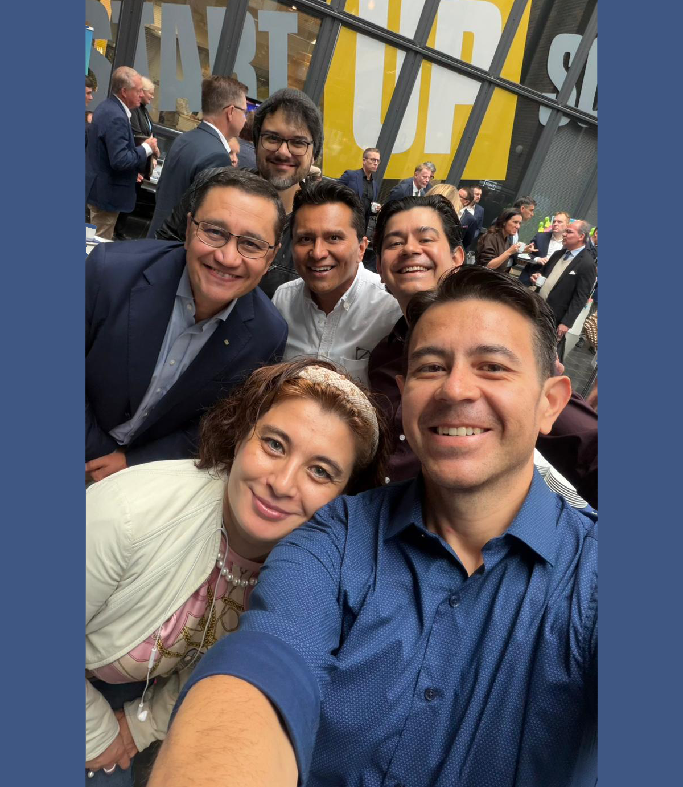
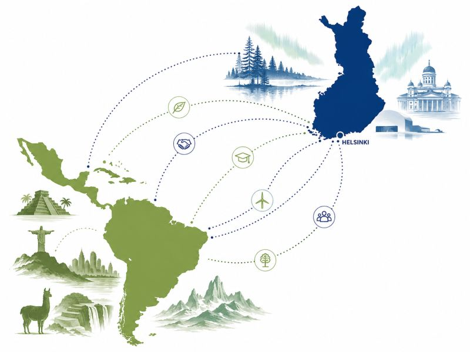

# Finland Meets Latin America: Building New Bridges in Global Business 🌎🇫🇮

**Author:** Olga Kryuchkova  
*Nordic Tech and Innovation Ecosystem Explorer | ICT Trainer | Certified AI Transformation Leader | MSc (Tech.) | Engineer*  
**Published on:** August 31, 2026

---

My work week starts off very briskly. Today’s **Latin America Business Forum 2026** in Helsinki feels like more than another business event. It feels like one of those moments when an ecosystem starts turning scattered connections into something more intentional.

The numbers already make the case: **Finnish companies exported more than €8 billion to Latin America between 2020–2024**, with 1,000+ Finnish companies represented locally. And with the EU–Mercosur agreement now in force, the economic geography is becoming even more interesting.

Today we are going to absorb the talks about:
*   Data centres & digital infrastructure
*   Circular economy & clean tech
*   Forestry & bio-based innovations
*   Education & talent exchange
*   Sustainable cross-border investment

These are exactly the areas where Finnish capabilities and Latin American opportunities can create some serious chemistry.

---

### Leaders, Diplomacy & Cross-Border Vision

I’m particularly looking forward to the conversations with Antti Kaski, Ari Mäki, Johanna Kotkajärvi, Lasse Keisalo, Eija Rotinen, Pertti Ikonen, Nicola Lindertz, Heidi Virta, Juan Pablo Romero, Roberto Requejo, Tomás Pacheco Pla, Rafael Murgi, Rafael Martins E Assis, Sofia Ramos, Matti Landin, Klaus Lüttjohann, Milton Aldrete, Andro Lindsay, Renato Pacheco, Juliana Meyer and Aleksis Kajava, together representing diplomacy, business, technology, education and trade across the region.

The forum is co-organised by:
*   **Finnish-Latin American Business Council**
*   **Ministry for Foreign Affairs of Finland**
*   **Enterprise Europe Network**
*   **Helsingin seudun kauppakamari - Helsinki Region Chamber of Commerce**
*   **Haaga-Helia University of Applied Sciences**

Which is, frankly, quite a good coalition for building bridges.

---

### The Scale of Opportunity

And Brazil deserves a special mention 🇧🇷. It has some of the planet’s most extraordinary natural resources, and apparently decided that natural beauty should not stop there. Its women have been making the Victoria’s Secret runway look like a rather modest benchmark for decades. 🙂 But jokes aside: **the opportunity is serious.**

> **Finland brings:** technology, trust, education, and deep industrial expertise.  
> **Latin America brings:** scale, resources, energy, talent, and rapidly evolving markets.

Put those together with the right people in the room, and we may be looking at more than business development. We may be watching the beginning of a new page in Finland–Latin America relations.

And I have a feeling today’s conversations will be worth remembering.

*Together with David Caceres Del Castillo, Delfin Vassallo, and others.*

---

*#LatinAmerica #Finland #InternationalBusiness #Brazil #LatinAmericaBusinessForum*
