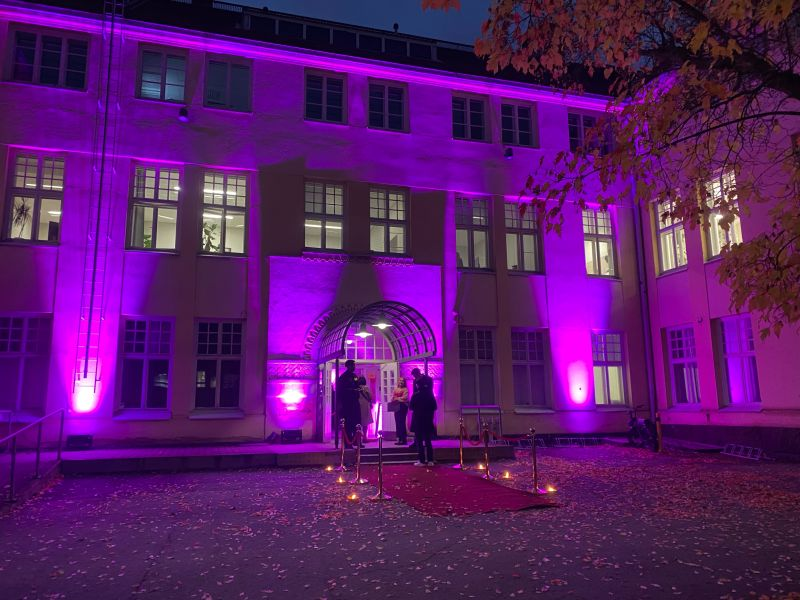
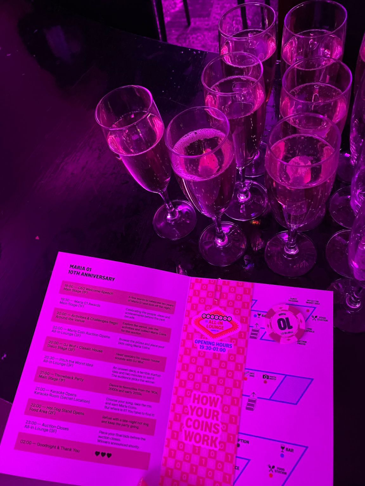
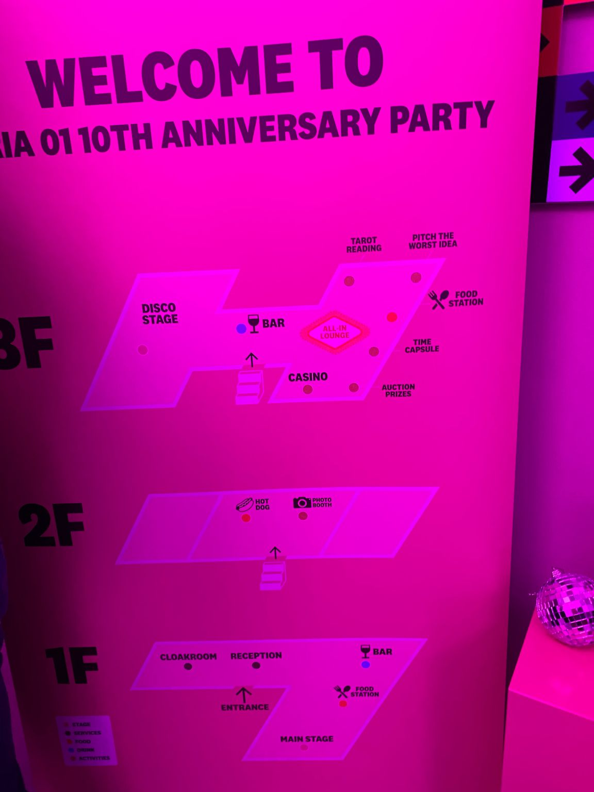
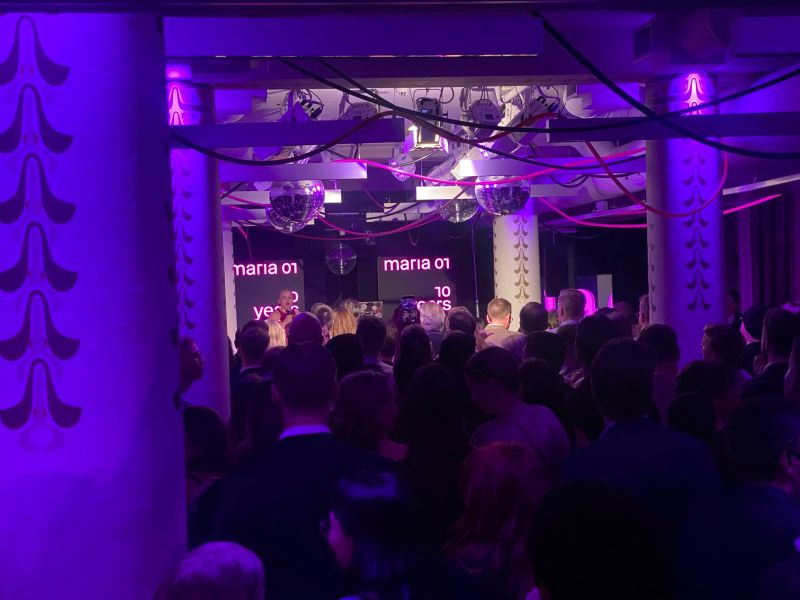
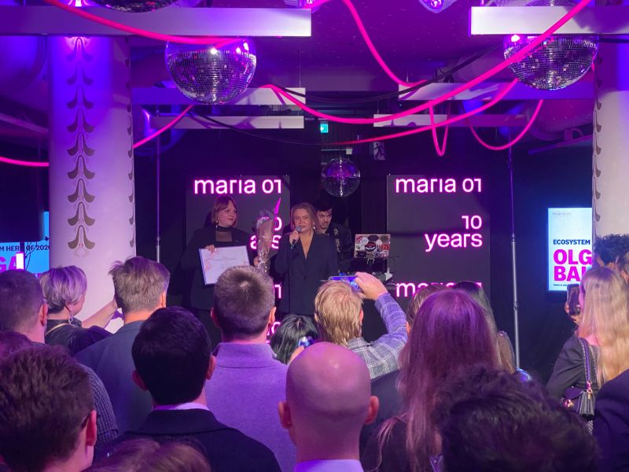
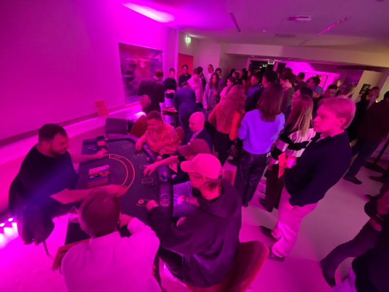
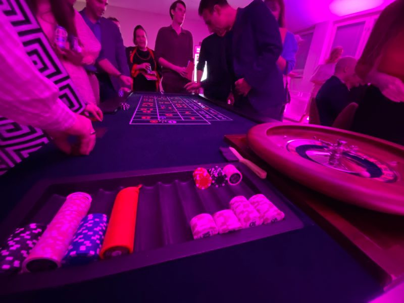
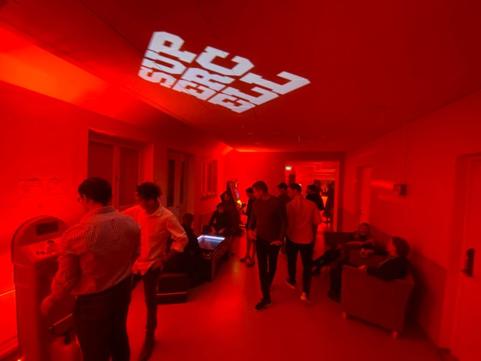
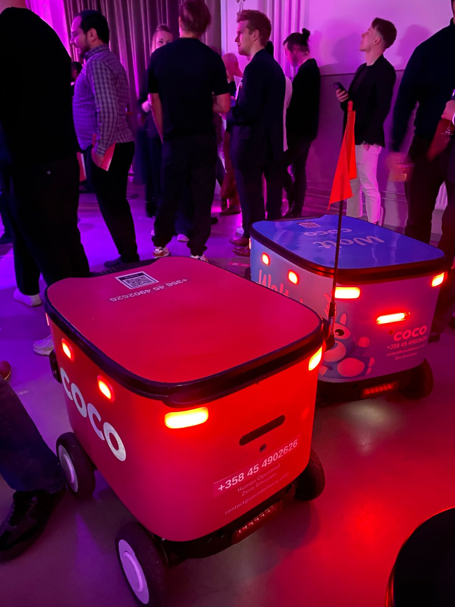
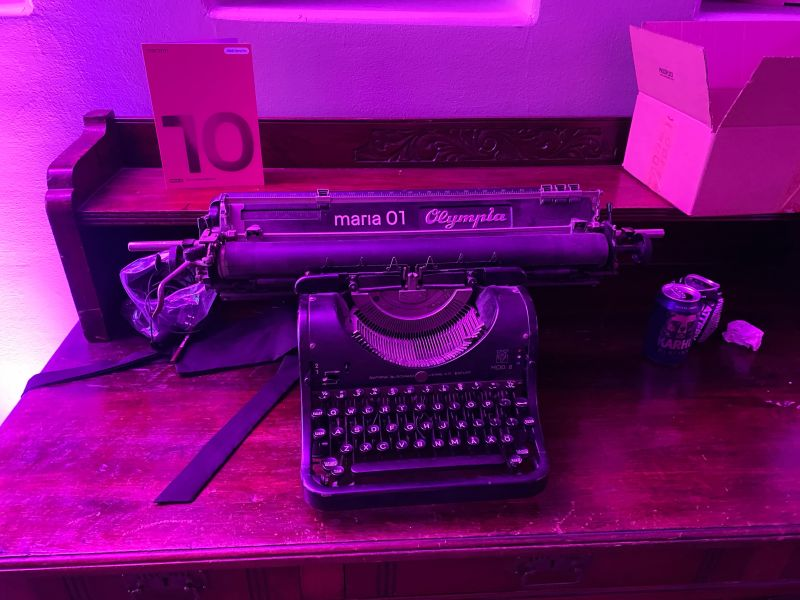

# Where Was Helsinki’s Best Party of the Month? Inside Maria 01’s 10th Anniversary Celebration 🥂🚀

**Author:** Olga Kryuchkova  
*Nordic Tech and Innovation Ecosystem Explorer | ICT Trainer | Certified AI Transformation Leader | MSc (Tech.) | Engineer*  
**Published on:** October 24, 2026

Where was Helsinki’s best party of the month? Yes: **Maria 01**. 🥂🚀

A huge thank-you to this legendary startup hub for giving us the perfect excuse to dress up fancy, raise a glass, and celebrate until 2 a.m. across three floors of pure entrepreneurial energy.

Walking up to the historic former hospital campus in central Helsinki, the building was bathed in vivid magenta and purple under the autumn night sky. A red carpet flanked by candle lanterns welcomed founders, investors, researchers, and ecosystem builders arriving to toast a full decade of Finnish tech history.

### Three Floors of Entrepreneurial Energy

Champagne flowed, delicacies disappeared, and the startup ecosystem was on full display. The anniversary was organized across all three floors of Maria 01, each buzzing with distinct activities and celebrations.

The evening’s agenda was packed with community traditions and playful startup challenges:
- **19:00** — CEO Welcome Speech on the Main Stage, kicking off ten years of Maria 01.
- **19:30** — Maria 01 Awards celebrating people, ideas, and impact.
- **20:00** — Activities, challenges, and the Maria Coin Auction in the All-In Lounge.
- **20:00** — DJ Wuf bringing classic house sounds to the Disco Stage.
- **20:30** — "Pitch the Worst Idea" — unseen slide decks, terrible business models, and two minutes to sell them to an audience jury.
- **21:00** — Throwback Party with anthems from the ’90s and 2000s, alongside a secret karaoke room.
- **22:00** — Late-night hot dog stand refueling the dancefloor.
- **23:00** — Final bids in the Maria Coin charity auction.
- **02:00** — Goodnight after six hours of celebration.

### Celebrating the Ecosystem: Ecosystem Hero of 2026

Maria 01 is more than square meters of office space; it is a community bound together by people who invest their time, network, and heart into helping others succeed.

One of the standout moments on the Main Stage was the Maria 01 Awards ceremony. A massive congratulations to [Olga Balakina](https://fi.linkedin.com/in/olga-balakina), who was awarded the title of **Ecosystem Hero of 2026**! Her relentless dedication to supporting founders, fostering cross-border connections, and elevating the Nordic startup community exemplifies everything Maria 01 stands for.

### Gambling with Business Models

Naturally, there was also a casino — complete with blackjack, roulette, and startups. Because why gamble with money when you can gamble with a business model? 😉

Founders and investors gathered around the green felt tables, placing bets using commemorative Maria Coins and debating unit economics with the same intensity as a term-sheet negotiation.

### 90s Nostalgia Meets Autonomous Robotics

Games of the ’90s made a glorious comeback. An entire hall was transformed into a retro arcade zone bathed in atmospheric crimson light, complete with classic arcade cabinets and a Supercell logo beaming overhead.

And in true Maria 01 fashion, past and future collided naturally: autonomous sidewalk delivery robots (from Coco and Wolt) silently navigated through the party halls, mingling effortlessly among founders raising glasses.

Tucked on an antique wooden desk sat a vintage mechanical Olympia typewriter, custom-branded with "maria 01", alongside the 10th-anniversary chronicle. A poetic reminder of how far Finnish tech has journeyed — from mechanical keystrokes to autonomous machines and generative intelligence.

### The Bender AI Spirit: Onward to the Next Decade

All of this was in the spirit of our very own Bender AI: the unique combination of entrepreneurial ambition, a little audacity, and an unwavering belief that the next breakthrough is just one pitch away.

Happy 10th anniversary, Maria 01! ❤️

May you continue to thrive, grow, connect brilliant minds, and celebrate many more decades — with dozens of unicorns galloping out of your doors.

Love you, Maria 01. Keep making magic happen. 🥂🦄

Together with [Aape Pohjavirta](https://fi.linkedin.com/in/aaape), [Olga Balakina](https://fi.linkedin.com/in/olga-balakina), [Angeliki Papagiannopoulou](https://fi.linkedin.com/in/angelikipapagiannopoulou), [Paramartha Sajjana Narendradhipa](https://fi.linkedin.com/in/paramartha), [Sarita Runeberg](https://fi.linkedin.com/in/saritaruneberg) and many others. 🌟

*#Maria01 #HelsinkiStartups #StartupEcosystem #Innovation #FinnishStartups*
