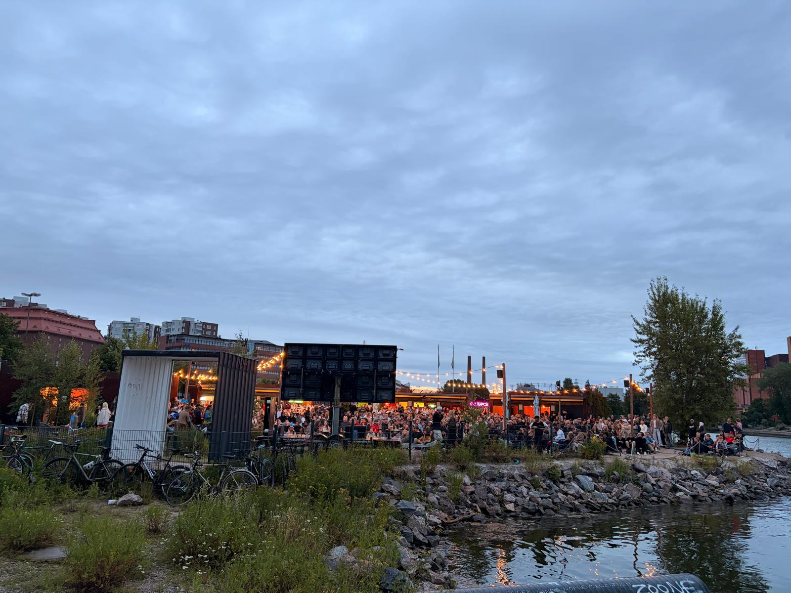

# Yesterday, Merihaka sounded nothing like the quiet Helsinki I know in summer ⚽🇫🇮

**Author:** Olga Kryuchkova  
*Nordic Tech and Innovation Ecosystem Explorer | ICT Trainer | Certified AI Transformation Leader | MSc (Tech.) | Engineer*  
**Published on:** July 20, 2026

---

Yesterday, Merihaka sounded nothing like the quiet Helsinki I know in summer.

For a couple of hours, it became Buenos Aires... then Madrid... and then simply one big celebration of football. We cheered for Argentina, celebrated Spain, argued about tactics like lifelong experts 😄, and proved that you don't actually need to be born in a football country to enjoy the beautiful game.

I have heard a joke that Finns only have one true religion: hockey. And yes, if hockey is the national language, football sometimes feels like the exchange student who arrived a little later. The Finnish national team (Huuhkajat) has not yet become a regular guest at the FIFA World Cup finals. But every football nation starts with people believing before the trophies arrive. Someone has to be there long before the history books are written.

That's why I'm joining everyone in supporting and helping shape the future of Finnish football. Special shoutouts to Ari Lahti, Marco Casagrande, Timo Harkimo, Jyrki Pyykkö, Markku Lehtola, Jan Walden, Aki Riihilahti, Juha Reini, Tommi Kautonen, Olli Huttunen, Antti Niemi, Pekka Hietala, Mikko Isokangas, Sauli Väisänen, and everyone across the **Suomen Palloliitto (Football Association of Finland)**, Veikkausliiga, HJK Helsinki, FC Inter Turku, KuPS Kuopio, PEPO Lappeenranta, Kultsu FC, FC LaPa and many other passionate clubs, academies, and the wider football community. Thank you for the work you are doing behind the scenes to help Finnish football grow, inspire the next generations, and dream bigger every season.

After yesterday's incredible atmosphere, I found myself thinking: Why should my wardrobe only have Argentina or Spain jerseys? I want to proudly add Finland's as well.

I put my hope in the idea that the next unforgettable football story will be written much closer to my Finnish home. And by the way, you too can still find the official Finland national team kit here: [Official Finland National Team Kit – Maajoukkueen verkkokauppa](https://kauppa.palloliitto.fi/)

I sincerely hope to see Finland competing at the 2030 FIFA World Cup, and I hope that one day wearing my personal Huuhkajat jersey during a World Cup match will feel as natural as wearing the colors of any traditional football nation. Because football is never just about ninety minutes. It's about belief, support, and community.

And every great football story begins long before the final whistle. 💓 ⚽🇫🇮
