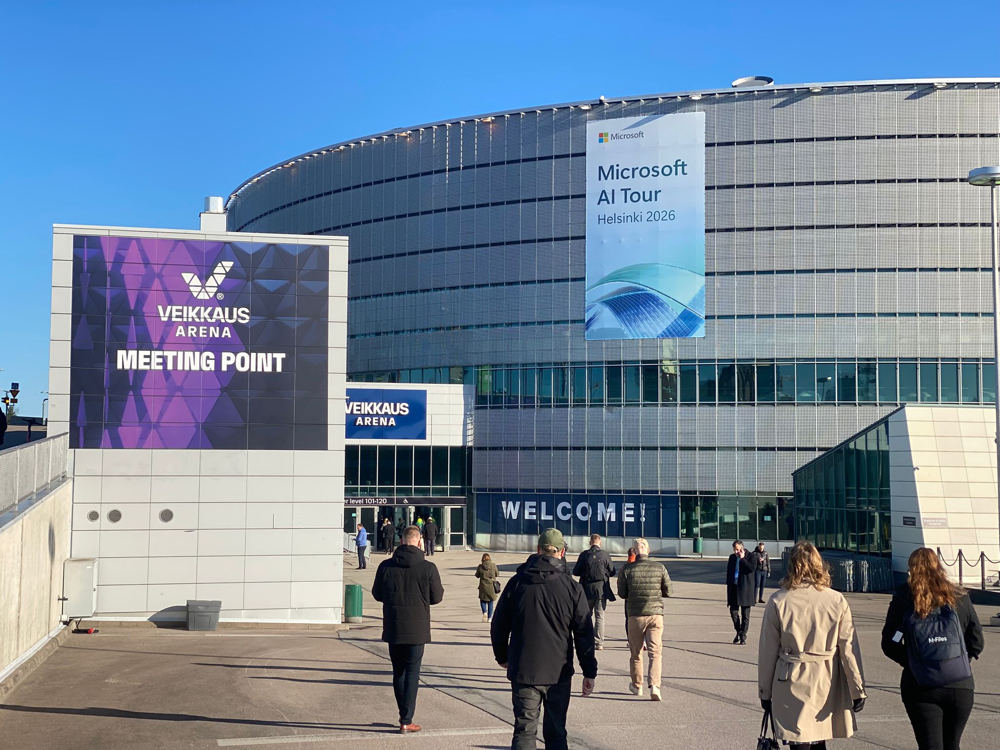
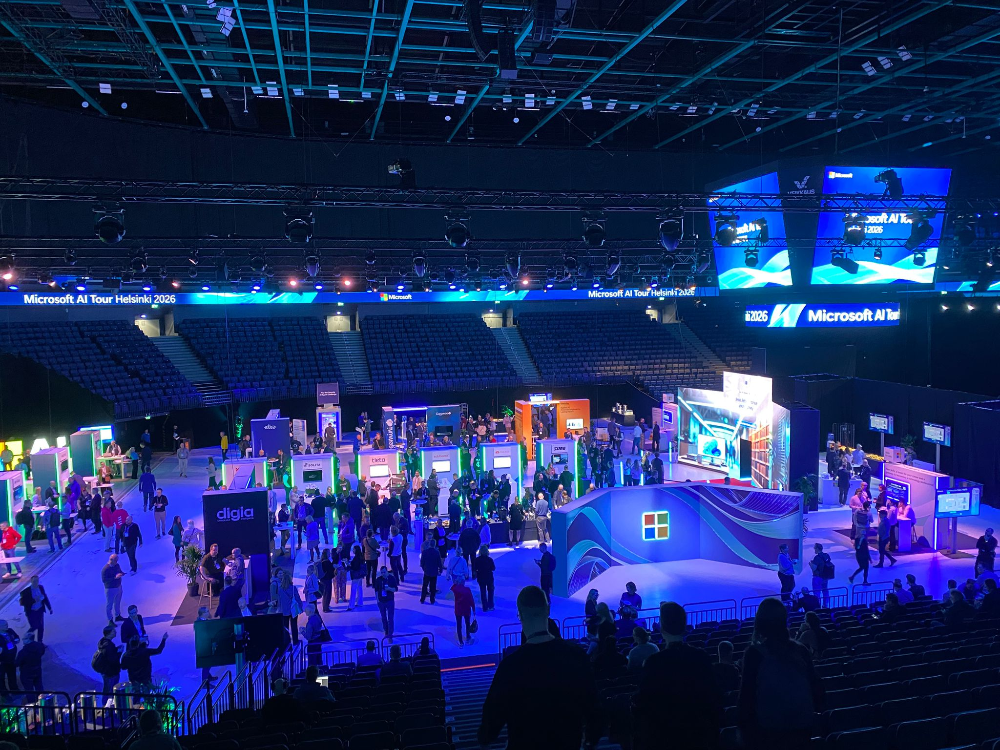

# AI builders in Finland: What Microsoft AI Tour Helsinki Revealed About Europe’s AI Future

Today the **Microsoft AI Tour Helsinki** is happening in Veikkaus Arena—one of 18 major EMEA events by Microsoft. Lots of booths, demos, coffee… and a few insights actually worth sharing 👇

### 1. Europe vs. Big Tech: An Ongoing Chess Game
With GDPR and the EU AI Act, Europe is serious about digital sovereignty. Microsoft, meanwhile, is investing billions to stay deeply rooted here, ensuring compliance and regional alignment.
* 📊 **EU AI market:** Projected to reach → **€200B+ by 2030**

### 2. Data Centers: The Real AI Backbone
AI isn’t just about "smart tools"—it’s infrastructure. And it’s scaling fast, especially in the Nordics.
* 📊 **Europe data center demand:** Expected to consume → **~150 TWh by 2030**
* 👉 **Finland is quietly becoming a strategic hotspot** because Microsoft is currently developing a cluster that consists of a dozen new data centers across three sites: **Espoo, Kirkkonummi, and Vihti**.

### 3. Learning is Getting More Personal
Today there was a great opportunity to explore the **AI Skills Navigator** up close. AI is transforming how we learn: tailored paths, adaptive content, and skill-based progression are replacing traditional learning models.
* 📊 **Skills half-life:** Approximately **5 years**
* 📊 **Personalized learning:** Delivers a **+30% engagement** boost

---

### Bottom Line
AI today is not just about tools; it is about **strategy, infrastructure, and how fast we can learn**. 

What stood out to you if you attended or follow these trends? Let's discuss in the comments or on LinkedIn!

*With Teemu Vidgren, Judson Althoff, Emma Kauppi, Hannakaisa Länsisalmi, Marco Wirén, Tomio Pihkala.*

