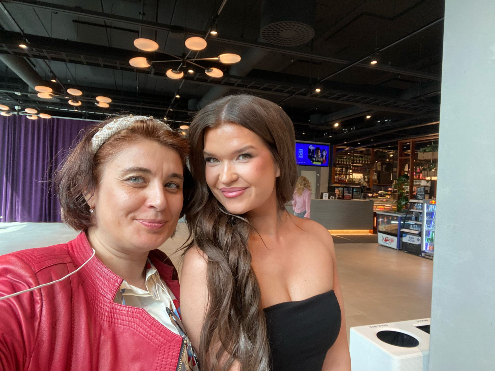

# Today I met the most beautiful women in Finland 💓

**Author:** Olga Kryuchkova  
*Nordic Tech and Innovation Ecosystem Explorer | ICT Trainer | Certified AI Transformation Leader | MSc (Tech.) | Engineer*  
**Published on:** August 11, 2026

---

Today I met the most beautiful women in Finland.

And some remarkably handsome men too — although, sadly, they didn’t make it into the frame.

And girls, let me tell you something about Finnish men: they may look like they could personally escort a Viking drakkar into battle, but apparently approaching a camera is where their courage ends. 😄

Finnish men are a fascinating paradox: intimidating exterior, Scandinavian minimalism, and the social boldness of a Victorian gentleman who has just been asked to dance.

So no, there are no handsome Finnish heartbreaking men on my photos.

Not because they weren’t there.

Because they were Finnish. 😉

With all my admiration to **Henniina Määttä**, **Aleksandra Hannusaari**, **Araitz Claramunt Oregi**, **Emma-Aurora Saukko**, **Enni Kivistö**, **Johanna Verkala**, **Jutta Häkkinen**, **Katariina Kinnunen**, **Kukka-Maaria Halme**, **Rebekka Homanen**, **Sani Meritähti**, and **Sofia Singh** 💓 

*At Hybridiarena Hype*

