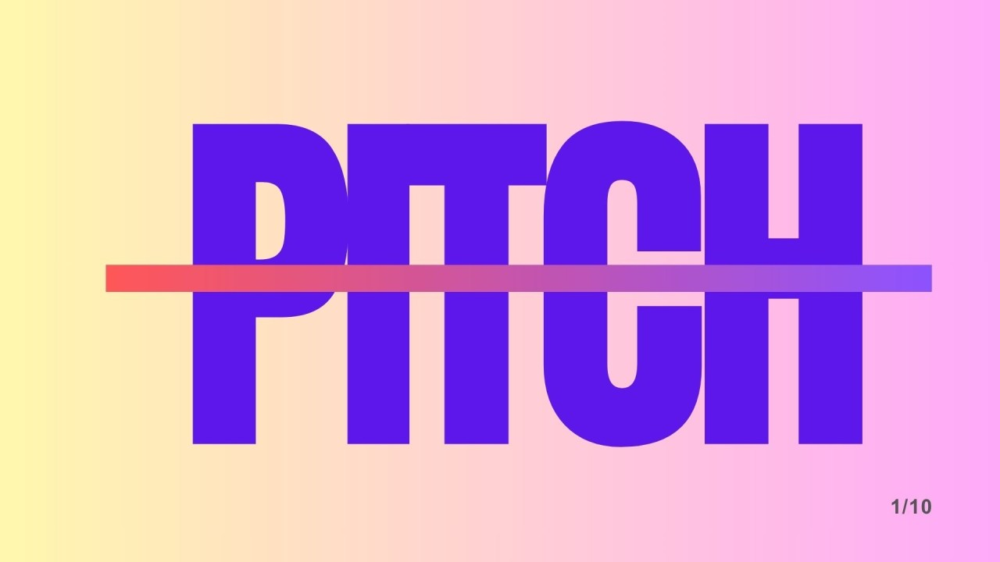

# My first pitch ever 🫠...

**Author:** Olga Kryuchkova  
*Nordic Tech and Innovation Ecosystem Explorer | ICT Trainer | Certified AI Transformation Leader | MSc (Tech.) | Engineer*  
**Published on:** June 10, 2026

---

It was my first-EVER pitch and it happened in **Helsinki Incubators**, and yes, I was nervous enough to briefly consider becoming a “silent investor" instead of founder. Out of 14 ideas, I presented my **Ecosystem Media Platform MVP**, mostly hoping my slides would carry emotional support for me. Somehow I made it through, and the audience only asked useful questions instead of “are you okay?”, so I’ll call that a win. 😁

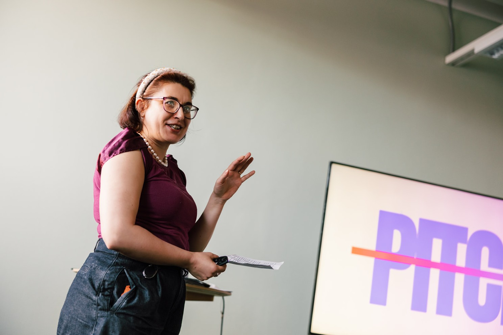

*This is not a pitch.*

It’s a story about why I believe Finland needs stronger visibility and collaboration inside its innovation ecosystem.

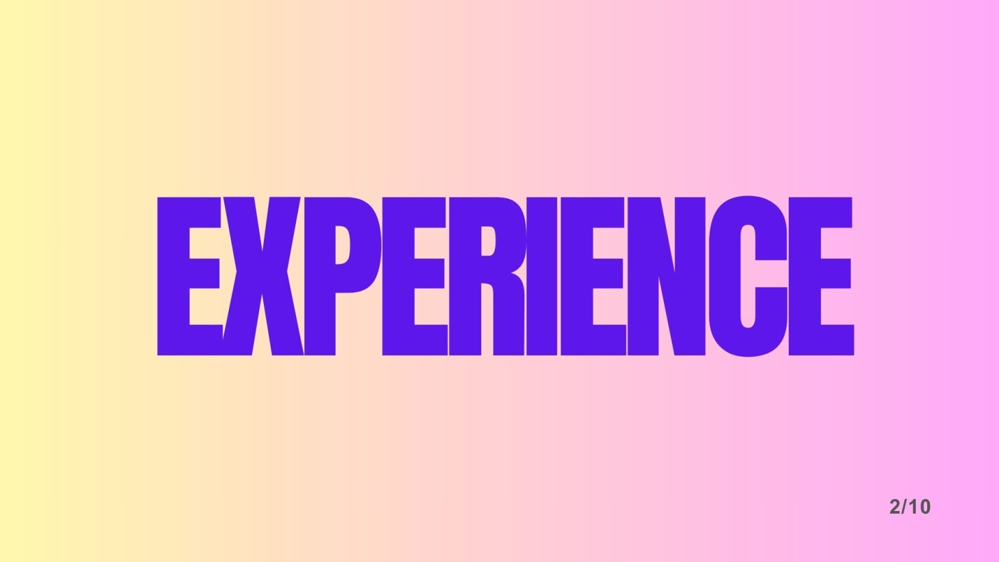

Before and during this pre-incubator journey, I spoke with founders, startup teams, community builders, and ecosystem supporters. And I realized something important: there are so many amazing and talented people building important things, but too many are building in isolation.

That observation became the beginning of my idea.

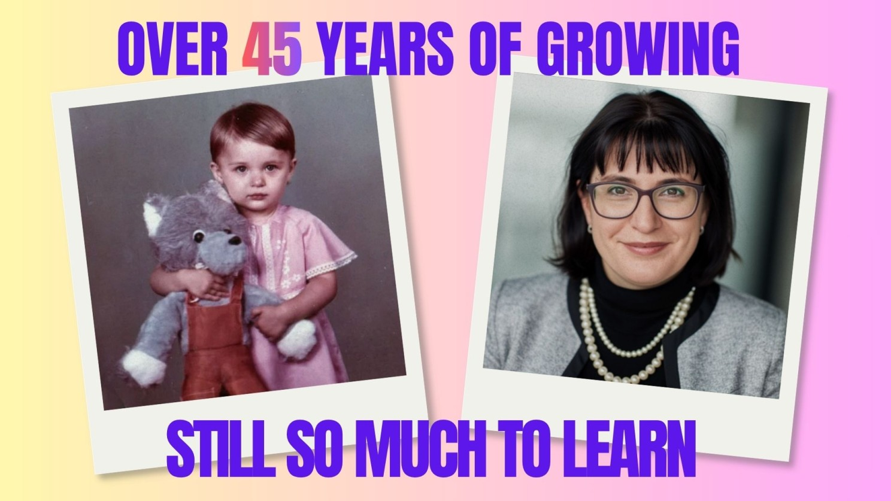

Over 45 years of life experience, and I still feel there is so much to learn. That is exactly why I am here. Not because I have all the answers, but because I believe experience combined with curiosity can create meaningful solutions.

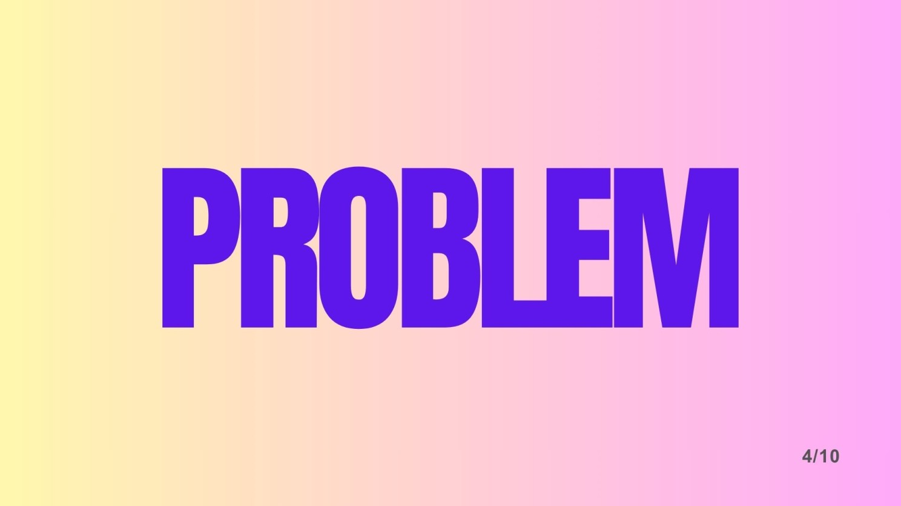

Research shows that the Finnish tech and innovation ecosystem is diverse, active, and full of hubs, incubators, startups, and communities. But despite all this activity, the ecosystem still feels fragmented.

Great initiatives exist, yet many people struggle to discover each other.

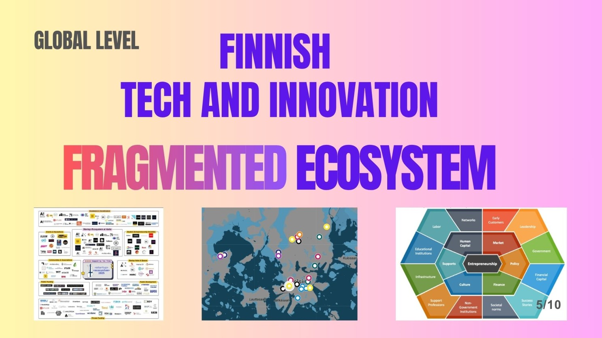

At a global level, Finland has incredible innovation potential. But visibility and connection are still challenges. The ecosystem is decentralized, scattered across platforms, events, and networks.

So what does this mean for founders?

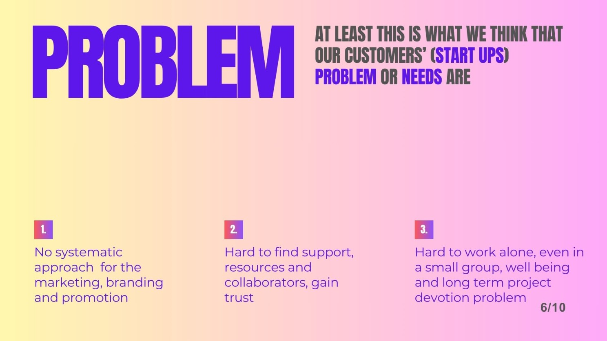

For startups and entrepreneurs, fragmentation creates real daily challenges:

*   It is difficult to find support, trusted collaborators, and the right resources.
*   Building alone creates pressure on motivation, wellbeing, and long-term commitment.
*   Marketing and visibility often become secondary because founders are focused on survival.

And sometimes, amazing ideas stay invisible simply because nobody hears about them.

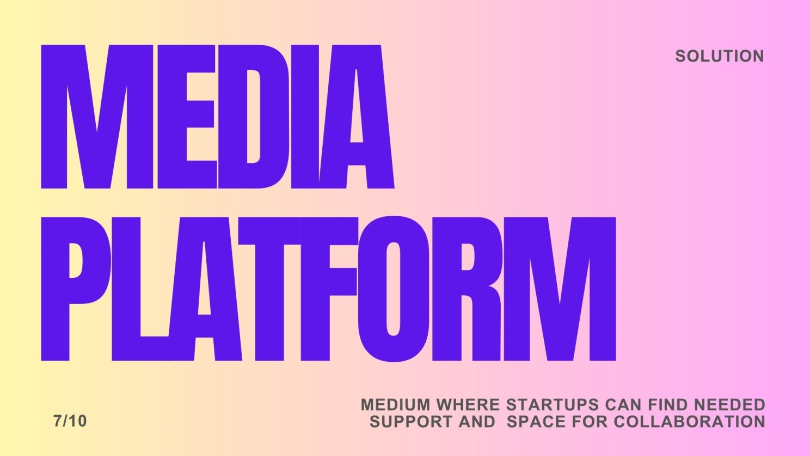

My solution is a collaborative media platform that connects startups, communities, experts, incubators, investors, and ecosystem supporters in one visible and interconnected space, where crosspollination helps to develop a community of creators, builders, and curious minds.

*Not another social network.*

A platform focused on visibility, storytelling, collaboration, and ecosystem trust.

And I didn’t start with assumptions.

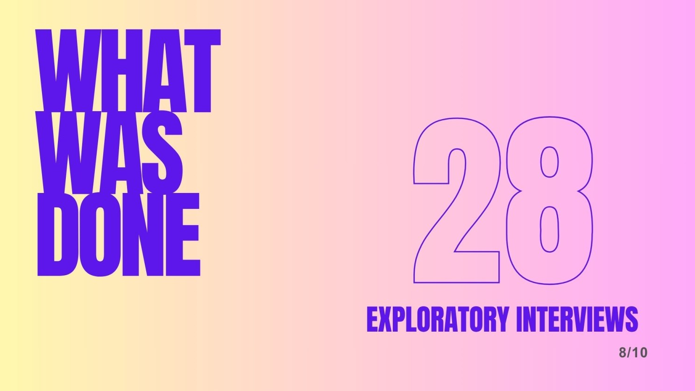

To validate the idea, I conducted over 30 interviews with startup founders, ecosystem participants, and professionals.

The goal was simple: understand their real struggles, visibility gaps, and collaboration needs.

And clear patterns started to appear:

*   The primary customer persona is an early-stage startup CEO.
*   Initial phase startup, small teams of 1–5 people.
*   Limited visibility and marketing capacity.
*   Strong need for trust-building and connections.

These interviews also helped me map the ecosystem itself and understand it deeper.

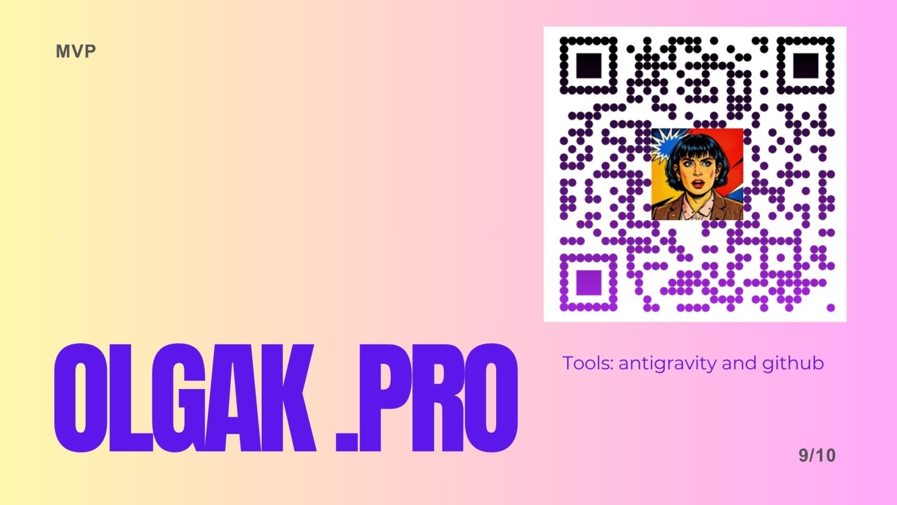

Use this QR code to test my MVP, your feedback is welcome.

Do not hesitate to connect with me on LinkedIn. Let’s make bright ideas more visible all together. And if you are attending **ARCTIC15 2027 — The Growth Edition** tomorrow, I would be glad to meet you there.

Thank you!

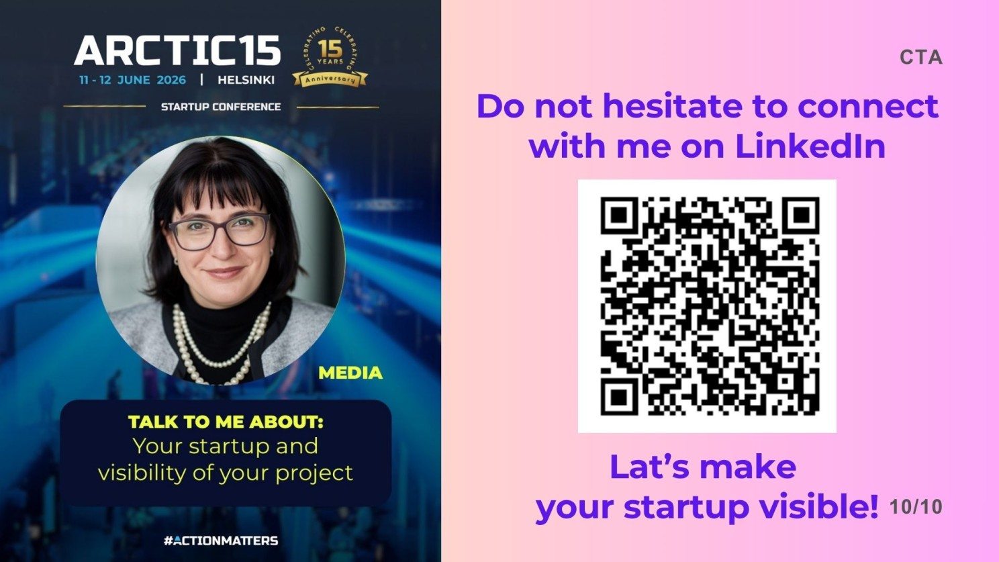
