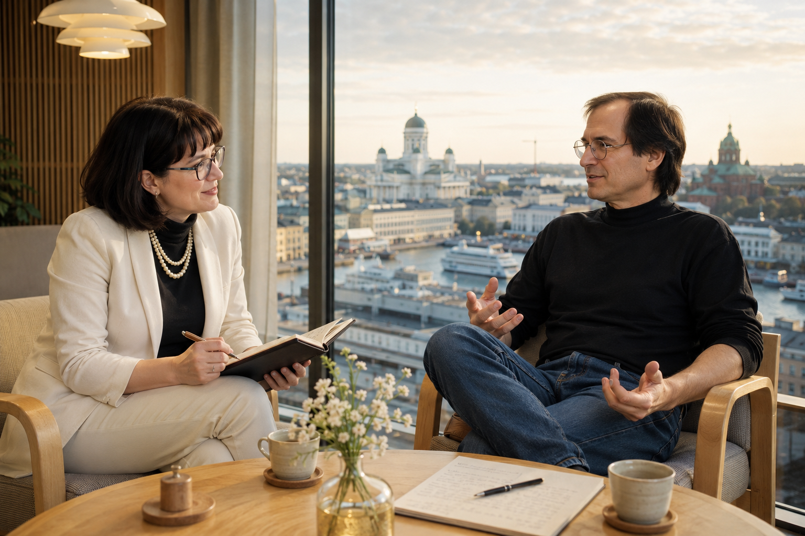

# My Three Questions to Steve Jobs 🍎💬

### A Conversation That Never Happened, Yet Somehow I Feel it is True

**Author:** Olga Kryuchkova  
*Nordic Tech and Innovation Ecosystem Explorer | ICT Trainer | Certified AI Transformation Leader | MSc (Tech.) | Engineer*  
**Published on:** July 16, 2026

---

Every interviewer dreams of one impossible conversation. Mine was with Steve Jobs.

No, I did not invent a time machine, nor did I stumble into a science-fiction screenplay. This interview exists as a thought experiment, an intellectual exercise inspired entirely by Steve Jobs' public talks, biographies, keynote presentations, and decades of recorded interviews. Every answer reflects ideas he genuinely expressed, woven together as if we had been fortunate enough to meet over coffee for twenty minutes.

And perhaps that is the closest anyone can come to interviewing a legend whose ideas still shape our industry.

I arrive ten minutes early. The room is almost empty. No grand stage. No cameras. Just a wooden table, two chairs, and a cup of black tea waiting beside one of them.

The door opens. Blue jeans. Black mock turtleneck. My heart is trembling. That unmistakable calm confidence. Steve Jobs walks in. He sits. Looks directly at me.

"So," he says with a slight smile, "what's worth talking about?"

I suddenly understand why people called him intimidating. Not because he was harsh, but because he expected every minute to matter. I take a breath.

"Steve, I can't thank you enough for giving me this opportunity. I know your time is incredibly valuable, and I'm deeply grateful you've agreed to meet. I have so many questions..."

He smiles: "Start with the important one."

---

### Question 1: The Finnish Ecosystem & The Big Five

**Olga:** Steve, Finland has become home to me. I've spent years studying here, working here, and contributing, however modestly, to its technology ecosystem. What fascinates me most is that Finland is no longer evolving in isolation. Together with the Nordic countries and the Baltics, it's becoming part of a remarkably cohesive innovation cluster. To many outsiders, Silicon Valley still appears to be the center of gravity. But I wonder whether something different, perhaps even more resilient, is emerging here. If you were choosing five Finnish companies today, which ones would capture your attention?

Steve leans back for a moment. He doesn't answer immediately. He thinks. Then he begins:

"Most people ask, *'Which companies are successful?'* I'd ask, *'Which companies are changing the interface between people and technology?'* Revenue follows. Technology changes. But human behavior—that's the real product."

He pauses. "So let's start there. If I were building the future today, I'd pay very close attention to **Varjo**. Every decade computing finds a new interface. The mouse. The graphical interface. The iPod wheel. Multi-Touch. The next interface won't be another screen. It will be space itself."

He draws an imaginary rectangle in the air: "The best interface eventually disappears. I've always believed technology alone isn't enough. It has to marry the liberal arts. Varjo understands that."

"The second company would probably surprise fewer people: **ŌURA**. They're solving an elegant problem. The computer almost disappears. You don't open an app because someone told you to. The technology quietly understands you before you think about it." He taps the table: "That's design. People think design is decoration. It never was. Design is how something works."

"I admire companies that stay focused long enough to become experts. **Polar** didn't suddenly discover health technology because it became fashionable. They've spent decades understanding the human body." He laughs softly: "The overnight success usually took thirty years."

"The fourth company that grabs my attention is **KONE**."

I hesitate: "KONE?"

He nods: "Exactly. People think elevators are engineering. I think they're user experience. When technology becomes invisible, you've probably designed it well."

His expression changes. Now he seems almost amused: "**Supercell**. This one isn't about games. It's about culture. They cancel products." He points his finger for emphasis: "That's incredibly difficult. Innovation isn't saying yes. Innovation is saying no to a thousand good ideas. Companies rarely fail because they lacked ideas. They fail because they lacked focus."

---

### An Unexpected Turn

I pause to collect my notes. Steve notices: "You're not surprised by my choices."

"I'm surprised by your reasoning," I admit.

He nods: "Good. Reasoning lasts longer than lists."

Then, unexpectedly, he turns the conversation around: "I've been watching your work."

I look up, certain I misheard him. This turn of our conversation took my breath away. A thought flashed through my head like lightning: *Does my idol know about my media project and course?*

He smiles encouragingly: "I noticed you've spent a lot of effort connecting founders, researchers, investors, and ecosystems. That's harder than people think. Everyone wants to build technology. Very few people build trust. You've become something every ecosystem quietly needs: a translator, an ambassador. If any of those companies understood the value of visibility as well as they understand engineering, they'd consider themselves fortunate to work with someone who genuinely understands both worlds like you."

For a brief second, I forget my next question. But I pull myself together and formulate the next one.

---

### Question 2: The Next Generation of Startups

**Olga:** Thanks Steve, you are very observant. But let's make this more difficult. Established companies are one thing. If you were investing today, which Finnish startups would make you stop and pay attention?

He laughs: "Now we're talking."

"**IXI**. If computing is becoming invisible, then wearable technology is inevitable. The companies that win won't build better glasses. They'll make people forget they're wearing computers."

"**Wirepas**. This one fascinates me. It's infrastructure. No headlines. No glamour. But the best technology is usually invisible. If your network demands attention, you've already lost."

"**ICEYE**. I've always admired companies that create entirely new industries. Not better versions of old ones. New ones. Making satellite intelligence commercially accessible changes how humanity understands the planet." He pauses: "That's a big idea."

"**Flow Computing**. This one is deeply technical. But fundamental engineering matters. Everyone wants faster software. Sometimes the real breakthrough happens underneath. If you can rethink computing itself without asking developers to rewrite everything... that's interesting."

After a pause, he smiles almost apologetically, looking at the wall clock: "And my last favorite today is **OneMind Dogs**."

I smile: "I love dogs! You've picked a dog-training company?"

He had this kind of laughter that made me smile: "No. I picked a company that simplified complexity. People underestimate how difficult simplicity really is. The world doesn't need more features. It needs more understanding."

I close my notebook for a second: "There's something fascinating about all your answers."

He raises an eyebrow: "What?"

**Olga:** "You never really answered with industries."

He smiles: "Exactly. I answered with principles."

---

### Question 3: The Personal Question & The Future of Apple

I glance at my questions: "This one is personal."

Steve tenses almost imperceptibly, but continues to smile.

**Olga:** "If you were still leading Apple today, where would the company be heading?"

Steve doesn't even hesitate, with obvious relief: "Oh, that's easy." He smiles: "You should ask Tim Cook. Of course not directly, he is so busy with the products, but you can talk with Kristin Huguet Quayle or Tor Myhren. And yes, Tim is very busy now. He doesn't have an easy job. I handed him the flag. His job was never to become Steve Jobs. It was to become the best Tim Cook Apple could have."

Steve stands: "Our time is up."

The assistants have already begun making discreet gestures that my audience with the legend has officially expired. As I gather my notebook, Steve says one final sentence over his shoulder:

"Keep asking questions that matter."

Then he's gone.

I looked at my notebook. At the very top of the next empty page, I quietly wrote one name.
