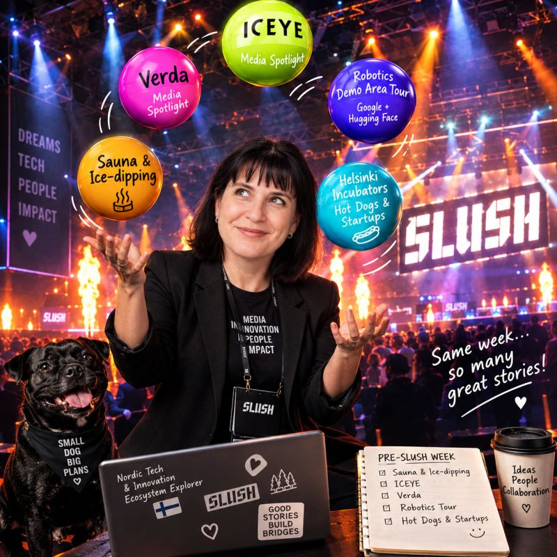

# [My Top 5 Pre-Slush Picks: Finnish Sauna, Space Intelligence, Unicorns & Robots 🚀](https://www.linkedin.com/posts/olgakruchkova_slush2026-nordictech-startupecosystem-share-7520822671694143488-OhMT)

*Published on 28-10-2026, 4 min read*

[Slush](https://fi.linkedin.com/company/slush) is coming and it’s time to pick your program. "After all, if you don’t plan out the Slush week, you’ll hardly manage to get anything done." - Finnish wisdom 😁 And maybe your the most interesting conversations will happen in a sauna, inside a factory, or while watching a robot do something that might soon replace half of our daily routines (or not 😁 ).

As an independent media professional exploring the Nordic tech and innovation ecosystem, here are **my top 5 picks for warming up before Slush 2026** — with a healthy balance of Finnish culture, deep tech, AI infrastructure, and a little technological curiosity. Maybe this will provide a clue for shaping your own program for whirlpool of pre-Slush events.

### 🔥 1. Sauna & Ice-Dipping | November 17, 10:00–11:30

Because no Finnish networking experience is complete without questioning your life choices in freezing water. Bonus: nobody expects you to pitch your startup while holding a towel. Probably.

### 🛰️ 2. Spotlight with [ICEYE](https://fi.linkedin.com/company/iceye) | November 17, 12:00–14:30

A visit to the office and factory of ICEYE, a global leader in synthetic aperture radar (SAR) satellite technology and space-based intelligence. An opportunity to hear the company's story firsthand and explore how Finnish deep tech is building capabilities with global implications.

### ☁️ 3. Spotlight with [Verda](https://fi.linkedin.com/company/verda-cloud) | November 17, 15:00–16:30

Meet Verda, the Finnish AI cloud company that has been making waves in Europe's AI infrastructure landscape. A chance to visit its office and learn more about its journey and to know more about what is behind ambitious AI company, to ask the less glamorous but absolutely essential question: where does all that computing power come from?

### 🌭 4. Hot Dogs & Startups, vol. 4 | November 17, 17:00–20:00 🚀

Hosted by [Helsinki Incubators](https://fi.linkedin.com/showcase/helsinki-incubators/), this relaxed networking event brings together Helsinki’s emerging startup community, entrepreneurs, and innovators. Expect startup conversations, new connections, and a taste of the [University of Helsinki](https://fi.linkedin.com/school/university-of-helsinki/)’s entrepreneurial ecosystem.

### 🤖 5. Robotics Demo Area Tour | November 18 & 19

Led by Slush CTO [Anshul Mahajan](https://fi.linkedin.com/in/anshul-mahajan), with the area powered by [Google](https://www.linkedin.com/company/google) and [Hugging Face](https://www.linkedin.com/company/huggingface). A chance to get closer to robotics in action, beyond the familiar AI demos and impressive slides. After all, the future is not only about what AI can say, but also about what machines can actually do.

**My Slush strategy?** A little sauna, a little space technology, a little AI infrastructure, a lot of curiosity and enough time for conversations that don't fit neatly into a conference schedule.

I'll be exploring the Nordic innovation ecosystem and sharing stories about the people, technologies, and ideas shaping it.

**What is on your pre-Slush agenda?**

Together with [Peter Vesterbacka](https://fi.linkedin.com/in/petervesterbacka), [Kustaa Valtonen](https://fi.linkedin.com/in/kustaavaltonen), [Sanni Heikkinen](https://fi.linkedin.com/in/sanni-heikkinen-886aaa2a1), [Nelli Sillanpää](https://fi.linkedin.com/in/nelli-sillanp%C3%A4%C3%A4-40256028b), [Niki Nurmi](https://fi.linkedin.com/in/niki-nurmi-9a0194196) and many others.

#Slush2026 #NordicTech #StartupEcosystem
