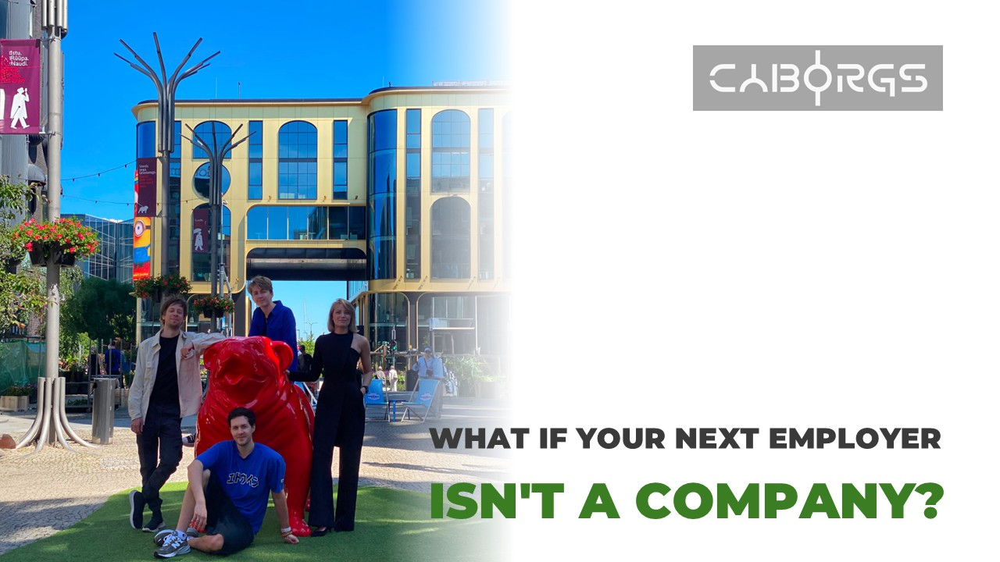
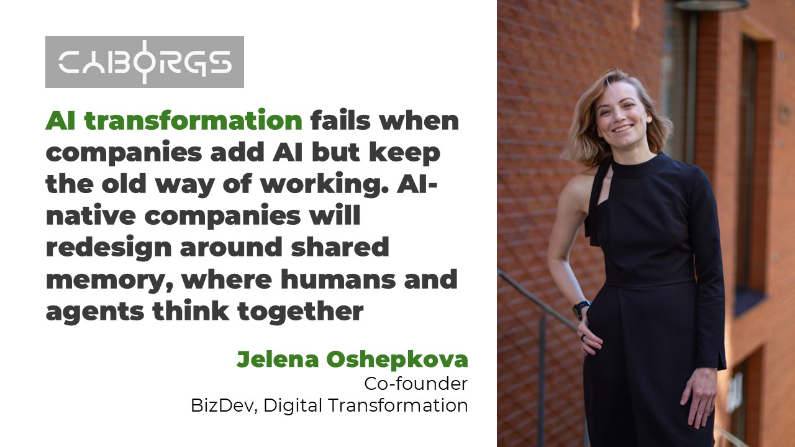
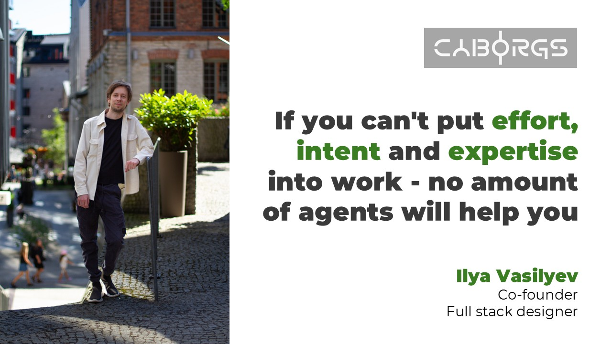
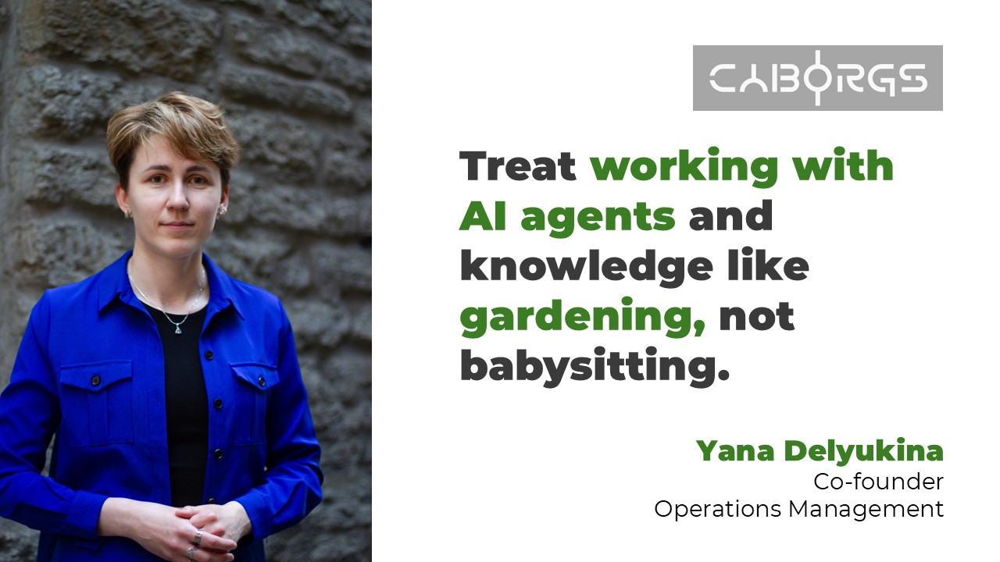
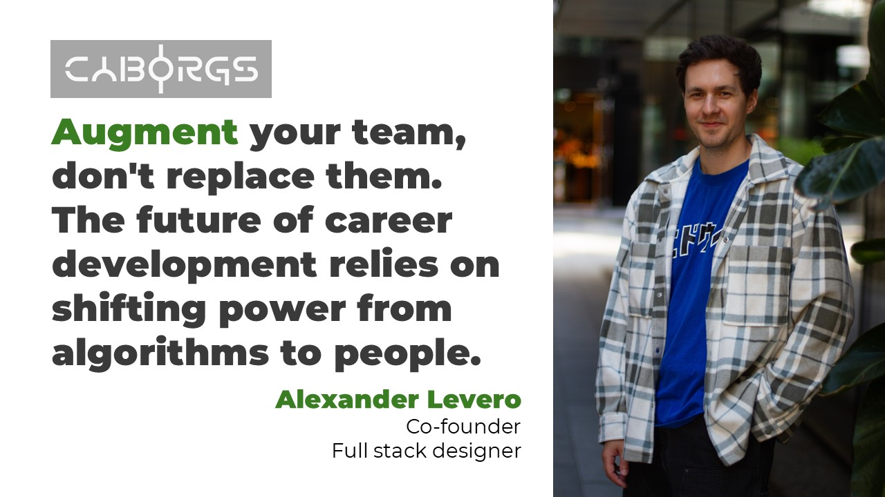
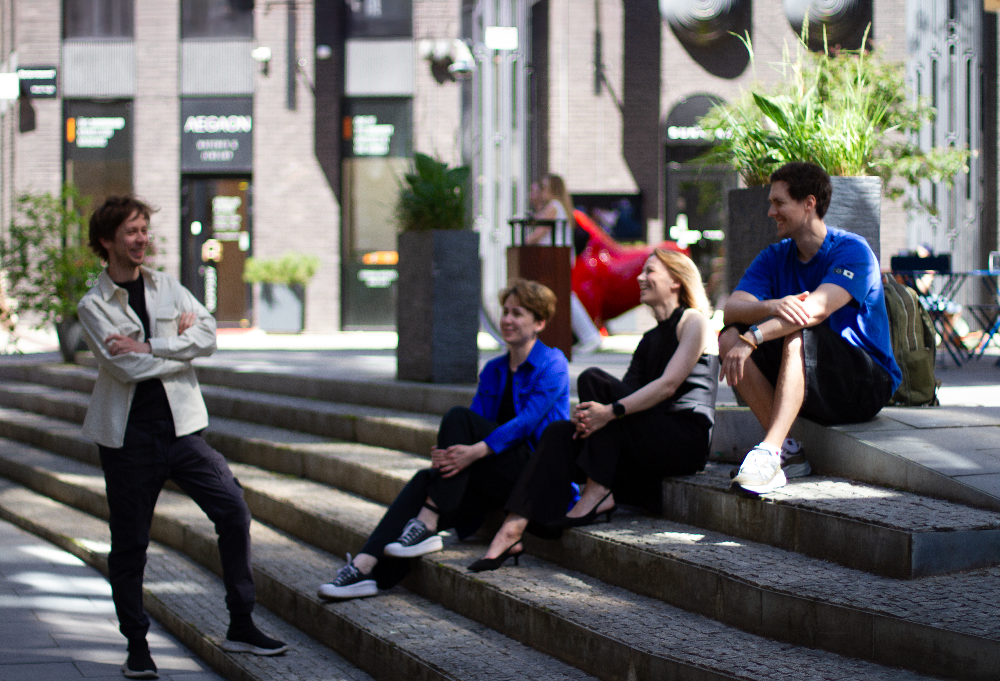
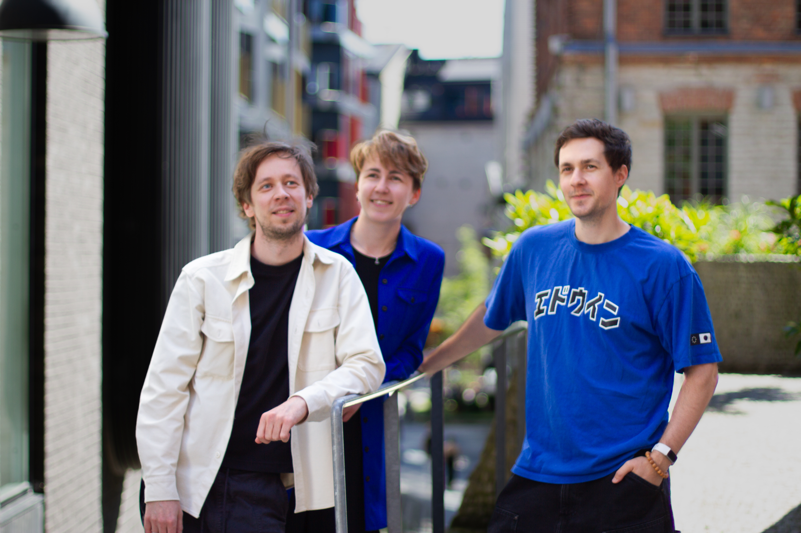

# What if your next employer isn't a company? 🤖💼

**Author:** Olga Kryuchkova  
*Nordic Tech and Innovation Ecosystem Explorer | ICT Trainer | Certified AI Transformation Leader | MSc (Tech.) | Engineer*  
**Published on:** August 18, 2026

---

My guests today are **Ilya Vasilyev** and **Jelena Oshepkova**, the forces behind **Cyborgs** and their new company brain platform, **KAOS**. 

For 18 months, they bootstrapped in the trenches, surviving three major product iterations, seven tech stacks, and nine different customer profiles. They killed their original darling project when they realized the market couldn't afford it, pivoted completely, and built an internal tool that is now racing to become the shared memory engine for the entire AI-native era. They are operating on a self-imposed conviction that their window to capture this multi-billion dollar category expires in just 3 months. 

This isn't a conversation about slick corporate software; it’s a raw look at the intense psychological toll of bootstrapping, the reality of pivoting under stress, and what happens when you stubbornly bet on human agency in a world obsessed with automating humans away.

---

**Olga K.:** Ilya, can you please introduce your team for us and tell a bit about everyone’s background that each brought to the team?

**Ilya Vasilyev:** We have **Yana Delyukina** who runs operations and makes sure sh\*t gets done on time in this team, now she builds our go-to-market strategy. We have **Jelena Oshepkova** who runs bizdev, brings resources and funds, you know, CEO stuff (she can even take a phone and just make a phone call: an impossible superpower for us nerdy millennials). We have **Alexander Levero** who joined as a junior dev and ended up writing scenarios for multiplayer multi-agent simulations, and developing psychological analytics framework. And I’m Ilya, I build stuff. I wrote music, made videos and animations, designed websites, developed apps, and worked in a few startups. It’s all the same to me.

**Olga:** If we looked back at your early childhoods or university days, what was the specific frustration or feeling of outsiderhood that unconsciously programmed you and your team to build a company called Cyborgs?

**Jelena:** My mum became an entrepreneur when I was a teenager, so I was involved in business from an early age, with trust and freedom to experiment. School and university were the opposite of that - theory, static with strict frames. I chose building and jumping into the unknown, questioning norms, looking into the future. In the early 2000s everything lived on paper (a lot of paper) and in Excel sheets. That drove me crazy - always wanted to optimize the data, digitize it, make it smarter. And twenty years later I’m part of Cyborgs - a startup building a company brain and figuring out how people and agents work together. So, the programming was quite literal.

**Olga:** Most co-founder stories are highly romanticized in retrospect. If you are being completely honest, what is the one fundamental way you see the world completely differently, and how close has that friction ever brought you to the edge of walking away?

**Ilya:** In my head, I always lived in the future. I read authors like James S. A. Corey, Ken Liu and Ted Chiang, and followed AI research way before it entered the mainstream (which is why the arrival of all these new tools was not a disruption but an enablement for me). So you can imagine how hard it is for me to get grounded in today's reality and accept that people are not perfect and the world is flawed.

**Olga:** Jelena, coming from the highly structured, risk-averse world of medical tech, what was the hardest part of your personal identity that you had to dismantle to step into the fast, volatile world of a pre-seed AI future-of-work startup?

**Jelena:** Small correction first - my world wasn’t MedTech, it was tourism for 20 years, sustainability and digital transformation. Honestly, the fast and volatile part was never the problem - this is who I am, I jump in fast, whether it’s a pivot or unexpected change. The thing I had to dismantle was a person who knows everything, and if she doesn't - figures it out on her own. 

I learned the price of that in 2020, when pandemic hit and family business didn't survive: I sat alone, holding my head that felt like it would explode. At Cyborgs I did something new for me: I stopped working alone and relying only on myself. When Ilya says "this stack or direction won't work" - I trust. Yana and Alex see things I don't see, and I listen. In the startup world, a team that can really think and act together is one of the strongest predictors of future success.

**Olga:** Ilya, as the Creative Lead and Co-Founder, you have to blend pure imagination with structural reality. When you look at the current team culture, what is a convention or common startup 'best practice' that you think is total nonsense and have intentionally banned from your workspace?

**Ilya:** Job descriptions. We don’t have them. And if you see any, like “Creative Lead” - it’s only for external communication, internally we are humans with our capabilities, and we allocate our time and effort into various projects. We even changed who is holding a CEO role a few times based on practical needs like grant applications or accelerator programs. So you may say we lean toward sociocracy here.

**Olga:** If your team was entirely transparent about their anxieties, what is the number one thing they are currently sacrificing in their personal lives to buy into your vision for cyborgs.work?

**Jelena:** Free time, side projects, hobbies, quiet evenings, weekends - all that kind of stuff. We're four slightly insane adults who chose the same thing at the same time. So what looks like sacrifice from outside is just the life we chose: envisioning and building future technologies and solutions.

**Olga:** Alexander’s background is fascinating: psychology, US military intelligence, and running D&D campaigns for years. That sounds like a secret weapon for predicting human behavior. Alexander, how does military intel and dungeon-mastering map onto building an environment where humans and unpredictable AI agents have to coexist?

**Alex:** The shared concept between these things is sensemaking under uncertainty. My career in Intel taught me evidence discipline. Psychology taught me that human behavior has complex emotional and social aspects apart from only rational thought. Pen and paper roleplaying games, while being inherently more amusing and less serious, are still very much about system design where unpredictable actors can create coherent outcomes in highly compelling ways. Creating a system that bridges this gap is exactly the problem KAOS is trying to solve for human-agent teams.

**Olga:** Yana was the first ever internal KAOS user, moving from running cold outreach for your old simulations to being the one who 'gets shit done.' Yana, when KAOS was in its ugliest, buggiest early form, what was the most frustrating argument you had with Ilya and Jelena about the tool actually making your life harder instead of easier?

**Yana:** I can't recall any arguments to be honest. I jumped into this tool when Ilya created it and was hooked immediately. The main problem was to use it through an IDE, the app where developers write code. Even though I am familiar with it, I still see myself as a non-tech founder meaning that I am avoiding using such tools. 

Before, I was using Claude Projects to have context in my conversations with AI and I was alone working on tasks. Now me and the team have the same context, which is changing and growing while we work on it, and it helps us do our job. Making it accessible for non-tech users and also be able to impress tech - that's the goal.

---

## I: About Cyborgs.work & The Vision

**Olga:** The word 'Cyborg' often evokes a cold, metallic, sci-fi future. But your writing heavily emphasizes that the most durable advantage right now is surprisingly analog, human behavior when things get messy. Why choose a name that sounds so detached from humanity to build something you claim is human-centered?

**Ilya:** Ah, the name, it comes from early days of AI hype, and inspired by Ethan Mollick’s posts about the way people use AI: they are either Centaurs (clear line separates human and AI tasks), or Cyborgs (blending and deeply integrating machine and person). So a cyborg is not a robot. Cyborg is a human augmented and supercharged by tech. We always saw ourselves as cyborgs and wanted to build tools for other cyborgs.

**Olga:** You’ve written that roles are remixing faster than job architectures can keep up, making a job 'less a noun and more a moving verb.' If jobs are liquid now, how do you plan to build a platform that maps skills without those maps becoming obsolete the moment they are generated?

**Alex:** I wouldn’t approach skills in an entirely static taxonomy. The jobs and skills should describe the verb: what work is being done, in what context, with what tools, with what evidence, and how recently. It should be a snapshot rather than an unchanging source of truth. We are most interested in a living model of where capability is showing up at this moment in time and will continue to change and evolve with time.

**Olga:** What is the single most contrarian belief you hold about how people actually want to work that the rest of the HR tech and marketplace industry completely disagrees with you on?

**Ilya:** Let’s do a little test. If you had an unconditional basic income, would you: a) Sigh in relief and focus even more on what you were doing, or b) grab food, sit on a couch and binge watch anime all day? We are from the first category, and believe that the future of work is in people from the first category who are passionate about the craft. But current jobs were built for forcing the second category into labor and squeezing every bit of productivity from them, which is really sad.

**Olga:** Imagine Cyborgs.work achieves total, absolute market dominance in five years. Walk me through a day in the life of an average worker using your platform. What is the biggest frustration they experience today that you have entirely eradicated?

**Ilya:** In five years there will be no need for a tool we build today. It will get normalized and every company will be AI-native and will run a company brain by default. So we will have to evolve and deal with emerging problems we haven’t seen yet. Like *"How to enable operational observability of fully autonomous swarms of AI companies capable of running full vertically integrated industries given enough resources and compute?"*. The average worker’s life would be too different from what we know or assume today, impossible to predict.

**Olga:** Every founder has a 'secret metric', not the one you show investors on a slide deck, but the one you look at privately to know you are actually changing human behavior. What is that metric for Cyborgs.work?

**Jelena:** We’re building a future that doesn’t exist yet, a new way of how work between humans and agents will actually look like. So, our private metric comes in two parts. First - can we describe and show this future well enough that people can get it and see it? Second: KAOS becomes the first thing you want to open with your morning coffee or when an idea hits you. Not because you have to, but because that’s where your thinking lives. When that happens, we’ve changed behaviour.

---

## III: Geographic Development (Estonia, Finland, EU vs. US)

**Olga:** Estonia is celebrated globally as a frictionless digital paradise, and Finland is right next door with a massive, high-energy tech ecosystem. But digital efficiency doesn't automatically mean cultural agility. What is the hidden psychological barrier in the Nordic/Baltic workforce that makes launching a disruptive labor platform harder here than for example in the US?

**Yana:** Not to be affected by hype and do not make rush decisions. Sometimes it's better this way than some rush decisions.

**Olga:** If you base your headquarters strictly in the EU, you operate under intense regulatory frameworks like the AI Act and strict data protections. If you move your center of gravity to the US, you enter a hyper-aggressive, growth-at-all-costs environment. If you are choosing the EU, are you consciously choosing values over maximum velocity?

**Jelena:** Yes, choosing Europe is conscious. We’re not saying no to the US; we want breakthrough technologies like this built in Europe too, and we’re giving it a try from Estonia and Nordics. In our category, velocity comes from trust, not from geography.

**Olga:** There is a trope that European startups build beautiful, deeply ethical products but struggle to sell them, while US startups sell the dream before the product even works. How are you ensuring Cyborgs.work doesn't become another brilliant, over-engineered European secret?

**Yana:** With our previous product we built first and validated late. This time we started fundraising before we had a prototype to understand who gets it and who doesn't. Those early conversations told us more about our market than months of internal work would have.

**Olga:** If a massive US competitor with 100x your funding copies your core feature set tomorrow, what is the un-copyable regional or cultural advantage embedded in your Nordic roots that keeps you protected?

**Alex:** The Nordic/Baltic advantage is a practical one of high trust, close-knit teams, and low tolerance for tools that turn people into managed units. Businesses here can be much more personal, and creative solutions to challenges are more typical when teams are forced to work within budget and man-power limitations. A larger company can copy features but would be hard pressed to copy product culture that refuses the easy but unsavory version that includes surveillance and worker replacement.

**Olga:** Let’s talk about capital. If you could choose between a €1.5M pre-seed check from a conservative, highly protective European fund or a €5M check from a cutthroat Silicon Valley VC that demands a pivot toward total automation, which check do you take, and what does that choice say about your soul?

**Yana:** Neither. A conservative fund would slow us down. And a fund that pushes us toward full automation is asking us to become a different company, the one we don’t want to be and do not believe in. We're looking for investors who understand that collaboration between AI and humans where humans are the main decision makers is the future. It will make humans better and help them to grow.

---

## IV: Tech, AI, Data & Ethics, The Future of Work

**Olga:** McKinsey surveys and market data show that GenAI isn't closing performance gaps; it's accelerating them, widening the chasm between the highly adaptable and those left behind. Is there a dark truth here that Cyborgs.work is forced to participate in: that tech transitions naturally create an economic underclass?

**Alex:** That risk, especially for Cyborgs, is a real one. While KAOS is not and will not contain labor policy, the nature of GenAI tools’ potential impact on existing work hierarchies don’t allow us to escape some level of responsibility. We choose to build tools that preserve agency, shared memory, and learning from within the work itself so we do make an effort to balance in the opposite direction of ranking, replacement, and judgement.

**Olga:** We hear endless talk about 'upskilling' and 'reskilling' as if it’s an easy software update for a human being. But learning an entirely new cognitive skill set when you have a mortgage and a family is deeply stressful. How does your platform handle the psychological trauma of a worker realizing their core identity is no longer valued by the market?

**Alex:** The first thing is to ensure that humans understand the reality of the situation, that they can never truly be obsolete and there can be actionable paths to learn and adapt that everyone is capable of. KAOS preserves what workers already know, but can help them move into adjacent or new roles using agents as scaffolding. It doesn’t remove economic pressure, but it can make the transition feel less solitary, humiliating, and dependent on pretending that upheaval of the type of work you have spent time and effort improving happens overnight.

**Olga:** As an AI-driven platform operating in the labor space, you are collecting data on human capabilities, behaviors, and adaptabilities. Where do you draw the line between using data to 'empower' a worker and accidentally building a hyper-efficient, algorithmic panopticon that scores human worth?

**Alex:** The line is purpose, consent, and visibility. A lot of our thoughts and guidance are distilled from works by world organizations like the European Commission, National Career Development Association, and United Nations Educational Scientific and Cultural Organization who are making sustained efforts to trailblaze social human rights and moral guidance regarding AI-driven platforms. Data shouldn’t be used as a hidden ranking of human worth or adaptability. To put it simply: work should be legible to the people doing it before making it legible to management.

**Olga:** If uniquely human skills, like empathy, reading the room, and navigating messiness, are the most durable, how do you build an objective, data-driven system to measure them without destroying the very magic that makes them human?

**Alex:** You can’t! We don’t measure that magic, we make note of and measure the moments where it happens. In our earlier workplace simulations project we looked at observable patterns: did someone notice tension, repair a misunderstanding, invite a quieter person in, or change their mind when the situation changed? It is different from simply assigning an arbitrary numerical value. We are objective by observing and measuring traces and caveats. We don’t pretend that human judgement is a thermometer reading.

**Olga:** What keeps you up at night regarding the timeline of GenAI? Are business leaders moving too slow to adapt their organizational structures, or is the technology moving too fast for human psychology to keep pace?

**Ilya:** The economic bubble. Plus research labs (and some governments) keep the best models for themselves. That can turn very dystopian very fast.

**Jelena:** I did digital transformation for years, and GenAI is repeating the pattern I saw then. 95% of enterprise GenAI pilots fail, not because the models are weak, but because companies install the future on top of the past. New tools, old structures, same scattered knowledge. So, those are companies trying AI on the old foundation, getting nothing, and concluding AI doesn't work.

---

## V: Vision & Future of Cyborgs.work

**Olga:** Jelena, you spent a decade leading digital transformation for clients before bootstrapping this for 18 months. You’ve put your name, your reputation, and your email right on the front lines of this deck. If you look at the next 6 months of this €3M raise, what is the personal toll this is taking on your health and your life outside of Cyborgs?

**Jelena:** I might disappoint you - no dramatic tolls here. Yes, the raise is intense and there are quite a lot of “no”s in my inbox, exhausting travels and so on. But those are just things that need to be done, and there’s its own beauty in that. I do my essentials: proper sleep, regular trainings to decompress and quality time with my kid. I know whatever this raise takes - I’ll recover. This is a journey and a challenge I’m really enjoying and passionate about.

**Olga:** Let’s talk about the personal cost of the crown. When you guys look at the sheer scale of rewriting how the labor market functions, what is the piece of your personal life, health, or relationships that you are currently neglecting the most to make this company survive?

**Yana:** Having any other interests. I have an Estonian language course so I am forced to switch off from AI, tech, and Cyborgs for several hours. Which is great. 

**Ilya:** No hobby time for me, it runs non-stop in my head from waking up till going to sleep. And sometimes I write complex multi-step prompts in my dreams.

**Olga:** If you could put a single message on a billboard that every single corporate executive and every single gig-worker walking into the Slush conference would see, what would it say?

**Alex:** Augment people to be more capable, not more disposable.

**Ilya:** I would put some bizarre meme about all of them being replaced by AI, just to troll them, no message.

**Olga:** Jelena, Ilya, you’ve given yourselves an incredibly tight, high-stakes six-month window to capture this category before the window closes. If an investor or a world-class engineer is listening to this right now and wants to step into the KAOS with you, what is the specific, unshakeable piece of conviction they need to share with you today to help you win this race?

**Ilya:** They simply need to see that a wave of AI-native companies is coming and there are no good tools to run such companies available today. 

**Jelena:** Ilya said the market part. Mine is simpler: they need to actually want to be here - in the early, messy, unproven, but challenging and future-oriented stage, not wait for it to become safe. We're ambitious and curious, and we're looking for the same kind of people: future believers, who change how humans work instead of waiting for it to change. If someone needs something solid and proven first, we're not their company yet.

**Olga:** For the founders and team leaders listening who are currently drowning in disconnected AI tools and feel their company memory slipping away, what is the very first markdown file or 'knowledge garden' asset they need to author inside KAOS tonight to stop trying to automate their people, and start actually scaling their collective human intelligence?

**Ilya:** As a human you can only bring your intent, effort, and expertise. The rest will follow: structure will emerge, tools will take the right shape. But only if you keep providing these 3 components, because the moment you stop, it will turn into slop overnight.

