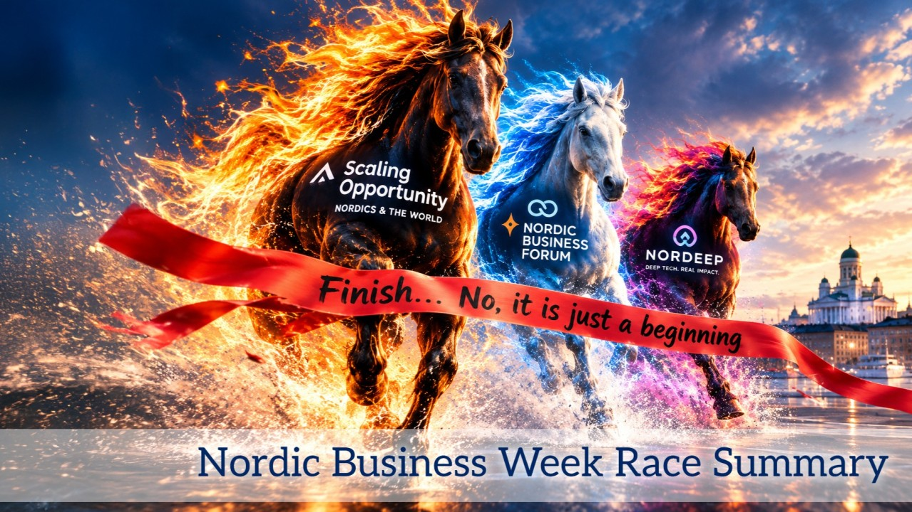
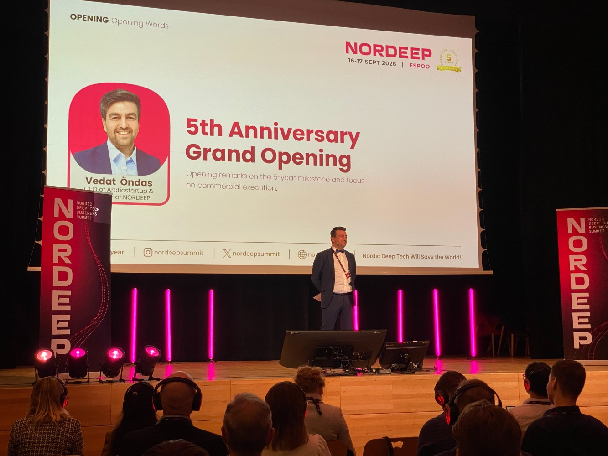
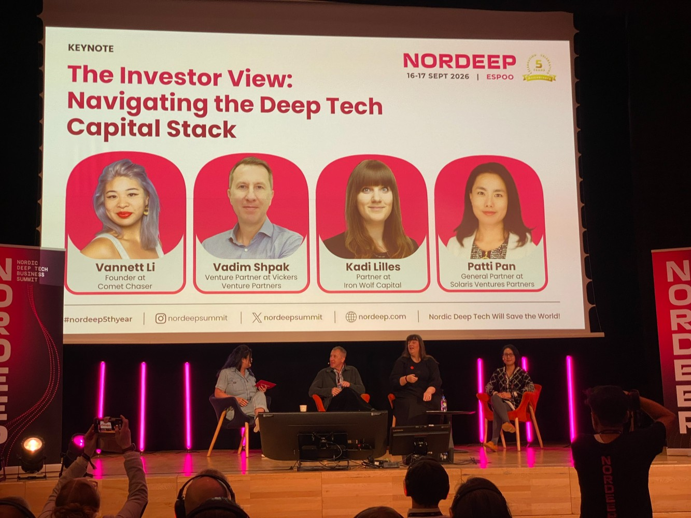
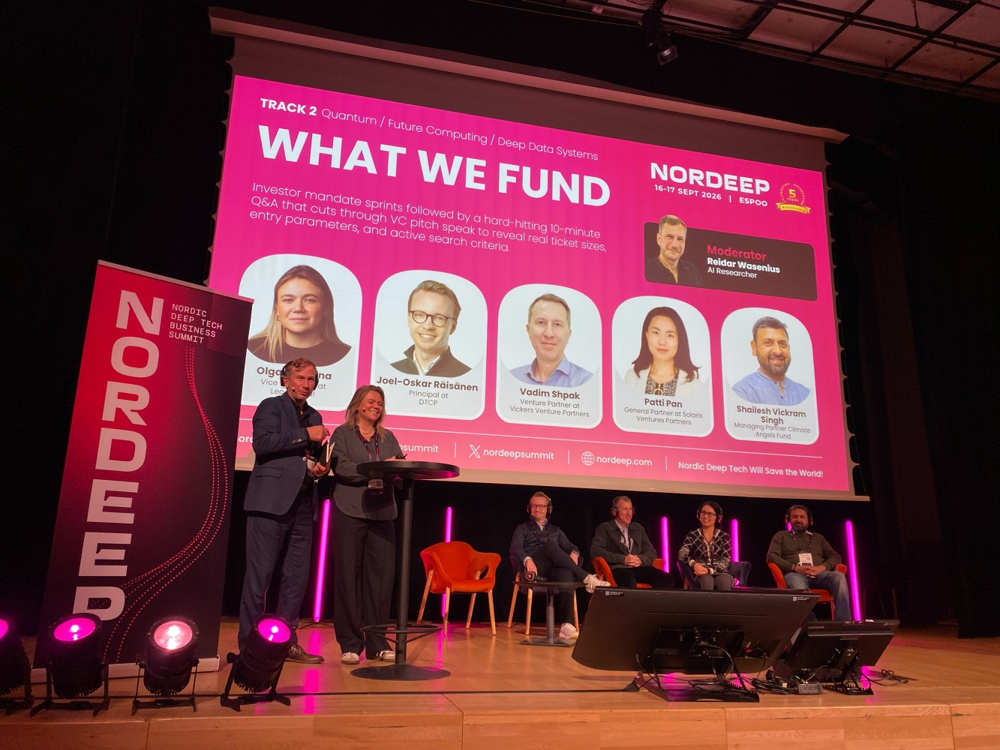
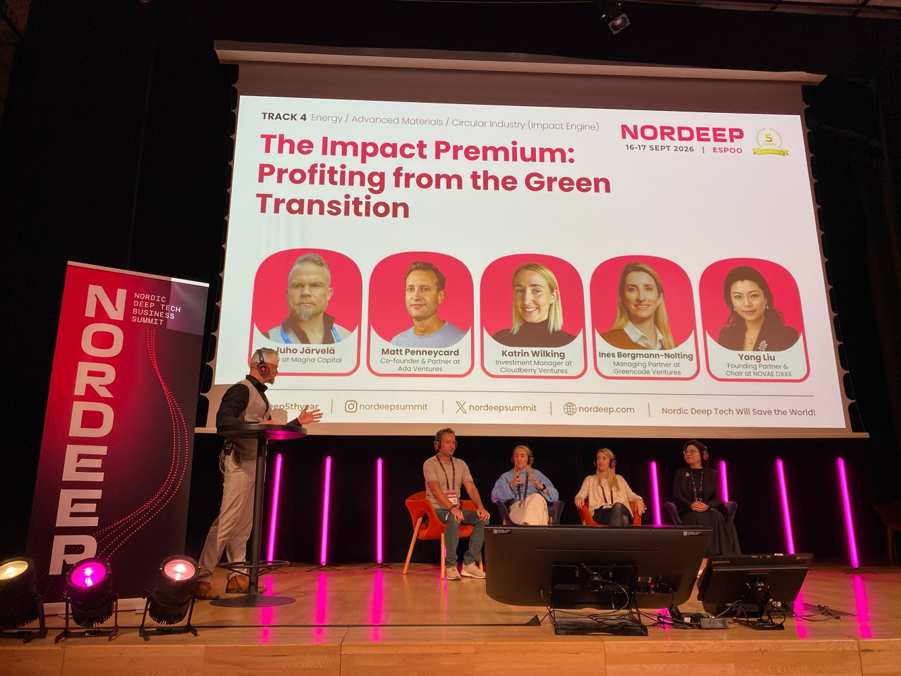
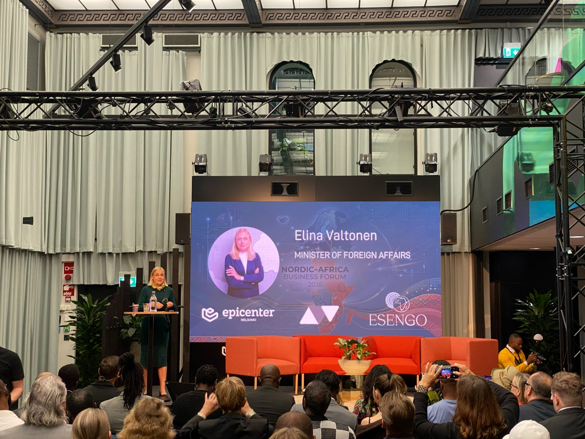
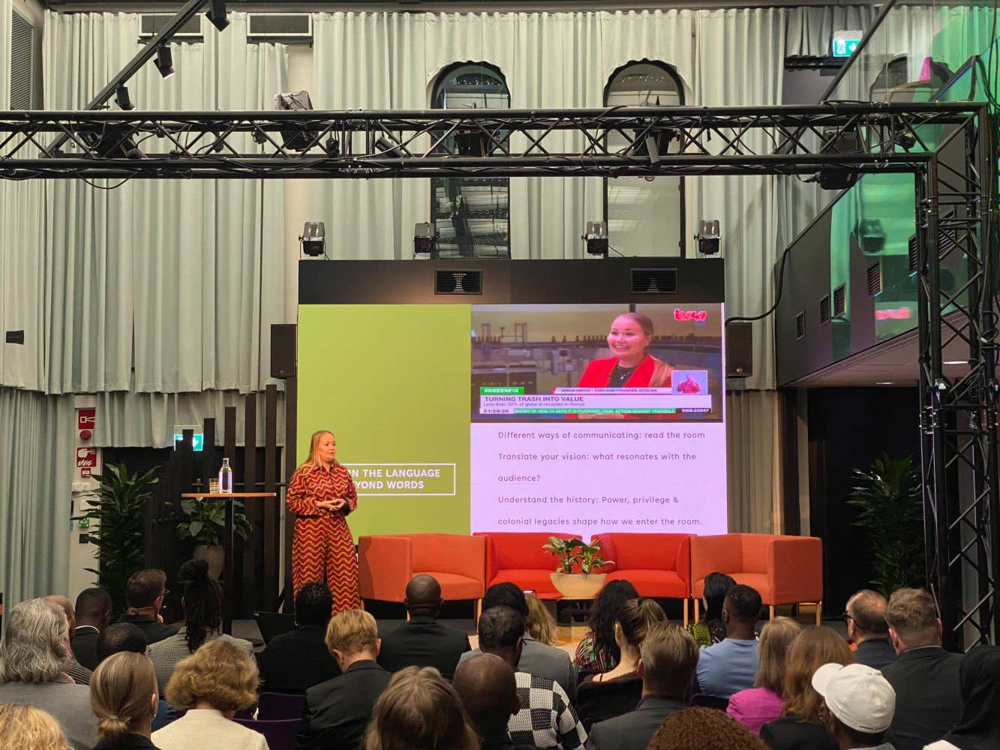
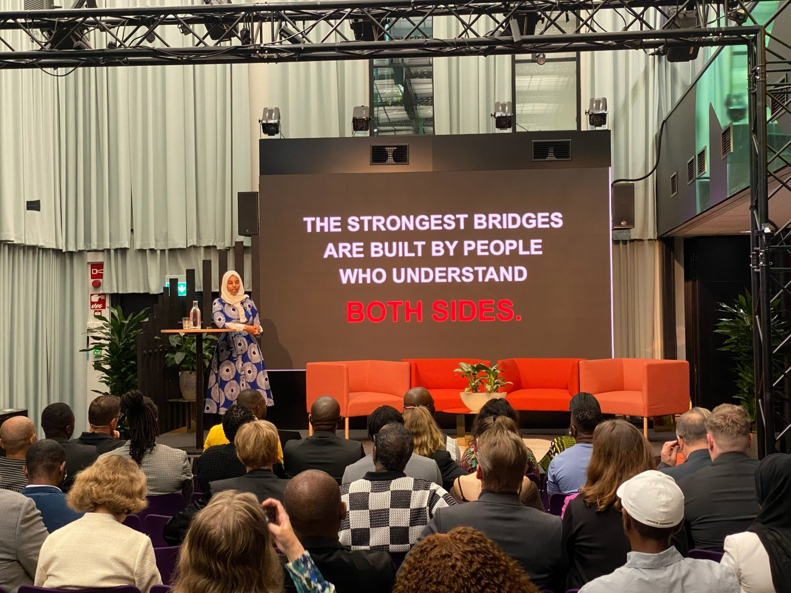

# Nordic Business Week Race Summary (14 - 18 Sept. 2026) 🐎🏁

**Author:** Olga Kryuchkova  
*Nordic Tech and Innovation Ecosystem Explorer | ICT Trainer | Certified AI Transformation Leader | MSc (Tech.) | Engineer*  
**Published on:** September 29, 2026

What can I say? It’s been a truly intense Nordic Business Week.

For those who couldn't quite escape work but are still keeping one eye on the Finnish tech and innovation ecosystem, here is my slightly selective field report. A lot happened. Far too much for one LinkedIn post and even article, but fortunately, I have no intention of reproducing every panel, presentation and announcement. Consider this an ecosystem tasting menu. And if this is only the beginning, the prospects are rather breathtaking.

### 🐎 First, the Dark Horse: Scaling Opportunity

The week kicked off by betting on a "dark horse": the *Scaling Opportunity: Nordics & The World* event by [Epicenter Helsinki](https://www.linkedin.com/company/epicenter-helsinki/) + [Lahde Impact](https://www.linkedin.com/company/lahdeimpact/), and those who joined me in that bet certainly didn't regret it. It turned out that the "dark horse" put in a powerfully confident performance.

The event was a concentrated lesson in what Finnish companies need when they look beyond Finland: not simply another market report, but knowing the culture and the right people in the market. Europe. The Middle East. Asia. The US. The speakers observed quite openly how differently business works across these markets and shared some best practices from their experience.

### 🌍 The Ambassadors Are Already Here

[Erik Åkesson](https://fi.linkedin.com/in/erikaakesson)’s opening session, **“Wake Up Nordics!”**, gave me one of the strongest signals of the day. His point about international talent was particularly striking: Finland should not look at highly qualified migrants merely as people who need employment. It should also look at them as **bridges to markets Finland wants to enter.**

People who have lived, studied and worked elsewhere already possess something a Finnish market-entry strategy cannot easily manufacture: **context.** They understand how business is done in their countries. They know the language, networks and unwritten rules. They are becoming gateways between ecosystems and countries.

In other words, some of Finland's internationalization infrastructure has already arrived and is currently sitting here wondering why nobody has called. The irony is rather Finnish. We talk about internationalization while sometimes overlooking the international expertise already living next door.

### 🇺🇸 And Then There Was America

The session **“Cracking America: What Does It Take to Win in the U.S.?”** brought another useful reality check.

One idea from [Jarmo Sareva](https://fi.linkedin.com/in/jarmo-sareva) stayed with me: **time moves differently in Finland and America (different clock speed).** For Finnish companies, this is more than a cultural curiosity. It can become a GTM problem. The Finnish instinct to prepare, verify, refine, consult, establish consensus and perhaps have one more coffee before making the decision does not necessarily travel well into markets where speed and confidence are themselves part of the proposition.

And John Black's advice was wonderfully uncomplicated: **be loud and proud of your product.** Which may be one of the more radical pieces of advice a Finnish company can receive. Because somewhere between *“we have developed a technically excellent solution”* and *“the world absolutely needs this”* lies the uncomfortable territory of marketing.

### 🔎 The Signal I Took Away

For me, the most interesting story of Scaling Opportunity wasn't any individual market. It was the connection between **technology, GTM and visibility**. Finland has technology. Finland has talent. Finland has an increasingly international ecosystem. But scaling requires making these three things **visible and connected both inside Finland and beyond it.**

And perhaps the next chapter of Finland’s innovation story is less about inventing more and more about making the world notice what is already here. The ambassadors are already here. The products are already here. The expertise is already here. Now somebody has to introduce them to each other. And preferably before the next Finnish coffee break.

### 🐎 The Draught Horse: Nordic Business Forum

[Nordic Business Forum](https://www.linkedin.com/company/nordic-business-forum) met guests with an interesting question about what, precisely, will remain stubbornly human once machines become very good at producing the obvious answer.

[Shawn Kanungo](https://ca.linkedin.com/in/shawnkanungo) approached the problem from the dangerous end. His argument was less about what AI can do than about what it can tempt organizations to do badly: move faster, automate faster, and mistake activity for transformation. His title **The Most Dangerous Person in the Room: Decision-Making in the Age of AI** contains the joke and the warning. The threat is not the machine. It is the human who becomes excessively comfortable with it.

[Rahaf Harfoush](https://fr.linkedin.com/in/rahafharfoush) shifted the lens from machines to minds. Her idea of a rising “thinking class” suggests that when information becomes abundant — almost indecently abundant — the scarce resource is no longer access to knowledge but the ability to think, question, connect and decide what deserves attention. In an AI-saturated world, curiosity begins to look less like a soft skill and more like infrastructure.

[Kjell A. Nordström](https://se.linkedin.com/in/kjell-a-nordstr%C3%B6m-58778b4a) offered perhaps the most provocative version of the same thought. His *Wild Knowledge* points toward the value of knowledge that lives outside the obvious systems: the strange observation, the peripheral connection, the person who knows something the database does not. AI is extraordinarily good at what is already legible. The interesting territory may increasingly be what has not yet been made legible. And that, perhaps, was the quiet message underneath all three talks.

**What I’m taking home:**

1. **AI is becoming infrastructure.** The competitive question is shifting from *“Who has AI?”* to *“Who knows what to do with it?”*
2. **Human judgment, curiosity and attention** are becoming more valuable precisely because machines are making information cheaper.
3. **The next interesting layer of the innovation economy** may live between the databases — in conversations, weak connections, unexpected expertise and people who have not yet found one another.

That last signal interests me most. Because perhaps the future of media is not simply to report what happened. It is to notice who should be talking to whom — and make the connection visible.

### 🧬 Deep Tech at NORDEEP 2026

Deep Tech is becoming less about the idea and much more about evidence, capital strategy and industrial reality.

At NORDEEP 2026 we were listening to founders, investors, researchers and people working at the intersection of technology, industry and capital. There were many fascinating technologies on stage. But for me, the most interesting part was not the technology itself. It was listening to **how investors think.** And three themes kept coming back.

#### 1. There is no such thing as “the investor”

One of the strongest sessions was **“The Investor View: Navigating the Deep Tech Capital Stack”**, with [Vadim Shpak](https://sg.linkedin.com/in/vadim-shpak-291b8314) of Vickers Venture Partners, [Kadi-Ingrid Lilles](https://ee.linkedin.com/in/kadiingrid) of Iron Wolf Capital and [Patti Pan](https://www.linkedin.com/in/pattipan) of Solaris Venture Partners, moderated by [Vannett Li](https://www.linkedin.com/in/vannett-li-816ab18) of Comet Chaser.

Three investors can look at the same startup and see completely different opportunities — because they are operating with different:

* Investment theses
* Stages
* Ticket sizes
* Geographies
* Sector priorities
* Risk tolerance
* Expectations around evidence
* Portfolio strategies

**Vadim Shpak** brings a broad international investment perspective from Vickers, where he has been involved in investment selection, portfolio monitoring and strategic and financial value creation.

**Kadi-Ingrid Lilles** represents Iron Wolf Capital's Baltic-focused deep-tech and defence strategy. Iron Wolf invests €0.5–5 million, prefers to lead rounds and focuses on exceptional founders building global companies in deep tech, AI and defence.

**Patti Pan** comes from a very different angle: Solaris focuses on digital infrastructure, robotics, physical AI and next-generation technologies, with a particular interest in the convergence of AI and the physical world and cross-border connections between Europe, the US and Asia.

The lesson for founders is quite straightforward: **Don't ask only, “How do I convince investors?”** First ask: **“Which investor strategy actually matches my company?”** The wrong investor can be just as problematic as no investor.

#### 2. Investors are becoming much more explicit about evidence

The **“What We Fund”** session, moderated by [Reidar Wasenius](https://fi.linkedin.com/in/reidar) and featuring [Olga Balakina](https://il.linkedin.com/in/olga-balakina-4b046543), [Joel-Oskar Raisanen](https://uk.linkedin.com/in/joeloskar), Vadim Shpak, Patty Pan and Shailesh Vickram Singh, offered a particularly useful look behind the curtain of venture capital through pitching the startups. Yes, VCs were presenting their pitches!

The most useful investor message for me was not a particular sector prediction. It was the emphasis on **precision, evidence and the ability to learn.** A startup can have an impressive technology. It can have a brilliant scientific team. It can even have a huge market. But if the founders cannot clearly explain:

> *“What exactly are we building? For whom? What evidence do we have? What have we learned? What changed because of customer feedback? What still needs to be proven?”*

— the conversation becomes difficult very quickly.

Instead of generic VC panels, investors were asked to present their actual mandates: investment stage, ticket size, geography, technologies, evidence requirements and search priorities. That is an important shift. The startup is not simply presenting itself. **The investor is also presenting what they are looking for.** And that makes the relationship much more like a matching problem than a pitching competition.

#### 3. The green transition is increasingly an industrial and investment story

The session **“The Impact Premium: Profiting from the Green Transition”** brought together [Matt Penneycard](https://uk.linkedin.com/in/mattpenneycard) of Ada Ventures, [Katrin Wilking](https://uk.linkedin.com/in/katrinwilking) of Cloudberry Ventures, [Ines Bergmann-Nolting](https://de.linkedin.com/in/inesbergmann-nolting) of Greencode Ventures and [Yang Liu](https://fi.linkedin.com/in/lynovae99) of NOVAE DXXII, moderated by [Juho Järvelä](https://fi.linkedin.com/in/juhojarvela) of Magna Capital.

What I found interesting was the reframing of “green”. This was not simply a discussion about sustainability. It was about: **resources + supply chains + industrial resilience + regulation + technology + capital.**

**Katrin Wilking**, for example, focuses on industrial infrastructure at Cloudberry, particularly energy transition, advanced materials and robotics, combining legal-economic expertise with venture investing.

**Ines Bergmann-Nolting** brings more than 15 years of experience across energy, cleantech and venture capital and was instrumental in developing E.ON's Future Energy Ventures.

And **Yang Liu** brings another important dimension: the ability to connect technology with industrial supply chains, financing and cross-border deployment. Her work has included critical chemical raw materials and critical-minerals supply chains connecting Europe, China and Africa. That makes the “impact premium” an interesting concept. The opportunity is not necessarily: *“Let's build something environmentally friendly.”*

It can be: **“There is a strategic industrial problem created by energy transition, resource scarcity, regulation or geopolitical dependency. Can technology solve it — and can solving it create a defensible business?”** That is a much more investment-oriented question.

### 🌍 Bonus Track: Nordic African Business Forum

The **Nordic-Africa Business Forum** at [Epicenter Helsinki](https://www.linkedin.com/company/epicenter-helsinki) offered a useful shift in perspective: Africa was discussed not as a development-aid destination, but as a **business partner, growth market and increasingly important part of global value chains**.

The forum, opened by Finland’s Minister for Foreign Affairs [Elina Valtonen](https://fi.linkedin.com/in/elinamariavaltonen), brought together Nordic and African entrepreneurs, investors and business leaders around practical questions of market access and international growth. Elina Valtonen highlighted the complementary roles of governments and entrepreneurs: institutions can open doors, build connections and reduce uncertainty, while businesses have to turn those relationships into functioning commercial partnerships.

[Sonja Sirviö](https://ke.linkedin.com/in/sonjasirvio)’s experience of scaling Ecocan in Kenya made the discussion particularly concrete. Her story demonstrated that entering an African market is not simply a matter of exporting a Nordic solution and translating the pitch. Local realities can fundamentally change the problem you are solving and the way you communicate it. Sonja has described how her company’s positioning around recycling in Finland had to be adapted to the Kenyan context, where issues such as counterfeit products and local market realities can become much more relevant. Her takeaway was essentially: **scale the solution, but adapt the understanding of the problem.**

Another important theme came from [Fadumo Ali](https://fi.linkedin.com/in/fadumo-ali) and the broader discussion about how Africa is perceived from the Nordics. The relationship needs to move from a traditional **“aid recipient–donor” model towards equal partnership**, where African entrepreneurs, consumers, investors and companies are recognised as active participants shaping the market.

And “Africa” itself is far too broad a category for a business strategy: the continent consists of 55 African Union member states, with very different markets, cultures, regulations, customer needs and business environments. As Fadumo emphasised, a meaningful strategy has to start with a **specific country, customer, problem and local network**, rather than an abstract “Africa strategy.”

Perhaps the most interesting structural takeaway was the discussion about **where value is created**. Africa has often been positioned in global trade primarily around extraction, mining resources, exporting raw materials and importing finished products. The more interesting opportunity is to build **local processing, manufacturing, technology, skills and value creation before export**.

In other words: not simply *extract → export*, but **extract → process → create value → build industries → export**. That requires thinking about Africa not as one market but as a highly diverse set of regional ecosystems from West and East Africa to Southern Africa, each with different capabilities and opportunities.

For Nordic companies, this changes the question from *“What can we sell to Africa?”* to something much more interesting: **“What can we build together with Africa?”**
