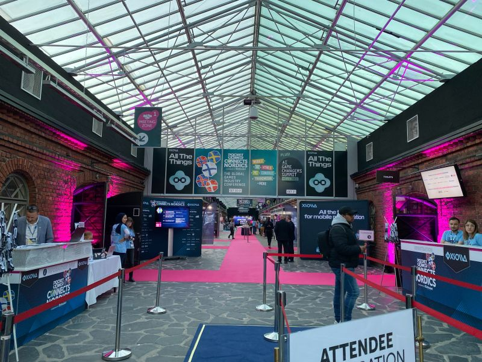
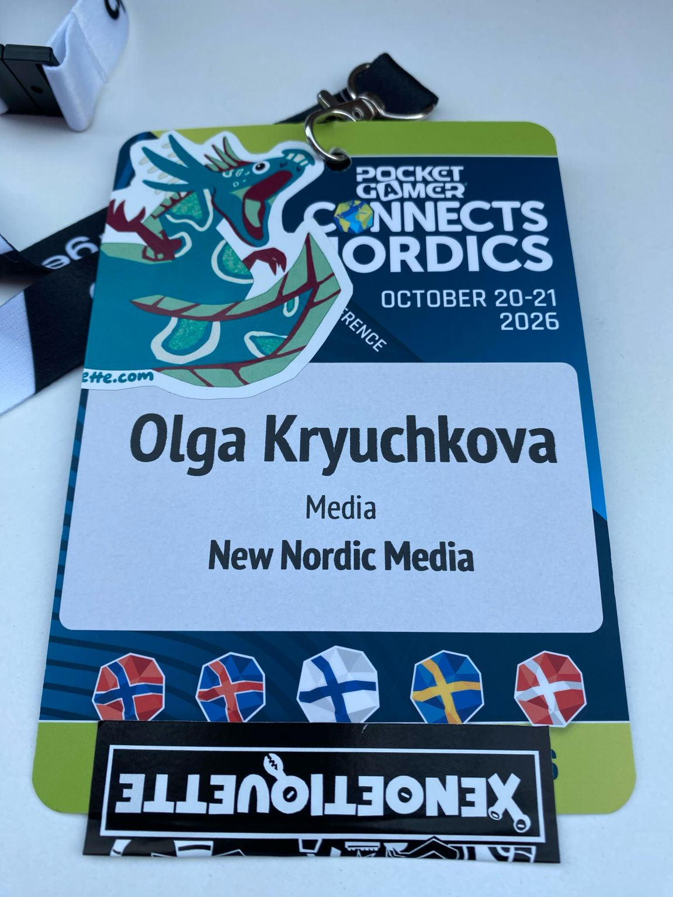
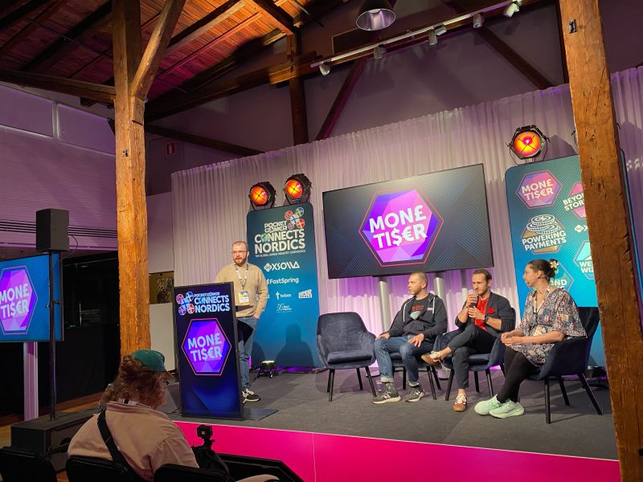
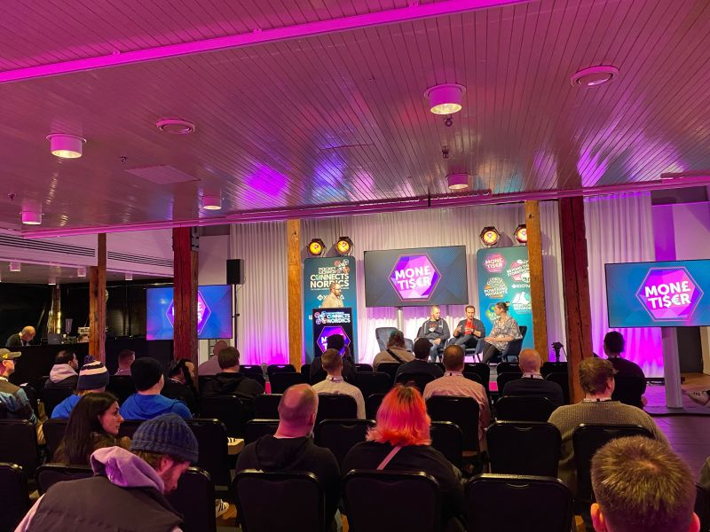
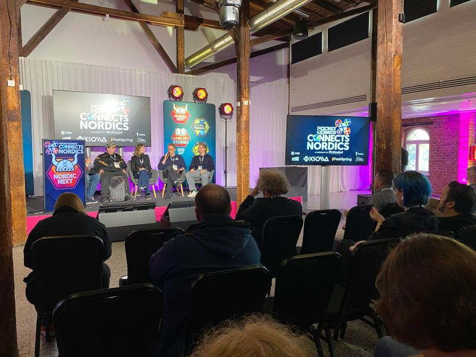
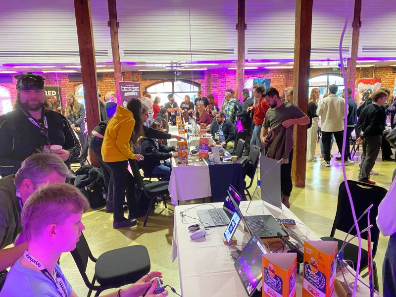
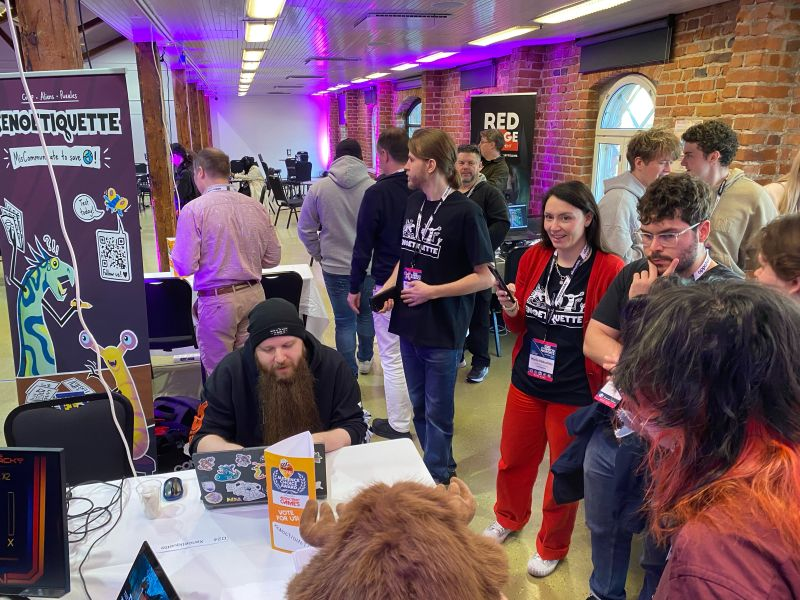

# Day 1 at Pocket Gamer Connects Nordics 2026: Indie Game Makers and the Future of Nordic Play 🎮

**Author:** Olga Kryuchkova  
*Nordic Tech and Innovation Ecosystem Explorer | ICT Trainer | Certified AI Transformation Leader | MSc (Tech.) | Engineer*  
**Published on:** October 20, 2026

Day 1 at [Pocket Gamer Connects](https://uk.linkedin.com/showcase/pg-connects/) Nordics 2026 🎮 at Wanha Satama in Helsinki!

First and foremost, I am here to support my favourite indie game makers, [Xenoetiquette](https://www.linkedin.com/company/xenoetiquette), and to get a better feel for the state of the Nordic games industry in 2026.

This year, the event has expanded its scope beyond Helsinki to bring together the wider Nordic games ecosystem, such as our favourite neighbour 🇸🇪, with 1,500+ industry professionals expected, 150+ speakers, and discussions spanning game development, funding, monetisation, AI, and the future of interactive entertainment.

### Key Questions for the Nordic Games Ecosystem

What I’m particularly interested in hearing today:

- 🎮 **How are Nordic indie studios really doing?** How are smaller teams navigating funding, visibility, distribution, and an increasingly competitive global market?
- 🤖 **Where is AI making a genuine difference?** Beyond the hype, how is it changing the way games are built, marketed, and scaled?
- 🌍 **What makes the Nordic games ecosystem resilient?** Is it talent, collaboration, access to international markets, or the ability to turn creative ideas into sustainable businesses?

### Bridging Creativity and Commercial Success

Let’s uncover the space between creativity and commercial success. Making a brilliant game is one challenge; getting it discovered, funded, and into the hands of the right audience is another.

And that’s why events like this matter: they bring developers, publishers, investors, and other ecosystem players into the same conversation.

Here’s to good games, honest conversations, unexpected connections, and the indie teams bold enough to build something different. Let’s see what Day 1 has to bring us!

And of course, we love [Xsolla](https://www.linkedin.com/company/xsolla) ❤️

*#PGCNordics #IndieGames #NordicGames #GameDev #FinnishGamesWeek*
