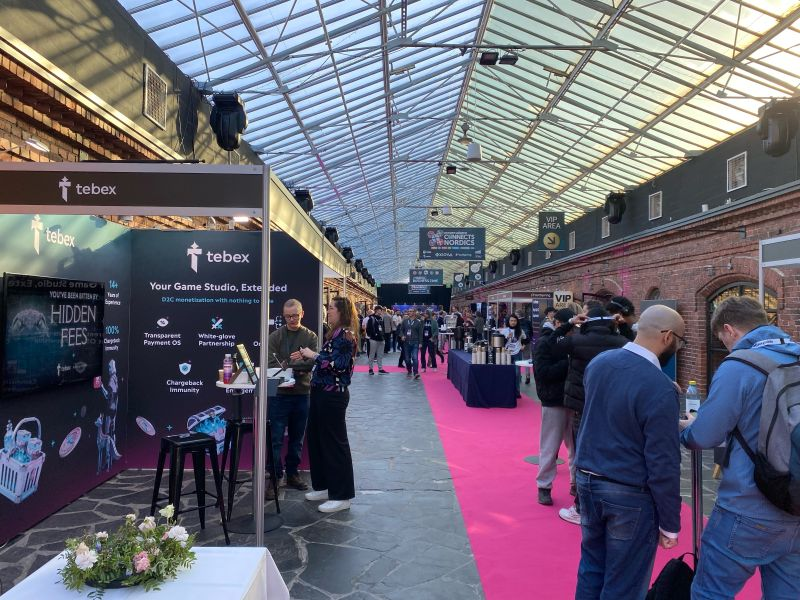
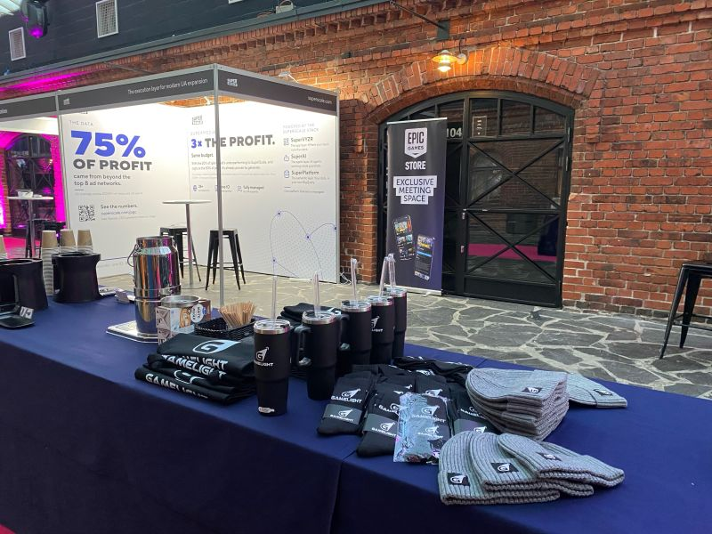
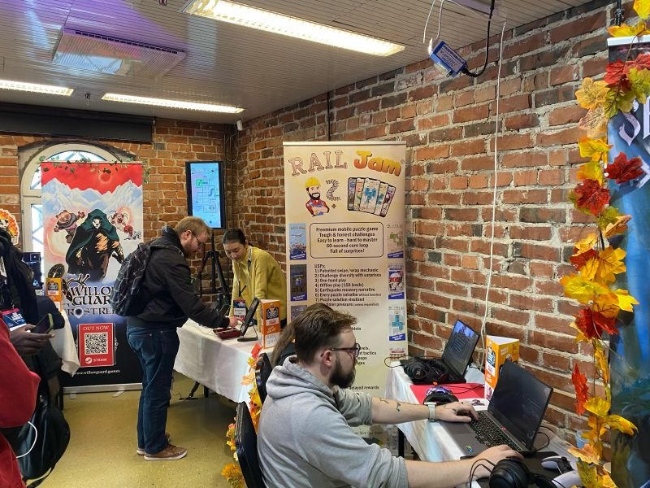
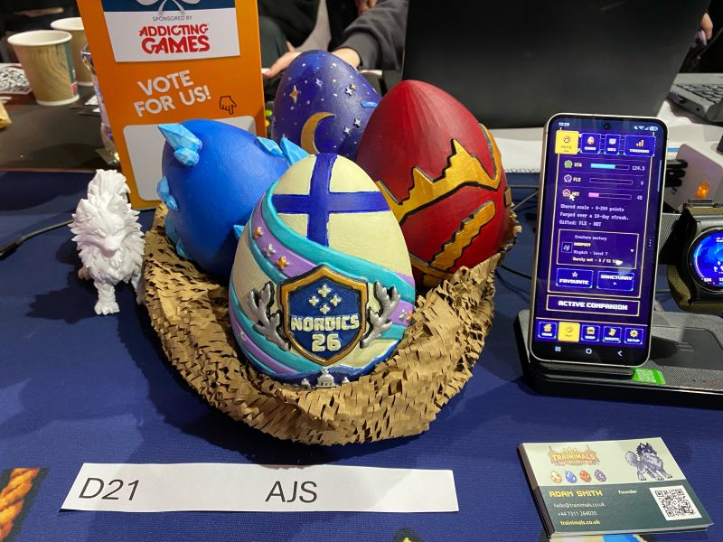
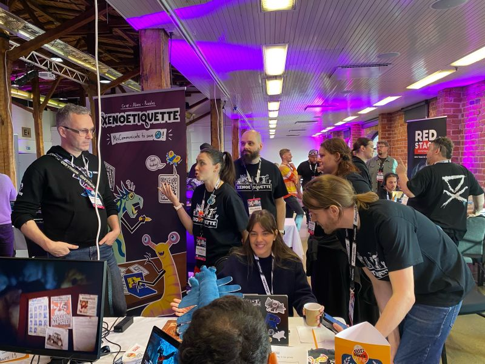
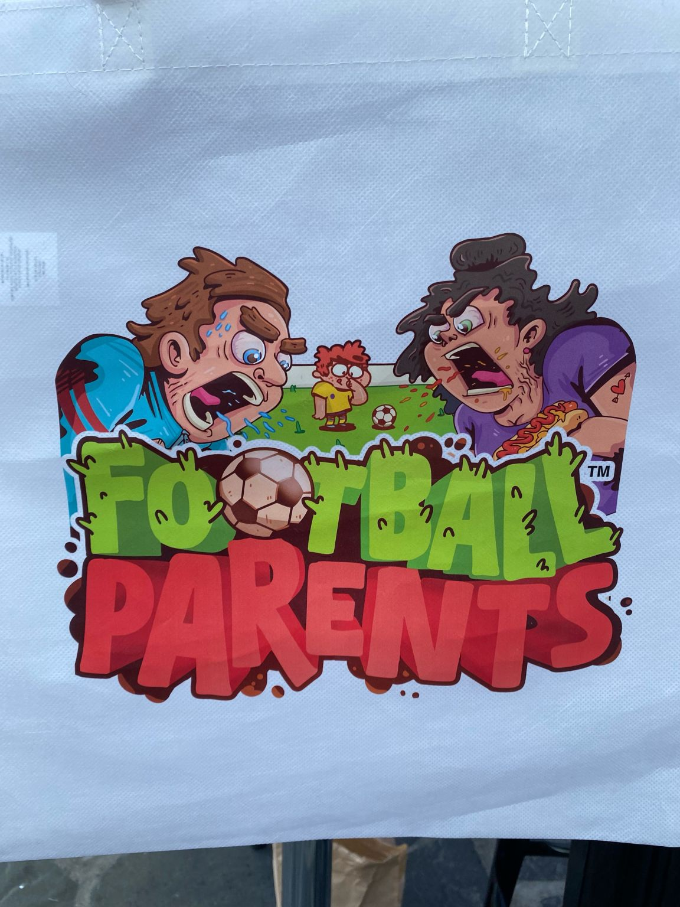
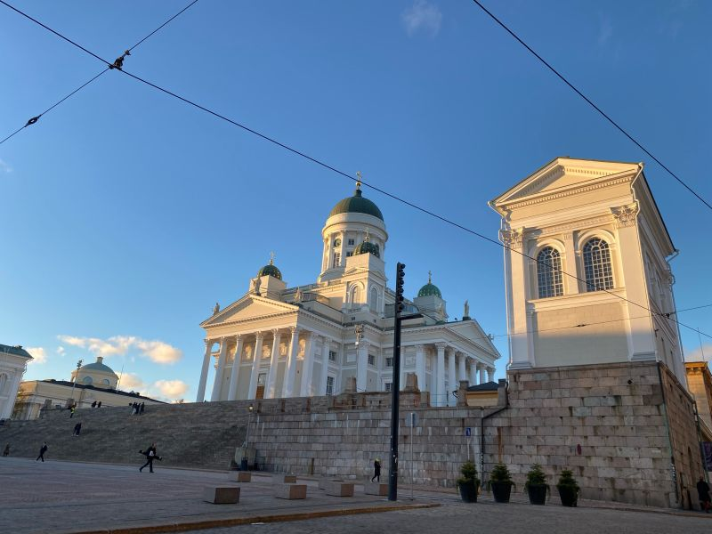

# Day 2 at Pocket Gamer Connects Nordics 2026: Big Games, Bold Indies, and the Business Behind the Fun 🎮

**Author:** Olga Kryuchkova  
*Nordic Tech and Innovation Ecosystem Explorer | ICT Trainer | Certified AI Transformation Leader | MSc (Tech.) | Engineer*  
**Published on:** October 21, 2026

Day 2 at [Pocket Gamer Connects](https://uk.linkedin.com/showcase/pg-connects/) Nordics 2026: **Big games, bold indies, and the business behind the fun.** 🎮

Day two in Helsinki, and the conversations move from making great games to what it takes to make them thrive: player acquisition, retention, monetisation, AI, publishing, and the delicate art of staying relevant in a market where everyone is competing for the same precious resource: **our attention.**

Pocket Gamer Connects brings together the community of developers, publishers, investors, and industry specialists from across the Nordic region and beyond. Today’s programme includes the PC & Console edition of *The Very Big Indie Pitch*, practical AI sessions, publisher matchmaking, and the annual [PocketGamer.biz](http://PocketGamer.biz) *Top 50 Mobile Game Makers* celebration.

### Top 5 Mobile Game Makers 2026

Speaking of mobile games, here are five names I’m particularly interested in keeping an eye on from the **Top 50 Mobile Game Makers 2026**:

1. 📱 **#1 [Scopely](https://www.linkedin.com/company/scopely)** — the powerhouse behind *MONOPOLY GO!* and *Stumble Guys*, showing how familiar concepts can become enormous live-service businesses.
2. 🧩 **#2 [Microfun](https://cn.linkedin.com/company/microfun)** — a major name in casual mobile gaming, with a portfolio built around accessible gameplay and long-term player engagement.
3. 🏰 **#3 [Century Games](https://sg.linkedin.com/company/century-game)** — the studio behind my personal favourite, *Whiteout Survival*. There’s something fascinating about turning survival, strategy, community, and a frozen apocalypse into a game that keeps people coming back. Apparently, even the end of the world needs good retention mechanics!
4. 🌏 **#4 [Tencent Games](https://cn.linkedin.com/company/tencent-games)** — a global gaming giant with influence across mobile, PC, and console, and an ecosystem that reaches far beyond any single title.
5. 👑 **#5 [Dream Games](https://tr.linkedin.com/company/dreamgames)** — the Turkish studio behind *Royal Match*, demonstrating how polished puzzle gameplay, strong creative execution, and sophisticated user acquisition can build a global hit.

Of course, we are cheering on our local Finnish powerhouse [Supercell](https://fi.linkedin.com/company/supercell), who bravely stays strong in the global Top 10! 🇫🇮

### The Indie Spirit & The Very Big Indie Pitch

And of course, there’s the heart of the event: the indie games side of today’s story. The showcase floor was buzzing with creative energy, passion projects, and teams pitching at *The Very Big Indie Pitch*.

We’re still eagerly waiting for the final results of the indie games competition! 🏆

As another energizing conference day wrapped up, Helsinki treated everyone to a crisp, golden autumn sunset over Senate Square and the Cathedral — a beautiful finish to a week celebrating Nordic game craftsmanship.

*#PGCNordics #FinnishGamesWeek #MobileGames #GameDev #IndieGames #GamingIndustry*
