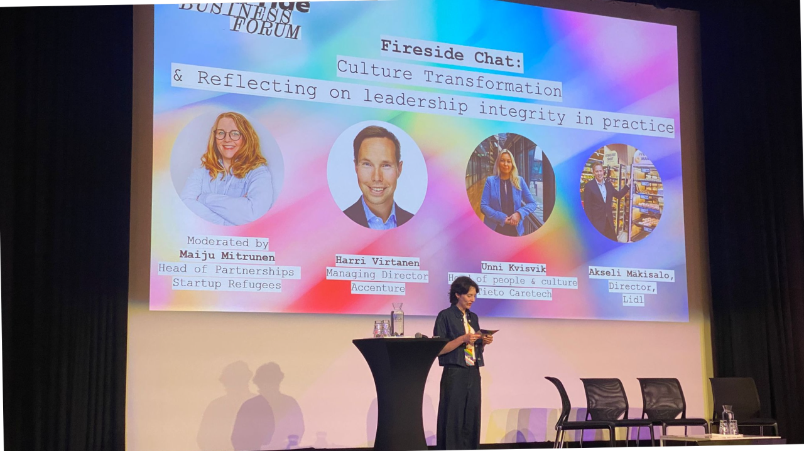
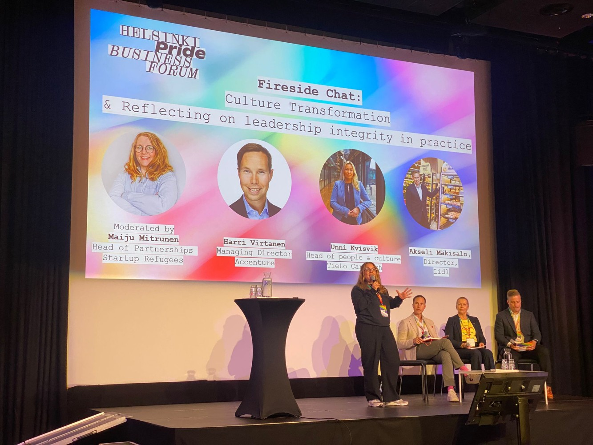
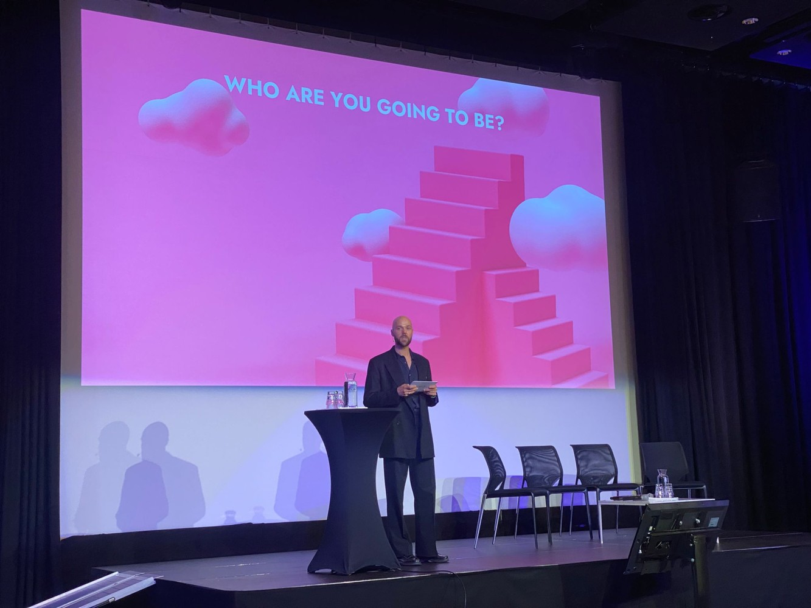
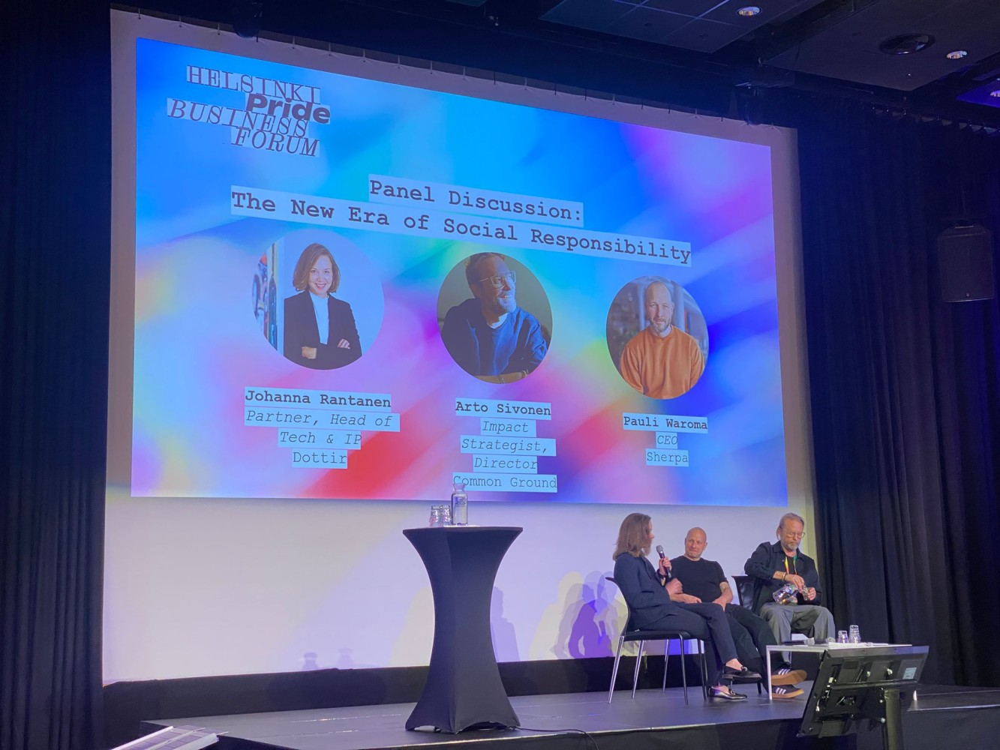
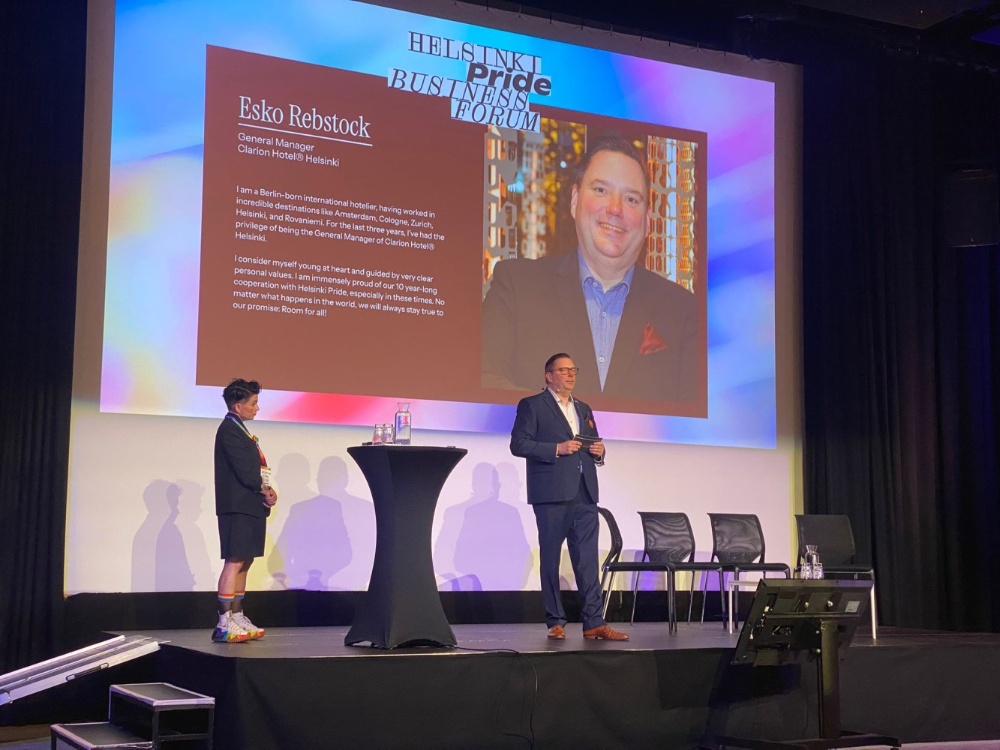
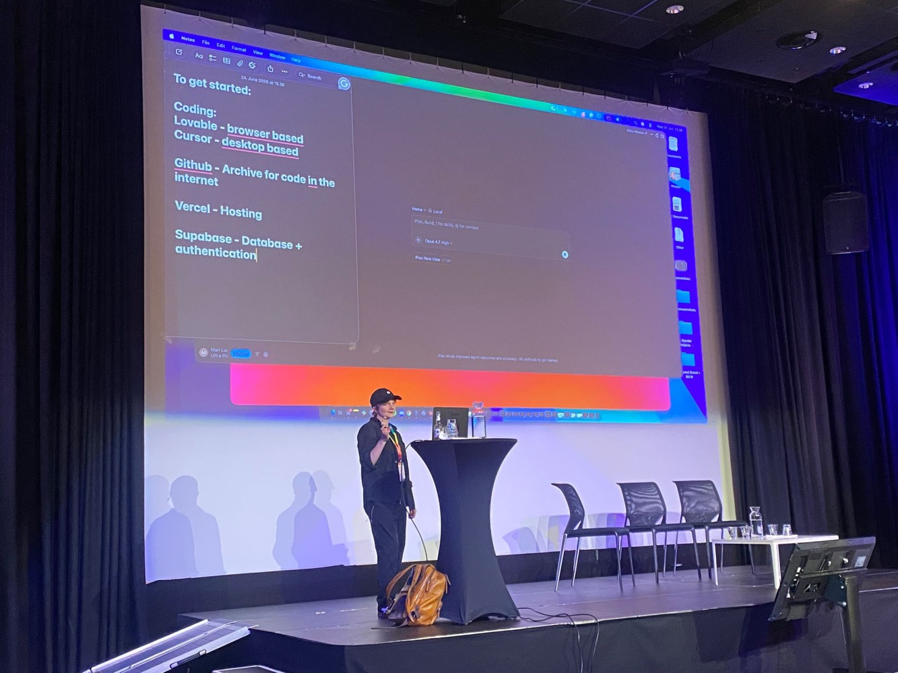

# Can Businesses Thrive Without Inclusion? My Key Takeaways from Pride Business Forum Helsinki

**Author:** Olga Kryuchkova  
*Nordic Tech and Innovation Ecosystem Explorer | ICT Trainer | Certified AI Transformation Leader | MSc (Tech.) | Engineer*  
**Published on:** June 25, 2026

---

Can businesses truly innovate if everyone in the room thinks the same way?

This question stayed with me after attending the **Pride Business Forum** at **Clarion Hotel Helsinki** on June 24.

In today's business environment, organizations face unprecedented challenges: rapid technological change, talent shortages, evolving customer expectations, and increasing pressure to create meaningful workplaces. While companies often focus on digital transformation and business strategy, one critical factor is sometimes overlooked: **people**.

The Pride Business Forum brought together business leaders, entrepreneurs, executives, and professionals to discuss inclusion, leadership, workplace culture, and the future of work. What stood out most was that diversity and inclusion are no longer viewed as social initiatives alone—they are increasingly recognized as core business drivers.

Here are some of the key insights I took away from the event.

One of the highlights of Pride Business Forum was the exceptional lineup of speakers and **Viivi Marttinen** as moderator, who brought diverse perspectives on leadership, inclusion, innovation, and corporate responsibility. My thanks to **Esko Rebstock** (Clarion Hotel Helsinki) and **Annu Kemppainen** (Helsinki Pride Community) for setting the tone for meaningful discussions. Valuable insights were shared by **Harri Virtanen** (Accenture), **Akseli Mäkisalo** (Lidl Finland), **Unni Kvisvik** (Tieto Caretech), and moderator **Maiju Mitrunen** (Startup Refugees) during the leadership fireside chat. The keynote by **John Hermansson** (IDA WARG Beauty / Lumene Group) offered a powerful perspective on values-driven brands and authentic allyship. The discussion on the future of social responsibility was enriched by **Johanna Rantanen** (Dottir), **Arto Sivonen** (Common Ground), and **Pauli Waroma** (Sherpa), who shared valuable reflections on the impact of partnership and leadership. The event concluded with networking and innovation-focused sessions, including the inspiring "Vibe Coding" workshop led by **Mari Luukkainen**, demonstrating that building inclusive and future-ready organizations requires both courage and action. Big thanks to **Anna Mäkinen** for great hospitality and friendly atmosphere creation.

---

### 1. Inclusive Leadership Is Becoming a Competitive Advantage
The most successful organizations understand that leadership today requires more than technical expertise and business acumen. Companies like Accenture, Clarion Hotel® Finland, Lidl International, Dottir, Startup Refugees, IDA WARG Beauty AB, Tieto Caretech and many others shared their experiences of surviving crises and emphasized the importance of good intentions and the ability to acknowledge mistakes and move on for constructive work and collaboration.

Employees want to work in environments where they feel respected, heard, and valued. Customers increasingly expect companies to demonstrate authentic values. Investors are paying attention to organizational culture alongside financial performance. Inclusive leaders create psychological safety. They encourage different perspectives, welcome constructive challenges, and foster collaboration across diverse teams.

This isn't simply about doing the right thing—it's about making better decisions.

Research consistently shows that diverse teams often outperform homogeneous teams when solving complex problems because they bring a wider range of experiences and viewpoints to the table. For entrepreneurs and business leaders, this means that creating an inclusive culture should be viewed as a strategic investment rather than an HR initiative.

---

### 2. Talent Chooses Culture as Much as Compensation
One of the recurring themes throughout the forum was the growing importance of employer branding. Today's workforce, particularly younger generations, looks beyond salary and benefits when evaluating employers. People want purpose. They want belonging. They want workplaces where they can be themselves.

In highly competitive labor markets, organizations that fail to create inclusive environments risk losing talented professionals to companies that do. This trend is particularly relevant in Finland and across Europe, where businesses continue to compete for skilled employees in technology, healthcare, education, and other sectors. The message was clear: culture is no longer a "nice-to-have." It is a business necessity.

---

### 3. Innovation Thrives Where Different Perspectives Meet
One of the most inspiring aspects of the Pride Business Forum was seeing professionals from different industries, backgrounds, and experiences come together to exchange ideas. Innovation rarely happens in echo chambers. Whether developing new products, improving customer experiences, or solving organizational challenges, businesses benefit when diverse voices contribute to the conversation.

Entrepreneurs often focus heavily on product-market fit, operational efficiency, and growth strategies. While these areas remain essential, innovation increasingly depends on the ability to attract and empower people with different viewpoints. The organizations that embrace diversity are often better equipped to identify opportunities that others miss.

---

### 4. Authenticity Builds Trust
Another powerful takeaway was the importance of authenticity in leadership. Employees, customers, and partners can quickly recognize when inclusion efforts are performative rather than genuine. Authentic leaders do not claim to have all the answers. Instead, they demonstrate curiosity, empathy, and a willingness to learn.

Trust is built through consistent actions, not statements. Organizations that openly discuss challenges, celebrate progress, and remain committed to continuous improvement are more likely to earn credibility both internally and externally. In an era where transparency matters more than ever, authenticity has become one of the most valuable leadership qualities.

---

### 5. The Future of Business Is Human-Centered
Artificial intelligence, automation, and digital transformation continue to reshape the business landscape. Yet one message resonated throughout the event: technology may change how we work, but people remain at the center of every successful organization. As businesses adopt new technologies, leaders must ensure that innovation supports human potential rather than replacing human connection.

The future belongs to organizations that combine technological advancement with empathy, inclusion, and purpose. Companies that invest in people while embracing innovation will be better positioned to navigate uncertainty and achieve sustainable growth.

---

### Actionable Takeaways for Business Leaders and Entrepreneurs
If there is one lesson from the Pride Business Forum, it is that inclusion is not separate from business success—it is part of business success.

Here are a few actions leaders can take immediately:

*   **Listen actively** to diverse perspectives within your organization.
*   **Review hiring and promotion practices** to ensure equal opportunities.
*   **Create environments** where employees feel safe sharing ideas and feedback.
*   **Measure culture** with the same seriousness as financial performance.
*   **Lead with authenticity** and continuous learning.

Small changes implemented consistently can create significant long-term impact.

---

### Final Thoughts
The Pride Business Forum Helsinki was a conversation about leadership, innovation, and the future of work. As business leaders, entrepreneurs, and professionals, we have an opportunity to build organizations where people can contribute their best ideas, feel valued, and thrive. The companies that succeed in the coming years will not necessarily be those with the largest budgets or the most advanced technology. They will be the organizations that understand a simple truth:

> **Business grows when people feel they belong.**

