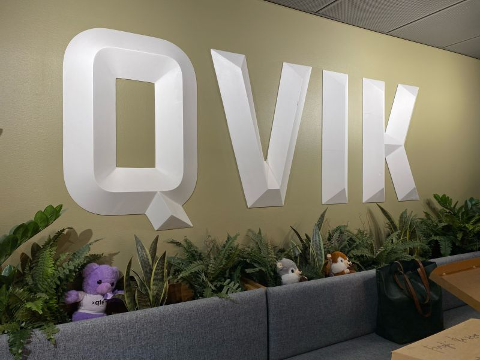
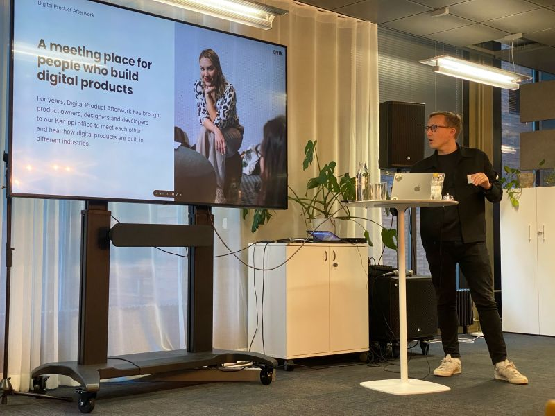
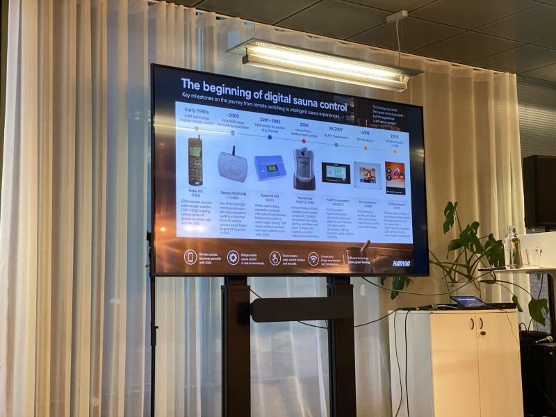
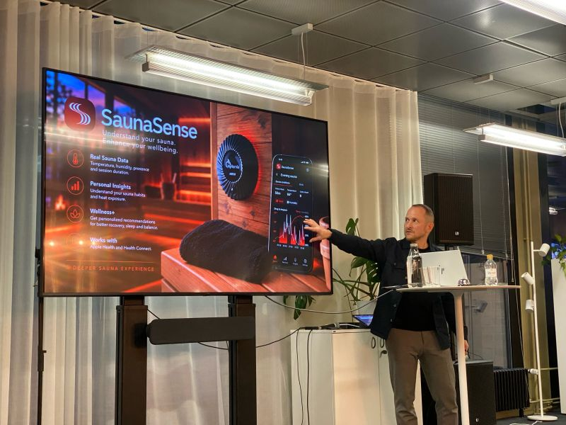
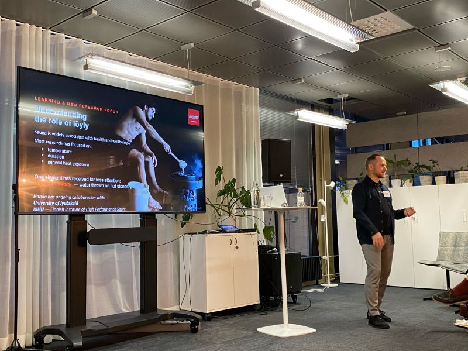

# When Finnish Sauna Meets Smart Technology: Inside the Qvik x Harvia Afterwork 🔥🇫🇮

**Author:** Olga Kryuchkova  
*Nordic Tech and Innovation Ecosystem Explorer | ICT Trainer | Certified AI Transformation Leader | MSc (Tech.) | Engineer*  
**Published on:** October 22, 2026

There are a few things that need no explanation to a Finn. One of them is why a sauna is always a good idea. 🔥

So when an after-work event with [Qvik](https://fi.linkedin.com/company/qvik) and [Harvia](https://fi.linkedin.com/company/harviaglobal) — bringing together Finland’s digital product consultancy and its internationally renowned sauna technology giant — came together, I was naturally curious. Not just as a sauna lover, but as someone fascinated by how technology can transform even the most traditional experiences.

The Finnish sauna has conquered the world. This is a fact. And now, it has entered the smart era.

### Wireless Connectivity Meets Finnish Engineering

Yes, you can control your sauna from your smartphone or smartwatch — even when it’s wood-heated, you can monitor it. 

Wireless connectivity meets Finnish engineering, finding ways to stay connected despite the sauna’s double-layer aluminium insulation. If that isn’t a satisfying little engineering challenge, what is?

### A Ritual, A Culture, A Wellbeing Experience

What I particularly admire about Harvia is its understanding that selling sauna equipment is only part of the business. Educating customers about different sauna experiences is equally important — a point strongly emphasised by [Perttu Rönkkö](https://fi.linkedin.com/in/pertturonkko), Head of Digital & Devices at Harvia.

A sauna is not merely a product; it’s a ritual, a culture, a wellbeing experience, and one that Finland has every reason to share with the world.

That combination of deep local heritage, customer education, technological innovation, and international ambition is a powerful formula for growth. Harvia isn’t just exporting equipment; it’s helping people around the world discover what a Finnish sauna can mean to them.

### The Science of Löyly and the Connected Ecosystem

Harvia is also investing in scientific research to decode the physiological impact of sauna bathing, collaborating with the University of Jyväskylä and KIHU (the Finnish Institute of High Performance Sport) to understand the role of löyly and humidity on recovery and performance.

And here’s where we can see an exciting next step: **the sauna is becoming part of an integrated personal wellbeing ecosystem.**

Imagine connecting your sauna experience with your wellbeing app, bringing together heat exposure, relaxation, recovery, and sleep insights. Not technology for technology’s sake, but technology that helps people understand their own wellbeing and make more informed choices.

The future of smart technology isn’t simply about connecting IoT devices. It’s about building and connecting experiences, making them genuinely meaningful. 🇫🇮

*#Harvia #FinnishInnovation #SmartTechnology #WellbeingTech #DigitalWellbeing*
