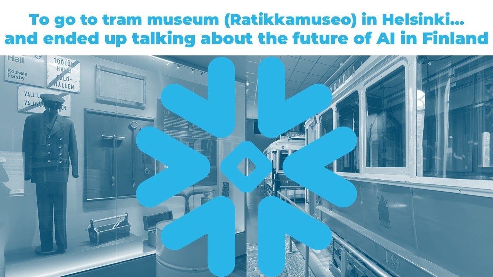
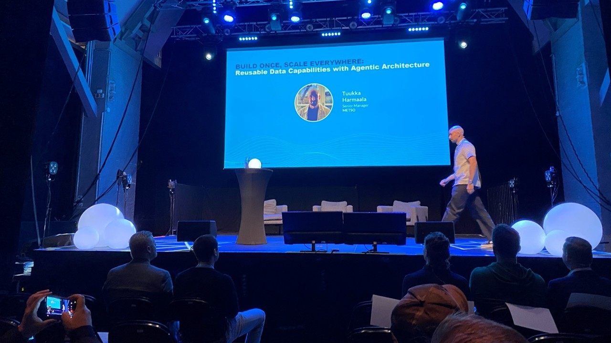
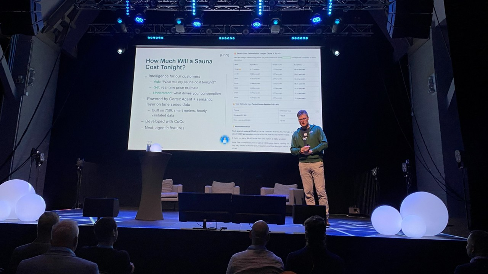
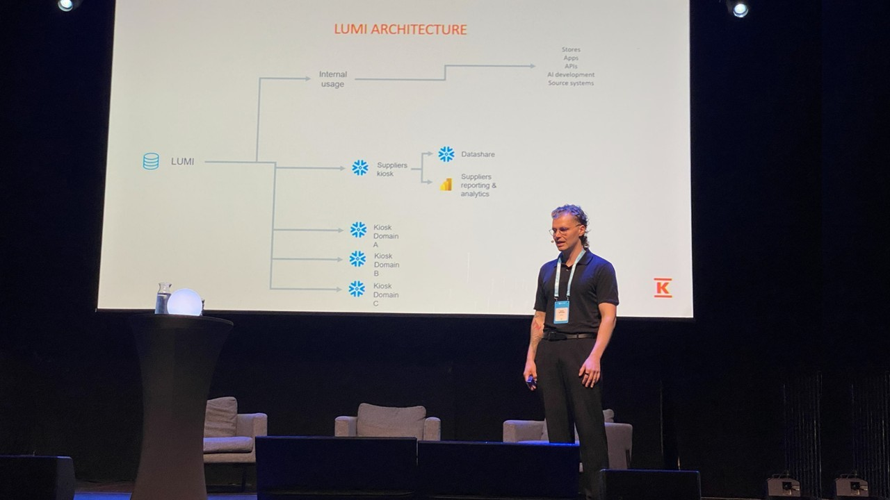
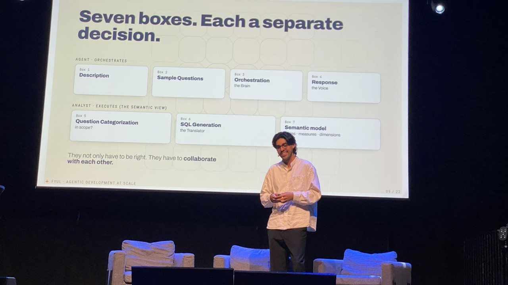
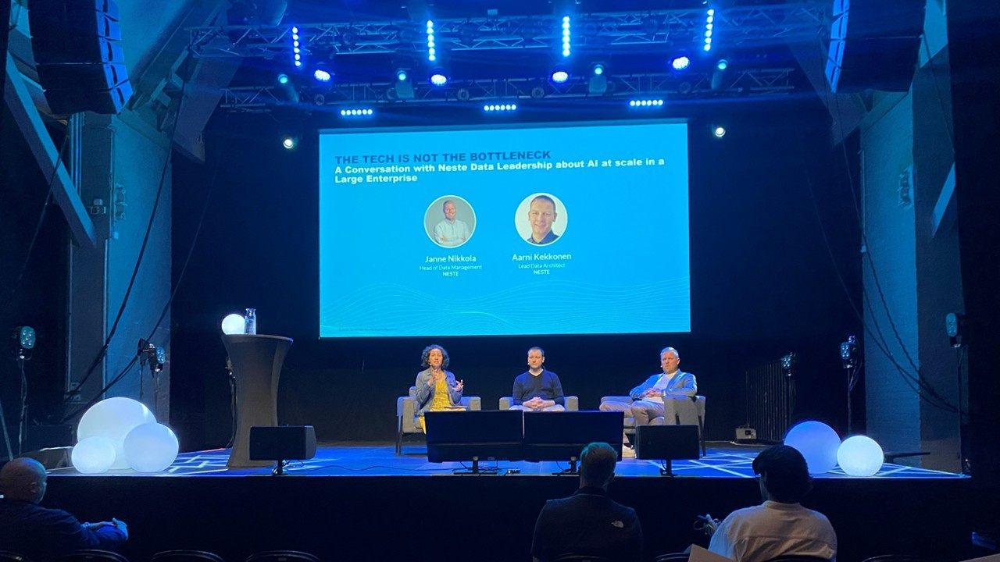
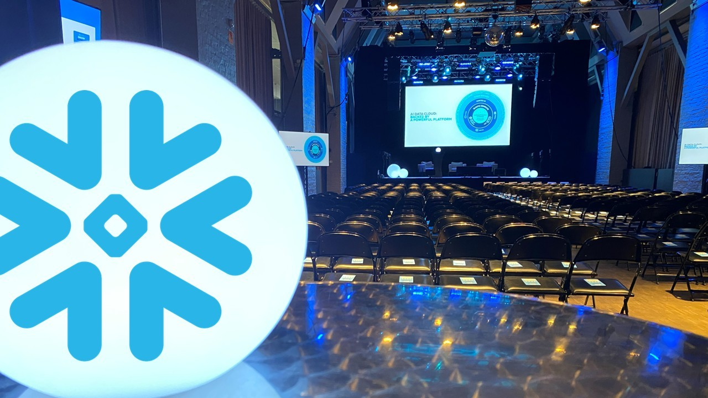

# I went to tram museum 🚋 (Ratikkamuseo) in Helsinki… and ended up talking about the future of AI in Finland ❄️

**Author:** Olga Kryuchkova  
*Nordic Tech and Innovation Ecosystem Explorer | ICT Trainer | Certified AI Transformation Leader | MSc (Tech.) | Engineer*  
**Published on:** June 15, 2026

---

What do trams 🚋 and a snowflake ❄️ have in common in Helsinki?

At first glance, not much. Yet in Finland, it's a surprisingly fitting combination, even in the middle of summer when, thankfully, there isn't a snow in sight 😁.

Last week, among all the activities, there was one you could miss for some reason. The historic **Tram Museum** in Helsinki became the gravity point for one of the most interesting technology ecosystem events of the season: **Snowflake's AI in Action, Helsinki Summer Social**.

What stood out to me was the quality of conversations around how organizations are turning data into business value through AI.

🎤 There were several interesting showcases and insights that caught my attention (and actually worth sharing). The Snowflake team, led by **Juho Friberg** welcomed everyone with an introductory opening session outlining the theme of the day—leveraging modern data platforms for scalable artificial intelligence—alongside amazing moderator **Angela Carpenter**. They set the stage for how enterprises can transition from AI experimentation to real-world deployment.

---

🔹 **Metso's senior manager Tuukka Harmaala**, shared experience through the implemented approach *"Build Once, Scale Everywhere: Reusable Data Capabilities with Agentic Architecture."* This session covered how industrial machinery manufacturer Metso designs highly scalable data architectures. The focus was on "Agentic Architecture", using AI agents capable of autonomous workflows, and how building modular, reusable data capabilities allows them to scale AI applications across different global business units efficiently.

🔹 **Finnish HR and staffing company Barona** discussed how they built a reliable, enterprise-grade AI data analyst. The session highlighted their use of Snowflake Cortex (Snowflake's fully managed service for LLMs and machine learning) to ensure that their AI-driven insights are trusted, secure, and accurate for business decision-making.

🔹 **Electricity distribution company Caruna's head of data and AI Pekka Wartiainen** presented their case about sauna (Where would Finland be without a sauna? 😄), and the topic was extremely actual to Finnish reality: he demonstrated a highly localized, practical application of real-time data. By combining streaming data from smart utility meters with AI forecasting, Caruna showcased how they process data at scale to calculate dynamic energy insights for consumers.

🔹 **Retail conglomerate Kesko - K-Group** shared insights into how AI is changing the software development lifecycle within their organization. They look at "swarms" (coordinated AI agents or cross-functional developer squads paired with AI tools) to augment human skills and scale up development velocity.

🔹 **Valtiokonttori (State Treasury of Finland)** observed their journey as part of its *"Snowflake-Odysseia,"* which involves a multi-year transition toward a modernized, AI-enhanced data platform, and **Virpi Hotti** talked in detail about the main milestones:

*   **2023 (Experiments)**: The journey began with experimentation focused on LangChain agents, exploring how autonomous AI workflows could be integrated into their operations.
*   **2024 (Storm)**: This period was characterized by a "storm" or challenge regarding the absence of Customer Managed Keys (CMK), highlighting a phase of navigating security and encryption requirements for cloud data.
*   **2025 (Decision)**: A strategic pivot led to the decision to consolidate onto one main platform, streamlining their data architecture.
*   **2026 (Production)**: The transition moves into full production, utilizing shared workspaces and dbt (data build tool) for scalable data transformation and collaborative development.

🔹 Next deeply technical session dived into advanced generative AI engineering. **FYUL** presented how they handle complex agentic AI systems at scale using meta-prompting, a technique where AI is used to systematically design, optimize, and manage prompts for other AI agents to achieve predictable, high-quality outputs.

🔹 And as a final accord, an interview-style session featured **Janne Nikkola** and **Aarni Kekkonen** from energy company **Neste**. Instead of focusing purely on tools, the conversation addressed the human, cultural, and organizational challenges of scaling AI, emphasizing that change management and processes, rather than the technology itself, are often the hardest bottlenecks to clear.

---

💡 A recurring message throughout the event was that AI success is not primarily about having access to the latest models or tools. For enterprise companies, it starts with:

✅ Trusted data  
✅ Strong governance  
✅ Modern cloud infrastructure  
✅ Cross-functional collaboration  
✅ A clear business purpose  

🌍 What makes the Nordic market particularly interesting is the combination of growing digital maturity, cloud adoption, data-driven cultures, and a strong ecosystem of technology partners working together to accelerate innovation.

**My key takeaway?**

The organizations that will create the greatest value from AI won't necessarily be those adopting every new technology first. They will be the ones who build scalable data foundations and connect people, processes, and technology into a coherent ecosystem.

👏 Thank you to the Snowflake team, speakers, partners **Etlia**, **Etteplan**, **Amity**, **Adesso**, **The Infotrust**, **Solita**, **twoday** (special thanks for tasty ice-cream 😄🍦), **Smartdatahub**, **ISLET Group**, **SAP** and attendees for an insightful evening filled with valuable discussions, practical perspectives, and new connections.

*#Snowflake #AI #DataCloud #DataEngineering #Analytics #DigitalTransformation*

