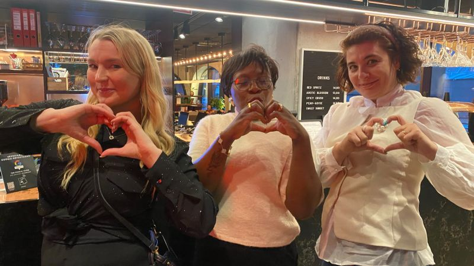
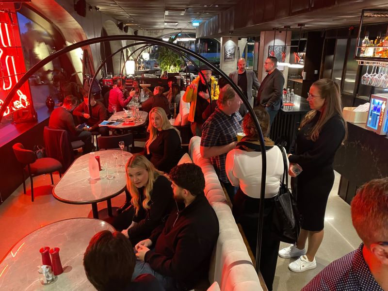

# Where to Spend a Friday Evening in Helsinki? Stripe x Lovable and the Power of Different Minds Meeting 🍸✨

**Author:** Olga Kryuchkova  
*Nordic Tech and Innovation Ecosystem Explorer | ICT Trainer | Certified AI Transformation Leader | MSc (Tech.) | Engineer*  
**Published on:** September 25, 2026

We all have our own ideas of a perfect Friday evening. Some involve cocktails, some involve dancing, and some involve explaining why AI will change everything, preferably before the second drink.

My personal preference? A room full of curious people, a few ambitious ideas, and conversations that make me forget to check my phone.

Thanks to [Paul James Brennan](https://fi.linkedin.com/in/tribenetworks) and [Mia Saukko](https://fi.linkedin.com/in/mia-maria), I discovered the fascinating [Stripe](https://www.linkedin.com/company/stripe) x [Lovable](https://se.linkedin.com/company/lovable-dev) event, and it turned out to be precisely my kind of Friday night.

New connections, engaging conversations, a delightful atmosphere, and that rare feeling of being in a room where people are genuinely interested in what others think. A rather underrated form of entertainment, if you ask me.

### Conversations, Progress & Cultural Perspectives

I was delighted to meet [Magdalen Ogbomon](https://fi.linkedin.com/in/magdalen-ogbomon-aa2123172), with whom we are currently working on an interview. Then there was my always-inspiring conversation with [Juho Järvelä](https://fi.linkedin.com/in/juhojarvela), who is well-versed in specialized natural resource portfolios. 

And, of course, the good news about the [Sean Kipinä](https://fi.linkedin.com/in/seankipina) project's progress added another reason to leave with a smile. In the innovation ecosystem, progress is not always announced with a keynote and a spectacular slide deck. Sometimes, it arrives in a conversation that makes you think:

> *“Oh, this is moving forward!”*

A special thank you to [Mika Kivimäki](https://fi.linkedin.com/in/mikakivimaki) and [Joshitha Shree Bharath](https://fi.linkedin.com/in/joshitha-shree) for a genuinely thoughtful conversation about technology, innovation, and the cultures of different countries.

These are the discussions I value most: exploring how people from different backgrounds understand the same technological developments, approach challenges differently, and imagine entirely different possibilities. Because technology may be global, but the people building it bring their own cultural assumptions, experiences, values, and ways of thinking.

### What Becomes Possible When Different Minds Actually Meet

Every now and then, you meet people with whom ideas begin to travel, perspectives expand, and new possibilities emerge. No pitch deck required. No awkwardly forced *“How can we create synergies?”* moment. (Humanity has suffered enough.)

That, for me, is the real value of Helsinki’s tech and innovation community: not simply being in the same room, but discovering what becomes possible when different minds actually meet.

**So, where to spend a Friday evening in Helsinki?**

My recommendation: find a gathering where you can meet people who challenge your thinking, introduce you to something you didn't know, and make you want to continue the conversation long after the event is over.

And if there happens to be a good atmosphere, interesting people, and a little news about projects moving forward? Well, that's practically a five-star evening.

Thank you, Paul and Mia, for the discovery and to everyone who made this Friday memorable.

> **What makes an event worth attending for you: the people, the ideas, the opportunities, or the unexpected conversations that turn out to be the most valuable part?**

