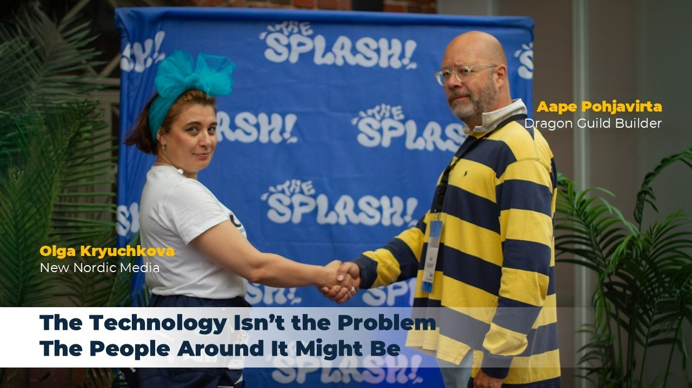
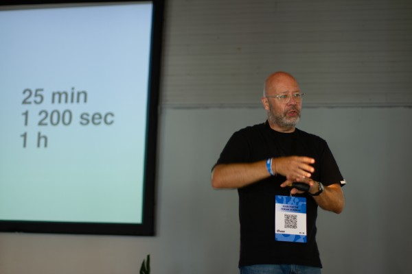
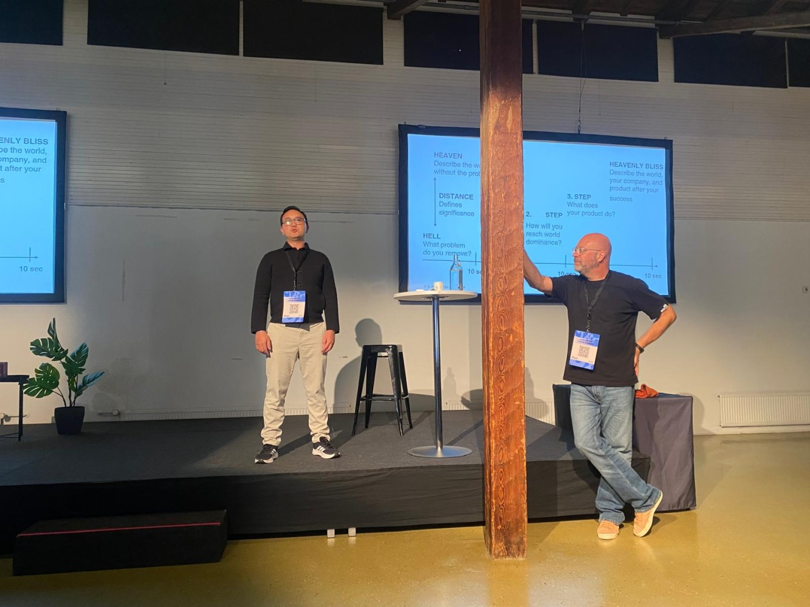
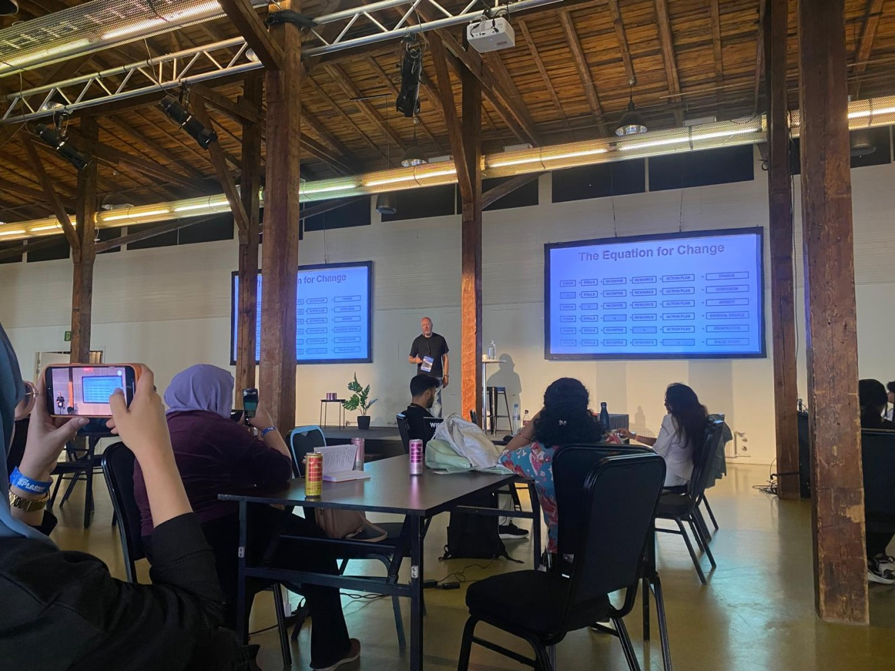
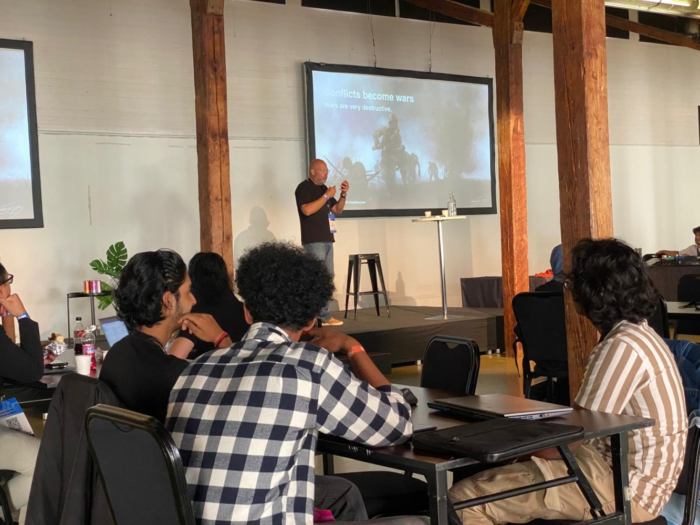
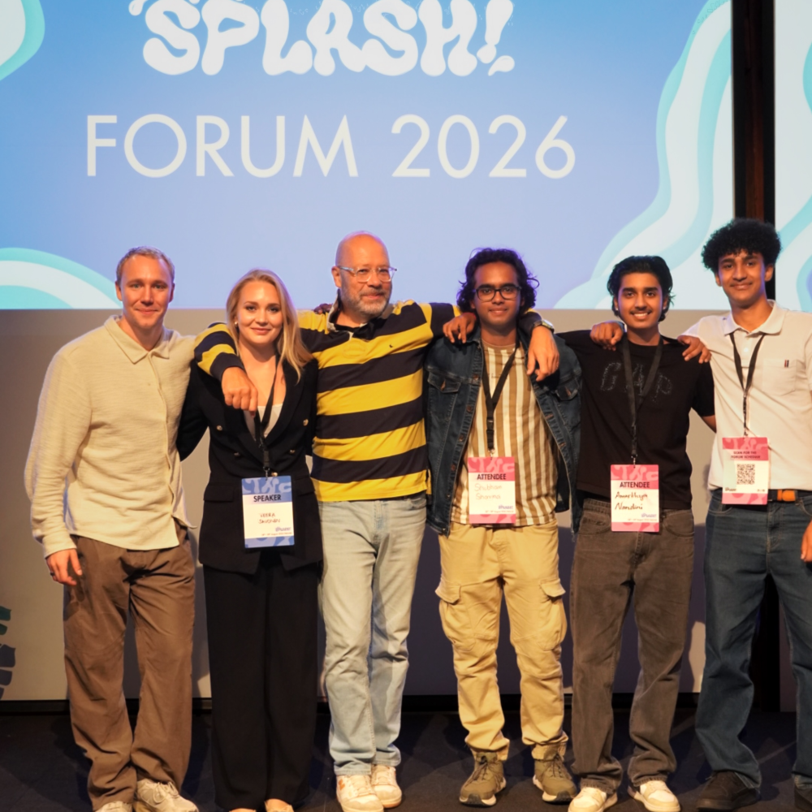
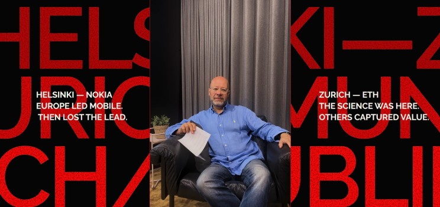
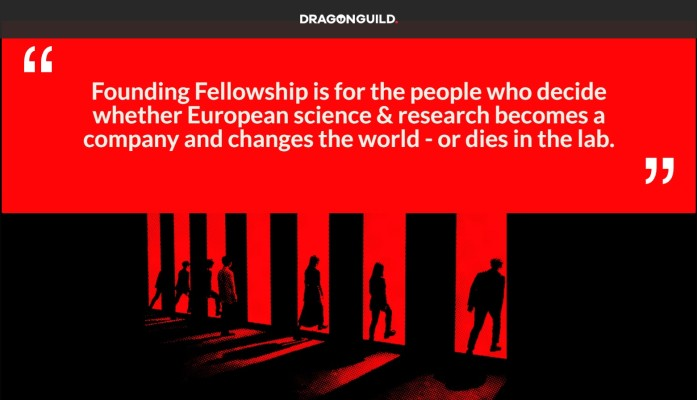

# The Technology Isn’t the Problem. The People Around It Might Be. 🐲✨

**Author:** Olga Kryuchkova  
*Nordic Tech and Innovation Ecosystem Explorer | ICT Trainer | Certified AI Transformation Leader | MSc (Tech.) | Engineer*  
**Published on:** September 9, 2026

---

### The Catalyst on Dragon Guild, Europe’s Innovation Gap and the Art of Moving Things

Today we are speaking with **Aape Pohjavirta**, Co-Founder & CEO of **Dragon Guild**, who brings 35+ years at the technology frontier, international leadership, Funzi, education, coaching, and a very specific conviction: **Europe’s problem is not a shortage of science or capital, but the people and mechanisms that carry breakthroughs across the gaps between research, investment, corporations and society.**

I saw his amazing speech at Aalto University last year, and a year later, this extraordinary experience found its way back to me at **THE SPLASH!**, giving me once again the pleasure of discovering what I find most irresistible in a thinker — not merely what meets the eye, but the clarity of thought that makes everything else infinitely more compelling.

Perhaps this is the historian and professional chronicler in me: I tend to dig beneath the surface of things, including names. Having lived since childhood between cultures, I have developed a weakness for discovering how much meaning can hide in words we normally pass without a second thought.

So I opened a dictionary of names and found something rather curious:
*   **Aape** is the Finnish form of Abraham (Heb. *Avraham*), traditionally interpreted as *“father of many.”*
*   **Pohjavirta** can be poetically read as *“the deep current”* (Fin. *pohja*, depth or foundation, and *virta*, a flowing current).

I could hardly have asked for a more fitting metaphor for what Aape is building with Dragon Guild:

A *“father of many”* — not literally, but as someone creating the environment for very different people, disciplines, and ideas to meet, grow, and actually do something together. Scientists, entrepreneurs, investors, policymakers, and institutions do not exactly come with a shared user manual. Yet the most consequential innovation happens where these worlds learn to speak to one another.

And then there is the *deep current*. The strongest currents are rarely the most visible. They move beneath the surface, quietly shaping the direction of everything above them. There is a peculiar force beneath the waves, a strong gravity — one that does more than break upon the shore. Given enough time, it reshapes the very landscape, patiently altering what appears, at first glance, to be immovable.

Change is not impossible; impossible is nothing; it is simply often so slow that, from within the moment, it feels indistinguishable from stillness.

And this is where Dragon Guild becomes particularly interesting. It is not another initiative producing startups, buzzwords, and the occasional heroic LinkedIn post about “disruption.” It is a fellowship designed to strengthen the underlying current of the innovation ecosystem — connecting breakthrough science with capital, industry, talent, and society, and helping ideas make the notoriously difficult journey from discovery to impact.

> **Aape’s modest Finnish response to my intro:**  
> *“I have to spoil a good theory. Aape is not my real name. I was given my father's first name. Two people answering to the same name in one house lasted about two months. They started calling me aape. It stuck. Everyone knows me as aape. My bank cards carry it. So the Abraham reading is real etymology. It is also not how I got here. I got here because a household needed a workaround. Which may be the more honest origin story for someone who builds mechanisms for a living.  
> Pohjavirta is Nordström, translated. Somewhere back there a family swapped languages. But I read it differently. Not a deep current shaping things from below. The undertow. The pull beneath waves breaking on a beach. I surfed as a teenager. That word has a specific meaning to me. Everyone else on the beach is warned about the undertow. It drags you out. Surfers use it. It is how you get past the break to where the waves are. That, I will take. That’s how I survive.”*

---

### I. Origins & Background — Beyond Education

**Olga:** Aape, you have been building at the frontier of technology for roughly 35 years. What is one thing you believed about technology in 1995 that you would now publicly admit was spectacularly wrong, and what did that mistake teach you?

**Aape:** I believed the best technology wins. It does not. It never has. **The technology with the best access to the market wins, and it is not close.** In 1995 that felt like cynicism to me. I thought it was a temporary injustice. Engineering and product design would eventually correct it. Give the market time and quality would find its way through. It never corrected. It is the permanent condition.

I was involved in building one of the first database-driven services globally for mobile email — gnwmail.com. It was by far the best implementation anywhere. It was launched, rebranded to iobox, and sold for more than a billion Finnish markkas only to vanish without making a dent in the universe.

What it taught me is uncomfortable: **If you are not designing the path to the human being on the other end from day one, you are not building a product. You are building a demonstration.** I have spent thirty years since then working on the path, not the thing. That is basically the whole story.

**Olga:** Your career spans mobile technology, product development, education, entrepreneurship and ecosystem building. What practical skill survived every technological revolution, from the mobile era to AI, and why has that skill proved more durable than any particular technology?

**Aape:** **Translation.** Not languages. The ability to sit with a physicist for an hour, then with a fund partner, then with a minister, and carry the same idea through all three without it losing meaning or picking up nonsense.

Every technology has a half-life. Mobile had fifteen good years. The web had twenty. AI will have its own and it will end too. But every single one of those transitions produced the identical problem: The people who understood the new thing could not speak to the people who had to fund it, buy it, regulate it, or live with it. That gap has never once closed. Not in thirty-five years.

It is durable because it is not about the technology at all. It is about the fact that expertise makes people worse communicators, not better. The deeper you go, the more you speak in shorthand to people who already agree with you. Every field does this. Every field then wonders why nobody outside understands its value.

Translation is the most valuable job in technology and almost nobody trains for it. There is no degree. No title. No career path. That is roughly why Dragon Guild exists.

**Olga:** You have worked both as a builder and as a coach. What changes when you move from being the person who has to make something work to the person who has to make other people capable of making it work?

**Aape:** Coaching is easier. Your job is to enable and to empower. You do not carry the execution. Which is the trap: Easy job, so it attracts people who want an easy job — advice with no consequence attached to it. Enable and empower only work if you have built something yourself. Otherwise you are enabling nothing and empowering nobody. What changes is your ego. As a builder you are rewarded for being right. As a coach, being right is the worst thing you can do.

**Olga:** Funzi was essentially an experiment in using technology to make learning radically more accessible across very different markets. What did emerging markets teach you about innovation that Silicon Valley, and perhaps Finland, still tends to misunderstand?

**Aape:** That constraint is not a limitation on innovation. It is the design brief. Every European product instinct I had was wrong. Video was wrong. Long form was wrong. Anything assuming a quiet room and a spare hour was wrong.

Silicon Valley assumes abundance, builds for it, and calls everywhere else a market to enter. Finland assumes trust and stability, and builds products that quietly depend on a functioning society sitting underneath them. Both are designing for a context, not for a human being. Emerging markets do not let you get away with that. When building Funzi we thought that we’d do an app. After initial prototypes and testing we understood that apps would be the wrong way to go in markets with low bandwidth and a wide variety of devices. We went the Mobile Internet way. In a time when everybody went the ‘App Economy Way’ we went the other way. And that’s why we succeeded.

**Olga:** If you stripped your CV of every title, company and achievement and left only three scars, three lessons learned the hard way, what would they be?

**Aape:** 
1. I believed people would remember my deeds and that good actions would be rewarded. That is not how the world works.
2. I trusted global market leaders to respect an agreement and not take the idea. That is not what they are.
3. I trusted the legal system to compensate unfair treatment. It does not.

None of that made me careful. It made me specific about who I build with.

---

### II. Finland, the New Nordics & Europe: Advantages, Problems and Survival

**Olga:** Finland has an extraordinary concentration of science, engineering talent, trust and public infrastructure. So why does a country that can build world-class technology sometimes struggle to build world-class technology businesses? Where exactly does the pipeline leak?

**Aape:** It does not leak at invention. It leaks the moment the thing has to meet a human being who did not build it. We build to solve the problem. We build for the builder. We do not sell. We do not market. We do not talk to users. Then we are surprised that the world did not notice.

And we are a small country with too little capital. That is real. It is not the excuse people use it as, but it is real. Less capital means less room to be wrong, and a company that cannot afford to be wrong cannot afford to be ambitious.

**Olga:** You have described Europe’s science-to-market problem as a broken chain: researcher → investor → corporate → market. If you use basics of TRIZ and could remove only one link from the existing system and rebuild it from scratch, which one would you attack first?

**Aape:** I would refuse the question, and TRIZ is exactly why. Pick a link and you have accepted the chain. Fix the researcher and the investor still cannot read the science. Fix the investor and the corporate still cannot buy it. You move the failure, you do not remove it.

The contradiction is that every link is optimised for itself and none of them is responsible for the handover. So the thing to build is not a better link. It is a layer that runs across all four, made with all four in the room. That is the whole design of Dragon Guild.

**Olga:** If you put a Finnish founder, a Swedish founder, a German founder and an American founder around the same table with the same technology, who is most likely to move first, and who is most likely to spend six months «making the PowerPoint perfect»?

**Aape:** The American moves first. Often wrong, and it costs less than everybody thinks. The Swede makes the most beautiful deck. The German makes the most effective one. The Finn does not make a deck. The Finn says the product will sell itself and puts one photograph of it on a slide. Then goes home and improves the product. That is the whole story of Finnish technology in one meeting.

**Olga:** What are the observations every European entrepreneur should understand about competing globally today, observations that are obvious to Americans but still uncomfortable for Europeans to admit?

**Aape:** Three things:
1. **Get out of the building.** Nothing you believe about your market is true until somebody outside your team says it back to you.
2. **If you are not ashamed of what you are selling, you are late.** Shipping something you are proud of means you spent the extra six months on the wrong thing.
3. **Say you are the best there is, then ask for the money.** Both halves. Europeans skip the first out of modesty and the second out of embarrassment, and then wonder why the room went quiet.

**Olga:** Imagine you are advising a European entrepreneur who has twelve months of runway left, no huge network and a genuinely good technology. What are the three things you would tell them to do tomorrow morning to survive and become harder to ignore?

**Aape:** The same three: Get out of the building. Ship before you are proud of it. Say you are the best and ask for the money. Twelve months does not change the advice. It removes the option of ignoring it.

**Olga:** Is Europe suffering from an innovation problem — or from an execution, ambition and coordination problem that we politely keep calling an innovation problem?

**Aape:** Neither, quite. Europe is missing a layer. We have nation states. We have local and regional innovation ecosystems. We have an enormous amount of policy. What we do not have is anything European that actually operates between them. Plenty of coordination on paper. Very little action.

A head of department at the European Parliament put it to me better than I can: *The losses along the innovation chain occur at the transitions, not within the individual links. They are failures of translation before they are failures of financing.* That is the sentence I would put on the wall. We keep sending money to a problem that is not made of money. Calling it an innovation problem is comfortable, because the answer is more research funding. It is systemic, and systemic problems have no single root cause to fix. So you do not fix it. You build the missing thing, small and real, and let it become the example the rest of the system copies.

---

### III. USA vs Europe: Technology Adoption, Regulation & Competing with Asia

**Olga:** Americans often seem to ask, “What can this technology make possible?” Europeans more often ask, “What could go wrong?” Which instinct produces better societies, and which produces better companies?

**Aape:** I do not accept the split. It is a nice line for a panel and it explains nothing. Both questions are asked in both places, by different people, in different rooms, on the same day. The difference is who gets listened to.

What I do believe is narrower: The best technology and the best companies are built by people working with other people, and respecting every one of them. Not the users as a segment. The people. Every failure I have watched up close, mine included, came from somebody deciding that some group in the chain did not need to be understood.

**Olga:** At what point does responsible regulation stop being a safety mechanism and become an innovation boundary? And who should have the authority to decide where that line sits?

**Aape:** You cannot regulate the future. Every attempt freezes the state of the art on the day the text was drafted, which is usually years before the technology existed. What you can do is set clear rules for how we build. Human rights is the obvious one and it is not negotiable. Then a simple test: Look at what you are building and ask whether a reasonable person could see it as driven by one of the seven deadly sins — greed, envy, pride, the rest of them. If the honest answer is yes, stop. And if you ask me who should decide: it should be the people who carry the consequences on both sides of the line, which is almost never who is currently in the room.

**Olga:** What exactly does America understand about scaling that Europe still refuses to learn?

**Aape:** **Risk.** They price it differently and everything else follows from that. An American looks at a possible failure and sees opportunity cost — *what does it cost me not to try?* A European looks at the same failure and sees the failure. So we count what we might lose and they count what we are already losing by waiting. Same technology, same odds, opposite decision.

From there it is mechanical: They treat distribution as a product and staff it with their best people. They hire ahead of proof and let the organisation create the demand. We wait for demand to appear, then hire, then discover somebody owns the category.

**Olga:** If the US wins through speed and capital and Europe through engineering, regulation and social infrastructure, what does Europe need to become exceptionally good at to compete?

**Aape:** **Synthesis.** That is the one. The US wins on speed and capital. Asia wins on scale and execution. Neither of them is built to put a health system, an energy grid, and a research institute into the same solution. We are. We have the pieces and we have the practice of working across borders whether we enjoy it or not. We are just slow at it, and careful about it, and we ask permission first. So: better at synthesis. More courageous. Faster. In that order, because being fast at the wrong thing is just losing sooner.

**Olga:** Could Europe actually turn its constraints into a competitive advantage?

**Aape:** Yes. Not as consolation. As the actual bet. Privacy, sustainability, public trust: Those are not compliance costs. They are what people want and they are what the hard systems have to buy. Anyone selling into a hospital or a grid will need them within ten years. We already have them.

Fragmented markets and many languages taught us something the Americans never had to learn: How to work across systems that do not share a language, a regulator, or a habit. That is the carrying skill. It is the one thing Europe is structurally trained for. The bet only pays if we go and sell it. Advantages do not announce themselves. Deciding in advance that your own conditions are a handicap is how you lose. It's time for us to start winning and building for winning.

---

### IV. Technology, AI, Data & Ethics — What is Actually Changing?

**Olga:** If intelligence becomes a commodity, what becomes scarce, and therefore valuable?

**Aape:** **Judgement. Taste. Trust.** In that order. Intelligence provides progress. The futures are created by consciousness. A machine can generate any answer you like. It cannot tell you which question is worth asking, because that is a choice about the world you want, and it is made by people with something at stake.

When answers are free, the question becomes the valuable object. And trust becomes the bottleneck. If anyone can produce a plausible anything, the scarce thing is being the person somebody believes when the stakes are real. That is earned slowly and it does not scale. Which is why we are not building an AI company. We are building the people who decide what to point it at.

**Olga:** We keep asking whether AI will replace jobs. Is that the wrong question? Should we instead be asking which organisations will use AI to redesign work before their competitors do?

**Aape:** Wrong question. Yes. Start with what this actually is: The AI of today is the user interface the ICT industry has been trying to build for forty years. Nothing more exotic than that. And it is still worse than the AI in Apple's Knowledge Navigator film from 1987. We have been promising this since before most of the people worried about it were born.

So the question is not replacement. It is who redesigns the work first. Everyone now has access to roughly the same intelligence. The difference will come entirely from who is willing to change how work happens instead of bolting the tool onto the process they already had. The human stays human. Focus on the opportunity, not on the fear.

**Olga:** Technology increasingly shapes what we consider possible. Who should be responsible when an algorithm quietly changes the boundaries of human behaviour?

**Aape:** Somebody always decided. You need to know who you are. If you do not, something will shape you, and it does not have to be an algorithm. It never has been. That is the oldest problem we have. Equipping people with that is the job of parents, of communities, of societies. That does not let the builder off: Somebody chose the objective. Somebody chose what to measure and shipped it. There has to be a named human being who could have said no. And there have to be consequences.

**Olga:** Europe is trying to lead in trustworthy and human-centred AI. But can ethics become a competitive advantage?

**Aape:** Look at who has to buy this technology in the end: An air traffic operator. A data center operator. A hospital. A ministry. None of them can purchase from a supplier they cannot hold accountable. For them trustworthiness is not an ethical preference, it is a procurement requirement. That is where it turns into an advantage, and it happens to be exactly the market Europe is built for. So stop calling it a virtue. Sell it as reliability. Nobody buys the ethics; they buy the fact that the thing will still work in ten years and somebody will answer the phone when it does not.

**Olga:** If you were forced to choose between three things for Europe — better AI, better data, or better people capable of connecting AI and data to real-world problems — which one would you fund first?

**Aape:** **People. Because people trump tech.** Better AI is being funded at a scale we cannot match and do not need to match. Better data we already have, sitting unused in institutions across the continent. What we do not have is the layer of humans who can look at a real problem, understand the science well enough to know what is possible, understand the institution well enough to know what will actually get adopted, and carry it across. Fund the models and you are renting somebody else's future. Fund the people and you can use every model that comes after this one.

**Olga:** Are we currently having an ethics conversation about AI because we genuinely want to shape its future, or because we are trying to regulate a future that somebody else is already building?

**Aape:** Simpler than that: We are having the discussion because we are not doing enough. Talking is what you do when you are not building. It fills the same hours and it feels similar from the inside. The time to act is always now.

---

### V. Dragon Guild: Vision, Future & Collaboration

Dragon Guild is particularly interesting because its thesis goes beyond another founder accelerator. Its stated premise is that Europe already has science, talent and capital, but repeatedly loses value when breakthroughs move between researchers, investors, corporates and the public sector. The Guild is deliberately working on those actors, the people on the other side of the table, rather than only accelerating founders.

**Olga:** Most startup programmes focus on founders. Dragon Guild deliberately focuses on the people around them. What convinced you that the missing piece was not another accelerator, but better-informed people and better methods of collaboration? Could media and narrative-building be part of that missing infrastructure?

**Aape:** Founders already get all the help. Every city has an accelerator. Every university has a programme. If more of that worked, we would have fixed this years ago. Founders do not fail alone. They fail against people: An investor who cannot judge the science. A corporate manager with money but no mandate. A tech transfer office counting patents instead of companies. A public servant who wants to help and has no tool to do it with. None of them is the bad guy. Nobody ever taught them this job.

So we train the people who make a founder's life easier, not the founders. And yes, media is part of it. Somebody has to make a breakthrough understandable to the person who funds it or buys it. Right now that job is done badly or not at all.

**Olga:** You have called the problem a “broken ray”: the breakthrough starts in the lab, but loses energy every time it crosses from one ecosystem actor to another. If Dragon Guild succeeds spectacularly, what will that journey look like five years from now?

**Aape:** **Boring. That is the ambition.** Today the science leaves the lab misunderstood, reaches an investor who cannot fund it, arrives at a corporate too late, and meets the public sector as a procurement problem. Energy lost at every border.

In five years the researcher already knows an investor who understands her field, because they sat in the same room for months. The corporate lead is not reading a pitch, she is calling someone she trusts. The public servant knows which instrument to reach for. Nothing dramatic happens. That is the point. The four people who have to agree already know each other and already speak the same language. Science discovers. Entrepreneurship delivers. There is no other way knowledge becomes life.

**Olga:** Cohort 0 brings together co-creators across four ecosystem “silos.” What are you hoping will happen in that room?

**Aape:** What I want is for them to stop performing. At a conference everyone shows up as a representative: The investor performs investor. The professor performs professor. Everyone is polite, cards are exchanged, nothing changes. You cannot perform for months. Eventually people admit what they do not know: The investor about the science. The researcher about the money. The corporate manager about what his innovation budget is really for. That is where the work starts. It only happens in a small group, in private, with nobody watching. Except the future.

**Olga:** What did discovering that Dragon Guild's initial corporate messaging was wrong teach you?

**Aape:** We were offering companies access to a room they could not otherwise enter. True, and useless to them. A corporate innovation chief does not have a room problem. She has a problem her CEO is asking about, a budget that expires, and a board that wants to see something. We were selling a beautiful idea to someone with a concrete emergency. What it taught me is old and I still had to relearn it: When you build something nobody has built before, you stay awake and you run it lean. Build, measure, learn. Be humble.

**Olga:** What does Dragon Guild actually need from the ecosystem now? If someone reading this believes deeply in the mission and wants to help Europe move faster from science to market, what is the concrete door they should knock on?

**Aape:** People who become active. Participate, contribute. The time to act is now. Here are three concrete doors:
1. If you lead research commercialisation, or invest early in deep science, or run innovation inside a corporate, or hold a public budget: **take a seat.**
2. If you cannot, send us the person in your organisation who already does this work without a title for it. Every institution has one. They are usually exhausted and rarely thanked.
3. If you sit on a public budget, come and talk. That silo is the hardest to fill and the most important, because it holds the instruments the other three need.

Beyond the seats, there is a founding shareholder group. It exists because some people want their name attached to the thing being built rather than to the thing being discussed. We talk to those people directly.

**Olga:** Aape, you stated your own philosophy: *“Choose the problem. Create miracle. Commit. Execute.”* When Dragon Guild succeeds, what do you hope will be different about Europe?

**Aape:** European values actually implemented, not recited. Rule-based societies. Human rights in practice, where people live, not in a document somebody signed. And very good returns on investment. I put that in the same list on purpose: We have a habit here of treating values and money as opposites, as if wanting both makes you suspect. That habit has cost us a continent's worth of good ideas.

Culturally, one thing: I want it to be normal in Europe to carry something rather than invent it, and to be respected for it. We have exactly one hero story, the Founder, and most people cannot wear that costume and should not have to. **Europe has been waiting for heroes. What it needs is a guild.**

---

*#DragonGuild #DeepTech #InnovationEcosystem #Startups #Europe #Finland #AapePohjavirta*
