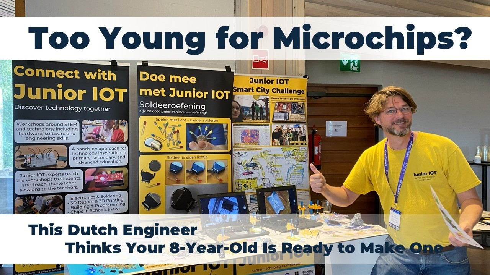

# Too Young for Microchips? This Dutch Engineer Thinks Your 8-Year-Old Is Ready to Make One. 💡🇳🇱🇫🇮

**Author:** Olga Kryuchkova  
*Nordic Tech and Innovation Ecosystem Explorer | ICT Trainer | Certified AI Transformation Leader | MSc (Tech.) | Engineer*  
**Published on:** October 6, 2026

An in-depth conversation with **[Marco van Schagen](https://nl.linkedin.com/in/marcovanschagen)**, mechanical and IT engineer and founder of **[Junior IOT](https://junioriot.nl/)**, exploring hands-on technology education, why children should encounter semiconductors long before career choices, and bringing the **Chips in Schools** initiative from the Netherlands to Finland and across Europe.

### I. Origins & Background: The person behind the technology

**Olga K.:** Was there a moment in your own education when you realized that the way we teach technology and the way people actually learn it are two very different things?

**Marco van Schagen:** In my own primary and secondary schooling some creative classes were available. However these were limited to woodworking, art and maybe some needle work. The happy few like me found their own inspiration outside the school environment: at home, usually leaning on skills and tools of our parents, family and friends. It was indeed a time where people used to fix their stuff to make things last longer. Nobody was a super expert, but that did not matter. We were comfortable in trying and getting it done.

Now everything has changed. Schools in the Netherlands have removed the classroom spaces for the tech and art experience, and now no longer have the skills in their team for this. To me it feels that what is left is geared to learning and grading in a style that needs to be ‘right’ – making children avoid anything that could be perceived as ‘wrong’. It may be more customary to hire specialists to fix our house, and our other things. I feel that kids no longer get the space to learn to try, which is the first step to learning something new on your own power.

**Olga K.:** You spent part of your career working with business data and application development. What did the corporate world teach you about people that eventually became useful in a classroom full of children?

**Marco van Schagen:** My 10 years in mechanical engineering and 20 years in IT have shaped my current approach. I love being an engineer, creating possibilities and solutions that were a day before not possible. I see engineering as a synonym for inventing. That is what I love. In this career I focused on building teams who feel confident in handling the new specifications, while solidifying the repeatable part of the work into very repeatable processes.

Teaching can exist of two parts: knowledge and abilities. As knowledge transfer allows for a nicely streamlined and repeatable process in the classroom, I think this approach has gotten too much attention over discovering how to actually be able to do something. I discovered that children are built differently, as each child at young age has the ability to play, imagine, event. We love to use this children’s super power, and apply this even to the way we work with grown-ups.

**Olga K.:** If we could visit your childhood home, what would we be most likely to find: a dismantled electronic device, an ambitious experiment, or something completely unexpected?

**Marco van Schagen:** In my youngest years you would find me amid a half a dozen of half finished projects. Welding three bikes into one experimental lay-down bike, while stepping over disassembled PC’s. You would find me trying to breed different kinds of fish, and even some turtles in a bunch of extra large fish tanks and even a bath tub. With this it did not even surprise my family that I wanted to buy the old Disney Star Wars bus to use this as my Junior IOT maker space. All this is how Junior IOT took shape.

**Olga K.:** Your journey moved from troubleshooting and software to hands-on technology education. Was that a carefully designed career transition or did curiosity simply refuse to stay in its assigned lane?

**Marco van Schagen:** Good question. Oftentimes a situation asks you to define the ‘assigned lanes’. I think I can conceptually understand why this would comfort some people. That is the beaten path that works well for everyone. However, something inside me really wants to know everything about ‘what is outside the box’. If somebody has to do it, this might as well be me.

**Olga K.:** Outside technology and education, what activity makes you lose track of time and does it reveal something about how you approach your work?

**Marco van Schagen:** I think people see me as someone who makes surprising, bold decisions. Well hidden below the surface is my need to be well prepared for these ‘opportunistic detours’. I love to take an idea, simplify it and imagine how to use it in a bigger scale in various fun scenarios and situations. Being way to busy with other stuff, these ideas usually remain in the world of daydreams.

###  II. Junior IOT Onderwijs: Rethinking how children learn technology

**Olga K.:** You have said, in effect, that children can often do more when adults give them room to work things out themselves. What is the hardest thing for an educator to learn to let go of?

**Marco van Schagen:** I think modern educators find confidence in the system that is built around them to provide a solid proof for what each individual is capable of, guiding their students trough their optimal learning path. However, as technology inspiration is not yet part of this system, we need to provide the educators with a similarly high level of confidence to convince them to make this step outside their comfort zone.

Still the educator intrinsically wants to figure out which is ‘the correct solution’, eager to provide their learners with the one correct example to follow. Our challenge is to help educators to feel confident their learner can handle a bit more responsibility over their personal experience.

The hardest change for educators is to allow each learner their own space for discovering. This requires them to create a completely different support and guidance towards their students, celebrating more the differences and creativity over the expected results of a well operating end product.

**Olga K.:** Imagine a child who has never shown any interest in technology. What would you put in front of them first and what would you look for to know that curiosity had been sparked?

**Marco van Schagen:** We keep the first approach as simple as possible. With any child, no matter if they are 8, 18, or 48 years old, I like to start with the battery and a shared pile of colored leds. Showing them a photo or example, I help the child to make their decision to start. I let the child pick up their own materials, affirming that they are in control. They need to try a bit to make their own light work – it takes a few seconds – and their success is quickly shared with others. Leasurely I dump some more leds onto their pile, suggesting the record is ‘38’. Now many of them cannot stop until they finished their pile, or until their battery has no more space to add any other led.

**Olga K.:** In your workshops, what happens when a child's solution is technically wrong but brilliantly creative? Is that a teaching moment, a design breakthrough, or both?

**Marco van Schagen:** I hope this happens often, as the brilliantly creative result – yet may need further technical experiments - is the best learning opportunity towards the educator in the classroom. Students will look at their teacher to see if they are allowed to be happy with what they created. Even the most solidly melted blob of solder can be celebrated as ‘beautiful progress’. Unexpected design breakthroughs, I like that!

**Olga K.:** How do you design a workshop that challenges the child who is already building their own robots without making the child who has never held a circuit feel that technology is not for them?

**Marco van Schagen:** This question may be the secret of what makes the Junior IOT workshops tick. The Junior IOT workshop series start with the most simplified exercises, if presented dryly these would technically not be challenging at all. We allow for a bit of noise, cooperation between the children. With this, somebody who is a bit ahead will easily pick up a guiding role towards others, allowing some space to experiment with their own leadership possibilities. Showing others what you can do generates a lot of pride in those who are a few steps ahead.

As we built our workshops from industrial parts, the experience even adds new discoveries for those who already master the most advanced subjects.

**Olga K.:** If a school adopted the Junior IOT philosophy but eventually no longer needed your team because its own teachers could run everything independently, would you consider that the ultimate success of your work?

**Marco van Schagen:** Bringing our own trained teachers in front of the classroom is the easiest way to start technology inspiration in a new school. Also, hiring our people is a solid way for us to generate enough business and ensure a consistent support and refresh of our workshops. However, our main goal is to create impact – and the best impact will happen when schools are able to continue our workshops independently. We will add international teach-the-teacher support to help the schools run the program without our experts.

###  III. Chips in Schools From the Netherlands to Finland and across Europe

**Olga K.:** A microchip can be smaller than a fingernail, yet it connects to an enormous global industry. If you could take Finnish and Dutch children on one shared technological adventure, what would you want them to discover together?

**Marco van Schagen:** The Chips in Schools series is envisioned to help children of all ages (8-18 years old) and all countries discover the intriguing aspects of making a microchip. The first workshop Chips in Leds helps them discover the world of tiny. We forgot to tell them that they cannot do this: Working with what they already experienced in earlier workshops, they are able to manipulate the tiniest objects and discover the inner components that makes this work.

The intricacies of using transistors have been woven into many of our workshops. We are waiting till we can tell them that the transistor is what builds chips, the brain of everything that is cool in modern technology. With our etching workshop we are bringing fabrication into the classroom – in an absolutely safe way!

The ultimate goal is to add more fabrication oriented workshops to the Chips in Schools series, so children in both countries later can better recognize their technology learning and career opportunities. We need these students to be able to change the world!

See the video below this page: [https://junioriot.nl/chips-in-leds/](https://www.linkedin.com/redir/redirect?url=https%3A%2F%2Fjunioriot%2Enl%2Fchips-in-leds%2F&urlhash=otBA&trk=article-ssr-frontend-pulse_little-text-block)

**Olga K.:** Suppose we launched the first Dutch–Finnish Chips in Schools collaboration tomorrow. What should be designed together from day one, and what should each country be free to do differently?

**Marco van Schagen:** The Chips in Schools series, with the connected technology workshop lines, is now ready to be rolled out in tools and learning materials – only a translation is needed. Materials are strong enough for a STEM teacher to start the workshops with their students in their school. We can provide a local teach-the-teacher session to provide deep training into the subjects. A future addition is to create a team of Junior IOT teachers that will bring the workshops into the schools, able to dive deeper into the materials.

The Junior IOT workshops provide the ‘tools and technology’, but in itself is loosely tied into the school curriculum. We provide inspiration and experience as a basis for further learning. We invite each school to write their own curriculum on top of these workshops.

**Olga K.:** If a semiconductor engineer from the Netherlands and a Finnish teacher had one afternoon to invent a workshop for 10-year-olds, what would you hope they could create that neither would have developed alone?

**Marco van Schagen:** The workshops have been created from colors, approaches, hints that we know to foster a self-propelled discovery in young Dutch learners, while guiding the teacher to allow the required free space. As every culture is different, it will be an interesting journey to discover what works best in each location.

Having seen the technology in Helsinki, I think a teacher in the Netherlands can learn a lot from the Finnish semiconductor engineers :)

**Olga K.:** Your ambition is to make semiconductor technology accessible across Europe. What is the bigger challenge: translating the technical content, adapting it to different education systems, or persuading people that children should encounter chips long before they choose a career?

**Marco van Schagen:** I believe that there is an enormous challenge in persuading our EU policy makers and program designers to pro-actively aim for technology inspiration towards the youngest generation (8-12 years and 13-15 years). So far I have seen many initiatives being started, only to run into a slowdown after a few years. I think a stronger approach over multiple countries will help build the strong and resilient talent pipeline that we now need.

**Olga K.:** Imagine Chips in Schools becomes a European network rather than simply a workshop series. What would you want partners to contribute beyond funding and what would make you say, “This is exactly the kind of partner we need”?

**Marco van Schagen:** I envision Chips in Schools as an opportunity for the partners in the chips industry to supply cool semicon related materials to the schools. We would need wafers, samples, products, and uptimately a custom designed chip for the learners to produce in their own classroom. These are products specific to the industry. And I hope that once we reach scale, the industry will be eager to supply their customized versions to be part of our program.

### IV. Technology, AI, Data & Ethics: What happens to childhood in a technological world?

**Olga K.:** Today's children can ask AI to write a story, generate an image or solve a problem in seconds. What is one thing you believe every child should still struggle to do for themselves?

**Marco van Schagen:** I believe children have a solid level of playful creativity. They are able to play with what makes sense for them now, and to dream of what they could reach in their future. AI could help support these dreams.

**Olga K.:** When a child builds a circuit and sees an LED light up, the relationship between action and result is tangible. Can AI offer an equally meaningful learning experience, or does something important get lost when the mechanism is hidden?

**Marco van Schagen:** In my 20 years as a software engineers, among others I have built the most impressing things. However they always remained inside the digital world. Still the first time I programmed either a robot or a led light, that moment held a lot of magic!

Of cause will AI help accelerate the thinking processes, and will it in part replace learning from books. But today AI is guided by what the user asks from it. The user adds the creativity. And before you can think creatively on a technical level, you need the hands-on experience. I think learning with AI will be more meaningful if it is on top of real tangible technology experience. Even if it is only to remind us who is in control.

**Olga K.:** Children are growing up in a world where algorithms increasingly decide what they see, watch and read. At what age should we start teaching them to question not just the information on a screen, but the system deciding what appears on it?

**Marco van Schagen:** This is a strong question. I believe that the educators who are close to the children in the classroom have an important responsibility in both aspects. Possibly more than we are aware of. However, it is Junior IOT who show the ‘bones’ of the technology, and the educators in the classroom to educate the children on how it affects our lifes.

Hopefully, working with chips in the classroom makes children more aware of the systems that we, our industry, built into everything. The first example is when they discover the chip inside the color changing led. We created this – which we will demonstrate with the increasing number of semicon production steps we’ll be able to perform in the classroom.

**Olga K.:** We often talk about preparing children for jobs that do not exist yet. Are we paying enough attention to preparing them for the ethical decisions those future jobs will involve?

**Marco van Schagen:** Most workers in the industry will be creating technology. Operate factories, build data centers, program software. Making ethical decisions happens in another room, on another level. However, decision makers need to be open and in some sense follow the public opinion.

So, if more people in our society are aware about how these systems are built and how these influence our lives, these people will be more aware about how such high level decisions can influence our lives. This may make it easier for the schools to fulfill this as an educational task.

**Olga K.:** If you could introduce one new subject into every European primary school not coding, not AI, and not robotics what would it be, and why might it matter even more in a technological future?

**Marco van Schagen:** Soldering electronics. It is a very enabling experience to create your own version of the machines that make up the modern world around us. Doing this yourself pronounces the understanding that we are creating technology, not the other way around.

### V. Vision & Future: Finland, innovation ecosystems and the next chapter

**Olga K.:** When you look at Finland from the Netherlands, what stands out in its technology and innovation ecosystem — and what would you be most curious to discover by spending time here rather than simply reading about it?

**Marco van Schagen:** What I love about (my idea of) Finland is the tight connection between people, and the tight connection between companies and education. If something is needed, you make it happen.

Through the semicon event, I have had a glimpse of the technology infrastructure. From what I have seen you have very good deep technology research and production capabilities, supported by the happiest people in the world. When spending time here, this is what I would be eager to explore more. Thank you for this amazing and welcoming experience!

**Olga K.:** Finland is internationally associated with education, while the Netherlands has its own strong technology and semiconductor communities. Where do you see the most interesting opportunity to connect these strengths — and what might each side learn from the other?

**Marco van Schagen:** While in the Netherlands, Junior IOT feels like a big contrast with the current educational approach, I feel the match will be much smoother with Finnish schools. I am eager to see how this will allow us to further fine-tune our approach for both countries.

While our workshops are based on the technology background in the Netherlands, I believe they will benefit from the more open connection with the industry in Finland.

**Olga K.:** If you could bring three people from Finland into the Chips in Schools conversation one from industry, one from education and one unexpected wildcard what expertise or perspective would you hope each would bring?

**Marco van Schagen:** I hope the connection with the industry will add cool materials that are safe for the classroom to explore to the workshops in schools, such as wafers, quantum- or Fluïdics research objects, MEMS items to explore.

The educator could have a strong role in connecting with the STEM education community in Finland. Especially SiruStart (Arduino) and Business Village (Yrityskylä). Their role is to create a wide audience within the educational community.

The third person may have a strong link in ensuring the projects will continue to grow and expand, being able to inform policy makers and project writers and to ensure the funding streams will remain consistent even after the initial project.

**Olga K.:** What would a genuinely successful Finnish partnership look like one year after its launch? Would you measure it in schools reached, teachers empowered, children inspired, or something that is much harder to put into a spreadsheet?

**Marco van Schagen:** The first year should be used to prove our approach is accepted – having materials delivered to 30 schools is a good start, allowing to scale up to 100 schools in the next years, and growing after that.

With the teachers of the school executing the workshops, it would be fair to expect 2 or 3 full classes per school to join, each with approx. 20 students, and each with a modest 6 workshop sessions of one hour (Soldering & Electronics, 3D, Programming, Chips). Schools may start building their own projects and curriculum on top of this offering.

If we are able to send a trained team into the schools you can expect 4-5 class moments per school day, allowing 4-5 classes to join the program in each school. This approach will create more impact (both in student contact hours and in depth of the program), however more funding is needed to hire and train the team.

**Olga K.:** Imagine a Finnish organisation reading this interview and thinking, “We could help make this happen.” What kind of organisation should get in touch with you, and what is the first small experiment you would be excited to build together?

**Marco van Schagen:** The most important question is that of funding. The first partner before anything can start is the one who can create a consistent funding. A partner with strong ties with the industry, to look ahead toward the next years. The partner who will ensure a smooth operation of the machine :)

The next partner is a local STEM technology partner with a network with schools throughout Finland. As a local partner who either has people on board, eager to travel to the schools, or can help the schools self-educate on the materials.
