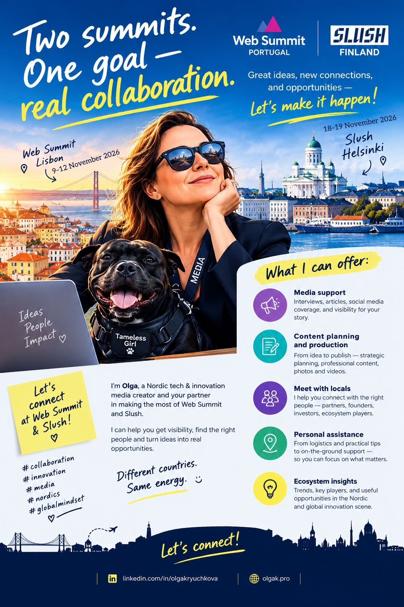

# Two Summits. One Goal — Real Collaboration: Web Summit Lisbon & Slush Helsinki 🚀🤝

**Author:** Olga Kryuchkova  
*Nordic Tech and Innovation Ecosystem Explorer | ICT Trainer | Certified AI Transformation Leader | MSc (Tech.) | Engineer*  
**Published on:** October 23, 2026

Going to [Web Summit](https://websummit.com/) in Portugal (9–12 November 2026) or [Slush](https://slush.org/) in Finland (18–19 November 2026)? 🚀

Great! But attending a major tech summit and actually being noticed are two very different things. 😉

I’m Olga — Nordic tech and innovation media creator, connector, and your potential partner in conference survival (with far better outcomes than simply collecting 47 random business cards).

### What I Can Offer

- 🎤 **Media Support & Interviews:** Articles, social media coverage, and visibility for your story across Nordic and international innovation channels.
- ✍️ **Content Planning & Production:** From idea to publishing — strategic planning, professional content, articles, and high-impact coverage.
- 🤝 **Local Connections & Introductions:** Connecting you with the right people on the ground — partners, founders, investors, and ecosystem builders.
- 🧭 **Personal On-the-Ground Assistance:** Practical insights and on-site support so you can focus on what truly matters.
- 💡 **Ecosystem Insights:** Key trends, key players, and actionable opportunities across the Nordic and European innovation scenes.

### Let’s Make It Happen

You bring the ideas. I’ll help make sure the right people hear about them.

Write to me, and let’s plan your presence and visibility before the conference calendars fill up and your best opportunities walk past you.

Different countries. Same ambition. Better connections. 🌍✨

*#WebSummit #Slush #TechMedia #StartupVisibility #Collaboration #NordicTech*
