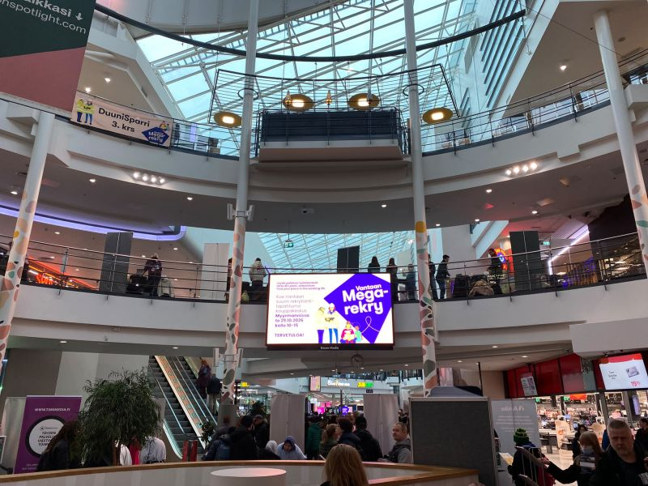
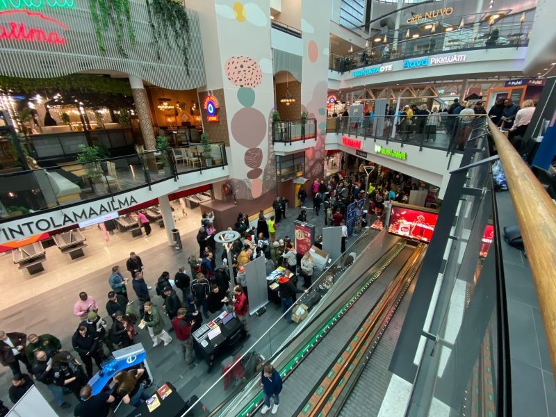
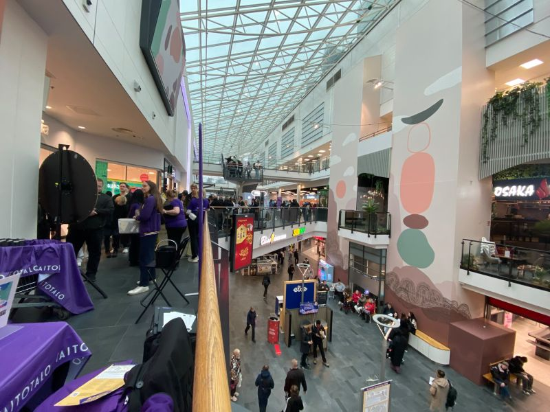
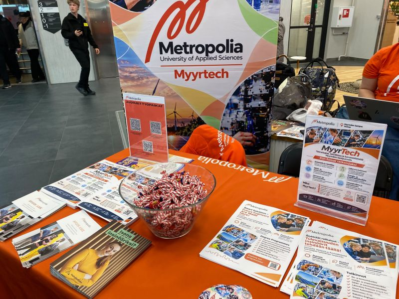
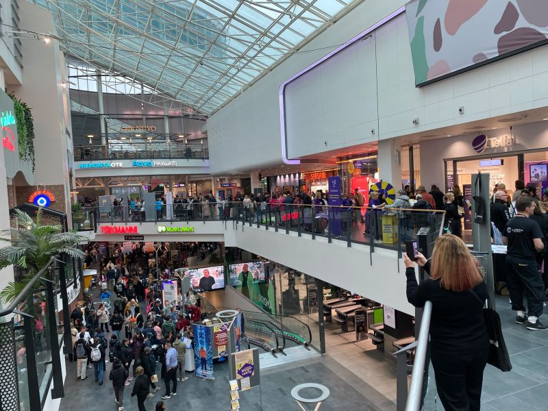
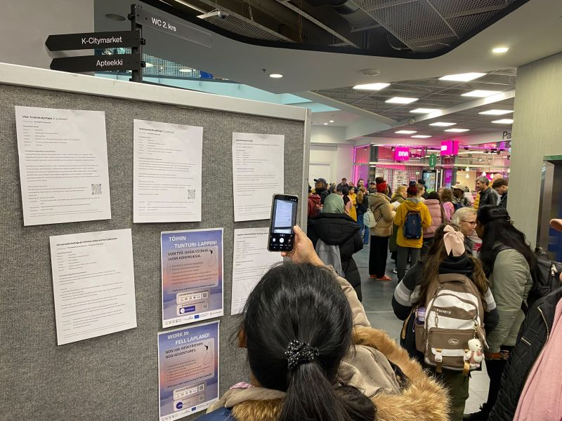
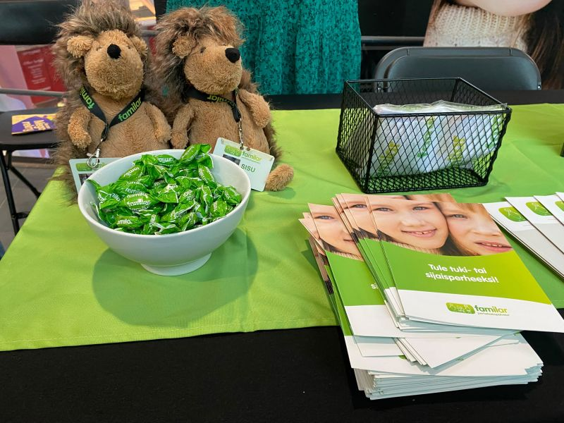

# [Rethinking the Labour Market in Myyrmanni: Inside Vantaa’s Megarekry 2026 🏢🤝](https://www.linkedin.com/posts/olgakruchkova_vantaa-megarekry-futureofwork-ugcPost-7521568947016663041-ZCWa)

*Published on 29-10-2026, 4 min read*

[Vantaan kaupunki - Vanda stad - City of Vantaa](https://fi.linkedin.com/company/city-of-vantaa), you have every reason to be proud. And so do I.

I wrote about Talent Boost Summit organized by [Work in Finland](https://fi.linkedin.com/company/work-in-finland) in [Helsingin kaupunki – Helsingfors stad – City of Helsinki](https://fi.linkedin.com/company/city-of-helsinki) and recruitment event at Sello Library in [Espoon kaupunki - Esbo stad - City of Espoo](https://fi.linkedin.com/company/espoonkaupunki). Today, Vantaa offered a rather compelling reminder that the quality of a labour market is measured by how many different people can realistically access jobs.

At Megarekry in Myyrmanni, employers, educational institutions and jobseekers came together in a setting more commonly associated with shopping bags than career-changing decisions. An unexpectedly good place to rethink one’s future, as it turns out.

The range of opportunities was impressive. Transport, logistics, construction, engineering and other industries were represented alongside education and employment-support services. There were opportunities to explore jobs in Finland and elsewhere in Europe, including Sweden, Norway, the Netherlands and Germany. And for those without a clear professional direction or those ready to change one, there were pathways into education and Finnish-language learning.

I was particularly pleased to see [Metropolia University of Applied Sciences](https://fi.linkedin.com/school/metropolia-university-of-applied-sciences/), [Taitotalo](https://fi.linkedin.com/school/taitotalofi/) and [TTS Työtehoseura](https://fi.linkedin.com/company/tts-institute). Having taught IT to adult learners myself, I know that education is not only about transferring knowledge and skills. It is about helping people discover that they can do more than they thought possible. The warm welcome and genuinely human conversations with [Timo Pitkänen](https://fi.linkedin.com/in/timo-pitk%C3%A4nen-08671810a) and [Filip Polak](https://fi.linkedin.com/in/fpolakhelsinki) at these stands were very engaging.

But what impressed me most was the atmosphere.

At every stand, people were ready to help in Finnish and English, in some tables with Swedish, Ukrainian, Arabic and sign-language support. This matters enormously. Accessibility is not a paragraph in a strategy document; it is what happens when a person walks up to a table and can actually have a conversation. And it happened during this event!

We often discuss talent shortages, integration, reskilling and the future of work as separate policy problems. Yet here, employers, educators and support services were addressing them under one roof. Less abstract discussion, more practical possibilities.

My takeaway? A good recruitment fair does more than match vacancies with CVs. It makes the next step imaginable and possible.

I am proud of Vantaa for creating that kind of space, and grateful to everyone who made it welcoming, practical and genuinely inclusive.

To everyone looking for work, considering a new profession or wondering whether there might be a place for them in Finland’s working life: I wish you find your place. Sometimes a new chapter begins with a conversation at a stand in a shopping centre.

And that, frankly, is a rather good return on a Thursday morning.

#Vantaa #Megarekry #FutureOfWork #Employment #LifelongLearning #Inclusion #Finland
