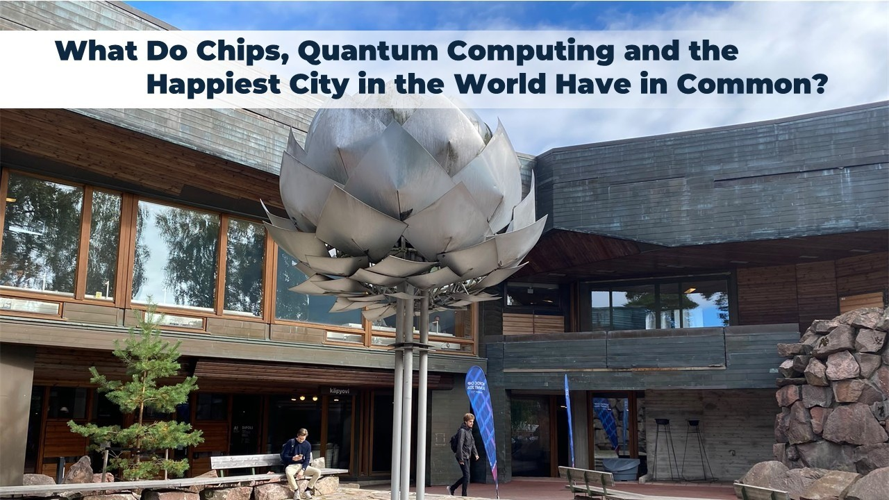
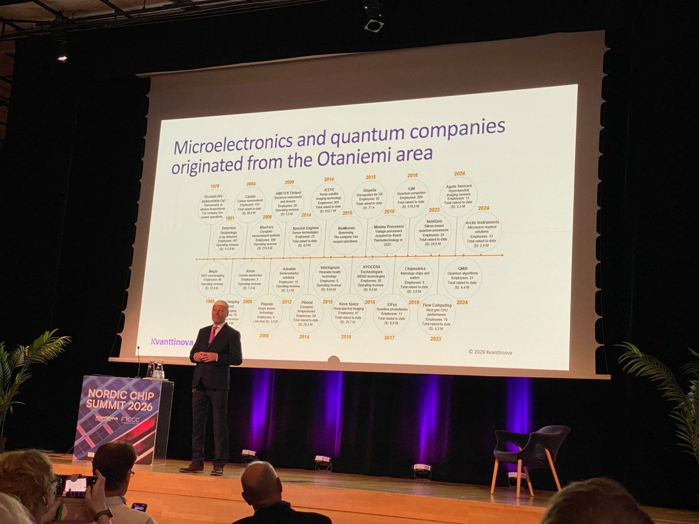
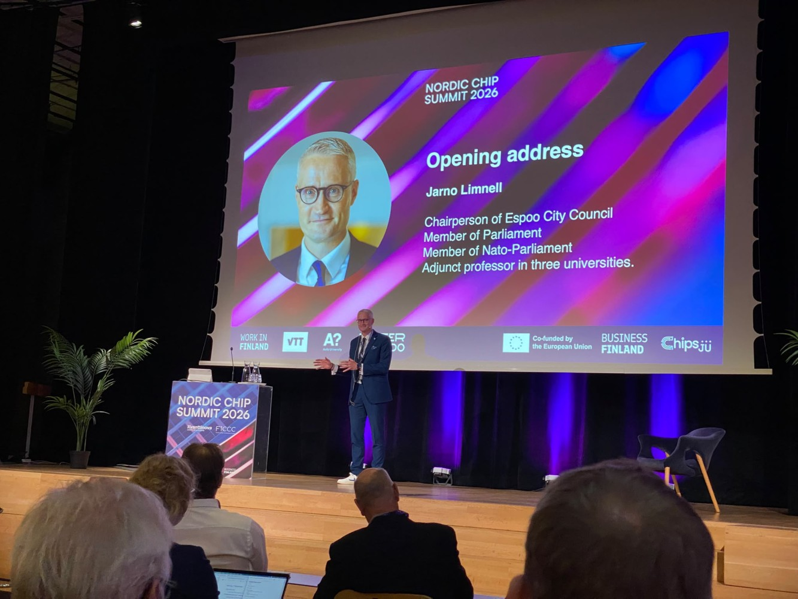
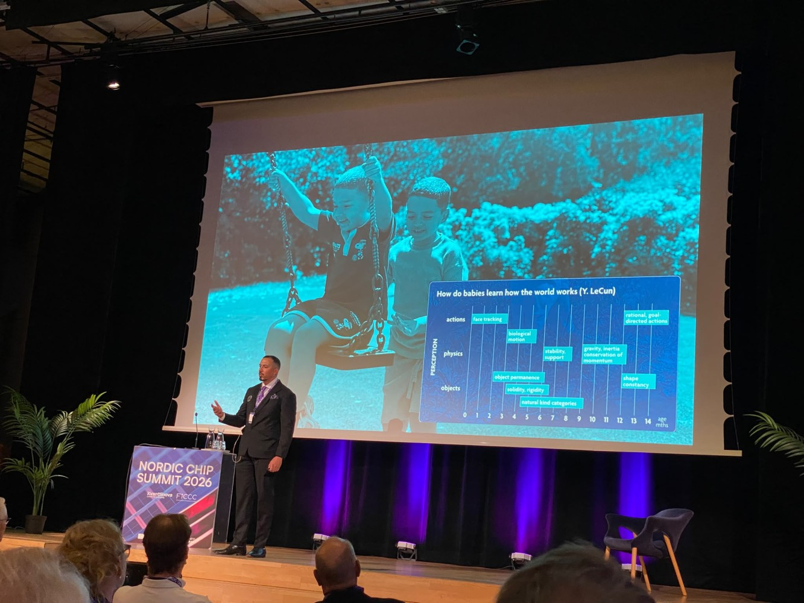
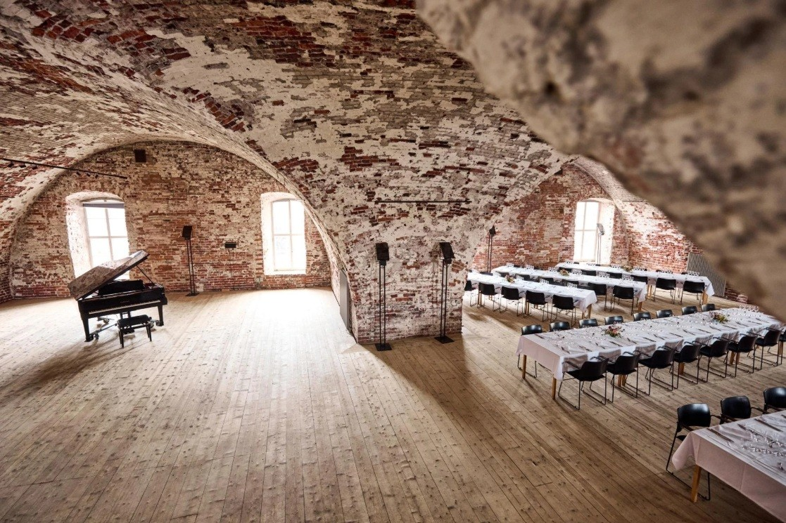
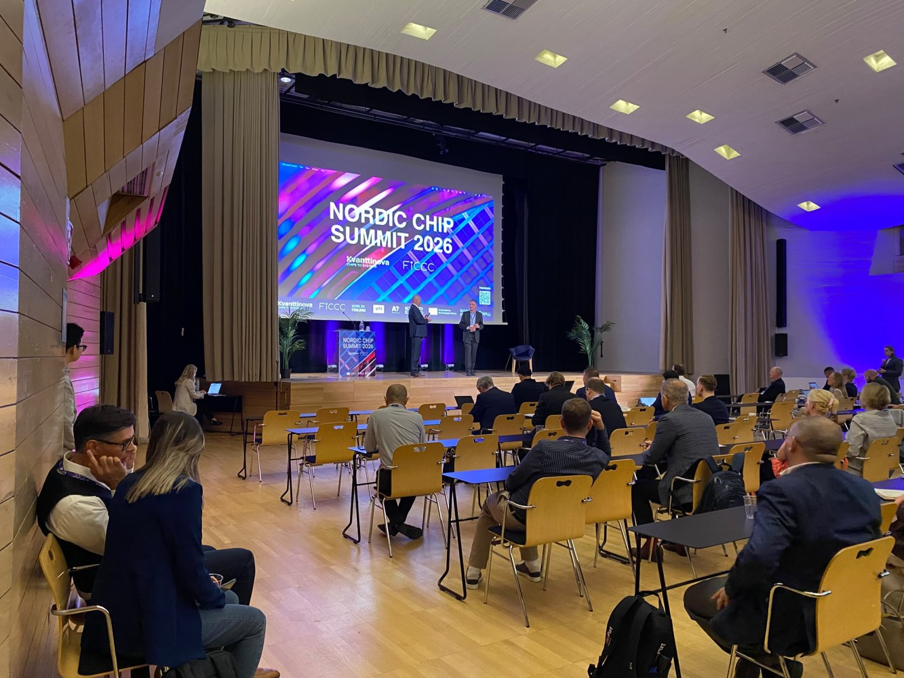

# What Do Chips, Quantum Computing and the Happiest City in the World Have in Common? ⚛️🇫🇮

**Author:** Olga Kryuchkova  
*Nordic Tech and Innovation Ecosystem Explorer | ICT Trainer | Certified AI Transformation Leader | MSc (Tech.) | Engineer*  
**Published on:** September 8, 2026

---

**WOW. Welcome to the Happiest country. Be curious. Be ambitious. Collaborate. And, above all: have fun.** — That is more or less how my second Nordic Chip Summit experience began.

The official opening by **Jussi Tuovinen**, CEO of Kvanttinova Ltd, somehow managed to set the tone perfectly: start with *Wow*, continue with *Hi*, remind us that we are in the happiest country in the world, and finish with the very Finnish idea that serious technology and serious business do not mean we have to forget how to have fun.

And perhaps that is exactly what an ecosystem event should do. Bring serious people together, and then give them enough space to actually talk to each other:

> *“Start a dialogue with a new person. Share an idea. Start a discussion.”*

Simple advice. Surprisingly difficult to follow at many conferences, where people sometimes spend two days standing next to the same three colleagues while enthusiastically networking on LinkedIn with people sitting 40 centimetres away. Nordic Chip Summit seemed determined to do the opposite.

---

### Three Simple Words for Innovation

Then came **Jarno Limnell**, Chairperson of Espoo City Council, with a welcome to the happiest city in the world: Espoo. His message was equally simple and, in my opinion, rather important:

*   **Be curious.** Curiosity creates questions.
*   **Be ambitious.** Ambition turns questions into projects.
*   **Collaborate.** Collaboration gives those projects a chance to survive contact with reality.

Three words that sound almost suspiciously uncomplicated until you remember that most successful innovation ecosystems are built precisely on these three things.

---

### The Game of Chips: Reconsidering Assumptions

And then came the moment when I had to reconsider one of my own assumptions. I have to admit: semiconductors are not normally the topic that makes me sit forward in my chair with excitement, even with my long-standing experience in IT.

Then **Salah Nasri**, CEO & Co-Founder of the International Semiconductor Industry Group and author of *"Game of Chips"*, stepped onto the stage.

And suddenly… I was paying attention. Not politely paying attention. **Actually paying attention.**

Salah spoke about the semiconductor industry, global dynamics, statistics, geopolitics, and the strategic importance of chips with such energy and storytelling that I began to suspect that perhaps semiconductors had been unfairly accused of being boring all these years.

Salah, I think I owe you an apology on behalf of all people who have ever looked at a semiconductor presentation and quietly thought: *"Perhaps coffee would be more exciting."* Your presentation took my breath away. And I have reached a serious conclusion: The Mohammed Qahtani Prize for Eloquence, which, in my personal and entirely unofficial awards system, has previously been safely reserved for Mohammed, now has a very serious new contender: **Salah Nasri**.

Because achieving the impossible deserves recognition. And Salah achieved the impossible: **He made a room full of people genuinely excited about semiconductors.** His book *"Game of Chips"* presents semiconductors as the new oil of the 21st century, while also exploring the fascinating intersection of quantum and silicon. Hope we will be able to talk more about this book soon. Salah, thank you for an unforgettable and impressive speech.

---

### AI Gigafactory, Sovereignty & Deep Tech

Then came **Marika Mentula**, VP, Network Infrastructure Sales at Nokia, introducing the **AI Gigafactory Northern** initiative and the ambition behind building the infrastructure needed for Europe to strengthen its AI capabilities and sovereignty.

And this is where the summit became particularly interesting. Because chips are no longer simply about chips:

*   Chips are about **AI**.
*   AI is about **computing**.
*   Computing is about **energy**.
*   Energy is about **infrastructure**.
*   Infrastructure is about **sovereignty**.

And sovereignty, in today's geopolitical environment, is very much about who controls the technology underneath the technology. That is why discussions around the **EU Chips Act 2.0**, European competitiveness, and semiconductor manufacturing feel considerably less theoretical than they might have a few years ago.

I can go on and on about all these wonderful speakers:
*   **Sara Pourjamal**, Research Team Leader and Project Manager at VTT, European Inventor Award 2026 finalist
*   **Dr. Mikko Möttönen**, Academy Professor and co-founder of several quantum companies
*   **Juha Hassel**, VP Quantum Engineering, IQM Quantum Computers
*   **Lauri Sainiemi**, VP Fabrication, Microsoft Quantum
*   **Pier Paolo Aurino**, Project Manager, QSIP & Chalmers Industriteknik
*   **David Gunnarsson**, Chief Business Development Officer, Bluefors
*   **Miikka Putaala**, Director, Business Development, MEGIN
*   **Tauno Vähä-Heikkilä**, Director, Strategic Partnerships, VTT
*   **Paolo Gervasoni**, Aerospace and Defense EMEA Director, GlobalFoundries
*   **Kalle Spoof**, RFIC Designer, Saab Finland
*   **Antti Näsilä**, Mantis Vision
*   **Markku Korhonen**, Managing Director, Kongsberg Defence

Surprise, surprise! Nordic Chip Summit also had a fantastic evening programme: dinner in **Suomenlinna**, a UNESCO World Heritage site.

---

### Building the Ecosystem Together

The summit continued with an equally stellar lineup of leaders and researchers:
*   **Paul de Bot**, owner of Systemview Consultancy and former President of TSMC Europe
*   **Pasi Pylväs**, Director of FiCCC – Finnish Chips Competence Centre
*   **Tero Kola**, VP of RAN System Product Management, Nokia
*   **Miika Soikkeli**, Senior Scientist, VTT
*   **Timo Valtonen**, CEO & co-founder, Flow Computing
*   **Hele Savin**, Professor, Aalto University
*   **Himadri Majumdar**, CEO, SemiQon
*   **Mika Laiho**, CTO, Kovilta
*   **Erkki Seppäläinen**, CEO, SisuSemi
*   **Paola Haka**, Deputy Director EMEA Aerospace & Defence, GlobalFoundries
*   **Marcus Rinkiö**, Murata
*   **Eric Fribourg-Blanc**, Chips JU
*   **René Kromhof**, Cloudberry VC
*   **Timo Ahopelto**, Lifeline Ventures
*   **Tor-Oskar Karlberg**, Stephen Industries
*   **Jason Harrison, Ph.D.**, Beneq
*   **Philippe Flatresse**, Director of Innovation and Partnerships at Minalogic France
*   **Frank Bösenberg**, Managing Director of Silicon Saxony
*   **Clément Fleury**, Senior Scientist at Silicon Austria Labs, representing the Austrian Photonics ecosystem, and others.

Thanks to **Kvanttinova**, **FiCCC – Finnish Chips Competence Centre**, **Tamlink**, **Photonics Finland**, **BusinessOulu**, **VTT**, **Aalto University**, and the **City of Espoo (Espoon kaupunki)** for creating a space where these conversations can actually happen.

And thank you to everyone who stopped for a conversation, introduced themselves, shared an idea, challenged an assumption, or simply said hello.

> Because perhaps this is the real technology behind an ecosystem: **People talking to people.**  
> The chip may be tiny. The ecosystem behind it is anything but.  
> And yes, Jussi — I agree: **Let's have some fun while building it.**

---

*#NordicChipSummit #Semiconductors #QuantumComputing #Espoo #Finland #Innovation #Ecosystem*
