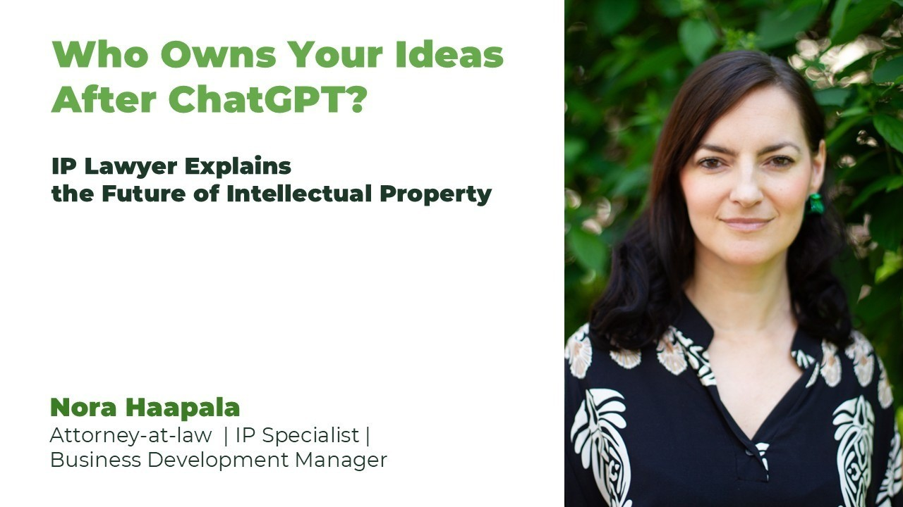
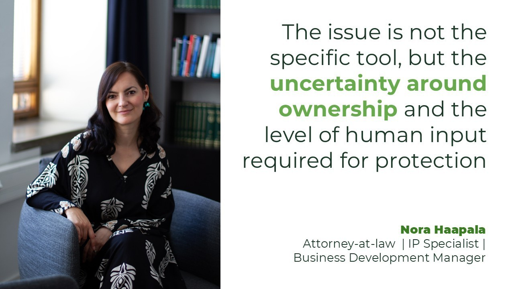
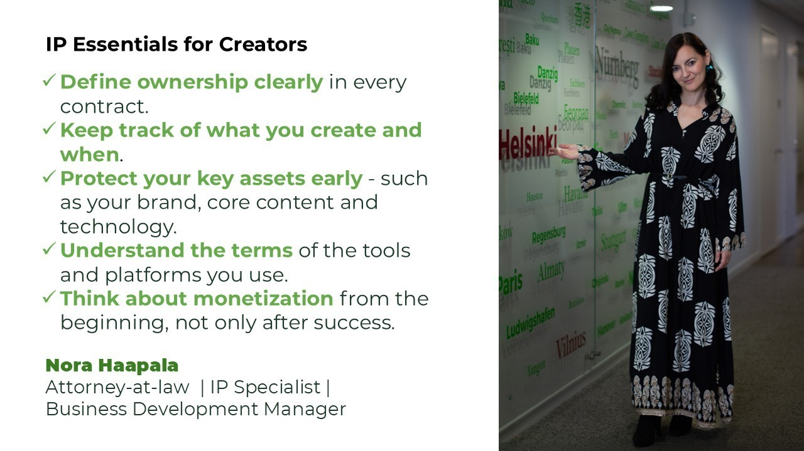
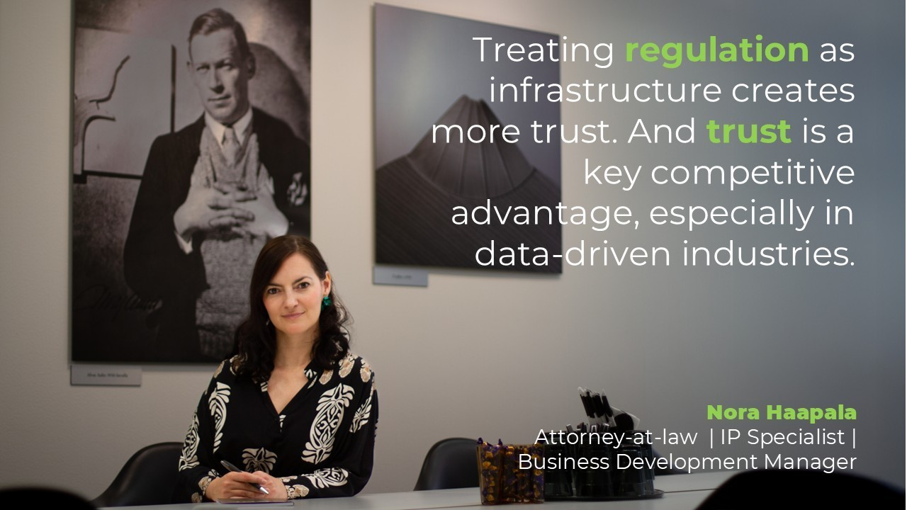
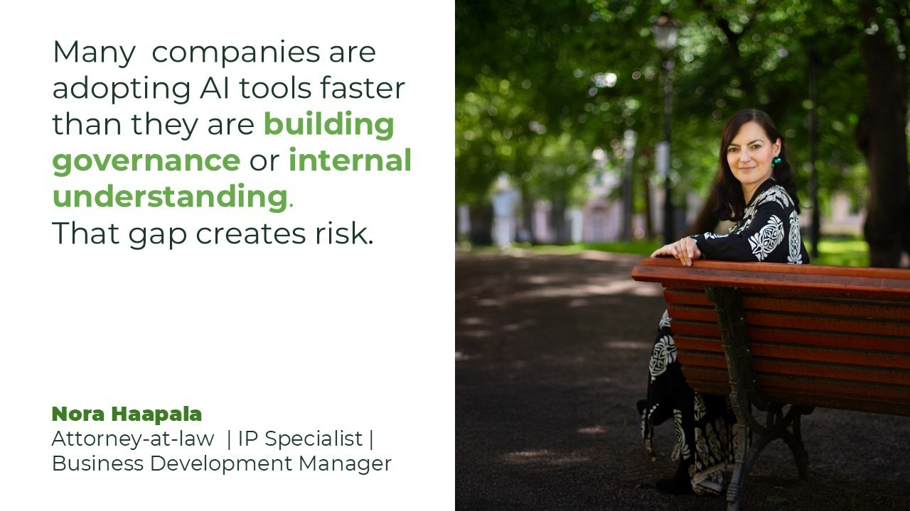
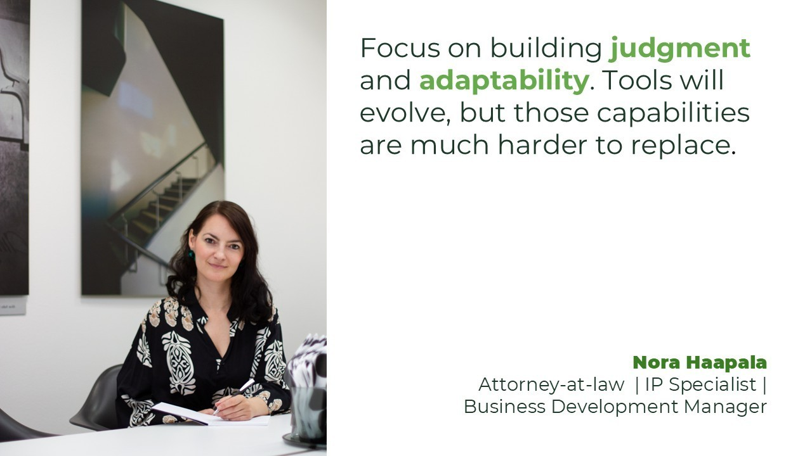

# Who Owns Your Ideas After ChatGPT? ⚖️🤖

**Author:** Olga Kryuchkova  
*Nordic Tech and Innovation Ecosystem Explorer | ICT Trainer | Certified AI Transformation Leader | MSc (Tech.) | Engineer*  
**Published on:** August 25, 2026

---

### IP Lawyer Explains the Future of Intellectual Property

Artificial Intelligence is rewriting the rules of business, creativity, and ownership faster than governments can regulate it. So who actually owns your ideas in the AI era? And what happens when technology moves faster than the law itself?

In this interview, we speak with **Nora Haapala** — Attorney-at-Law, IP Specialist and Business Development Manager at RÖDL Finland, and Vice Chair of the British & Commonwealth Chamber of Commerce in Finland ry. From AI-generated content and intellectual property battles to remote work, global talent mobility, and Europe’s tech future, Nora operates at the intersection where innovation meets regulation.

Can Europe compete with Silicon Valley, India and China without sacrificing ethics? Are creators and freelancers unknowingly giving away their rights every day? And is AI becoming humanity’s greatest productivity tool or its biggest legal grey zone?

This conversation goes beyond legal theory into the real future of work, digital ownership, and the global knowledge economy.

---

### I. Origins & Background

**Olga:** Nora, you studied and worked across multiple legal and cultural systems: Czech Republic, Germany, Finland. Which country changed your thinking about law the most, not academically, but philosophically and in which direction?

**Nora:** Finland. Compared to Central Europe, the legal system feels more pragmatic and business-oriented. The focus is much less theoretical and much more on what the parties actually agreed and what makes sense in practice.

**Olga:** If your younger self from law school saw your current work around AI, IP, and digital regulation — what would surprise her the most?

**Nora:** How dynamic and interdisciplinary the work is. Back then, law felt structured and predictable, whereas today it’s closely tied to technology, strategy and real-time business decisions. The pace of change would probably be the biggest surprise.

**Olga:** Many lawyers specialize narrowly, but your work combines law, business development, technology, and international networks. Was that intentional strategy or controlled chaos?

**Nora:** A bit of both. I was always interested in working across borders and disciplines, but many opportunities came from saying yes to things outside a traditional legal path. Over time, it became a clear strategy to position myself where law meets business and innovation.

**Olga:** What was the first moment in your career when you realized intellectual property is not just “legal paperwork” but actually geopolitical power?

**Nora:** When I started seeing how companies build entire business models around intangible assets — like technology, data, know-how and brand. These assets don’t just support the business, they are the business. That’s when it became clear that intellectual property plays a direct role in how companies compete and maintain their position in the market.

**Olga:** If you had to explain your career path using one trademark, one patent, and one contract as metaphors, what would each represent?

**Nora:** A trademark represents building a recognizable personal and professional identity. A patent reflects innovation and constantly developing new ways to deliver value. A contract represents alignment — bringing different interests together in a workable structure.

---

### II. IP Protection in Finland & Europe

**Olga:** A photographer uploads work to Instagram, a designer uses Midjourney, and a consultant writes content with ChatGPT. Which of them is currently the most legally vulnerable in Europe, and why?

**Nora:** The highest risk is with AI-generated content, whether created via Midjourney or tools like ChatGPT. The issue is not the specific tool, but the uncertainty around ownership and the level of human input required for protection.

**Olga:** Many creators think “if I made it, I own it.” What is the most dangerous misconception knowledge workers have about ownership in the AI era?

**Nora:** That using AI automatically gives them ownership of the result. Under EU copyright law, only a human can be the author, and protection arises only if the work is an independent and original creation. If a work is generated mainly by AI and the human input is insufficient, it may not be protected at all.

**Olga:** What’s a real-life IP case or situation that made you think: “This is where technology moved faster than law”?

**Nora:** The rapid adoption of AI tools in business workflows. Companies integrate them into content, design and development without fully understanding ownership or data implications. The law is still catching up to how these tools are actually used in practice.

**Olga:** If a Finnish freelancer wants to become globally mobile, living in Finland and work remotely while protecting their work and clients, what are the first legal structures they should put in place?

**Nora:** Clear contracts, especially around ownership and liability. Proper business structure and tax alignment across jurisdictions. And a basic IP strategy — what to protect, what to keep as trade secrets and what to license.

**Olga:** Europe is often described as regulation-heavy. But from your perspective, does strong IP regulation actually create more freedom for independent creators and knowledge workers?

**Nora:** Yes, if it is understood and used properly. Strong regulation provides predictability and enforceability, which is essential for independent creators. Without it, you may create value, but you have no real control over it.

#### IP Essentials for Creators

**Olga:** What are the 5 smartest IP habits every freelancer or creative professional should develop before they become successful?

**Nora:** 
1. **Define ownership clearly in every contract.**
2. **Keep track of what you create and when.**
3. **Protect your key assets early** — such as your brand, core content and technology.
4. **Understand the terms of the tools and platforms you use.**
5. **Think about monetization from the beginning**, not only after success.

**Olga:** Which legal protection gives the highest ROI for solo creators: trademark, copyright, contracts, licensing, or something else?

**Nora:** Contracts. They define ownership, usage, and risk allocation from the start and often prevent disputes before they arise. Without clear agreements, even registered rights can be much harder to use and enforce in practice.

**Olga:** What should people stop publishing online immediately if they care about protecting future commercial value?

**Nora:** Anything with future commercial value that isn’t protected or strategically shared. Early-stage ideas, datasets or proprietary methods are often given away too easily. Once it’s public, control is largely lost.

#### Remote Work from Finland

**Olga:** What are the top 3 legal or tax mistakes remote workers make when operating internationally from Finland?

**Nora:** Misunderstanding permanent establishment risks, unclear tax residency status and weak contracts with international clients. These issues often only surface once there is already a problem.

**Olga:** Could Finland realistically become Europe’s best base for independent global knowledge workers?

**Nora:** Yes, it has strong infrastructure, legal stability and trust-based systems. The challenge is aligning tax and regulatory frameworks with the realities of global remote work. If that evolves, Finland is very well positioned.

#### Global Labor Mobility

**Olga:** Are we moving toward a future where talent becomes “jurisdiction independent,” while laws remain territorial?

**Nora:** Economically and practically yes, but legally, not yet. Talent moves globally, but laws remain territorial. That gap is one of the biggest structural tensions today.

**Olga:** Which professions will benefit most from cross-border mobility in the next decade to your opinion?

**Nora:** Knowledge-intensive roles like software development, design, consulting and tech advisory. In these roles, the work is digital and not tied to a physical location, which makes it much easier to operate across borders.

---

### III. US vs Europe: Technology Adoption, Regulation & Legal Boundaries

**Olga:** The US often asks “Can we build it?”, while Europe asks “Should we allow it?”. Which mindset do you think creates more sustainable innovation long term?

**Nora:** A combination of both. The US drives speed and experimentation, while Europe builds trust and long-term stability. Sustainable innovation requires both elements.

**Olga:** Do you think Europe’s cautious approach to AI regulation risks slowing innovation or preventing future chaos?

**Nora:** Short-term, it may slow certain developments. Long-term, it reduces systemic risk and builds trust, which is critical for adoption.

**Olga:** American tech companies often treat regulation as an obstacle. European companies often treat it as infrastructure. Which model produces more trust?

**Nora:** Treating regulation as infrastructure creates more trust. And trust is a key competitive advantage, especially in data-driven industries.

**Olga:** If Silicon Valley culture was imported directly into Europe without European labor protections — what would break first?

**Nora:** Labor protections would be the first point of tension. European systems are built around stability and worker protection, which would clash with purely growth-driven models.

**Olga:** Is the future of tech law moving toward global harmonization, or are we entering an era of “digital legal blocs” where the US, EU, and Asia operate under completely different realities?

**Nora:** We are moving toward digital legal blocs, but with some selective harmonization. The EU, US and Asia are developing distinct regulatory approaches, especially around AI and data, and companies increasingly have to navigate these differences. At the same time, certain standards will still align where global cooperation is necessary.

---

### IV. Tech, AI, Data & Ethics

**Olga:** AI can now generate ideas, designs, contracts, code, music, and legal drafts. What human skill becomes MORE valuable because of AI, not less?

**Nora:** Judgment. The ability to interpret, question and apply outputs in context becomes far more important than producing first drafts.

**Olga:** At what point does convenience become intellectual laziness? Are we outsourcing too much thinking to machines already?

**Nora:** Convenience becomes a problem when we stop really engaging with the output and just take it at face value. AI can be extremely useful, but it also makes it easy to skip that extra step of thinking things through ourselves. Whether we are outsourcing too much already depends on how consciously we use it.

**Olga:** You’ve said AI is a tool and humans remain responsible. But realistically are companies emotionally and ethically prepared for that responsibility?

**Nora:** Not fully. Many are adopting tools faster than they are building governance or internal understanding. That gap creates risk.

**Olga:** What worries you more today: AI replacing jobs, or AI quietly reshaping human judgment?

**Nora:** Both are real concerns. Job displacement is immediate and very tangible for many people, while the shift in human judgment is more subtle and likely longer-term.

**Olga:** If future employees work alongside AI agents every day, what happens to traditional concepts like authorship, expertise, and accountability?

**Nora:** They become more complex. Authorship becomes shared or layered, and expertise shifts from creation to oversight and accountability.

---

### V. Vision & Future of Law, Europe & Labor Markets

**Olga:** What kind of professionals should start collaborating NOW if they want to stay relevant in the next 10 years: lawyers and developers, designers and ethicists, educators and AI engineers? What combinations to your opinion make strong collaborations?

**Nora:** Lawyers with developers and designers with ethicists are good examples. The strongest combinations are those that connect regulation, innovation and real-world application.

**Olga:** Europe talks a lot about innovation ecosystems. In your experience, what is still missing emotionally or culturally in Europe’s startup and legal environment?

**Nora:** A higher tolerance for risk and failure. Europe has strong foundations, but there is still a tendency toward more cautious decision-making, especially in situations involving uncertainty.

**Olga:** If you could redesign one outdated legal concept for the digital age from scratch what would it be?

**Nora:** Territoriality in IP. In a digital world, strict geographic boundaries no longer reflect how value is created and used.

**Olga:** What kind of partnerships, initiatives, or conversations are you personally looking for right now through your work and international networks?

**Nora:** Cross-border, interdisciplinary collaborations where legal understanding supports innovation. Especially in areas where IP, AI and business strategy intersect.

**Olga:** If someone listening today is a young creator, founder, or knowledge worker feeling overwhelmed by AI and global competition what should they focus on building that machines cannot easily replicate?

**Nora:** Focus on building judgment and adaptability. Understanding context, making decisions and taking responsibility are still fundamentally human. Tools will evolve, but those capabilities are much harder to replace.

**Olga:** If we meet again in 2035, what legal or technological change do you think will have transformed society the most but people today are still underestimating?

**Nora:** The shift in ownership models driven by AI and data. How value is created, owned and shared will look very different — and we are only at the beginning.

