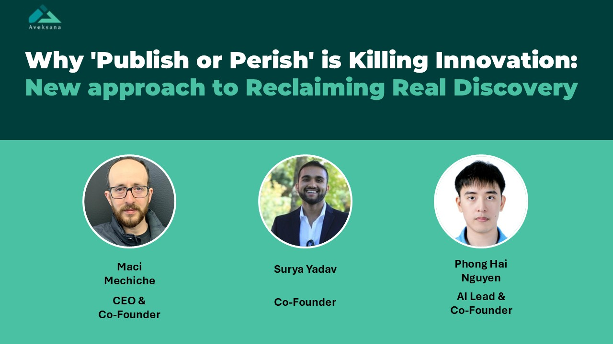
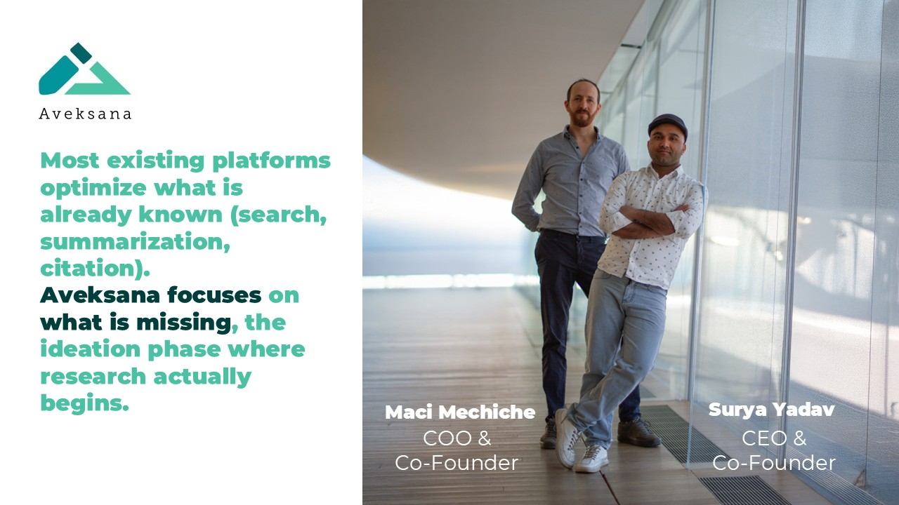
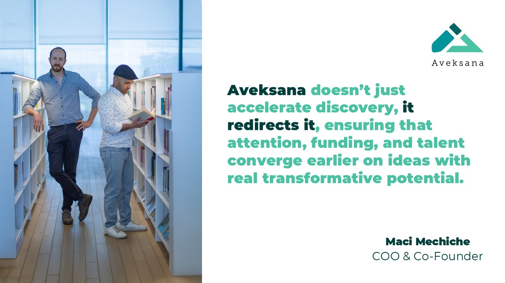
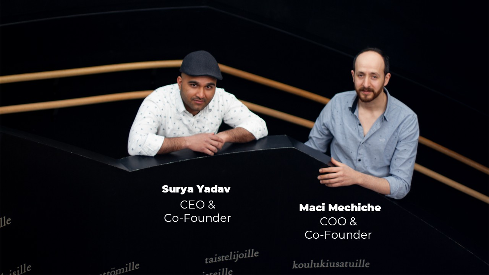
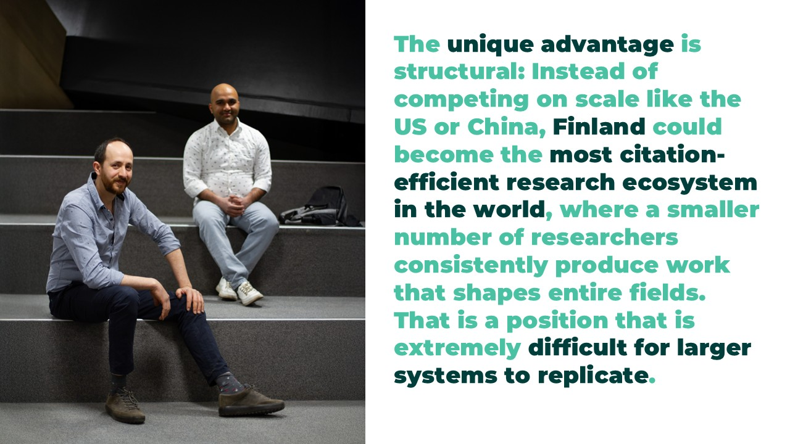
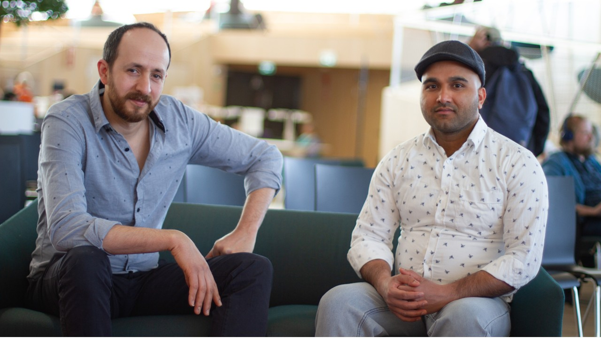

# Why 'Publish or Perish' is Killing Innovation: New approach to Reclaiming Real Discovery

**Author:** Olga Kryuchkova  
*Nordic Tech and Innovation Ecosystem Explorer | ICT Trainer | Certified AI Transformation Leader | MSc (Tech.) | Engineer*  
**Published on:** April 29, 2026

---

## I. Origins & Background

**Olga:** Maci, Surya and Phong, please tell us a bit about your background and experience and how did you meet as a team?

**Maci:** Core Team / Founders Aveksana’s founding team combines 20 years of AI/software development and 30 years of research expertise, spanning Asia, Africa, and Europe.

*   **Surya Yadav** – COO & Co-Founder  
    *Expertise:* Research practices, product development, SaaS delivery. 
*   **Maci Mechiche** – CEO & Co-Founder  
    *Expertise:* Business strategy, partnerships, research publications, product delivery. 
*   **Phong Hai Nguyen** – AI Lead & Co-Founder  
    *Expertise:* AI/NLP, research publications, machine learning (Cinnamon AI).

First it was only Surya and Maci, that is where the idea was born from the frustration and the need for something to change, later on when these two validated the problem and understood that such a solution is actually needed, they made a post on LinkedIn and shortly after Phong became a part of the team and started building.

**Olga:** What belief about academia or innovation did each of you have to unlearn to build your startup?

**Maci:** It was without a doubt what we like to call “Blind Literature”, and what is meant is whenever you have to research anything, first you go read everything that was done about it in order to come up with serious, valid-ish idea that you can refine later on.

**Olga:** Was there a specific moment when the team shifted from “interesting idea” to “this must exist”? What triggered it?

**Maci:** Not Really, the validation was done at the earliest stage ever, using a clickable prototype and a lot of driving around, and online meetings talking to researchers, students and enthusiasts.

**Olga:** How do your personal backgrounds conflict rather than align, and how does that tension improve your decisions?

**Maci:** Not at all, the diversity in our background to say the least is our strongest driver ever, it doesn't only create a healthy friction but also allows us to study any given problem from every possible angle. The mono look or "collective cultural groupthink" at solutions is non-existent in our team.

**Olga:** If one of you had never joined, what version of Aveksana would exist today, and what would be missing?

**Maci:** We would probably be having an Aveksana with an API, not an Aveksana with an inbuilt model. Took years and a lot of inhouse fighting to get the model to what it is today, so yes That is it.

---

## II. The Idea & Innovation Behind Aveksana

**Olga:** Can you please tell us a bit more about your project. Are you building a tool for researchers, or quietly redefining what “research” even means?

**Maci:** Aveksana is not just another research tool, it operates at a different layer of the research process. Most existing platforms optimize what is already known (search, summarization, citation). Aveksana focuses on what is missing, the ideation phase where research actually begins.

**Olga:** Most platforms try to accelerate research, what part of the process did you intentionally decide to slow down and why?

**Maci:** Aveksana intentionally slows down the formation of the research question. While most tools accelerate writing and literature processing, we focus on making researchers spend more time validating what they are choosing to investigate. This includes systematically identifying gaps, stress-testing assumptions, and refining the novelty and impact of an idea before any execution begins. The reason is simple: speed applied to the wrong question only produces faster irrelevance. By slowing down this early stage, Aveksana ensures that everything that follows, analysis, writing, and publication, is built on a foundation that is genuinely novel and worth pursuing.

**Olga:** What’s a type of “bad idea” that your system is surprisingly good at identifying, and what does that reveal about research culture?

**Maci:** Aveksana is especially good at filtering out ideas that look novel but aren’t, what we call “pseudo-novel” research. These are projects that slightly modify existing work or reframe known problems without generating new insight. What this reveals about research culture is a structural bias toward apparent novelty. Researchers are often incentivized to publish quickly, which leads to safe, incremental variations that can pass peer review but don’t meaningfully advance the field. By identifying these early, Aveksana shifts the focus from producing acceptable research to pursuing work that is genuinely original and impactful.

**Olga:** If your validation engine had existed 20 years ago, which major scientific breakthrough might have happened earlier, or not at all?

**Maci:** If Aveksana’s validation engine had existed 20 years ago, breakthroughs like CRISPR gene editing could have emerged significantly earlier, not because the data was missing, but because the right questions weren’t being validated fast enough. At the same time, it might have prevented years of collective effort spent on ideas that were mathematically compelling but empirically stagnant. What this reveals is that progress is not only constrained by technology or data, but by our ability to identify which ideas are truly worth pursuing.

Aveksana changes that dynamic. It doesn’t just accelerate discovery, it redirects it, ensuring that attention, funding, and talent converge earlier on ideas with real transformative potential. The result is a future where breakthroughs don’t wait decades for recognition, and where entire generations of research effort are no longer lost to questions that were never going to lead anywhere meaningful.

**Olga:** What’s something your AI still cannot understand about human curiosity or creativity?

**Maci:** What Aveksana still cannot understand is the origin of human curiosity itself. It can analyze ideas, test their novelty, and map their potential, but it cannot explain why certain questions feel worth asking in the first place. Some of the most important breakthroughs have come from lines of thinking that initially appeared unjustified or even unreasonable.

This highlights a clear boundary: Aveksana can guide and validate direction, but it does not replace the instinct, intuition, or creative drive that leads humans to ask unexpected questions. In that sense, the system works best not as a replacement for creativity, but as a counterpart to it, bringing structure to something that remains fundamentally human.

---

## III. Relevance to Nordic and Finnish Needs

**Olga:** Nordic and Finland invests heavily in innovation, what’s one invisible inefficiency in the system that outsiders rarely notice?

**Maci:** An often invisible inefficiency in the Nordic innovation system is not in funding or execution, but in early-stage idea validation. Finland has built world-class mechanisms to support innovation, but the process that determines which ideas enter that pipeline still relies heavily on consensus, precedent, and clarity of justification. This creates a subtle bias toward safer, more legible ideas.

As a result, high-potential but unconventional directions can be filtered out before they are ever explored, not because they lack merit, but because they are difficult to validate early on. It’s an inefficiency that doesn’t show up in metrics, but it shapes the trajectory of innovation long before funding decisions are made.

**Olga:** If Aveksana worked only within Finland for the next 3 years, what unique advantage could that create globally?

**Maci:** If Aveksana operated only within Finland for three years, its biggest global advantage would be concentrated impact, not scale. Finland already produces high-quality research, with universities like the University of Helsinki and Aalto University consistently ranking among the top ~100–120 globally. But global rankings are disproportionately influenced by citation impact and research originality, not volume. Aveksana’s effect would be to systematically increase the novelty and relevance of research questions before projects even begin.

Even a modest shift, such as:
*   10–15% of research outputs becoming significantly more novel
*   Higher alignment with unexplored gaps
*   Fewer incremental or redundant studies

would compound into:
*   Higher citation rates per paper
*   Stronger academic reputation signals
*   More high-impact collaborations

In ranking terms, that kind of shift does not produce linear improvement, it produces step changes. A university already around #100 globally does not need more papers; it needs more papers that get cited disproportionately.

The likely outcome is that Finland could:
*   Consolidate multiple universities into the global top 100 simultaneously
*   Increase its share of highly cited papers relative to its size
*   Punch far above its population in global research influence

The unique advantage is structural: Instead of competing on scale like the US or China, Finland could become the most citation-efficient research ecosystem in the world, where a smaller number of researchers consistently produce work that shapes entire fields. That is a position that is extremely difficult for larger systems to replicate.

**Olga:** What kind of Finnish research ideas are currently undervalued or overlooked by traditional funding systems?

**Maci:** Some of Finland’s highest-potential research quietly goes unseen, because ideas that challenge norms or span disciplines often never reach traditional validation or funding pipelines.

**Olga:** How does the Finnish mindset (trust, education, collaboration) influence how your platform is designed?

**Maci:** You see, Aveksana is built to amplify Finland’s trust, education, and collaborative culture, focusing on transparent validation, shared insights, and structured guidance rather than top-down directives.

**Olga:** If you had to convince a skeptical Finnish public institution in one sentence, what would you say that isn’t about AI at all?

**Maci:** Aveksana helps Finland’s researchers find the questions that truly matter, because brilliance doesn’t care about accents, and neither should funding committees.

---

## IV. Tech, AI, Data & Ethics Reflections

**Olga:** With a 500M+ article knowledge graph, what’s the most unexpected pattern your system has uncovered?

**Maci:** With over 500M articles in its knowledge graph, Aveksana uncovered a surprising pattern: many high-impact questions are repeatedly “discovered” in isolation across unrelated fields, meaning entire research communities are unknowingly reinventing the same solutions. This highlights hidden inefficiencies in how knowledge spreads, and where interdisciplinary breakthroughs are waiting to happen.

**Olga:** Where do you draw the line between guiding researchers and biasing research outcomes?

**Maci:** Aveksana guides without dictating. It highlights gaps, flags redundancies, and evaluates novelty, but it never enforces a direction or favors a particular outcome. Researchers remain fully in control; the platform only clarifies what is unexplored, not what should be done.

**Olga:** If your AI became the global standard, what kind of research might stop happening altogether?

**Maci:** If Aveksana set the global standard, work done for optics rather than impact, trendy but low-value studies, would fade. The result would be a research ecosystem focused on questions that genuinely matter, not just what is safe or popular.

**Olga:** How do you design for intellectual humility in a system built on massive data and predictive power?

**Maci:** Even with massive data and predictive power, Aveksana is designed to admit what it doesn’t know, surface conflicting perspectives, and encourage researchers to question its suggestions, so decisions remain human-led, not AI-prescribed.

---

## V. Vision, Future & Collaboration

**Olga:** If Aveksana succeeds beyond expectations, what part of today’s research ecosystem disappears?

**Maci:** Success means researchers no longer waste time on obvious or already-solved questions, every project starts from validated, high-impact gaps. The ecosystem shifts from repetition to meaningful discovery.

**Olga:** What’s a partnership you would refuse, even if it came with unlimited funding?

**Maci:** Even with unlimited funding, we would never collaborate with organizations that expect research to be shaped by politics, profit, or prejudice rather than truth. Integrity comes first.

**Olga:** Are you building something that researchers will rely on, or something they will eventually question or resist?

**Maci:** Aveksana is designed to be indispensable but not unquestionable.

**Olga:** What kind of collaborator do you need right now: skeptics, builders, institutions, or disruptors, and why?

**Maci:** We’re a small startup with big ambition and no safety net, we’ve poured everything into Aveksana, so every bit of support counts. Right now, we’re seeking builders and constructive skeptics: collaborators who can test, challenge, and help refine our platform.

We’re also actively looking for institutions to partner with, shaping the future of research together. With our seed round launching in the coming weeks, now is the perfect time to get involved, your collaboration can make a real impact.

We are currently working with cities and few universities and we seek partnerships with other cities and universities to run pilots and highlight our value proposition. And of course if you are a smart investor who can see the vision of our startup, we can definitely use the financial support to accelerate our processes. With this help what would take us months to accomplish would simply take us weeks if not days.

**Olga:** Five years from now, what would make you say: “We scaled too fast, and missed something important”?

**Maci:** Scaling too fast would mean reaching a large audience without preserving the depth, care, and critical validation that make Aveksana truly valuable. Growth is exciting, but the impact comes from quality over quantity.

